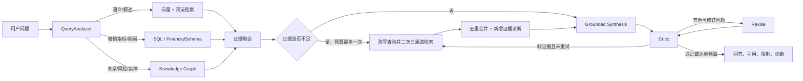

# Claude Copilot RAG 实现与企业合格性审计材料

> **2026-09-13 口径勘误（优先于本文其余历史快照）**：第三方复核发现三份核心
> 年报把母公司利润表收入误作默认公司收入。原始年报复核后的合并口径为：指南针
> 2021/2020 年营业收入 `932,420,978 / 692,598,184` 元；聚灿光电
> `2,009,197,450.44 / 1,406,674,200.72` 元；天华新能
> `3,397,557,862.27 / 1,313,177,402.56` 元。本文下方嵌入的 2026-09-08
> 联合检索逐题原始数据仍是历史快照，其中旧数值及“156/156”结论已失效，不得作为
> 当前验收证据。修复后 L1/L2 三份真实年报 `core_metric_exact_match` 均为 `1.0`，
> Serving Gate 均通过；L3 联合检索必须在重新入库后重跑，不能沿用旧报告。
> 本地 golden 同步命令：`uv run python scripts/sync_golden_entity_scope.py`（真值源：
> `data/fixtures/consolidated_metric_truth.json`）。

> 审计快照日期：2026-09-08
> 仓库分支：`main`
> 基准提交：`2e7f5f6945e9d09487e44d0c3fcd26f05e5ce9b7`
> 重要声明：本文件描述的是上述提交叠加**当前未提交工作区改动**后的状态，不代表已经发布、打标签或部署到生产环境的版本。

## 1. 文档目的

本文将 Claude Copilot 金融文档智能项目中与 RAG 有关的实现、测试数据、评测结果和已知限制集中到一处，供独立第三方判断：

1. 当前系统是否真正实现了混合检索、图检索和 Agentic RAG；
2. 现有指标能证明什么，不能证明什么；
3. 当前是否达到企业生产级要求；
4. 若尚未完全达到，缺少哪些可验证证据。

本文不把“测试全部通过”等同于“生产级合格”。所有结论均区分为：

- **已实现**：代码路径和协议已经存在；
- **已验证**：有自动测试或保存的评测报告支持；
- **尚未证明**：架构存在，但样本量、真实环境或独立评审证据不足。

## 2. 执行摘要

### 2.1 当前结论

当前 RAG 可以评为：**开发与受控试点条件下合格，尚不能评为企业生产级全面合格**。

主要依据：

- 已形成文本向量/词法、结构化财务指标和知识图谱三条证据通道；
- 已实现问题路由、候选融合、重排、年份/章节约束、相邻切片窗口、相对分数门槛、去重和来源诊断；
- 已实现检索不足时最多一次有预算的二次检索，并记录新增证据量；
- 最新联合检索基准为 22 份样本、156 题，硬门禁 18/18，总用例 156/156；
- 排序子集 Recall@5 为 0.9621，MRR@10 为 0.9405，nDCG@10 为 0.9338；
- 但只有 49 题参与排序评价，其中只有 33 题具有明确人工相关性标签；
- 90/156 题仅走 SQL，纯图检索只有 2/156，图检索和真正多跳推理覆盖不足；
- 6/22 文档是每份仅 3–4 个切片的合成节选，另有一份真实扫描件是页级子集；
- 最新联合报告未开启真实通道消融，因此不能从该报告单独证明每个检索通道或每项优化的因果贡献；
- L4 报告/研究层虽有 7 文档、42 题全通过记录，但规模仍不足以证明复杂真实报告的分析质量和跨域泛化。

### 2.2 企业合格性快速判定

| 维度 | 当前状态 | 审计判断 |
|---|---|---|
| 协议化架构与后端可替换性 | 已实现 | 合格 |
| 单文档结构化指标检索 | 已实现且有硬门禁 | 受控范围合格 |
| 文本混合检索 | 已实现，排序指标达当前软阈值 | 条件合格 |
| GraphRAG | MVP 已实现 | 样本覆盖不足，未达企业证明标准 |
| Agentic 二次检索 | 已实现并有单元测试 | 缺真实三库增益评测 |
| 引用与页码可追溯 | 已实现 | 机制合格，语料覆盖仍需审计 |
| 完整年报覆盖 | 未建立逐文档统一覆盖闸门 | 不合格 |
| 大规模跨行业泛化 | 样本不足 | 不合格 |
| 通道因果消融 | 最新报告未运行 | 不合格 |
| 人工金融专家盲评 | 未形成足够规模的正式报告 | 不合格 |
| 安全、权限、租户隔离、灾备 | 不属于本次 RAG 报告证据范围 | 未评价 |

## 3. 系统边界与数据流

Claude Copilot 后端负责文档处理、检索和研究编排。前端位于同级目录 `frontend`；本仓库的 `web/` 已冻结，不承担产品功能。

RAG 依赖文档先完成以下流水线：

```text
上传
  → 解析（原生 PDF / OCR / 表格 / MinerU 路由）
  → 清洗
  → 章节切分
  → 表格理解
  → 结构重建
  → FinancialSchema 映射
  → 章节感知切片
  → 文本/向量索引
  → 知识图谱构建
```

检索与回答路径：



核心代码位置：

- 混合文本检索：[`app/core/rag/retriever.py`](../app/core/rag/retriever.py)
- 查询分析及三通道路由：[`app/core/rag/orchestrator.py`](../app/core/rag/orchestrator.py)
- 查询扩展：[`app/core/rag/query_expansion.py`](../app/core/rag/query_expansion.py)
- 向量存储协议与 Qdrant：[`app/core/rag/vector_store.py`](../app/core/rag/vector_store.py)
- 重排协议与实现：[`app/core/rag/reranking.py`](../app/core/rag/reranking.py)
- 图构建与存储：[`app/core/kg/`](../app/core/kg/)
- Agentic 检索及研究服务：[`app/api/services/research_service.py`](../app/api/services/research_service.py)
- LangGraph 研究循环：[`app/workflows/research/graph.py`](../app/workflows/research/graph.py)
- 对外数据契约：[`src/claude_copilot/schemas/research.py`](../src/claude_copilot/schemas/research.py)

## 4. 混合检索实现

### 4.1 问题分析与路由

`QueryAnalyzer` 使用可审计的中英文线索识别：

- 指标键，例如 `revenue`、`net_income`、经营活动现金流；
- 年份和是否需要同比/CAGR；
- 章节倾向，例如管理层讨论、风险、公司概况、财务报表；
- 语义解释、结构化取数和关系型问题。

输出意图为：

- `semantic`：文本语义通道；
- `structured`：SQL 财务指标通道；
- `relational`：图通道；
- `hybrid`：组合通道。

实际证据路由是 `vector`、`sql`、`graph` 的一个或多个组合。路由规则在代码中确定，不是完全交由生成模型自由决定。

### 4.2 文本候选生成

`LocalRetriever` 当前默认参数：

| 参数 | 默认值 | 作用 |
|---|---:|---|
| `candidate_multiplier` | 4 | 每个通道先取 `top_k × 4` 候选 |
| `vector_weight` | 0.65 | 向量相似度融合权重 |
| `lexical_weight` | 0.35 | 词法相似度融合权重 |
| 相对分数门槛 | 0.35 | 丢弃低于最高融合分 35% 的弱候选 |
| 相邻窗口衰减 | 0.85 | 同章节相邻 ±1 切片的得分衰减 |
| API `top_k` | 1–10，默认 3 | 最终返回证据数量 |

执行顺序：

1. 中英文规则查询扩展；
2. Qdrant 向量检索和 Segment Repository 词法检索；
3. 按 `segment_id` 合并各扩展查询和各通道的最高分；
4. 按 0.65/0.35 线性融合；
5. 加入年份、章节、指标和常见金融硬负样本调整；
6. 年份和章节约束；无匹配时允许回退并产生 warning；
7. 应用最高分 35% 的相对门槛；
8. 为种子命中补充同章节位置 ±1 的切片，避免表头与数值断裂；
9. 删除无实质证据的短交叉引用并去重；
10. 使用可替换的 reranker 重排；
11. 返回最终结果和逐条诊断信息。

### 4.3 查询扩展

当前为轻量中英文规则扩展，不依赖模型临场生成。已覆盖：

- 管理层讨论与分析；
- 风险因素；
- 营业收入；
- 净利润，以及“归属于母公司股东的净利润”；
- 增长、同比、CAGR；
- 经营活动现金流；
- 行业、子公司和业务分部。

优点是可复现、低成本；限制是词表覆盖有限，无法替代基于真实查询日志形成的同义词与实体词典。

### 4.4 重排

系统提供 `RerankingServiceProtocol`：

- 无外部 reranker 时使用确定性排序；
- 配置 Silicon reranker 且有可用密钥时调用外部重排模型；
- 保存 `fused_score`、`rerank_score` 和 `final_score`，避免重排后丢失融合阶段信息。

当前报告没有单独给出“无 reranker / 确定性 reranker / 模型 reranker”的大规模对照结果。

### 4.5 证据诊断

每条文本命中的 `metadata.retrieval` 包含：

- `vector_score`
- `lexical_score`
- `fused_score`
- `rerank_score`
- `final_score`
- `position`
- `page`

该数据可用于解释命中来源、定位原页以及排查某一通道是否支配结果。

## 5. 结构化财务检索

结构化通道从 FinancialSchema/财务事实仓库检索经过标准化的指标观察值，而不是让 LLM 从文本中重新猜测数字。

当前能力包括：

- 按公司、文档、指标和年份过滤；
- 同比增长率和 CAGR 计算；
- 同指标同期间多来源冲突检测；
- 基于来源质量选择冲突胜者并输出 warning；
- 问题年份与固定文档年份不一致时警告或过滤；
- 固定文档与问题提到的公司不一致时，SQL 和图通道拒绝越界检索。

这条通道是当前基准中验证最充分的部分，但也导致总体 156/156 容易高估叙述型文本检索能力：156 题中有 90 题只走 SQL。

## 6. GraphRAG 实现

### 6.1 图模型

图谱支持的主要节点包括：

- Company
- Subsidiary
- Industry
- BusinessSegment
- Event
- Document
- Metric
- Risk
- Section

主要关系包括：

- `HAS_DOCUMENT`
- `HAS_SECTION`
- `REPORTS_METRIC`
- `HAS_RISK`
- `OWNS`
- `OPERATES_IN`
- `AFFECTED_BY`
- `COMPETES_WITH`
- `EVIDENCED_BY`

关系带有 `document_id`、页范围、证据文本和置信度。存储后端通过协议支持本地 JSON 和 Neo4j。

### 6.2 当前优化

当前工作区的图检索改动包括：

- 中文查询分词/词元改进；
- 风险问题优先排序 `HAS_RISK`；
- 关系意图排序；
- 公司别名归一化及污染别名过滤；
- 固定公司/文档范围保护；
- 图路径作为 `G*` 证据进入研究合成和 Critic。

### 6.3 当前限制

GraphRAG 仍是 MVP，而不是完整企业知识图谱：

- 当前实体抽取以 FinancialSchema 和确定性模式为主；
- 自动多跳查询规划有限；
- 子公司、竞争对手、事件等开放实体覆盖不足；
- 缺少足够规模的人工节点、边和路径真值集；
- 联合基准只有 2 个纯图题和 10 个 `vector+graph` 题，不能证明复杂图推理质量。

## 7. Agentic RAG 实现

### 7.1 首轮检索

研究服务首先调用完整 `RetrievalOrchestrator`，而不是只调用向量检索，因此首轮可同时获得：

- 文本切片；
- 结构化指标；
- 计算结果；
- 图路径；
- 融合摘要；
- 年份、章节、公司范围和后端降级 warnings。

### 7.2 证据缺口识别

二次检索触发条件包括：

- 完全没有证据；
- 需要文本但没有文本命中；
- 指标缺失；
- 年份缺失或约束被放宽；
- 章节证据不足；
- 解释性问题未命中管理层讨论；
- Critic 报告 `missing_evidence`。

### 7.3 有预算的二次检索

`SecondRetrievalPlan` 明确记录：

- 触发原因；
- 改写后的查询；
- 使用的通道；
- 指标、年份和章节约束；
- 检索预算。

当前预算最多一次补检索，避免无界循环和不可预测成本。补检索仍调用完整三通道编排器，再对文本、指标和图路径去重合并。

### 7.4 边际证据诊断

每一轮使用 `RetrievalPassDiagnostic` 记录：

- 实际查询和路由；
- 文本、指标、图路径数量；
- 相比上一轮新增的文本命中、指标和图路径数量。

因此可以区分“发生了重试”和“重试真正带来了新证据”。目前这部分已有单元测试，但尚未完成基于完整 22 文档三库环境的正式前后对照报告。

## 8. Grounded Research 与报告合理性

LangGraph 研究流程为：

```text
retrieve_context
  → synthesize_answer
  → critique_answer
  ⇄ revise_answer
  → END
```

对外响应不是只有自然语言正文，还包括：

- `hits`
- `metrics`
- `calculations`
- `graph_paths`
- `fusion_summary`
- `warnings`
- `synthesis.citations`
- `synthesis.confidence`
- `synthesis.limitations`
- `critic.issues`
- `grounded`
- 二次检索计划和逐轮诊断。

Critic 问题类型包括：

- `unsupported_claim`
- `numeric_mismatch`
- `citation_error`
- `logic_error`
- `missing_evidence`

### 8.1 什么情况下报告才可视为合理

企业使用中，一份报告应同时满足：

1. **语料完整**：关键页、章节、财务报表和附注已被解析并索引；
2. **检索充分**：重要结论所需证据进入候选，而不只是某条相似文本；
3. **数字可信**：数值优先来自结构化事实，保留期间、单位、币种、口径和来源；
4. **引用蕴含**：引用内容确实支持对应主张，而不是只在同一主题下；
5. **推断透明**：事实、计算和模型推断明确区分；
6. **缺失拒答**：证据不足、年份不符或公司不符时不编造答案；
7. **分析可复核**：用户可以定位到文档、页码和证据片段；
8. **人工可接受**：金融专业人员对完整性、口径和结论合理性进行盲评。

当前系统对第 2–7 项已经提供机制，但第 1 项尚缺逐文档全文覆盖硬门禁，第 8 项尚缺足够规模的独立人工评审。

## 9. 联合检索测试数据

### 9.1 数据集总览

清单：[`data/golden/joint_retrieval_benchmark/manifest.json`](../data/golden/joint_retrieval_benchmark/manifest.json)

| 属性 | 当前值 |
|---|---:|
| 文档/样本 | 22 |
| `ready` | 16 |
| `synthetic_ready` | 6 |
| 硬门禁 `retrieval_cases` | 18 |
| 扩展 `benchmark_cases` | 138 |
| 总问题 | 156 |
| 排序评价题 | 49 |
| 明确相关性标签题 | 33 |
| 语义代理评价题 | 16 |
| 拒答题 | 48 |

文档类型分布：

| 类型 | 数量 |
|---|---:|
| 中国年度报告 | 13（其中 1 个是合成年报节选） |
| 美国 Form 10-K | 3 |
| 公告 | 1（合成） |
| 研报 | 1（合成） |
| 扫描 PDF | 1（真实页级子集） |
| 招股书 | 1（合成） |
| 业绩预告 | 1（合成） |
| ESG 报告 | 1（合成） |

### 9.2 逐样本构成

`切片数` 只对合成 fixture 给出；真实 Serving 文档的完整切片数当前没有统一固化进 manifest，这本身是一个审计缺口。

| 样本 | 状态 | 类型 | 硬门禁题 | 扩展题 | 合成切片数 |
|---|---|---|---:|---:|---:|
| `znz_2021` | ready | 年报 | 8 | 13 | — |
| `jucan_2021` | ready | 年报 | 5 | 12 | — |
| `tianhua_2021` | ready | 年报 | 5 | 12 | — |
| `huaheng_announcement` | synthetic_ready | 公告 | 0 | 4 | 3 |
| `huaheng_research` | synthetic_ready | 研报 | 0 | 4 | 3 |
| `gongtong_2021` | ready | 扫描 PDF 子集 | 0 | 12 | — |
| `langqi_restatement` | synthetic_ready | 年报重述节选 | 0 | 5 | 4 |
| `beida_prospectus` | synthetic_ready | 招股书 | 0 | 5 | 3 |
| `xingye_earnings_preview` | synthetic_ready | 业绩预告 | 0 | 5 | 3 |
| `greenpower_esg` | synthetic_ready | ESG | 0 | 5 | 3 |
| `aapl_2023` | ready | Form 10-K | 0 | 7 | — |
| `aapl_2022` | ready | Form 10-K | 0 | 6 | — |
| `tonghuashun_2021` | ready | 年报 | 0 | 6 | — |
| `shunluo_2021` | ready | 年报 | 0 | 5 | — |
| `aipeng_2021` | ready | 年报 | 0 | 4 | — |
| `yunda_2021` | ready | 年报 | 0 | 5 | — |
| `langqi_2021` | ready | 年报 | 0 | 4 | — |
| `jpmc_2023` | ready | Form 10-K | 0 | 4 | — |
| `boyun_2021` | ready | 年报 | 0 | 5 | — |
| `nenghui_2021` | ready | 年报 | 0 | 5 | — |
| `dongpeng_2021` | ready | 年报 | 0 | 5 | — |
| `thunder_2021` | ready | 年报 | 0 | 5 | — |

`gongtong_2021` 使用 `gongtong_2021_ocr_table_subset.pdf`，不应被解释为完整扫描年报质量证明。

### 9.3 路由分布

最新 156 题的实际路由组合：

| 路由 | 题数 | 占比 |
|---|---:|---:|
| SQL | 90 | 57.7% |
| Vector | 47 | 30.1% |
| Vector + Graph | 10 | 6.4% |
| Vector + SQL | 7 | 4.5% |
| Graph | 2 | 1.3% |

这一分布说明：总体通过率主要受结构化指标题影响，不能单独用于证明混合排序或 GraphRAG。

## 10. 最新联合检索结果

冻结基线：[`data/reports/joint_retrieval_benchmark/baseline_joint_retrieval_benchmark.json`](../data/reports/joint_retrieval_benchmark/baseline_joint_retrieval_benchmark.json)
最新报告：[`data/reports/joint_retrieval_benchmark/latest_joint_retrieval_benchmark.json`](../data/reports/joint_retrieval_benchmark/latest_joint_retrieval_benchmark.json)

| 指标 | 冻结基线 | 最新 | 变化 |
|---|---:|---:|---:|
| 总用例通过率 | 1.0000 | 1.0000 | 0 |
| 硬门禁 | 18/18 | 18/18 | 0 |
| Hit Rate@5 | 0.9592 | 1.0000 | +0.0408 |
| Recall@5 | 0.9066 | 0.9621 | +0.0555 |
| MRR@10 | 0.9097 | 0.9405 | +0.0308 |
| nDCG@10 | 0.9081 | 0.9338 | +0.0257 |
| Hard Negative@5 | 0.3469 | 0.2653 | -0.0816 |
| Hard Negative@10 | 0.3878 | 0.3061 | -0.0817 |
| 拒答准确率 | 1.0000 | 1.0000 | 0 |

最新延迟：

| 指标 | 值 |
|---|---:|
| 查询数 | 156 |
| P50 | 54.50 ms |
| P95 | 2044.57 ms |
| 当前软阈值 | P95 ≤ 3000 ms |

### 10.1 正确解释这些数字

- Recall@5、MRR@10、nDCG@10 的明确标签证据只有 33 题；
- 16 个语义代理题不进入 Recall@5；
- Hard Negative@5 仍为 0.2653，说明前五结果中错误年份、错误指标、预测/实际等干扰仍值得继续优化；
- 最新报告记录 `ablation=false` 且 `channel_ablation={}`，所以它是端到端对比，不是单变量因果实验；
- 总通过率 156/156 代表现有用例断言通过，不代表检索排序完美。

## 11. L4 研究与 Agent 测试数据

Phase H L4 汇总：[`data/reports/l4_eval/phase_h_summary.json`](../data/reports/l4_eval/phase_h_summary.json)

| 属性 | 当前记录 |
|---|---:|
| 文档 | 7 |
| 行业 | 5 |
| 语言 | 中文、英文 |
| 跨年组 | Apple、JPMorgan |
| 总案例 | 42 |
| 核心回归 | 18 |
| 有数值精确匹配评价的案例 | 28 |
| 案例通过率 | 1.0 |
| Grounded rate | 1.0 |
| Critic pass rate | 1.0 |
| Citation coverage | 1.0 |
| Numeric exact match | 1.0 |

Agent 质量报告：[`data/reports/agents/phase_h_quality.json`](../data/reports/agents/phase_h_quality.json)

该报告记录了路由、任务分解、依赖有效性、风险 grounding、数值精确匹配、对比准确率、unsupported claim、端到端成功率和三次运行稳定性均达到当前阈值。

这些结果说明固定题集上的协议和闭环能够工作，但还存在以下外推限制：

- 7 份文档仍然偏少；
- 同一套系统生成与 Critic 可能存在相关误差；
- 未形成足够规模的第三方金融专家盲评；
- 42 题不能覆盖完整投研报告的所有主张和口径；
- 当前保存的 L4 报告早于本轮 Agentic 二次检索改动，不能作为新逻辑的直接实测证明。

## 12. 当前自动化测试状态

2026-09-08 在当前未提交工作区运行：

```bash
uv run pytest -q \
  tests/core/rag \
  tests/core/kg \
  tests/api/services/test_research_service.py \
  tests/core/llm/test_grounded_research.py \
  tests/workflows/test_research_graph.py \
  tests/workflows/test_report_workflow.py \
  tests/workflows/test_orchestrator_graph.py \
  tests/scripts/test_joint_retrieval_benchmark.py \
  tests/scripts/test_l4_research_eval_samples.py \
  tests/test_retrieval_eval_common.py
```

结果：

```text
113 passed, 1 warning in 2.66s
```

warning 来自本地内存 Qdrant 对 payload index 不生效；测试自身通过。该结果验证代码级行为，但不替代真实 Postgres、Qdrant Server、Neo4j 和外部模型组成的端到端运行。

## 13. 复现命令

### 13.1 基础设施

```bash
docker compose up -d postgres qdrant neo4j redis
```

### 13.2 文档入库与索引

```bash
uv run python scripts/backfill_qdrant.py
uv run python scripts/backfill_knowledge_graph.py
uv run python scripts/run_serving_ingest_eval.py
```

更换 embedding 模型或维度后必须重建/回填向量，不能将 hash 测试向量与真实 embedding 混入同一集合。

### 13.3 联合检索基准

运行真实通道消融：

```bash
uv run python scripts/run_joint_retrieval_benchmark.py --ablation
```

与冻结基线比较：

```bash
uv run python scripts/run_joint_retrieval_benchmark.py \
  --ablation \
  --compare-baseline
```

仅复核当前端到端配置：

```bash
uv run python scripts/run_joint_retrieval_benchmark.py \
  --no-ablation \
  --compare-baseline
```

### 13.4 L4 研究闭环

```bash
uv run python scripts/run_l4_research_eval.py --profile phase-h
```

L4 依赖可用 LLM 和已完成 Serving 入库的文档。LLM 不可用时不应把降级结果记录为正式通过。

### 13.5 一键验收

```bash
uv run python scripts/run_acceptance_suite.py --profile smoke
uv run python scripts/run_acceptance_suite.py --profile regression
uv run python scripts/run_acceptance_suite.py --profile all
```

完整说明见 [`docs/acceptance_suite.md`](acceptance_suite.md) 和 [`docs/evaluation_system.md`](evaluation_system.md)。

## 14. 已知风险与审计缺口

### 14.1 数据规模和代表性

- 22 份样本足够做回归，不足以证明广泛泛化；
- 33 个明确相关性排序题太少；
- 中文样本集中于少数年份；
- 缺少更多扫描质量、复杂版式、跨页表格、修订/重述、季度报告和多币种样本；
- 合成节选可能比真实长文档更容易检索。

### 14.2 全文覆盖不可见

manifest 没有统一记录真实文档的：

- 原始页数；
- 成功解析页数；
- 切片数；
- 章节覆盖率；
- 表格覆盖率；
- 带有效页码的证据比例；
- 重复、极短和空切片比例。

在这些指标固化前，无法证明“没有命中”是检索失败还是内容根本没有成功入库。

### 14.3 排序仍有污染

Hard Negative@5 为 0.2653，当前主要风险包括：

- 相邻年份；
- 同表其他指标；
- 预测值与实际值；
- 合并口径与母公司口径；
- 审计/附注中的同主题弱证据；
- 章节引用语句替代实质证据。

### 14.4 图检索证据不足

纯图题仅 2 个，不能评估：

- 多跳路径召回率；
- 关系方向正确率；
- 实体消歧；
- 跨年度图合并；
- 错误边对答案的影响；
- Neo4j 与本地 JSON 的一致性。

### 14.5 Agentic RAG 尚缺成本收益证明

已记录二次检索新增证据量，但还需要正式报告回答：

- 二次检索触发率；
- 有新增证据的有效重试率；
- 无增益重试率；
- Recall、回答正确率和 unsupported claim 的净变化；
- 平均延迟、P95 和模型/检索成本增量。

### 14.6 报告合理性仍需独立评审

自动 Critic 不能完全替代人工金融审阅，特别是：

- 会计口径是否一致；
- 因果解释是否越过证据；
- 非经常性项目是否被误认为持续经营能力；
- 预测、事实和管理层观点是否区分；
- 风险结论是否存在遗漏；
- 多文档冲突是否被正确呈现。

## 15. 建议的下一阶段企业验收标准

以下是本项目下一阶段建议门槛，不是行业统一标准。

### 15.1 数据集

- 至少 50–100 份完整真实文档；
- 覆盖至少 8 个行业、3–5 个年份、中英文、原生 PDF 与扫描 PDF；
- 至少 500–1000 个问题；
- 至少 300 个具备人工 `relevant_segment_ids/fingerprints` 的排序题；
- 至少 100 个图关系或多跳题；
- 至少 100 个拒答/越界/冲突题；
- 合成样本单独报告，不与真实全文结果混算。

### 15.2 入库完整性

- 关键页解析覆盖率 ≥ 99%；
- 必需章节覆盖率 = 100%；
- 核心三表及关键附注覆盖率 = 100%；
- 引用页码可定位率 ≥ 95%；
- 重复切片比例 ≤ 3%；
- 对不完整文档显式阻断“完整报告”生成。

### 15.3 检索

- 明确标签集 Recall@5 ≥ 0.95；
- MRR@10、nDCG@10 ≥ 0.90；
- Hard Negative@5 应继续降低，并按年份/指标/口径/预测类别拆分；
- 拒答准确率 ≥ 0.95；
- Graph path precision/recall ≥ 0.95；
- 每次优化必须提供单变量或通道消融，不只报告最终总分；
- 分行业、语言、解析方式分别报告，不只给总体平均值。

### 15.4 完整报告

- 关键数值精确匹配 = 100%；
- 关键主张引用覆盖率 = 100%；
- 引用蕴含准确率 ≥ 95%；
- 严重 unsupported claim = 0；
- 缺证据时拒答/限定语正确率 ≥ 95%；
- 至少两名金融专业审阅者进行盲评并报告一致性；
- 报告中明确展示数据截止日、文档范围、币种、单位、口径和限制。

### 15.5 运行与治理

- 在真实 Postgres、Qdrant Server、Neo4j 环境重复运行；
- 记录 P50/P95、错误率、降级率和单请求成本；
- 增加数据权限、租户隔离、删除传播、审计日志和备份恢复测试；
- 固化模型、embedding、reranker、提示词、代码提交和数据集 hash；
- 使用未参与开发的隐藏测试集，防止针对固定题集过拟合。

## 16. 建议第三方重点回答的问题

请第三方审阅者不要只判断“是否用了某框架”，而应回答：

1. 三条证据通道的职责边界是否正确，是否存在 LLM 重新猜测结构化数字？
2. 0.65/0.35 融合、35% 相对门槛和 ±1 窗口是否需要按题型或语料校准？
3. 最新提升能否通过开启 `--ablation` 的实验被归因到具体改动？
4. 33 个明确排序标签是否足以支撑当前阈值结论？
5. GraphRAG 的实体、关系和路径真值集应如何扩大？
6. 二次检索是否真实增加新证据，还是主要增加延迟和重复内容？
7. 完整研究报告是否应改为“任务分解后按章节多轮检索”，而不是单次 Top-K？
8. 自动 Critic 与生成模型是否存在相关性偏差，应如何引入独立验证器？
9. 哪些指标必须提升为发布硬门禁？
10. 在补齐哪些证据后，才能正式声明企业生产级合格？

## 17. 最终审计意见

当前项目不是“只有模型自由决定答案”的封闭 RAG。它已经具备可审计路由、协议化后端、结构化事实优先、图证据、检索诊断、引用、Critic 和有限预算二次检索，技术路线基本合理。

但是，当前最主要的问题已经不是“再增加一个检索框架”，而是**评测证据密度不足**：

- 明确相关性标注少；
- 图题少；
- 合成短文档占比不低；
- 完整文档覆盖没有统一量化；
- 新 Agentic 检索缺真实环境增益报告；
- 报告质量缺独立金融专家盲评。

因此合理结论是：

> **架构和受控基准达到试点要求；真实企业生产合格性尚未被充分证明。**

下一步应优先扩大真实全文标注集、固化入库覆盖指标、运行通道消融和 Agentic 边际增益评测，再考虑继续调整检索算法或引入新的存储/框架。

## 附录 A：可离线审阅的原始评测配置

以下内容直接嵌入当前 manifest。第三方不需要访问仓库即可读取。
其中的 golden 字段仅用于版本溯源，不是理解本附录的前提。

- manifest SHA-256：`98fd48697aa8e913a44750c32403b1150c71a2e8b62b26803e65ae5b3a7bdd6c`
- 最新结果 SHA-256：`7e528d399500fff139347bef5c3eb24d6c5614f66373d51e14053224eb0a1b50`

~~~json
{
  "version": 1,
  "name": "joint_parse_retrieval_benchmark",
  "description": "Expanded parse↔retrieval joint eval. Gate cases stay in retrieval_cases (18/18). New difficulty lives in benchmark_cases until labelled/green.",
  "targets": {
    "documents": "10-20",
    "questions": "80-120",
    "hard_negatives": ">=20",
    "cross_year_or_cross_company": ">=10"
  },
  "thresholds": {
    "route_accuracy": 0.98,
    "recall_at_5": 0.95,
    "mrr_at_10": 0.9,
    "ndcg_at_10": 0.9,
    "metric_exact_match": 1.0,
    "graph_path_precision_recall": 0.95,
    "abstention_accuracy": 0.95,
    "retrieval_p95_seconds": 3.0,
    "duplicate_block_ratio": 0.03,
    "note": "Soft targets for labelled explicit-relevance subset; do not override L3 gate until corpus is labelled."
  },
  "samples": [
    {
      "name": "znz_2021",
      "role": "smoke",
      "status": "ready",
      "document_type": "annual_report",
      "golden": "data/golden/znz_2021_stage_expectations.json"
    },
    {
      "name": "jucan_2021",
      "role": "regression",
      "status": "ready",
      "document_type": "annual_report",
      "golden": "data/golden/jucan_2021_stage_expectations.json"
    },
    {
      "name": "tianhua_2021",
      "role": "regression",
      "status": "ready",
      "document_type": "annual_report",
      "golden": "data/golden/tianhua_2021_stage_expectations.json"
    },
    {
      "name": "huaheng_announcement",
      "role": "expansion",
      "status": "synthetic_ready",
      "document_type": "announcement",
      "golden": "data/golden/joint_retrieval_benchmark/huaheng_announcement_expectations.json",
      "notes": "Synthetic announcement fixture for opinion-vs-filing hard negatives."
    },
    {
      "name": "huaheng_research",
      "role": "expansion",
      "status": "synthetic_ready",
      "document_type": "research_report",
      "golden": "data/golden/joint_retrieval_benchmark/huaheng_research_expectations.json",
      "notes": "Synthetic research desk fixture; forecasts must not outrank filing authority."
    },
    {
      "name": "gongtong_2021",
      "role": "expansion",
      "status": "ready",
      "document_type": "scanned_pdf",
      "golden": "data/golden/gongtong_2021_stage_expectations.json",
      "notes": "Serving-ingested OCR+table subset (pages 1-3 + BS p.86). Parse stress goldens remain separate."
    },
    {
      "name": "langqi_restatement",
      "role": "expansion",
      "status": "synthetic_ready",
      "document_type": "annual_report",
      "golden": "data/golden/joint_retrieval_benchmark/langqi_restatement_expectations.json",
      "notes": "Synthetic restatement conflict: restated 2020 revenue vs stale figure."
    },
    {
      "name": "beida_prospectus",
      "role": "expansion",
      "status": "synthetic_ready",
      "document_type": "prospectus",
      "golden": "data/golden/joint_retrieval_benchmark/beida_prospectus_expectations.json",
      "notes": "Synthetic prospectus excerpt: proceeds vs rumor revenue hard negatives."
    },
    {
      "name": "xingye_earnings_preview",
      "role": "expansion",
      "status": "synthetic_ready",
      "document_type": "earnings_preview",
      "golden": "data/golden/joint_retrieval_benchmark/xingye_earnings_preview_expectations.json",
      "notes": "Synthetic earnings preview vs research ceiling hard negatives."
    },
    {
      "name": "greenpower_esg",
      "role": "expansion",
      "status": "synthetic_ready",
      "document_type": "esg_report",
      "golden": "data/golden/joint_retrieval_benchmark/greenpower_esg_expectations.json",
      "notes": "Synthetic ESG excerpt; financial metric questions must abstain."
    },
    {
      "name": "aapl_2023",
      "role": "expansion",
      "status": "ready",
      "document_type": "form_10k",
      "golden": "data/golden/aapl_2023_stage_expectations.json"
    },
    {
      "name": "aapl_2022",
      "role": "expansion",
      "status": "ready",
      "document_type": "form_10k",
      "golden": "data/golden/aapl_2022_stage_expectations.json"
    },
    {
      "name": "tonghuashun_2021",
      "role": "expansion",
      "status": "ready",
      "document_type": "annual_report",
      "golden": "data/golden/tonghuashun_2021_stage_expectations.json"
    },
    {
      "name": "shunluo_2021",
      "role": "expansion",
      "status": "ready",
      "document_type": "annual_report",
      "golden": "data/golden/shunluo_2021_stage_expectations.json"
    },
    {
      "name": "aipeng_2021",
      "role": "expansion",
      "status": "ready",
      "document_type": "annual_report",
      "golden": "data/golden/aipeng_2021_stage_expectations.json"
    },
    {
      "name": "yunda_2021",
      "role": "expansion",
      "status": "ready",
      "document_type": "annual_report",
      "golden": "data/golden/yunda_2021_stage_expectations.json"
    },
    {
      "name": "langqi_2021",
      "role": "expansion",
      "status": "ready",
      "document_type": "annual_report",
      "golden": "data/golden/langqi_2021_stage_expectations.json"
    },
    {
      "name": "jpmc_2023",
      "role": "expansion",
      "status": "ready",
      "document_type": "form_10k",
      "golden": "data/golden/jpmc_2023_stage_expectations.json"
    },
    {
      "name": "boyun_2021",
      "role": "expansion",
      "status": "ready",
      "document_type": "annual_report",
      "golden": "data/golden/boyun_2021_stage_expectations.json"
    },
    {
      "name": "nenghui_2021",
      "role": "expansion",
      "status": "ready",
      "document_type": "annual_report",
      "golden": "data/golden/nenghui_2021_stage_expectations.json"
    },
    {
      "name": "dongpeng_2021",
      "role": "expansion",
      "status": "ready",
      "document_type": "annual_report",
      "golden": "data/golden/dongpeng_2021_stage_expectations.json"
    },
    {
      "name": "thunder_2021",
      "role": "expansion",
      "status": "ready",
      "document_type": "annual_report",
      "golden": "data/golden/thunder_2021_stage_expectations.json"
    }
  ],
  "latest_aggregate": {
    "total": 156,
    "passed": 156,
    "pass_rate": 1.0,
    "gate_total": 18,
    "gate_passed": 18,
    "benchmark_total": 138,
    "benchmark_passed": 138
  },
  "latest_diagnostics": {
    "ranking": {
      "evaluated_cases": 49,
      "explicit_relevance_cases": 33,
      "semantic_proxy_cases": 16,
      "hit_rate_at_5": 1.0,
      "mrr_at_5": 0.9405,
      "ndcg_at_5": 0.9362,
      "recall_at_5": 0.9621,
      "mrr_at_10": 0.9405,
      "ndcg_at_10": 0.9338,
      "hard_negative_rate_at_5": 0.2653,
      "hard_negative_rate_at_10": 0.3061,
      "note": "recall_at_5 / mrr_at_10 / ndcg_at_10 use explicit fingerprint|id labels only where present; semantic_proxy rows are excluded from recall_at_5."
    },
    "abstention": {
      "evaluated_cases": 48,
      "accuracy": 1.0
    },
    "latency_ms": {
      "count": 156,
      "p50": 54.5,
      "p95": 2044.57
    },
    "route_combinations": {
      "graph": 2,
      "sql": 90,
      "vector": 47,
      "vector+graph": 10,
      "vector+sql": 7
    },
    "route_coverage_ablation": {
      "vector_only": {
        "covered": 47,
        "total": 156
      },
      "sql_only": {
        "covered": 90,
        "total": 156
      },
      "graph_only": {
        "covered": 2,
        "total": 156
      },
      "vector_sql": {
        "covered": 144,
        "total": 156
      },
      "vector_graph": {
        "covered": 59,
        "total": 156
      },
      "all_channels": {
        "covered": 156,
        "total": 156
      }
    },
    "failure_categories": {}
  },
  "ablation_enabled": false,
  "channel_ablation": {}
}
~~~

## 附录 B：156 个问题、预期真值与本次实际结果

格式为 JSON Lines，每一行是一道题，包含完整 golden case 和本次实际结果。
有文本命中的题还直接包含 `retrieved_text_evidence`：排名、segment ID、分数、章节、
fingerprint、页码和命中正文预览。suite=gate 表示硬门禁，suite=benchmark 表示扩展评测。

本次联合报告没有保存完整图路径正文，只保存图路径数量和命中的关系类型；因此第三方
可以离线复核文本命中，但不能仅凭本文独立复算图路径准确率。这属于当前审计缺口。

~~~jsonl
{"n":1,"sample":"znz_2021","sample_status":"ready","document_type":"annual_report","suite":"gate","golden":{"id":"q_revenue_2021","question":"2021年营业收入是多少？","expect_route":"structured","expect_metric_key":"revenue","expect_period":"2021","expect_value":931944638},"actual":{"intent":"structured","routes":["sql"],"passed":true,"checks":{"route":true,"metric":true,"semantic":true,"section":true,"graph":true,"abstain":true},"evidence_counts":{"text_hits":0,"metrics":1,"graph_paths":0},"latency_ms":57.8,"matched_metric":{"metric_key":"revenue","period":"2021","value":931944638}}}
{"n":2,"sample":"znz_2021","sample_status":"ready","document_type":"annual_report","suite":"gate","golden":{"id":"q_revenue_2020","question":"2020年营业收入是多少？","expect_route":"structured","expect_metric_key":"revenue","expect_period":"2020","expect_value":691620925},"actual":{"intent":"structured","routes":["sql"],"passed":true,"checks":{"route":true,"metric":true,"semantic":true,"section":true,"graph":true,"abstain":true},"evidence_counts":{"text_hits":0,"metrics":1,"graph_paths":0},"latency_ms":45.37,"matched_metric":{"metric_key":"revenue","period":"2020","value":691620925}}}
{"n":3,"sample":"znz_2021","sample_status":"ready","document_type":"annual_report","suite":"gate","golden":{"id":"q_ocf_2021","question":"2021年经营活动产生的现金流量净额是多少？","expect_route":"structured","expect_metric_key":"net_cash_from_operating_activities","expect_period":"2021","expect_value":373048933},"actual":{"intent":"structured","routes":["sql"],"passed":true,"checks":{"route":true,"metric":true,"semantic":true,"section":true,"graph":true,"abstain":true},"evidence_counts":{"text_hits":0,"metrics":1,"graph_paths":0},"latency_ms":43.5,"matched_metric":{"metric_key":"net_cash_from_operating_activities","period":"2021","value":373048933}}}
{"n":4,"sample":"znz_2021","sample_status":"ready","document_type":"annual_report","suite":"gate","golden":{"id":"q_mda_overview","question":"管理层如何讨论与分析公司经营情况？","expect_route":"semantic","expect_section_types":["management_discussion"],"expect_keywords":["经营","收入","业务"],"expect_relevant_segment_fingerprints":["c2f4ff08be9b8b2c9671502c22d10b6d3a0df8230fdcc547a4d9dc2266d64b84","8a52705b23808c21b32e5180f07bd742bf5e5d3bffd26e75ce392f8f5d266afa","f6d5e87d359f6408419c8c533931ff987e2c9ea8cfa81aea7b7cea21f9290c0a","2146e0bbb47f311d3e2a406bd79e501ddb4ae78db6d50c7d8b4c6a39298f54f5"],"expect_hard_negative_segment_fingerprints":["a3e541c5cb410bd8ecd22b495507cedd328a128861d5884345b7f4531ed94028"]},"actual":{"intent":"semantic","routes":["vector"],"passed":true,"checks":{"route":true,"metric":true,"semantic":true,"section":true,"graph":true,"abstain":true},"evidence_counts":{"text_hits":10,"metrics":0,"graph_paths":0},"latency_ms":1733.77,"matched_section_types":["management_discussion"],"keyword_hits":["经营","收入","业务"],"ranking":{"relevance_source":"explicit_segment_fingerprints","relevant_hit_ranks":[1,2,3],"recall_at_5":0.75,"reciprocal_rank":1.0,"ndcg_at_10":1.0,"hard_negative_hit_ranks":[]},"retrieved_text_evidence":[{"rank":1,"segment_id":"1d4c8d6112144b1e8d69f1b85f1cbc69-segment-207","score":0.9474,"section_type":"management_discussion","segment_fingerprint":"8a52705b23808c21b32e5180f07bd742bf5e5d3bffd26e75ce392f8f5d266afa","page_start":null,"page_end":null,"content_preview":"第三节 管理层讨论与分析 一、报告期内公司所处行业情况 2021年是我国“十四五”开局之年，也是中国资本市场深化改革的关键一年。注册制全面推进、北交所鸣锣开市、深交 所主板中小板平稳合并，我国多层次资本市场版图进一步完整。与此同时，资本市场基础性制度建设逐步完善，新证券法进 一步落地实施，监管层严把上市公司质量关，从完善新股发行承销机制、压实中介机构责任，到提高上市公司信息披露质量，"},{"rank":2,"segment_id":"1d4c8d6112144b1e8d69f1b85f1cbc69-segment-228","score":0.777,"section_type":"management_discussion","segment_fingerprint":"f6d5e87d359f6408419c8c533931ff987e2c9ea8cfa81aea7b7cea21f9290c0a","page_start":null,"page_end":null,"content_preview":"能无法完整衡量全年的经营业绩。具体请见本报告“第三节 管理层讨论与分析”中“十一 公司未来发展的展望”披露的“公 司可能面对的风险和应对措施”中“14.经营业绩全年分布不均衡的风险”。 （四）公司所处的行业地位及特点 目前国内金融信息服务行业的市场参与者包括同花顺、东方财富、大智慧、指南针等上市公司以及益盟软件、麟龙股份 等全国股转系统挂牌公司。其中，同花顺、东方财富的证券、期货市场信息服务的业务较为全面，软件功能趋于平台化，客 户群体相对庞大；而公司则更侧重证券分析软件产品"},{"rank":3,"segment_id":"1d4c8d6112144b1e8d69f1b85f1cbc69-segment-29","score":0.4133,"section_type":"management_discussion","segment_fingerprint":"2146e0bbb47f311d3e2a406bd79e501ddb4ae78db6d50c7d8b4c6a39298f54f5","page_start":11,"page_end":76,"content_preview":"从上述风险事项可以看出，公司在未来发展过程中，经营业绩可能受证券市场景气程度、行业监管政策、技术和研发、 管理经营等多方面因素的影响。公司管理层关于公司未来成长性及持续盈利能力的判断，系基于现有的行业前景、市场地位、 业务模式、研发能力、核心技术能力及持续创新能力等因素的分析结果。若未来影响上述环境因素发生不利变化，且公司不 能及时做出调整，则可能出现公司无法按照预期情况实现成长的风险。 应对措施：公司将根据证券市场景气程度、行业监管政策、技术和研发、管理经营等多方面因素的具"},{"rank":4,"segment_id":"1d4c8d6112144b1e8d69f1b85f1cbc69-segment-308","score":0.4008,"section_type":"management_discussion","segment_fingerprint":"a44cda2270b3f9ebf528568cfd3462774c450e543a2928e20616fc3cbf940899","page_start":null,"page_end":null,"content_preview":"13. 成长性风险 从上述风险事项可以看出，公司在未来发展过程中，经营业绩可能受证券市场景气程度、行业监管政策、技术和研发、 管理经营等多方面因素的影响。公司管理层关于公司未来成长性及持续盈利能力的判断，系基于现有的行业前景、市场地位、 业务模式、研发能力、核心技术能力及持续创新能力等因素的分析结果。若未来影响上述环境因素发生不利变化，且公司不 能及时做出调整，则可能出现公司无法按照预期情况实现成长的风险。 应对措施：公司将根据证券市场景气程度、行业监管政策、技术和研发、管理"},{"rank":5,"segment_id":"1d4c8d6112144b1e8d69f1b85f1cbc69-segment-216","score":0.1664,"section_type":"management_discussion","segment_fingerprint":"fc2e4999c5ed51501a9be985c852b045ab0b248a524451bbf5a16582b99a2016","page_start":null,"page_end":null,"content_preview":"3. 保险经纪业务：利用金融信息服务积累的客户资源、流量入口优势及营销优势，与保险公司合作开展保险产品的宣 传与推介业务，提供办理投保手续、保全变更、理赔咨询等服务，并向合作保险公司按照约定收取经纪费用。 （二）公司经营情况 报告期内，公司聚焦主业协同发展，加快推动技术创新及产品升级，优化服务模式提升服务效能，持续构建公司核心竞 争力。"},{"rank":6,"segment_id":"1d4c8d6112144b1e8d69f1b85f1cbc69-segment-373","score":0.1241,"section_type":"management_discussion","segment_fingerprint":"251a4bd76615c83779428e844f4ec7350cebd9c5a033e7f0a2883f1c0e9703f3","page_start":null,"page_end":null,"content_preview":"3、董事对公司有关事项提出异议的情况 董事对公司有关事项是否提出异议 □ 是 √ 否 报告期内董事对公司有关事项未提出异议。 4、董事履行职责的其他说明 董事对公司有关建议是否被采纳 √ 是 □ 否 董事对公司有关建议被采纳或未被采纳的说明 公司全体董事恪尽职守、勤勉尽责，能够主动关注公司经营管理信息、财务状况、重大事项等，对提交董事会审议的各 项议案，均能深入讨论，各抒已见，为公司的经营发展建言献策，作出决策时充分考虑中小股东的利益和诉求，切实增强了 董事会决策的科学性，推"},{"rank":7,"segment_id":"1d4c8d6112144b1e8d69f1b85f1cbc69-segment-33","score":0.0746,"section_type":"management_discussion","segment_fingerprint":"aa4a5591b3610c9d05f31f1276eb4df5465580862464fc8c9023167618226085","page_start":11,"page_end":76,"content_preview":"绩说明会等多种形式认真回复投资者咨询和提问，保障了投资者知情权与参与权，积极维护公司与投资者良好关系，提高公 司信息披露的透明度，切实保护投资者特别是中小投资者的合法权益。 （七）内部审计制度 公司董事会下设审计委员会，负责公司审计事项的沟通，监督审查公司内部控制制度的执行情况，审查公司的财务信息 等。公司将逐步加强内部审计制度的建立与完善，有效规范经营管理，在控制风险的同时确保经营活动正常开展。 公司治理的实际状况与法律、行政法规和中国证监会发布的关于上市公司治理的规定是否"},{"rank":8,"segment_id":"1d4c8d6112144b1e8d69f1b85f1cbc69-segment-42","score":0.0638,"section_type":"management_discussion","segment_fingerprint":"240e71631f6adc6a4982adc82229e425c35fd79087c81134096581c57a9d6625","page_start":11,"page_end":76,"content_preview":"董事对公司有关建议是否被采纳 √ 是 □ 否 董事对公司有关建议被采纳或未被采纳的说明 公司全体董事恪尽职守、勤勉尽责，能够主动关注公司经营管理信息、财务状况、重大事项等，对提交董事会审议的各 项议案，均能深入讨论，各抒已见，为公司的经营发展建言献策，作出决策时充分考虑中小股东的利益和诉求，切实增强了 董事会决策的科学性，推动公司经营各项工作的持续、稳定、健康发展。 九、董事会下设专门委员会在报告期内的情况 委员会名称 成员情况 召开会 议次数 召开日期 会议内容 提出的重要"},{"rank":9,"segment_id":"1d4c8d6112144b1e8d69f1b85f1cbc69-segment-22","score":0.0576,"section_type":"management_discussion","segment_fingerprint":"85a005eb654a42971202497b44a6011f357defa66bf459648396ee834f10725c","page_start":11,"page_end":76,"content_preview":"公司分别于2021年4月23日、2021年6月22日召开第十二届董事会第十五次会议、2020年年度股东大会，审议通过《关 于变更部分募集资金投资项目的议案》。具体详见公司在巨潮资讯网（http://www.cninfo.com.cn）披露的《关于变更部分募集 资金投资项目的公告》（公告编号：2021-024）以及《2020年年度股东大会决议公告》（公告编号：2021-037）。 未达到计划进度或预计收益的情况和原因(分具体 项目) 不适用 变更后的项目可行性发生重大变化的情况"},{"rank":10,"segment_id":"1d4c8d6112144b1e8d69f1b85f1cbc69-segment-30","score":0.0537,"section_type":"management_discussion","segment_fingerprint":"548f9b828aef11d045f900c68542e03ece8ade5b134994fe766b44a54ae1f8ab","page_start":11,"page_end":76,"content_preview":"国内新冠疫情防控形势已趋于稳定，总体呈现出零星散发和局部聚集性疫情小暴发的常态化特点，公司各项生产经营基 本恢复正常。但未来可能受全球疫情的蔓延，仍然存在一定不确定性，预计对全年业绩会造成一定程度的负面影响。 应对措施：公司积极响应并严格执行党和国家各级政府对肺炎疫情防控的各项规定和要求，在确保员工安全、健康的前 提下，积极、有序恢复公司各项生产经营活动。根据市场需求加大对产品营销模式的转变，减轻疫情对公司销售所带来的短 期冲击。 十二、报告期内接待调研、沟通、采访等活动登记"}]}}
{"n":5,"sample":"znz_2021","sample_status":"ready","document_type":"annual_report","suite":"gate","golden":{"id":"q_revenue_growth_hybrid","question":"2021年营业收入相对2020年为什么增长？","expect_route":"hybrid","expect_metric_key":"revenue","expect_period":"2021","expect_value":931944638,"expect_section_types":["management_discussion"],"expect_relevant_segment_fingerprints":["e89f4641b909793eee168893805675daeb36917e70d213283440401d4cbaa546","7145e99679aaf8494070b0709654da9651d53dea517d647d8793eb522eba22a2","1a0f58e14002ca72add82795d9ae16cb294bbe8e2acea1ae3f87abf70e2b0d24"],"expect_hard_negative_segment_fingerprints":["51411fc9c97762dd00b00eb31cb338e26c77ff5352cde766d3253e040e5e5bed"]},"actual":{"intent":"hybrid","routes":["vector","sql"],"passed":true,"checks":{"route":true,"metric":true,"semantic":true,"section":true,"graph":true,"abstain":true},"evidence_counts":{"text_hits":10,"metrics":2,"graph_paths":0},"latency_ms":1720.35,"matched_metric":{"metric_key":"revenue","period":"2021","value":931944638},"matched_section_types":["management_discussion"],"ranking":{"relevance_source":"explicit_segment_fingerprints","relevant_hit_ranks":[1,3,6],"recall_at_5":0.6667,"reciprocal_rank":1.0,"ndcg_at_10":0.8711,"hard_negative_hit_ranks":[4]},"retrieved_text_evidence":[{"rank":1,"segment_id":"1d4c8d6112144b1e8d69f1b85f1cbc69-segment-11","score":0.9777,"section_type":"management_discussion","segment_fingerprint":"e89f4641b909793eee168893805675daeb36917e70d213283440401d4cbaa546","page_start":11,"page_end":76,"content_preview":"较上年同期增长 17.89%，主要是研发人员职工薪酬较上期增加所致。 2021 年，面对国内外环境的深刻变化，国内疫情率先得到有效控制。加快经济建设，全面贯彻新发展理念，构建新发 展格局，推动高质量发展，中国经济逆风而上，以强大的韧性实现了“十四五”良好开局。资本市场整体运行平稳，并与实 体经济结构调整后的新格局形成呼应，整体呈现良性互动的发展趋势，证券金融信息服务发展前景广阔。报告期内，公司坚 持聚焦主业，增加研发投入，扩充研发团队，优化产品功能，完善用户体验。同时，公司结"},{"rank":2,"segment_id":"1d4c8d6112144b1e8d69f1b85f1cbc69-segment-236","score":0.6287,"section_type":"management_discussion","segment_fingerprint":"de6a28a3e87bd8ce4594c89f32307b166dbf38f2a9809083f101ab567f973c00","page_start":null,"page_end":null,"content_preview":"97.51%。2021年度销售商品、提供劳务收到现金11.42 亿元，较上年同期增长 34.09%；经营活动产生的现金流量净额 3.73 较上年同期增长 17.89%，主要是研发人员职工薪酬较上期增加所致。 2021 年，面对国内外环境的深刻变化，国内疫情率先得到有效控制。加快经济建设，全面贯彻新发展理念，构建新发 展格局，推动高质量发展，中国经济逆风而上，以强大的韧性实现了“十四五”良好开局。资本市场整体运行平稳，并与实 体经济结构调整后的新格局形成呼应，整体呈现良性互动的"},{"rank":3,"segment_id":"1d4c8d6112144b1e8d69f1b85f1cbc69-segment-10","score":0.6051,"section_type":"management_discussion","segment_fingerprint":"7145e99679aaf8494070b0709654da9651d53dea517d647d8793eb522eba22a2","page_start":11,"page_end":76,"content_preview":"公司自成立以来坚持通过提升产品质量、丰富产品功能、优化客户体验、不断完善服务来树立公司产品的品牌形象，在 市场上形成了较高的知名度与品牌认可度；2019年公司实现创业板上市以来，品牌和知名度优势得到了进一步的巩固和提升。 同时，公司通过与互联网广告平台及服务商合作进行持续的广告推广，进一步提高了公司的品牌知名度和价值。 公司产品用户主要是以个人的专业投资者为主。受益于良好的品牌形象，公司培育了具有一定规模和品牌忠诚度的用户 群体。庞大的用户群体是公司各项业务的基础，也有利于公"},{"rank":4,"segment_id":"1d4c8d6112144b1e8d69f1b85f1cbc69-segment-237","score":0.5766,"section_type":"management_discussion","segment_fingerprint":"51411fc9c97762dd00b00eb31cb338e26c77ff5352cde766d3253e040e5e5bed","page_start":null,"page_end":null,"content_preview":"（1）营业收入构成 营业收入整体情况 单位：元 2021年 2020年 同比增减 金额 占营业收入比重 金额 占营业收入比重 营业收入合计 932,420,978.00 100% 692,598,184.00 100% 34.63%"},{"rank":5,"segment_id":"1d4c8d6112144b1e8d69f1b85f1cbc69-segment-14","score":0.5637,"section_type":"management_discussion","segment_fingerprint":"19b7a2ca6a4d15c6900df30b210d8dcd541b2be4697c776398082d12d365c60d","page_start":11,"page_end":76,"content_preview":"主要供应商其他情况说明 □ 适用 √ 不适用 3、费用 单位：元 2021年 2020年 同比增减 重大变动说明 销售费用 501,272,416.00 384,260,551.00 30.45% 公司加大广告宣传投入，以及销售部门的职工薪酬增加 管理费用 66,983,555.00 56,831,753.00 17.86% 职工薪酬增长，以及新增股权激励的股份支付 财务费用 -24,709,150.00 -25,799,211.00 4.23% 研发费用 108,901,4"},{"rank":6,"segment_id":"1d4c8d6112144b1e8d69f1b85f1cbc69-segment-217","score":0.5034,"section_type":"management_discussion","segment_fingerprint":"1a0f58e14002ca72add82795d9ae16cb294bbe8e2acea1ae3f87abf70e2b0d24","page_start":null,"page_end":null,"content_preview":"1. 坚持聚焦主业，公司实现稳健发展 2021年，公司经营稳健强劲，现金流量充裕，经营性现金流入增长明显。公司实现营业收入9.32亿元，较上年同期增长 34.63%；实现归属于上市公司股东的净利润1.76亿元，较上年同期增长97.51%。2021年度销售商品、提供劳务收到现金11.42"},{"rank":7,"segment_id":"1d4c8d6112144b1e8d69f1b85f1cbc69-segment-78","score":0.3618,"section_type":"financial_statement","segment_fingerprint":"84c5a8e8c59d1a4926c4325395599e65fe76f3b637aa822d9b529f20203a790d","page_start":80,"page_end":128,"content_preview":"项目 2021年度 2020年度 一、营业收入 931,944,638.00 691,620,925.00 减：营业成本 96,457,795.00 86,259,669.00 税金及附加 2,121,055.00 157,025.00 销售费用 574,466,520.00 450,564,098.00 管理费用 39,438,610.00 33,532,558.00 研发费用 111,819,799.00 88,271,151.00 财务费用 -18,852,311.00"},{"rank":8,"segment_id":"1d4c8d6112144b1e8d69f1b85f1cbc69-segment-235","score":0.3567,"section_type":"management_discussion","segment_fingerprint":"e23eeb7ff2932d280282299ec9941a4c938aaa1c1e20ff39d746768d4dd16bdb","page_start":null,"page_end":null,"content_preview":"四、主营业务分析 2021年，公司经营稳健强劲，现金流量充裕，经营性现金流入增长明显。公司实现营业收入9.32亿元，较上年同期增 长 34.63%；营业成本 1.11 亿元，较上年同期增长 4.15%；实现归属于上市公司股东的净利润 1.76 亿元，较上年同期增长"},{"rank":9,"segment_id":"1d4c8d6112144b1e8d69f1b85f1cbc69-segment-12","score":0.2861,"section_type":"management_discussion","segment_fingerprint":"66438a2c4487d4fc57626218a5020e98648daec5574578cd07bb714465e6f66a","page_start":11,"page_end":76,"content_preview":"国内 932,420,978.00 110,894,756.00 88.11% 34.63% 4.15% 3.48% 分销售模式 线上销售 932,420,978.00 110,894,756.00 88.11% 34.63% 4.15% 3.48% 公司主营业务数据统计口径在报告期发生调整的情况下，公司最近1年按报告期末口径调整后的主营业务数据 □ 适用 √ 不适用 （3）公司实物销售收入是否大于劳务收入 □ 是 √ 否 （4）公司已签订的重大销售合同、重大采购合同截本报告"},{"rank":10,"segment_id":"1d4c8d6112144b1e8d69f1b85f1cbc69-segment-816","score":0.2743,"section_type":"financial_statement","segment_fingerprint":"d04cabb6420093310837b7458bfb9d78f6be3bb80c412de14660414920ae4973","page_start":null,"page_end":null,"content_preview":"二、财务报表 项目 | 2021 | 2020 一、营业收入 | 931,944,638.00 | 691,620,925.00 减：营业成本 | 96,457,795.00 | 86,259,669.00 税金及附加 | 2,121,055.00 | 157,025.00 销售费用 | 574,466,520.00 | 450,564,098.00 管理费用 | 39,438,610.00 | 33,532,558.00 研发费用 | 111,819,799.00 | 88"}]}}
{"n":6,"sample":"znz_2021","sample_status":"ready","document_type":"annual_report","suite":"gate","golden":{"id":"q_market_risk_graph","question":"公司面临哪些市场风险或风险暴露？","expect_route":"graph","expect_graph_relation_types":["HAS_RISK"]},"actual":{"intent":"hybrid","routes":["vector","graph"],"passed":true,"checks":{"route":true,"metric":true,"semantic":true,"section":true,"graph":true,"abstain":true},"evidence_counts":{"text_hits":10,"metrics":0,"graph_paths":10},"latency_ms":3695.96,"matched_relations":["HAS_RISK"],"warnings":["Vector section constraint relaxed: kept 8 hit(s) outside ['risk_section']"],"retrieved_text_evidence":[{"rank":1,"segment_id":"1d4c8d6112144b1e8d69f1b85f1cbc69-segment-296","score":0.802,"section_type":"management_discussion","segment_fingerprint":"abc46894aebf34137cae537961deee37f6132a6f08365d4a86b08499c8366642","page_start":null,"page_end":null,"content_preview":"3. 市场竞争加剧的风险 公司经过多年的研发和经营，已形成技术、产品、用户、服务及平台等多方面的竞争优势，具备一定的市场竞争实力。 但是，由于互联网技术、金融产品的创新速度较快，国内同行业企业均在不断增加资金、技术的投入，国际知名企业也在不 断进入国内市场，互联网金融信息服务行业的市场竞争日趋激烈。随着投资者对金融信息的需求不断增加，对相关产品的数 据处理能力、安全性、系统可扩展性的要求不断提高。如果公司不能适时加大人力物力的投入、及时进行产品升级和新产品 开发，或出现决策失"},{"rank":2,"segment_id":"1d4c8d6112144b1e8d69f1b85f1cbc69-segment-695","score":0.5983,"section_type":"financial_statement","segment_fingerprint":"378c1dfd6a38f7db687d2ed2fa4a39e37001d3ef2878c68274562565eb44ac43","page_start":null,"page_end":null,"content_preview":"债使本公司面临公允价值利率风险。本公司根据当时的市场环境来决定固定利率及浮动利率合同的相对比例，并通过定期审 阅与监察维持适当的固定和浮动利率工具组合。 本公司密切关注利率变动对本公司利率风险的影响。本公司目前并未采取利率对冲政策。但管理层负责监控利率风险， 并将于需要时考虑对冲重大利率风险。利率上升会增加新增带息债务的成本以及本公司尚未付清的以浮动利率计息的带息债 务的利息费用，并对本公司的财务业绩产生重大的不利影响，管理层会依据最新的市场状况及时做出调整，这些调整可能是 "},{"rank":3,"segment_id":"1d4c8d6112144b1e8d69f1b85f1cbc69-segment-202","score":0.4313,"section_type":null,"segment_fingerprint":"7b55dc22b3a71fd906a728f5ed31cf4d36c3e4d95dc8c36f110af22a49fce959","page_start":null,"page_end":null,"content_preview":"中“公司可能面对的风险和应对措施”部分予以描述。敬请广大投资者关注， 并注意投资风险。 公司计划不派发现金红利，不送红股，不以公积金转增股本。"},{"rank":4,"segment_id":"1d4c8d6112144b1e8d69f1b85f1cbc69-segment-294","score":0.4028,"section_type":"management_discussion","segment_fingerprint":"220cb3e057363f2e2bec2359bfca0c503dab7cdd64b644a4cdd75d20694913fe","page_start":null,"page_end":null,"content_preview":"1. 市场波动引致经营业绩变动的风险 公司的主营业务是以证券工具型软件终端为载体，以互联网为工具，向投资者提供及时、专业的金融数据分析和证券投 资咨询服务。随着中国经济快速发展及国家政策的推动，国内证券市场发展迅速，投资者队伍不断壮大，也为互联网金融信 息服务行业的发展带来了广阔的空间。该业务的经营情况与证券市场的发展和景气程度密切相关。未来，若证券市场出现长 期低迷、市场交投不活跃等情况，或证券市场出现大幅波动、投资者对金融信息及咨询等服务的需求可能出现下降或发生较 大变化"},{"rank":5,"segment_id":"1d4c8d6112144b1e8d69f1b85f1cbc69-segment-308","score":0.37,"section_type":"management_discussion","segment_fingerprint":"a44cda2270b3f9ebf528568cfd3462774c450e543a2928e20616fc3cbf940899","page_start":null,"page_end":null,"content_preview":"13. 成长性风险 从上述风险事项可以看出，公司在未来发展过程中，经营业绩可能受证券市场景气程度、行业监管政策、技术和研发、 管理经营等多方面因素的影响。公司管理层关于公司未来成长性及持续盈利能力的判断，系基于现有的行业前景、市场地位、 业务模式、研发能力、核心技术能力及持续创新能力等因素的分析结果。若未来影响上述环境因素发生不利变化，且公司不 能及时做出调整，则可能出现公司无法按照预期情况实现成长的风险。 应对措施：公司将根据证券市场景气程度、行业监管政策、技术和研发、管理"},{"rank":6,"segment_id":"1d4c8d6112144b1e8d69f1b85f1cbc69-segment-228","score":0.3372,"section_type":"management_discussion","segment_fingerprint":"f6d5e87d359f6408419c8c533931ff987e2c9ea8cfa81aea7b7cea21f9290c0a","page_start":null,"page_end":null,"content_preview":"能无法完整衡量全年的经营业绩。具体请见本报告“第三节 管理层讨论与分析”中“十一 公司未来发展的展望”披露的“公 司可能面对的风险和应对措施”中“14.经营业绩全年分布不均衡的风险”。 （四）公司所处的行业地位及特点 目前国内金融信息服务行业的市场参与者包括同花顺、东方财富、大智慧、指南针等上市公司以及益盟软件、麟龙股份 等全国股转系统挂牌公司。其中，同花顺、东方财富的证券、期货市场信息服务的业务较为全面，软件功能趋于平台化，客 户群体相对庞大；而公司则更侧重证券分析软件产品"},{"rank":7,"segment_id":"1d4c8d6112144b1e8d69f1b85f1cbc69-segment-29","score":0.2869,"section_type":"management_discussion","segment_fingerprint":"2146e0bbb47f311d3e2a406bd79e501ddb4ae78db6d50c7d8b4c6a39298f54f5","page_start":11,"page_end":76,"content_preview":"从上述风险事项可以看出，公司在未来发展过程中，经营业绩可能受证券市场景气程度、行业监管政策、技术和研发、 管理经营等多方面因素的影响。公司管理层关于公司未来成长性及持续盈利能力的判断，系基于现有的行业前景、市场地位、 业务模式、研发能力、核心技术能力及持续创新能力等因素的分析结果。若未来影响上述环境因素发生不利变化，且公司不 能及时做出调整，则可能出现公司无法按照预期情况实现成长的风险。 应对措施：公司将根据证券市场景气程度、行业监管政策、技术和研发、管理经营等多方面因素的具"},{"rank":8,"segment_id":"1d4c8d6112144b1e8d69f1b85f1cbc69-segment-298","score":0.2766,"section_type":"management_discussion","segment_fingerprint":"f9fdab066d4d2c4f78ef72474ca557b0cdef2b25cf562ef8c1607517c2000c33","page_start":null,"page_end":null,"content_preview":"5. 专业技术人员流失的风险 公司属于技术密集型企业，技术研发和产品创新工作依赖公司的专业技术人员，专业技术人员流失可能会对公司的经营 和发展带来重大影响。公司自成立以来，始终重视人才的培养，拥有一支技术过硬、人员稳定的技术团队。报告期内公司专 业技术人员队伍稳定，未出现技术人员重大流失的情形。但随着市场竞争的加剧，不排除专业技术人员流失的可能，从而对 公司的未来发展产生不利的影响。 应对措施：公司采取了多种措施，如制定适当的员工薪酬体系及职业晋升通道体系等以保持技术人员团队"},{"rank":9,"segment_id":"1d4c8d6112144b1e8d69f1b85f1cbc69-segment-689","score":0.2482,"section_type":"financial_statement","segment_fingerprint":"68f40dd1ed300bb72f436a1215e532b5e9865347b63cb978d7f571175151026d","page_start":null,"page_end":null,"content_preview":"1、风险管理目标和政策 本公司从事风险管理的目标是在风险和收益之间取得适当的平衡，力求降低金融风险对本公司财务业绩的不利影响。基 于该风险管理目标，本公司已制定风险管理政策以辨别和分析本公司所面临的风险，设定适当的风险可接受水平并设计相应 的内部控制程序，以监控本公司的风险水平。本公司会定期审阅这些风险管理政策及有关内部控制系统，以适应市场情况或 本公司经营活动的改变。本公司的内部审计部门也定期或随机检查内部控制系统的执行是否符合风险管理政策。 本公司的金融工具导致的主要风险"},{"rank":10,"segment_id":"1d4c8d6112144b1e8d69f1b85f1cbc69-segment-200","score":0.2421,"section_type":null,"segment_fingerprint":"b66398b6233bfdf92f35cb5adf2627023802bf6811bd2628b328070c6229e119","page_start":null,"page_end":null,"content_preview":"公司董事会、监事会及董事、监事、高级管理人员保证年度报告内容的真 实、准确、完整，不存在虚假记载、误导性陈述或者重大遗漏，并承担个别和 连带的法律责任。 公司负责人冷晓翔、主管会计工作负责人郑勇及会计机构负责人(会计主管 人员)刘耀坤声明：保证本年度报告中财务报告的真实、准确、完整。 所有董事均已出席了审议本报告的董事会会议。 公司 2022 年度的经营计划不构成公司对投资者的业绩承诺，投资者应对此 保持足够的风险意识，应理解经营计划与业绩承诺之间的差异。敬请广大投资 者关注"}]}}
{"n":7,"sample":"znz_2021","sample_status":"ready","document_type":"annual_report","suite":"gate","golden":{"id":"q_industry_graph","question":"公司经营所在的行业是什么？","expect_route":"graph","expect_graph_relation_types":["OPERATES_IN"]},"actual":{"intent":"relational","routes":["graph"],"passed":true,"checks":{"route":true,"metric":true,"semantic":true,"section":true,"graph":true,"abstain":true},"evidence_counts":{"text_hits":0,"metrics":0,"graph_paths":10},"latency_ms":2479.09,"matched_relations":["EVIDENCED_BY","OPERATES_IN"]}}
{"n":8,"sample":"znz_2021","sample_status":"ready","document_type":"annual_report","suite":"gate","golden":{"id":"q_reports_metric_graph","question":"公司报告了哪些财务指标关联？","expect_route":"graph","expect_graph_relation_types":["REPORTS_METRIC"]},"actual":{"intent":"relational","routes":["graph"],"passed":true,"checks":{"route":true,"metric":true,"semantic":true,"section":true,"graph":true,"abstain":true},"evidence_counts":{"text_hits":0,"metrics":0,"graph_paths":10},"latency_ms":2571.46,"matched_relations":["REPORTS_METRIC"]}}
{"n":9,"sample":"znz_2021","sample_status":"ready","document_type":"annual_report","suite":"benchmark","golden":{"id":"b_revenue_2025_abstain","question":"2025年营业收入是多少？","expect_route":"structured","expect_abstain":true,"difficulty":"medium","tags":["abstain","cross_year"]},"actual":{"intent":"structured","routes":["sql"],"passed":true,"checks":{"route":true,"metric":true,"semantic":true,"section":true,"graph":true,"abstain":true},"evidence_counts":{"text_hits":0,"metrics":0,"graph_paths":0},"latency_ms":574.01,"warnings":["SQL route returned no matching financial metrics (doc_id=1d4c8d611214…; prefer a Serving-ingested annual report)"]}}
{"n":10,"sample":"znz_2021","sample_status":"ready","document_type":"annual_report","suite":"benchmark","golden":{"id":"b_cross_company_jucan_revenue_abstain","question":"聚灿光电2021年营业收入是多少？","expect_route":"structured","expect_abstain":true,"difficulty":"hard","tags":["abstain","cross_company"]},"actual":{"intent":"structured","routes":["sql"],"passed":true,"checks":{"route":true,"metric":true,"semantic":true,"section":true,"graph":true,"abstain":true},"evidence_counts":{"text_hits":0,"metrics":0,"graph_paths":0},"latency_ms":17.37,"warnings":["Company scope mismatch: question mentions 「聚灿光电」but pinned document is 「北京指南针科技发展股份有限公司」. SQL/graph abstained.","SQL route skipped due to company scope mismatch"]}}
{"n":11,"sample":"znz_2021","sample_status":"ready","document_type":"annual_report","suite":"benchmark","golden":{"id":"b_ocf_growth_not_revenue","question":"2021年经营活动现金流量净额相对2020年为什么增长？","expect_route":"hybrid","expect_metric_key":"net_cash_from_operating_activities","expect_period":"2021","expect_value":373048933,"expect_section_types":["management_discussion"],"expect_keywords":["经营","现金流"],"expect_relevant_segment_fingerprints":["661d806c0a00020e7fa012bcaae7be42beaceb5ee5747e1559ba125299d19eb6","de6a28a3e87bd8ce4594c89f32307b166dbf38f2a9809083f101ab567f973c00","64b8e669e849df15a5126963a66df03b7f4a23cbeafb50defd731d4864af3dd7"],"expect_hard_negative_segment_fingerprints":["7145e99679aaf8494070b0709654da9651d53dea517d647d8793eb522eba22a2","56c0c38cf90e483ac28d008d367ff77679337041f5499d1ec9b64d085075f7f1"],"difficulty":"hard","tags":["hard_negative","cross_year"],"label_notes":"Positives=OCF YoY explanation/table; hard-neg=revenue brand narrative + investing CF."},"actual":{"intent":"hybrid","routes":["vector","sql"],"passed":true,"checks":{"route":true,"metric":true,"semantic":true,"section":true,"graph":true,"abstain":true},"evidence_counts":{"text_hits":10,"metrics":2,"graph_paths":0},"latency_ms":2124.44,"matched_metric":{"metric_key":"net_cash_from_operating_activities","period":"2021","value":373048933},"matched_section_types":["management_discussion"],"keyword_hits":["经营","现金流"],"ranking":{"relevance_source":"explicit_segment_fingerprints","relevant_hit_ranks":[1,2,3],"recall_at_5":1.0,"reciprocal_rank":1.0,"ndcg_at_10":1.0,"hard_negative_hit_ranks":[4,5]},"retrieved_text_evidence":[{"rank":1,"segment_id":"1d4c8d6112144b1e8d69f1b85f1cbc69-segment-253","score":0.9682,"section_type":"management_discussion","segment_fingerprint":"661d806c0a00020e7fa012bcaae7be42beaceb5ee5747e1559ba125299d19eb6","page_start":null,"page_end":null,"content_preview":"相关数据同比发生重大变动的主要影响因素说明 √ 适用 □ 不适用 报告期内经营活动产生的现金流量净额较上期增长61.79%，主要系金融信息服务收款增加所致。 报告期内投资活动产生的现金流量净额较上期下降120.57%，主要系公司于2021年9月报名参加网信证券破产重整投"},{"rank":2,"segment_id":"1d4c8d6112144b1e8d69f1b85f1cbc69-segment-236","score":0.9506,"section_type":"management_discussion","segment_fingerprint":"de6a28a3e87bd8ce4594c89f32307b166dbf38f2a9809083f101ab567f973c00","page_start":null,"page_end":null,"content_preview":"97.51%。2021年度销售商品、提供劳务收到现金11.42 亿元，较上年同期增长 34.09%；经营活动产生的现金流量净额 3.73 较上年同期增长 17.89%，主要是研发人员职工薪酬较上期增加所致。 2021 年，面对国内外环境的深刻变化，国内疫情率先得到有效控制。加快经济建设，全面贯彻新发展理念，构建新发 展格局，推动高质量发展，中国经济逆风而上，以强大的韧性实现了“十四五”良好开局。资本市场整体运行平稳，并与实 体经济结构调整后的新格局形成呼应，整体呈现良性互动的"},{"rank":3,"segment_id":"1d4c8d6112144b1e8d69f1b85f1cbc69-segment-754","score":0.9296,"section_type":"management_discussion","segment_fingerprint":"64b8e669e849df15a5126963a66df03b7f4a23cbeafb50defd731d4864af3dd7","page_start":null,"page_end":null,"content_preview":"项目 | 2021 | 2020 | 经营活动现金流入小计 | 1,189,969,667.00 | 893,819,965.00 | 33.13 经营活动现金流出小计 | 816,920,734.00 | 663,238,074.00 | 23.17 经营活动产生的现金流量净额 | 373,048,933.00 | 230,581,891.00 | 61.79 投资活动现金流入小计 | 1,718,755,888.00 | 1,352,919,614.00 | 27.04 "},{"rank":4,"segment_id":"1d4c8d6112144b1e8d69f1b85f1cbc69-segment-81","score":0.7682,"section_type":"financial_statement","segment_fingerprint":"56c0c38cf90e483ac28d008d367ff77679337041f5499d1ec9b64d085075f7f1","page_start":80,"page_end":128,"content_preview":"投资活动现金流入小计 1,718,755,888.00 1,352,919,614.00 购建固定资产、无形资产和其他长期资产支付的现金 15,259,022.00 14,408,015.00 投资支付的现金 1,678,049,087.00 1,219,170,000.00 质押贷款净增加额 取得子公司及其他营业单位支付的现金净额 支付其他与投资活动有关的现金 50,000,000.00 投资活动现金流出小计 1,743,308,109.00 1,233,578,015.0"},{"rank":5,"segment_id":"1d4c8d6112144b1e8d69f1b85f1cbc69-segment-10","score":0.7367,"section_type":"management_discussion","segment_fingerprint":"7145e99679aaf8494070b0709654da9651d53dea517d647d8793eb522eba22a2","page_start":11,"page_end":76,"content_preview":"公司自成立以来坚持通过提升产品质量、丰富产品功能、优化客户体验、不断完善服务来树立公司产品的品牌形象，在 市场上形成了较高的知名度与品牌认可度；2019年公司实现创业板上市以来，品牌和知名度优势得到了进一步的巩固和提升。 同时，公司通过与互联网广告平台及服务商合作进行持续的广告推广，进一步提高了公司的品牌知名度和价值。 公司产品用户主要是以个人的专业投资者为主。受益于良好的品牌形象，公司培育了具有一定规模和品牌忠诚度的用户 群体。庞大的用户群体是公司各项业务的基础，也有利于公"},{"rank":6,"segment_id":"1d4c8d6112144b1e8d69f1b85f1cbc69-segment-501","score":0.7054,"section_type":"financial_statement","segment_fingerprint":"ac0038b5e3fbe4064ddb3c57aa947b3337d44871cb2d1768da41cda9484ff5af","page_start":null,"page_end":null,"content_preview":"5、合并现金流量表 项目 2021年度 2020年度 一、经营活动产生的现金流量： 销售商品、提供劳务收到的现金 1,141,600,738.00 851,357,396.00"},{"rank":7,"segment_id":"1d4c8d6112144b1e8d69f1b85f1cbc69-segment-79","score":0.699,"section_type":"financial_statement","segment_fingerprint":"e8169ee33f3db4eea00e2052b30e2f04d3c651014aa7f538843e2e1f9cb4082c","page_start":80,"page_end":128,"content_preview":"资产处置收益（损失以“-”号填列） 54,044.00 8,602.00 二、营业利润（亏损以“－”号填列） 142,943,370.00 64,406,418.00 加：营业外收入 13.00 43.00 减：营业外支出 354,797.00 三、利润总额（亏损总额以“－”号填列） 142,943,383.00 64,051,664.00 减：所得税费用 12,192,662.00 2,322,831.00 四、净利润（净亏损以“－”号填列） 130,750,721.00 "},{"rank":8,"segment_id":"1d4c8d6112144b1e8d69f1b85f1cbc69-segment-17","score":0.668,"section_type":"management_discussion","segment_fingerprint":"68da4bdd59705e15ad0a6700b8205e4f874dfa39c2de18146ec83804d6b04451","page_start":11,"page_end":76,"content_preview":"外，大部分系公司赎回、购买银行理财产品的形成的现金流。 报告期内筹资活动现金流入，系公司在招商银行北京分行授予的综合授信额度内新增的流动资金贷款引起；筹资活动现 金流出系公司2021年7月实施现金分红所致。 报告期内公司经营活动产生的现金净流量与本年度净利润存在重大差异的原因说明 √ 适用 □ 不适用 公司在提供金融信息服务前向客户收取全部款项，向客户收取的费用包括证券信息初始化费用和后继维护运行费。公司 收取的证券信息初始化费用，在客户获得软件授权时确认收入，收取的后继维护"},{"rank":9,"segment_id":"1d4c8d6112144b1e8d69f1b85f1cbc69-segment-254","score":0.6631,"section_type":"management_discussion","segment_fingerprint":"24fc486aa44cb5bbaff7f27662a123109c341428488b3d6172fb5a9dfeb186c5","page_start":null,"page_end":null,"content_preview":"资人遴选支付的意向金5,000.00万元。投资活动产生的现金流入、流出发生金额较大，除上述支付的意向金及购置固定资产 外，大部分系公司赎回、购买银行理财产品的形成的现金流。 报告期内筹资活动现金流入，系公司在招商银行北京分行授予的综合授信额度内新增的流动资金贷款引起；筹资活动现 金流出系公司2021年7月实施现金分红所致。 报告期内公司经营活动产生的现金净流量与本年度净利润存在重大差异的原因说明 √ 适用 □ 不适用 公司在提供金融信息服务前向客户收取全部款项，向客户收取的费"},{"rank":10,"segment_id":"1d4c8d6112144b1e8d69f1b85f1cbc69-segment-11","score":0.6169,"section_type":"management_discussion","segment_fingerprint":"e89f4641b909793eee168893805675daeb36917e70d213283440401d4cbaa546","page_start":11,"page_end":76,"content_preview":"较上年同期增长 17.89%，主要是研发人员职工薪酬较上期增加所致。 2021 年，面对国内外环境的深刻变化，国内疫情率先得到有效控制。加快经济建设，全面贯彻新发展理念，构建新发 展格局，推动高质量发展，中国经济逆风而上，以强大的韧性实现了“十四五”良好开局。资本市场整体运行平稳，并与实 体经济结构调整后的新格局形成呼应，整体呈现良性互动的发展趋势，证券金融信息服务发展前景广阔。报告期内，公司坚 持聚焦主业，增加研发投入，扩充研发团队，优化产品功能，完善用户体验。同时，公司结"}]}}
{"n":12,"sample":"znz_2021","sample_status":"ready","document_type":"annual_report","suite":"benchmark","golden":{"id":"b_revenue_2020_amount_trap","question":"2020年营业收入是多少？请勿回答2021年数值。","expect_route":"structured","expect_metric_key":"revenue","expect_period":"2020","expect_value":691620925,"difficulty":"medium","tags":["hard_negative","cross_year"]},"actual":{"intent":"structured","routes":["sql"],"passed":true,"checks":{"route":true,"metric":true,"semantic":true,"section":true,"graph":true,"abstain":true},"evidence_counts":{"text_hits":0,"metrics":2,"graph_paths":0},"latency_ms":51.61,"matched_metric":{"metric_key":"revenue","period":"2020","value":691620925}}}
{"n":13,"sample":"znz_2021","sample_status":"ready","document_type":"annual_report","suite":"benchmark","golden":{"id":"b_risk_vs_notes_confusion","question":"公司面临哪些市场风险？不要引用财务附注数字。","expect_route":"graph","expect_graph_relation_types":["HAS_RISK"],"expect_relevant_segment_fingerprints":["abc46894aebf34137cae537961deee37f6132a6f08365d4a86b08499c8366642","a970099aececec52ed072885de6f3893bf80fd95729e227103efc9dcdc01d422"],"expect_hard_negative_segment_fingerprints":["7b8611b00d03002aaeba1e916fe2d0afe52942d3f599cced42bf778361de794a","67fecd5c883ea851933e3744b429118993e88e02fe1cc236f674db4d1bc9d916"],"difficulty":"hard","tags":["hard_negative"],"label_notes":"Positives=MD&A market/product risk; hard-neg=financial instrument note tables."},"actual":{"intent":"hybrid","routes":["vector","graph"],"passed":true,"checks":{"route":true,"metric":true,"semantic":true,"section":true,"graph":true,"abstain":true},"evidence_counts":{"text_hits":10,"metrics":0,"graph_paths":10},"latency_ms":3879.78,"matched_relations":["HAS_RISK"],"warnings":["Vector section constraint relaxed: kept 8 hit(s) outside ['risk_section']"],"ranking":{"relevance_source":"explicit_segment_fingerprints","relevant_hit_ranks":[1,4],"recall_at_5":1.0,"reciprocal_rank":1.0,"ndcg_at_10":0.8772,"hard_negative_hit_ranks":[]},"retrieved_text_evidence":[{"rank":1,"segment_id":"1d4c8d6112144b1e8d69f1b85f1cbc69-segment-296","score":0.5256,"section_type":"management_discussion","segment_fingerprint":"abc46894aebf34137cae537961deee37f6132a6f08365d4a86b08499c8366642","page_start":null,"page_end":null,"content_preview":"3. 市场竞争加剧的风险 公司经过多年的研发和经营，已形成技术、产品、用户、服务及平台等多方面的竞争优势，具备一定的市场竞争实力。 但是，由于互联网技术、金融产品的创新速度较快，国内同行业企业均在不断增加资金、技术的投入，国际知名企业也在不 断进入国内市场，互联网金融信息服务行业的市场竞争日趋激烈。随着投资者对金融信息的需求不断增加，对相关产品的数 据处理能力、安全性、系统可扩展性的要求不断提高。如果公司不能适时加大人力物力的投入、及时进行产品升级和新产品 开发，或出现决策失"},{"rank":2,"segment_id":"1d4c8d6112144b1e8d69f1b85f1cbc69-segment-695","score":0.3113,"section_type":"financial_statement","segment_fingerprint":"378c1dfd6a38f7db687d2ed2fa4a39e37001d3ef2878c68274562565eb44ac43","page_start":null,"page_end":null,"content_preview":"债使本公司面临公允价值利率风险。本公司根据当时的市场环境来决定固定利率及浮动利率合同的相对比例，并通过定期审 阅与监察维持适当的固定和浮动利率工具组合。 本公司密切关注利率变动对本公司利率风险的影响。本公司目前并未采取利率对冲政策。但管理层负责监控利率风险， 并将于需要时考虑对冲重大利率风险。利率上升会增加新增带息债务的成本以及本公司尚未付清的以浮动利率计息的带息债 务的利息费用，并对本公司的财务业绩产生重大的不利影响，管理层会依据最新的市场状况及时做出调整，这些调整可能是 "},{"rank":3,"segment_id":"1d4c8d6112144b1e8d69f1b85f1cbc69-segment-294","score":0.2076,"section_type":"management_discussion","segment_fingerprint":"220cb3e057363f2e2bec2359bfca0c503dab7cdd64b644a4cdd75d20694913fe","page_start":null,"page_end":null,"content_preview":"1. 市场波动引致经营业绩变动的风险 公司的主营业务是以证券工具型软件终端为载体，以互联网为工具，向投资者提供及时、专业的金融数据分析和证券投 资咨询服务。随着中国经济快速发展及国家政策的推动，国内证券市场发展迅速，投资者队伍不断壮大，也为互联网金融信 息服务行业的发展带来了广阔的空间。该业务的经营情况与证券市场的发展和景气程度密切相关。未来，若证券市场出现长 期低迷、市场交投不活跃等情况，或证券市场出现大幅波动、投资者对金融信息及咨询等服务的需求可能出现下降或发生较 大变化"},{"rank":4,"segment_id":"1d4c8d6112144b1e8d69f1b85f1cbc69-segment-297","score":0.1802,"section_type":"management_discussion","segment_fingerprint":"a970099aececec52ed072885de6f3893bf80fd95729e227103efc9dcdc01d422","page_start":null,"page_end":null,"content_preview":"4. 技术及产品创新滞后的风险 公司目前主要依托互联网和移动通讯网提供金融信息服务，新产品的推出不仅需要互联网、数据挖掘及整理等IT技术的 保障，还需要融合证券分析、金融工程及用户行为分析等方面的技术，对公司技术创新的要求较高。由于互联网技术、软件 技术及数据处理技术发展迅速，金融工具创新速度不断加快，而客户对金融信息的需求也日益多元化、个性化。在此情况下， 若公司未来不能紧跟技术更新步伐、准确掌握用户需求，则可能出现技术及产品创新滞后的情形，从而可能对公司市场竞争 力和盈利"},{"rank":5,"segment_id":"1d4c8d6112144b1e8d69f1b85f1cbc69-segment-29","score":0.1679,"section_type":"management_discussion","segment_fingerprint":"2146e0bbb47f311d3e2a406bd79e501ddb4ae78db6d50c7d8b4c6a39298f54f5","page_start":11,"page_end":76,"content_preview":"从上述风险事项可以看出，公司在未来发展过程中，经营业绩可能受证券市场景气程度、行业监管政策、技术和研发、 管理经营等多方面因素的影响。公司管理层关于公司未来成长性及持续盈利能力的判断，系基于现有的行业前景、市场地位、 业务模式、研发能力、核心技术能力及持续创新能力等因素的分析结果。若未来影响上述环境因素发生不利变化，且公司不 能及时做出调整，则可能出现公司无法按照预期情况实现成长的风险。 应对措施：公司将根据证券市场景气程度、行业监管政策、技术和研发、管理经营等多方面因素的具"},{"rank":6,"segment_id":"1d4c8d6112144b1e8d69f1b85f1cbc69-segment-202","score":0.1504,"section_type":null,"segment_fingerprint":"7b55dc22b3a71fd906a728f5ed31cf4d36c3e4d95dc8c36f110af22a49fce959","page_start":null,"page_end":null,"content_preview":"中“公司可能面对的风险和应对措施”部分予以描述。敬请广大投资者关注， 并注意投资风险。 公司计划不派发现金红利，不送红股，不以公积金转增股本。"},{"rank":7,"segment_id":"1d4c8d6112144b1e8d69f1b85f1cbc69-segment-308","score":0.1448,"section_type":"management_discussion","segment_fingerprint":"a44cda2270b3f9ebf528568cfd3462774c450e543a2928e20616fc3cbf940899","page_start":null,"page_end":null,"content_preview":"13. 成长性风险 从上述风险事项可以看出，公司在未来发展过程中，经营业绩可能受证券市场景气程度、行业监管政策、技术和研发、 管理经营等多方面因素的影响。公司管理层关于公司未来成长性及持续盈利能力的判断，系基于现有的行业前景、市场地位、 业务模式、研发能力、核心技术能力及持续创新能力等因素的分析结果。若未来影响上述环境因素发生不利变化，且公司不 能及时做出调整，则可能出现公司无法按照预期情况实现成长的风险。 应对措施：公司将根据证券市场景气程度、行业监管政策、技术和研发、管理"},{"rank":8,"segment_id":"1d4c8d6112144b1e8d69f1b85f1cbc69-segment-688","score":0.1058,"section_type":"financial_statement","segment_fingerprint":"82a180d41cce25355efcde537e025e828ee28c075763188648b3b6c4ee58eddc","page_start":null,"page_end":null,"content_preview":"十、与金融工具相关的风险 本公司的主要金融工具包括货币资金、交易性金融资产、应收账款、其他应收款、其他权益工具投资、短期借款、应付 账款、其他应付款、租赁负债。各项金融工具的详细情况已于相关附注内披露。与这些金融工具有关的风险，以及本公司为 降低这些风险所采取的风险管理政策如下所述。本公司管理层对这些风险敞口进行管理和监控以确保将上述风险控制在限定 的范围之内。"},{"rank":9,"segment_id":"1d4c8d6112144b1e8d69f1b85f1cbc69-segment-200","score":0.1018,"section_type":null,"segment_fingerprint":"b66398b6233bfdf92f35cb5adf2627023802bf6811bd2628b328070c6229e119","page_start":null,"page_end":null,"content_preview":"公司董事会、监事会及董事、监事、高级管理人员保证年度报告内容的真 实、准确、完整，不存在虚假记载、误导性陈述或者重大遗漏，并承担个别和 连带的法律责任。 公司负责人冷晓翔、主管会计工作负责人郑勇及会计机构负责人(会计主管 人员)刘耀坤声明：保证本年度报告中财务报告的真实、准确、完整。 所有董事均已出席了审议本报告的董事会会议。 公司 2022 年度的经营计划不构成公司对投资者的业绩承诺，投资者应对此 保持足够的风险意识，应理解经营计划与业绩承诺之间的差异。敬请广大投资 者关注"},{"rank":10,"segment_id":"1d4c8d6112144b1e8d69f1b85f1cbc69-segment-9","score":0.0837,"section_type":"management_discussion","segment_fingerprint":"88a339600a0f96299c8a98869e1f91a0e94a99ad6562b5a6913639e3570a3f96","page_start":11,"page_end":76,"content_preview":"司可能面对的风险和应对措施”中“14.经营业绩全年分布不均衡的风险”。 （四）公司所处的行业地位及特点 目前国内金融信息服务行业的市场参与者包括同花顺、东方财富、大智慧、指南针等上市公司以及益盟软件、麟龙股份 等全国股转系统挂牌公司。其中，同花顺、东方财富的证券、期货市场信息服务的业务较为全面，软件功能趋于平台化，客 户群体相对庞大；而公司则更侧重证券分析软件产品设计，产品更加专业化、多样化，客户群体相对较小但更有针对性。 公司作为国内金融信息服务行业经验丰富的提供商之一，2"}]}}
{"n":14,"sample":"znz_2021","sample_status":"ready","document_type":"annual_report","suite":"benchmark","golden":{"id":"b_mda_business_drivers","question":"管理层如何解释主营业务增长的驱动因素？","expect_route":"hybrid","expect_section_types":["management_discussion"],"expect_keywords":["业务","增长"],"expect_relevant_segment_fingerprints":["e23eeb7ff2932d280282299ec9941a4c938aaa1c1e20ff39d746768d4dd16bdb","7e8a12569188a57a4a7e6820a5e199d15ec9d86cd16403f7b84fea6bda712d99","220cb3e057363f2e2bec2359bfca0c503dab7cdd64b644a4cdd75d20694913fe"],"expect_hard_negative_segment_fingerprints":["c2f4ff08be9b8b2c9671502c22d10b6d3a0df8230fdcc547a4d9dc2266d64b84","f6d5e87d359f6408419c8c533931ff987e2c9ea8cfa81aea7b7cea21f9290c0a"],"difficulty":"medium","tags":["hard_negative"],"label_notes":"Route is hybrid due to 增长 cue. Hard-neg=HR training + risk disclosure chunks."},"actual":{"intent":"hybrid","routes":["vector","sql"],"passed":true,"checks":{"route":true,"metric":true,"semantic":true,"section":true,"graph":true,"abstain":true},"evidence_counts":{"text_hits":10,"metrics":39,"graph_paths":0},"latency_ms":1995.67,"matched_section_types":["management_discussion"],"keyword_hits":["业务","增长"],"ranking":{"relevance_source":"explicit_segment_fingerprints","relevant_hit_ranks":[1,5],"recall_at_5":0.6667,"reciprocal_rank":1.0,"ndcg_at_10":0.8503,"hard_negative_hit_ranks":[3,6]},"retrieved_text_evidence":[{"rank":1,"segment_id":"1d4c8d6112144b1e8d69f1b85f1cbc69-segment-235","score":0.043,"section_type":"management_discussion","segment_fingerprint":"e23eeb7ff2932d280282299ec9941a4c938aaa1c1e20ff39d746768d4dd16bdb","page_start":null,"page_end":null,"content_preview":"四、主营业务分析 2021年，公司经营稳健强劲，现金流量充裕，经营性现金流入增长明显。公司实现营业收入9.32亿元，较上年同期增 长 34.63%；营业成本 1.11 亿元，较上年同期增长 4.15%；实现归属于上市公司股东的净利润 1.76 亿元，较上年同期增长"},{"rank":2,"segment_id":"1d4c8d6112144b1e8d69f1b85f1cbc69-segment-29","score":0.028,"section_type":"management_discussion","segment_fingerprint":"2146e0bbb47f311d3e2a406bd79e501ddb4ae78db6d50c7d8b4c6a39298f54f5","page_start":11,"page_end":76,"content_preview":"从上述风险事项可以看出，公司在未来发展过程中，经营业绩可能受证券市场景气程度、行业监管政策、技术和研发、 管理经营等多方面因素的影响。公司管理层关于公司未来成长性及持续盈利能力的判断，系基于现有的行业前景、市场地位、 业务模式、研发能力、核心技术能力及持续创新能力等因素的分析结果。若未来影响上述环境因素发生不利变化，且公司不 能及时做出调整，则可能出现公司无法按照预期情况实现成长的风险。 应对措施：公司将根据证券市场景气程度、行业监管政策、技术和研发、管理经营等多方面因素的具"},{"rank":3,"segment_id":"1d4c8d6112144b1e8d69f1b85f1cbc69-segment-8","score":0.024,"section_type":"management_discussion","segment_fingerprint":"c2f4ff08be9b8b2c9671502c22d10b6d3a0df8230fdcc547a4d9dc2266d64b84","page_start":11,"page_end":76,"content_preview":"报告期内，公司加强员工的培训工作，重视人才队伍建设和激励方案，为企业高质量发展奠定坚实的人才基础。 在人才培养方面，公司持续加强员工的培训工作，提升员工的业务水平和岗位技能，其中包括新员工的入职培训、在职 员工的岗位和学历培训，以及一线员工的技能培训等。同时，公司加大研发力量和扩充研发团队，突出高技能、高技术人才 培养和专业技术力量的储备，为公司增强企业核心竞争力提供有力的人才保障。 在人才激励方面，公司实施了2021年限制性股票与股票期权激励计划，有效地调动了公司管理团队和"},{"rank":4,"segment_id":"1d4c8d6112144b1e8d69f1b85f1cbc69-segment-4","score":0.0195,"section_type":"management_discussion","segment_fingerprint":"e0f322776a46339f42c519cdba453d563fc0662f46c623247e63566f015f743c","page_start":11,"page_end":76,"content_preview":"第三节 管理层讨论与分析 第三节 管理层讨论与分析 一、报告期内公司所处行业情况 2021年是我国“十四五”开局之年，也是中国资本市场深化改革的关键一年。注册制全面推进、北交所鸣锣开市、深交 所主板中小板平稳合并，我国多层次资本市场版图进一步完整。与此同时，资本市场基础性制度建设逐步完善，新证券法进 一步落地实施，监管层严把上市公司质量关，从完善新股发行承销机制、压实中介机构责任，到提高上市公司信息披露质量， 强化公司治理，推动上市公司高质量发展。各项政策紧锣密鼓，为我国资本"},{"rank":5,"segment_id":"1d4c8d6112144b1e8d69f1b85f1cbc69-segment-294","score":0.0188,"section_type":"management_discussion","segment_fingerprint":"220cb3e057363f2e2bec2359bfca0c503dab7cdd64b644a4cdd75d20694913fe","page_start":null,"page_end":null,"content_preview":"1. 市场波动引致经营业绩变动的风险 公司的主营业务是以证券工具型软件终端为载体，以互联网为工具，向投资者提供及时、专业的金融数据分析和证券投 资咨询服务。随着中国经济快速发展及国家政策的推动，国内证券市场发展迅速，投资者队伍不断壮大，也为互联网金融信 息服务行业的发展带来了广阔的空间。该业务的经营情况与证券市场的发展和景气程度密切相关。未来，若证券市场出现长 期低迷、市场交投不活跃等情况，或证券市场出现大幅波动、投资者对金融信息及咨询等服务的需求可能出现下降或发生较 大变化"},{"rank":6,"segment_id":"1d4c8d6112144b1e8d69f1b85f1cbc69-segment-228","score":0.0177,"section_type":"management_discussion","segment_fingerprint":"f6d5e87d359f6408419c8c533931ff987e2c9ea8cfa81aea7b7cea21f9290c0a","page_start":null,"page_end":null,"content_preview":"能无法完整衡量全年的经营业绩。具体请见本报告“第三节 管理层讨论与分析”中“十一 公司未来发展的展望”披露的“公 司可能面对的风险和应对措施”中“14.经营业绩全年分布不均衡的风险”。 （四）公司所处的行业地位及特点 目前国内金融信息服务行业的市场参与者包括同花顺、东方财富、大智慧、指南针等上市公司以及益盟软件、麟龙股份 等全国股转系统挂牌公司。其中，同花顺、东方财富的证券、期货市场信息服务的业务较为全面，软件功能趋于平台化，客 户群体相对庞大；而公司则更侧重证券分析软件产品"},{"rank":7,"segment_id":"1d4c8d6112144b1e8d69f1b85f1cbc69-segment-25","score":0.0166,"section_type":"management_discussion","segment_fingerprint":"296ded403804f394ecd661494e3fac8c2bd87b804c0ca247b1ea89aa9815169e","page_start":11,"page_end":76,"content_preview":"公司的主营业务是以证券工具型软件终端为载体，以互联网为工具，向投资者提供及时、专业的金融数据分析和证券投 资咨询服务。随着中国经济快速发展及国家政策的推动，国内证券市场发展迅速，投资者队伍不断壮大，也为互联网金融信 息服务行业的发展带来了广阔的空间。该业务的经营情况与证券市场的发展和景气程度密切相关。未来，若证券市场出现长 期低迷、市场交投不活跃等情况，或证券市场出现大幅波动、投资者对金融信息及咨询等服务的需求可能出现下降或发生较 大变化，从而引起公司产品销售和服务收入的下滑"},{"rank":8,"segment_id":"1d4c8d6112144b1e8d69f1b85f1cbc69-segment-308","score":0.0149,"section_type":"management_discussion","segment_fingerprint":"a44cda2270b3f9ebf528568cfd3462774c450e543a2928e20616fc3cbf940899","page_start":null,"page_end":null,"content_preview":"13. 成长性风险 从上述风险事项可以看出，公司在未来发展过程中，经营业绩可能受证券市场景气程度、行业监管政策、技术和研发、 管理经营等多方面因素的影响。公司管理层关于公司未来成长性及持续盈利能力的判断，系基于现有的行业前景、市场地位、 业务模式、研发能力、核心技术能力及持续创新能力等因素的分析结果。若未来影响上述环境因素发生不利变化，且公司不 能及时做出调整，则可能出现公司无法按照预期情况实现成长的风险。 应对措施：公司将根据证券市场景气程度、行业监管政策、技术和研发、管理"},{"rank":9,"segment_id":"1d4c8d6112144b1e8d69f1b85f1cbc69-segment-11","score":0.012,"section_type":"management_discussion","segment_fingerprint":"e89f4641b909793eee168893805675daeb36917e70d213283440401d4cbaa546","page_start":11,"page_end":76,"content_preview":"较上年同期增长 17.89%，主要是研发人员职工薪酬较上期增加所致。 2021 年，面对国内外环境的深刻变化，国内疫情率先得到有效控制。加快经济建设，全面贯彻新发展理念，构建新发 展格局，推动高质量发展，中国经济逆风而上，以强大的韧性实现了“十四五”良好开局。资本市场整体运行平稳，并与实 体经济结构调整后的新格局形成呼应，整体呈现良性互动的发展趋势，证券金融信息服务发展前景广阔。报告期内，公司坚 持聚焦主业，增加研发投入，扩充研发团队，优化产品功能，完善用户体验。同时，公司结"},{"rank":10,"segment_id":"1d4c8d6112144b1e8d69f1b85f1cbc69-segment-5","score":0.0112,"section_type":"management_discussion","segment_fingerprint":"e044e7c4e6794d5f0485e3341b94f670cdb4b3a6d673caea8cb7323db70c5aeb","page_start":11,"page_end":76,"content_preview":"随着移动互联网、大数据、云计算等技术的不断创新，人工智能、物联网、5G等应用也在日益成熟。数字技术改变了 社会生产和人们的生活方式，也为金融信息数据服务商带来了新的发展机遇。机构及个人投资者的交易习惯逐渐由PC端向 移动APP端转移，各类金融信息数据服务商紧密结合用户需求，适时推出差异化的产品及服务，形成当前国内金融信息服务 行业多元化的业务形态。同时，个人投资者对于行情、资讯、交易、社交等需求的提升，也推动了金融信息服务平台快速发 展。 4. 证券投资者数量稳步攀升，投资者"}]}}
{"n":15,"sample":"znz_2021","sample_status":"ready","document_type":"annual_report","suite":"benchmark","golden":{"id":"b_net_income_2021","question":"2021年净利润是多少？","expect_route":"structured","expect_metric_key":"net_income","expect_period":"2021","difficulty":"easy","tags":["structured"]},"actual":{"intent":"structured","routes":["sql"],"passed":true,"checks":{"route":true,"metric":true,"semantic":true,"section":true,"graph":true,"abstain":true},"evidence_counts":{"text_hits":0,"metrics":1,"graph_paths":0},"latency_ms":60.38,"matched_metric":{"metric_key":"net_income","period":"2021","value":130750721}}}
{"n":16,"sample":"znz_2021","sample_status":"ready","document_type":"annual_report","suite":"benchmark","golden":{"id":"b_total_assets_2021","question":"2021年总资产是多少？","expect_route":"structured","expect_metric_key":"total_assets","expect_period":"2021","difficulty":"easy","tags":["structured"]},"actual":{"intent":"structured","routes":["sql"],"passed":true,"checks":{"route":true,"metric":true,"semantic":true,"section":true,"graph":true,"abstain":true},"evidence_counts":{"text_hits":0,"metrics":1,"graph_paths":0},"latency_ms":68.74,"matched_metric":{"metric_key":"total_assets","period":"2021","value":9014572}}}
{"n":17,"sample":"znz_2021","sample_status":"ready","document_type":"annual_report","suite":"benchmark","golden":{"id":"b_operating_income_2021","question":"2021年营业利润是多少？","expect_route":"structured","expect_metric_key":"operating_income","expect_period":"2021","expect_value":142943370,"difficulty":"easy","tags":["structured"]},"actual":{"intent":"structured","routes":["sql"],"passed":true,"checks":{"route":true,"metric":true,"semantic":true,"section":true,"graph":true,"abstain":true},"evidence_counts":{"text_hits":0,"metrics":1,"graph_paths":0},"latency_ms":94.64,"matched_metric":{"metric_key":"operating_income","period":"2021","value":142943370}}}
{"n":18,"sample":"znz_2021","sample_status":"ready","document_type":"annual_report","suite":"benchmark","golden":{"id":"b_cost_of_sales_2021","question":"2021年营业成本是多少？","expect_route":"structured","expect_metric_key":"cost_of_sales","expect_period":"2021","expect_value":96457795,"difficulty":"easy","tags":["structured"]},"actual":{"intent":"structured","routes":["sql"],"passed":true,"checks":{"route":true,"metric":true,"semantic":true,"section":true,"graph":true,"abstain":true},"evidence_counts":{"text_hits":0,"metrics":19,"graph_paths":0},"latency_ms":90.26,"matched_metric":{"metric_key":"cost_of_sales","period":"2021","value":96457795}}}
{"n":19,"sample":"znz_2021","sample_status":"ready","document_type":"annual_report","suite":"benchmark","golden":{"id":"b_cross_company_gongtong_abstain","question":"共同药业2021年货币资金是多少？","expect_route":"structured","expect_abstain":true,"difficulty":"hard","tags":["abstain","cross_company"]},"actual":{"intent":"structured","routes":["sql"],"passed":true,"checks":{"route":true,"metric":true,"semantic":true,"section":true,"graph":true,"abstain":true},"evidence_counts":{"text_hits":0,"metrics":0,"graph_paths":0},"latency_ms":28.04,"warnings":["Company scope mismatch: question mentions 「共同药业」but pinned document is 「北京指南针科技发展股份有限公司」. SQL/graph abstained.","SQL route skipped due to company scope mismatch"]}}
{"n":20,"sample":"znz_2021","sample_status":"ready","document_type":"annual_report","suite":"benchmark","golden":{"id":"b_company_overview_semantic","question":"公司的基本情况或主营业务是什么？","expect_route":"semantic","expect_section_types":["company_overview","management_discussion"],"expect_keywords":["业务","公司"],"difficulty":"medium","tags":["hard_negative"]},"actual":{"intent":"semantic","routes":["vector"],"passed":true,"checks":{"route":true,"metric":true,"semantic":true,"section":true,"graph":true,"abstain":true},"evidence_counts":{"text_hits":5,"metrics":0,"graph_paths":0},"latency_ms":636.52,"matched_section_types":["company_overview"],"keyword_hits":["公司"],"ranking":{"relevance_source":"semantic_proxy","relevant_hit_ranks":[1,2,3,4,5],"recall_at_5":null,"reciprocal_rank":1.0,"ndcg_at_10":0.9948,"hard_negative_hit_ranks":[]},"retrieved_text_evidence":[{"rank":1,"segment_id":"1d4c8d6112144b1e8d69f1b85f1cbc69-segment-2","score":0.055,"section_type":"company_overview","segment_fingerprint":"d02462ea1974db4d5fd60b457517e3c8f1375e6450af32c56999c31332087c2e","page_start":7,"page_end":10,"content_preview":"营业收入（元） 932,420,978.00 692,598,184.00 34.63% 622,973,286.00 归属于上市公司股东的净利润（元） 176,196,693.00 89,210,644.00 97.51% 120,384,616.00 归属于上市公司股东的扣除非经常 性损益的净利润（元） 160,273,178.00 79,391,123.00 101.88% 111,488,964.00 经营活动产生的现金流量净额（元） 373,048,933.00 2"},{"rank":2,"segment_id":"1d4c8d6112144b1e8d69f1b85f1cbc69-segment-1","score":0.0495,"section_type":"company_overview","segment_fingerprint":"adcc520011404507b5e6dae18160f62eb3ad3fd8b93fa6763250ba198e9110c7","page_start":7,"page_end":10,"content_preview":"第二节 公司简介和主要财务指标 第二节 公司简介和主要财务指标 一、公司信息 股票简称 指南针 股票代码 300803 公司的中文名称 北京指南针科技发展股份有限公司 公司的中文简称 指南针 公司的外文名称（如有） BeijingCompassTechnologyDevelopmentCo.,Ltd. 公司的法定代表人 冷晓翔 注册地址 北京市昌平区北七家镇七北路42号院2号楼1单元501室 注册地址的邮政编码 102209 公司注册地址历史变更情况 公司自2019年11月上"},{"rank":3,"segment_id":"1d4c8d6112144b1e8d69f1b85f1cbc69-segment-739","score":0.024,"section_type":"company_overview","segment_fingerprint":"dd2907ea0f024e97fcda82a3bdbfdef059d096f998b9fd9225f721839fd34cb6","page_start":null,"page_end":null,"content_preview":"营业收入（元） | 932,420,978.00 | 692,598,184.00 | 34.63 | 622,973,286.00 归属于上市公司股东的净利润（元） | 176,196,693.00 | 89,210,644.00 | 97.51 | 120,384,616.00"},{"rank":4,"segment_id":"1d4c8d6112144b1e8d69f1b85f1cbc69-segment-740","score":0.0146,"section_type":"company_overview","segment_fingerprint":"1d218b62b37a3884e179ad94970e64b7874577d21f28fbb0d86717c8f70e76b3","page_start":null,"page_end":null,"content_preview":"经营活动产生的现金流量净额（元） | 373,048,933.00 | 230,581,891.00 | 61.79 | 48,207,284.00 基本每股收益（元/股） | 0.44 | 0.22 | 100.00 | 0.34 稀释每股收益（元/股） | 0.43 | 0.22 | 95.45 | 0.34 加权平均净资产收益率 | 14.66 | 8.14 | 6.52 | 15.95"},{"rank":5,"segment_id":"1d4c8d6112144b1e8d69f1b85f1cbc69-segment-741","score":0.0049,"section_type":"company_overview","segment_fingerprint":"1a5d2d0d56879238776498cd5511039a02057690db1ada79566e29575076f2c2","page_start":null,"page_end":null,"content_preview":"资产总额（元） | 2,045,588,428.00 | 1,640,253,950.00 | 24.71 | 1,506,397,892.00 归属于上市公司股东的净资产（元） | 1,282,080,185.00 | 1,120,704,472.00 | 14.40 | 1,089,261,125.00"}]}}
{"n":21,"sample":"znz_2021","sample_status":"ready","document_type":"annual_report","suite":"benchmark","golden":{"id":"b_wrong_year_2022_abstain","question":"2022年营业收入是多少？","expect_route":"structured","expect_abstain":true,"difficulty":"medium","tags":["abstain","cross_year"]},"actual":{"intent":"structured","routes":["sql"],"passed":true,"checks":{"route":true,"metric":true,"semantic":true,"section":true,"graph":true,"abstain":true},"evidence_counts":{"text_hits":0,"metrics":0,"graph_paths":0},"latency_ms":443.85,"warnings":["SQL route returned no matching financial metrics (doc_id=1d4c8d611214…; prefer a Serving-ingested annual report)"]}}
{"n":22,"sample":"jucan_2021","sample_status":"ready","document_type":"annual_report","suite":"gate","golden":{"id":"q_revenue_2021","question":"2021年营业收入是多少？","expect_route":"structured","expect_metric_key":"revenue","expect_period":"2021","expect_value":1311334600.52},"actual":{"intent":"structured","routes":["sql"],"passed":true,"checks":{"route":true,"metric":true,"semantic":true,"section":true,"graph":true,"abstain":true},"evidence_counts":{"text_hits":0,"metrics":1,"graph_paths":0},"latency_ms":45.81,"matched_metric":{"metric_key":"revenue","period":"2021","value":1311334600.52}}}
{"n":23,"sample":"jucan_2021","sample_status":"ready","document_type":"annual_report","suite":"gate","golden":{"id":"q_revenue_2020","question":"2020年营业收入是多少？","expect_route":"structured","expect_metric_key":"revenue","expect_period":"2020","expect_value":1279195406.04},"actual":{"intent":"structured","routes":["sql"],"passed":true,"checks":{"route":true,"metric":true,"semantic":true,"section":true,"graph":true,"abstain":true},"evidence_counts":{"text_hits":0,"metrics":1,"graph_paths":0},"latency_ms":60.17,"matched_metric":{"metric_key":"revenue","period":"2020","value":1279195406.04}}}
{"n":24,"sample":"jucan_2021","sample_status":"ready","document_type":"annual_report","suite":"gate","golden":{"id":"q_ocf_2021","question":"2021年经营活动产生的现金流量净额是多少？","expect_route":"structured","expect_metric_key":"net_cash_from_operating_activities","expect_period":"2021","expect_value":465398314.38},"actual":{"intent":"structured","routes":["sql"],"passed":true,"checks":{"route":true,"metric":true,"semantic":true,"section":true,"graph":true,"abstain":true},"evidence_counts":{"text_hits":0,"metrics":1,"graph_paths":0},"latency_ms":38.97,"matched_metric":{"metric_key":"net_cash_from_operating_activities","period":"2021","value":465398314.38}}}
{"n":25,"sample":"jucan_2021","sample_status":"ready","document_type":"annual_report","suite":"gate","golden":{"id":"q_mda_overview","question":"管理层如何讨论与分析公司经营情况？","expect_route":"semantic","expect_section_types":["management_discussion"],"expect_keywords":["经营","收入","业务"],"expect_relevant_segment_fingerprints":["92c9272936bf9cedf083b2e48579d9a8fa50bb1f55c482dabf02d42826e6f0b6","3f5c018fbc6745d737d1acb9ba08bd2cb4aa9c723f4d3ddf78077b9648af1f54"],"expect_hard_negative_segment_fingerprints":["8df7917237bd7f8d644a621a18a3e5a0a6f3a6dc502ca2d0ce9d693a0beba14e","b05053b4a5224301f55262543ecd9984af3f32ec7764a8ea19aa6b79d743cf4a","28456b3b6ade5de144425032880f40813fa2fd0608017c4deac87235a25bdd1b","9436962c58db6ab686dc7d853ba76c382a4f69bf0fb7fbafb73411097654e0fe"]},"actual":{"intent":"semantic","routes":["vector"],"passed":true,"checks":{"route":true,"metric":true,"semantic":true,"section":true,"graph":true,"abstain":true},"evidence_counts":{"text_hits":10,"metrics":0,"graph_paths":0},"latency_ms":1699.22,"matched_section_types":["management_discussion"],"keyword_hits":["经营","收入","业务"],"ranking":{"relevance_source":"explicit_segment_fingerprints","relevant_hit_ranks":[1,2],"recall_at_5":1.0,"reciprocal_rank":1.0,"ndcg_at_10":1.0,"hard_negative_hit_ranks":[3,5]},"retrieved_text_evidence":[{"rank":1,"segment_id":"122e413dc5c7425da7528836400f109b-segment-4","score":0.9505,"section_type":"management_discussion","segment_fingerprint":"92c9272936bf9cedf083b2e48579d9a8fa50bb1f55c482dabf02d42826e6f0b6","page_start":10,"page_end":75,"content_preview":"第三节管理层讨论与分析 第三节管理层讨论与分析 一、报告期内公司所处行业情况 （一）公司所处行业现状 LED 行业作为典型轻工业分支，受益全球化分工，产业培育充分，得益于成本及规模优势，全球 LED 芯片行业重心不 断向中国迁移， 经过十余年高速增长， 目前中国LED 芯片产能已稳居全球第一。 在“碳达峰”、“碳中和”背景下， 绿色照明、 显示行业将迎来历史性的发展机遇。LED 企业积极作为，与煤矿、光伏、核电等能源相关行业共同贡献力量，推动能源行 业绿色低碳高质量发展。 报"},{"rank":2,"segment_id":"122e413dc5c7425da7528836400f109b-segment-324","score":0.3092,"section_type":"management_discussion","segment_fingerprint":"3f5c018fbc6745d737d1acb9ba08bd2cb4aa9c723f4d3ddf78077b9648af1f54","page_start":null,"page_end":null,"content_preview":"四、主营业务分析 2021 年，是国家“十四五”规划和 2035 远景目标的开局之年，是党和国家历史上具有里程碑意义的一年，更是中国资本 市场深化改革的关键一年。中国资本市场稳健运行，改革持续推进，呈现蒸蒸日上的景象。一系列重大事件引人注目，全面 实行股票发行注册制， 取得重要阶段性成果； 设立第三家全国性证券交易所——北京证券交易所， 我国多层次资本市场的“大 拼图”进一步完整； 退市新规施行， 有利于建立“有进有出、 优胜劣汰”的市场生态； 优化重组审核机制， 有效提高审"},{"rank":3,"segment_id":"122e413dc5c7425da7528836400f109b-segment-489","score":0.2156,"section_type":"management_discussion","segment_fingerprint":"b05053b4a5224301f55262543ecd9984af3f32ec7764a8ea19aa6b79d743cf4a","page_start":null,"page_end":null,"content_preview":"及相关人员保持沟通， 积极了解公司的生产经营情况及财务状况， 对公司的发展战略、 完善公司治理等方面提出了积极建议， 对公司定期报告、董事及高级管理人员的薪酬、2018年股票期权与限制性股票激励计划、换届选举等事项发表了独立意见， 有效保证了公司董事会决策的公正性和客观性。 公司董事恪尽职守， 勤勉尽职， 努力维护了公司整体利益和广大中小股东的 合法权益，为公司的规范运作和健康发展发挥了积极作用。"},{"rank":4,"segment_id":"122e413dc5c7425da7528836400f109b-segment-18","score":0.2145,"section_type":"management_discussion","segment_fingerprint":"12a7721bc8359ddc7ded62a9e9d0f711b6cf2efa87aa56cf6678cf20cbcc4a38","page_start":10,"page_end":75,"content_preview":"占格局。报告期内，公司单一宿迁生产基地占地面积320亩，全年产量达到1,894万片，居同行业单一生产基地产能前茅，同 时鉴于公司前期已统筹安排、 合理规划该基地的基础配套与厂务公辅设备等， 为下一轮新扩产预留空间、 奠定基础， 将大幅 降低基建成本，未来该基地的规模效应优势将得到进一步显现。 四、主营业务分析 1、概述 2021 年，是国家“十四五”规划和 2035 远景目标的开局之年，是党和国家历史上具有里程碑意义的一年，更是中国资本 市场深化改革的关键一年。中国资本市场稳"},{"rank":5,"segment_id":"122e413dc5c7425da7528836400f109b-segment-426","score":0.1798,"section_type":"management_discussion","segment_fingerprint":"28456b3b6ade5de144425032880f40813fa2fd0608017c4deac87235a25bdd1b","page_start":null,"page_end":null,"content_preview":"一、公司治理的基本状况 报告期内，公司严格按照《公司法》、《证券法》、《上市公司治理准则》、《上市规则》、《规范运作指引》等法 律、法规和证监会有关法律法规的要求，确定了股东大会、董事会、监事会及经营管理层的分层治理结构，不断完善公司法 人治理结构，建立和健全公司内部控制制度，进一步规范公司运作，提高公司治理水平。"},{"rank":6,"segment_id":"122e413dc5c7425da7528836400f109b-segment-290","score":0.1087,"section_type":"management_discussion","segment_fingerprint":"230cf2092f73ce85930ef6ef4ea74c982fcd0ddd1cc67d4879acba68dba2f435","page_start":null,"page_end":null,"content_preview":"新产品的市场定制开发与中长期行业技术方向型研发有机结合，树立起较强的技术竞争优势。 （2）营销模式 公司产品主要面向境内外封装企业，采用直销模式，即由公司直接销售给客户。公司管理层每年末根据产销对比分析， 科学制定下一年度营销战略，包含产品战略、价格战略、客户战略等，由营销市场部门分区域、分客户负责具体实施。公司 产品营销的具体控制流程如下："},{"rank":7,"segment_id":"122e413dc5c7425da7528836400f109b-segment-423","score":0.0559,"section_type":"management_discussion","segment_fingerprint":"792f24e1db47067a995e93822a5ebce8d4e9a7d5939eb47d545a28afe1a8ddff","page_start":null,"page_end":null,"content_preview":"√ 适用 □ 不适用 接待时间 接待地点 接待方式 接待对象 类型 接待对象 谈论的主要内容及提供的资料 调研的基本情况索引 2021 年 3 月 3 日 聚灿宿迁会议室 实地调研 机构 徐州博硕投资管理有限公司祁超、 江苏盛 世国金投资管理有限公司祁智国、 正奇金 融控股股份有限公司王雪蓉、丁跃东、长 安信托石桥、长江证券投资部冯源、江苏 弘业股份袁泉、苏豪纺织集团高磊、上海 同安投资管理有限公司林祯景、仲华超 公司目前主营产品分类及应用领域、产能利 用率、未来业绩增长动力"},{"rank":8,"segment_id":"122e413dc5c7425da7528836400f109b-segment-44","score":0.0414,"section_type":"management_discussion","segment_fingerprint":"be5070b7ba7ff33536a91e6d95a9fa1e05f206552ef644ca55b1e99c79d1f7cb","page_start":10,"page_end":75,"content_preview":"公司 LED 外延片及芯片生产环节中使用的高端电气设备较多，电路复杂，且温度、粉尘等各方面要求的生产环境标准 较高， 如公司生产过程中发生电路问题或操作失误引致生产环境不达标， 将对公司的安全生产造成较大的风险。 随着公司业 务规模的不断扩大， 如因员工操作不当、 机器设备故障或自然灾害等原因而造成意外安全事故， 公司仍然存在发生安全事故 的风险，对公司财产及员工人身安全造成重大损失，对公司经营造成不利影响。 针对上述风险，遵照国家有关安全生产管理的法律法规，公司制定了《危险"},{"rank":9,"segment_id":"122e413dc5c7425da7528836400f109b-segment-336","score":0.0341,"section_type":"management_discussion","segment_fingerprint":"0d46f08c11c4b1c5ccec0949dac346523acce19364ecadad895657a4f012f6ef","page_start":null,"page_end":null,"content_preview":"7、拓展融资渠道，谋求共赢格局 公司审慎分析“2020 年再融资新规”各项规定并结合经营业务发展实际，在经营效益显著提升带来经营性现金流净流入 持续增长的基础上， 公司向特定对象发行股票募集资金成功到位， 有效管控了有息负债规模， 进一步降低了利息支出， 也大 幅改善了财务状况，资产负债率显著下降，对本期乃至后期经营业绩将产生明显的积极影响。公司实施的“2018 年股票期权 与限制性股票激励计划”在报告期内，首次授予及预留授予股份均成功完成解除限售、行权等系列工作，整体收益可"},{"rank":10,"segment_id":"122e413dc5c7425da7528836400f109b-segment-48","score":0.0328,"section_type":"management_discussion","segment_fingerprint":"36e27f25dea1b3a4cf342375d603026e850696410de9940e894ef9716673b925","page_start":10,"page_end":75,"content_preview":"公司拥有独立于控股股东、实际控制人及其控制的其他企业的生产经营场所、机器设备、商标、专利及其他辅助配套 设施和权利，对所属资产拥有完全控制支配权。公司资产完整，独立于控股股东、实际控制人及其控制的其他企业。 2、人员独立情况 公司董事、监事均严格按照《公司法》和《公司章程》的有关规定选举产生，高级管理人员均由董事会聘任，不存在 控股股东或其他关联方干涉公司人事任免的情况。 公司总经理、 副总经理、 财务总监和董事会秘书等高级管理人员均未在控 股股东、 实际控制人及其控制的其他"}]}}
{"n":26,"sample":"jucan_2021","sample_status":"ready","document_type":"annual_report","suite":"gate","golden":{"id":"q_market_risk_graph","question":"公司面临哪些市场风险或风险暴露？","expect_route":"graph","expect_graph_relation_types":["HAS_RISK"]},"actual":{"intent":"hybrid","routes":["vector","graph"],"passed":true,"checks":{"route":true,"metric":true,"semantic":true,"section":true,"graph":true,"abstain":true},"evidence_counts":{"text_hits":10,"metrics":0,"graph_paths":10},"latency_ms":2358.71,"matched_relations":["HAS_RISK"],"warnings":["Vector section constraint relaxed: kept 9 hit(s) outside ['risk_section']"],"retrieved_text_evidence":[{"rank":1,"segment_id":"122e413dc5c7425da7528836400f109b-segment-411","score":0.9351,"section_type":"management_discussion","segment_fingerprint":"d9e09d623f3723c4479a3d3330df98f0e6fc07772b60a0421d62fd635da77d87","page_start":null,"page_end":null,"content_preview":"（四）公司可能面对的风险 1、市场竞争风险 报告期内，LED 产业在海外疫情影响下，加速替代转移， 产品出口明显增长。 但是， 公司所处的LED 行业受宏观环境、 上下游产业链景气度及同业竞争对手产销状况等多重因素影响，若宏观经济形势发生变化或 LED 行业出现重大调整，将可 能对公司业绩产生一定的影响。 针对上述风险， 公司将积极跟踪行业竞争态势， 把握行业风向， 灵活调整市场竞争策略和经营管理策略， 对可能出现的 新的竞争和挑战及时作出应对措施。同时，公司将加强技术创新力"},{"rank":2,"segment_id":"122e413dc5c7425da7528836400f109b-segment-253","score":0.8245,"section_type":"financial_statement","segment_fingerprint":"93c7aa88f8f59f0e91318cf57a94b4fb3623d7d91b3ad737b9c728d79c8e4833","page_start":139,"page_end":174,"content_preview":"流动性风险， 是指企业在履行以交付现金或其他金融资产的方式结算的义务时发生资金短缺的风险。 本公司统筹负责公 司内各子公司的现金管理工作， 包括现金盈余的短期投资和筹措贷款以应付预计现金需求。 本公司的政策是定期监控短期和 长期的流动资金需求，以及是否符合借款协议的规定，以确保维持充裕的现金储备和可供随时变现的有价证券。 3、市场风险 市场风险， 是指金融工具的公允价值或未来现金流量因市场价格变动而发生波动的风险。 市场风险主要包括利率风险和 外汇风险。 （1）利率风险 利率"},{"rank":3,"segment_id":"122e413dc5c7425da7528836400f109b-segment-412","score":0.6902,"section_type":"management_discussion","segment_fingerprint":"2615e8949f6bc624e21c98757a824a46406ad312986eaa55da251e93a2cdd9b3","page_start":null,"page_end":null,"content_preview":"2、技术更新风险 近年来，LED 芯片产能逐渐向中国大陆转移，随着技术的提升和需求的升级，LED 新产品不断推出，应用格局持续优 化。 若公司不能准确或弱于竞争对手把握行业技术发展趋势， 则有可能面临技术与产品开发落后于市场需求的风险， 从而降 低公司的市场竞争力。 针对上述风险，公司将进一步加强研发投入力度，在坚持自主研发的同时，注重产学研合作、上下游协同，提高研发绩 效产出，积极寻觅并抓住技术发展新契机，不断提升产品的市场占有率。"},{"rank":4,"segment_id":"122e413dc5c7425da7528836400f109b-segment-414","score":0.671,"section_type":"management_discussion","segment_fingerprint":"1306531fdffc571ad530bf9db6b6bcb6b800da07ce3ae15bfe99b33dda2f1d6a","page_start":null,"page_end":null,"content_preview":"4、财务融资风险 报告期内， 公司仍处于持续建设期， 还需要投入大量资金进行项目建设， 同时， 目前国内整体融资环境依然存在一定的 不确定性，资金压力增大，从而面临一定的财务风险。 针对上述风险， 公司将密切关注市场的变化， 科学合理地选择融资产品， 在满足资金需求的前提下， 最大化降低融资成 本；同时，将加强财务内部管理，进一步优化融资结构，提高资金使用效率。"},{"rank":5,"segment_id":"122e413dc5c7425da7528836400f109b-segment-413","score":0.5914,"section_type":"management_discussion","segment_fingerprint":"f8e795bc91c801b91f106bb5d318a339569bce6f6aceaef12679a626ab3fb73f","page_start":null,"page_end":null,"content_preview":"3、人才流失或短缺的风险 报告期内，公司依然处于快速发展阶段，在运营管理、内部控制、技术研发、市场营销等各环节亟需大量专业的高素质 人才的加入， 若公司不能维持人才团队的稳定， 并不断吸引优秀技术人才加盟， 则公司经营稳定性和可持续发展均面临重大 风险。 针对上述风险， 公司将不断加大培养和引进更高水平人才的力度， 以满足公司日益发展壮大的需要， 同时， 不断完善各 种激励方式，促进公司和员工利益共享机制的形成，在最大程度内保持并发展壮大公司现有的核心人才团队。"},{"rank":6,"segment_id":"122e413dc5c7425da7528836400f109b-segment-419","score":0.2663,"section_type":"management_discussion","segment_fingerprint":"7aac6ebe3667effa6f71b50aaa2cb01fd2d2baf5e0f338b19eb0fd8ae2d6ebea","page_start":null,"page_end":null,"content_preview":"9、外汇汇率波动风险 随着公司产品质量的提升， 公司产品已获得境内外客户的广泛认可， 在提升国内市场占有率的同时， 公司稳步开拓海外 市场， 公司海外业务额占比大幅增长。 公司向海外客户的销售收入主要以外币结算。 随着汇率制度改革不断深入， 人民币汇 率波动日趋市场化， 同时国内外政治、 经济环境也影响着人民币汇率的走势。 因此， 汇率波动将会影响公司外币计价的销售 收入，同时，也影响着公司的汇兑损益，可能会对公司造成不利影响。 针对上述风险， 公司将密切关注人民币对外币汇率"},{"rank":7,"segment_id":"122e413dc5c7425da7528836400f109b-segment-416","score":0.1482,"section_type":"management_discussion","segment_fingerprint":"b68b320c342a696a3d26876a021f489edc1797b19627d9b13cc4dacab600f6c0","page_start":null,"page_end":null,"content_preview":"6、产品质量风险 LED 外延生长及芯片制造过程涉及物理分析、结构设计、参数设置、设备调控等多个生产环节，生产过程中需调控的 关键工艺参数多达百余个， 其中外延生长有上百个步骤， 芯片制造有五十多道主要工序。 若公司产品在上述任一环节出现问 题， 将可能导致产品可靠性、 性能指数出现差异， 使公司不能取得预期的经济效益， 甚至因产品质量问题导致下游客户提出 赔偿要求，对公司的品牌和盈利能力造成不利影响。 针对上述风险， 公司将完善品质保障体系建设和具体措施以有效落实工作， 继"},{"rank":8,"segment_id":"122e413dc5c7425da7528836400f109b-segment-420","score":0.0887,"section_type":"management_discussion","segment_fingerprint":"597cc2b54b69de8de6853253ff6692486d19a8d3da58729ca55a7537e5f271e0","page_start":null,"page_end":null,"content_preview":"10、安全生产风险 公司 LED 外延片及芯片生产环节中使用的高端电气设备较多，电路复杂，且温度、粉尘等各方面要求的生产环境标准 较高， 如公司生产过程中发生电路问题或操作失误引致生产环境不达标， 将对公司的安全生产造成较大的风险。 随着公司业 务规模的不断扩大， 如因员工操作不当、 机器设备故障或自然灾害等原因而造成意外安全事故， 公司仍然存在发生安全事故 的风险，对公司财产及员工人身安全造成重大损失，对公司经营造成不利影响。 针对上述风险，遵照国家有关安全生产管理的法律法"},{"rank":9,"segment_id":"122e413dc5c7425da7528836400f109b-segment-418","score":0.0863,"section_type":"management_discussion","segment_fingerprint":"a582c629141763a33fe9af2e69d30a2a8a5f16a1ee970379679afc724b3ce244","page_start":null,"page_end":null,"content_preview":"8、应收账款可能发生坏账的风险 报告期内， 本公司应收账款余额不断增加， 主要是由行业及公司的销售模式决定的。 公司主要应收账款客户为长期客户， 具有较强的经营实力， 拥有良好的回款记录， 且公司已制定完善的应收账款管理制度， 应收账款发生坏账的可能性较小。 但 如未来我国宏观经济形势调整， 公司客户所处行业或主要客户的生产经营状况、 财务状况出现恶化， 将给公司带来现金流紧 张、应收账款无法及时收回或无法全部收回的风险。 针对上述风险， 公司一方面加大客户信用管控及应收账款"},{"rank":10,"segment_id":"122e413dc5c7425da7528836400f109b-segment-272","score":0.0826,"section_type":null,"segment_fingerprint":"7140dfaa29d73b935f2e9926d106c28788261aff463bf02a247977c69f21ad33","page_start":null,"page_end":null,"content_preview":"公司经营中可能存在的风险及应对措施，敬请投资者关注相关内容。 公司经本次董事会审议通过的利润分配预案为：以公司实施利润分配方案时股权登记日 的总股本为基数，向全体股东每 10 股派发现金红利 0.4 元（含税），送红股 0 股（含税）， 以资本公积金向全体股东每 10 股转增 0 股。"}]}}
{"n":27,"sample":"jucan_2021","sample_status":"ready","document_type":"annual_report","suite":"benchmark","golden":{"id":"b_revenue_2025_abstain","question":"2025年营业收入是多少？","expect_route":"structured","expect_abstain":true,"difficulty":"medium","tags":["abstain","cross_year"]},"actual":{"intent":"structured","routes":["sql"],"passed":true,"checks":{"route":true,"metric":true,"semantic":true,"section":true,"graph":true,"abstain":true},"evidence_counts":{"text_hits":0,"metrics":0,"graph_paths":0},"latency_ms":203.11,"warnings":["SQL route returned no matching financial metrics (doc_id=122e413dc5c7…; prefer a Serving-ingested annual report)"]}}
{"n":28,"sample":"jucan_2021","sample_status":"ready","document_type":"annual_report","suite":"benchmark","golden":{"id":"b_cross_company_znz_revenue_abstain","question":"指南针2021年营业收入是多少？","expect_route":"structured","expect_abstain":true,"difficulty":"hard","tags":["abstain","cross_company"]},"actual":{"intent":"structured","routes":["sql"],"passed":true,"checks":{"route":true,"metric":true,"semantic":true,"section":true,"graph":true,"abstain":true},"evidence_counts":{"text_hits":0,"metrics":0,"graph_paths":0},"latency_ms":105.97,"warnings":["Company scope mismatch: question mentions 「指南针」but pinned document is 「聚灿光电科技股份有限公司」. SQL/graph abstained.","SQL route skipped due to company scope mismatch"]}}
{"n":29,"sample":"jucan_2021","sample_status":"ready","document_type":"annual_report","suite":"benchmark","golden":{"id":"b_revenue_growth_hybrid","question":"2021年营业收入相对2020年为什么变化？","expect_route":"hybrid","expect_metric_key":"revenue","expect_period":"2021","expect_value":1311334600.52,"expect_section_types":["management_discussion"],"expect_keywords":["收入","经营"],"expect_relevant_segment_fingerprints":["e88152fc2e1d7e79b5daa6a5b6c6008e226350a62eae6dc9fa5859760e8bdb3e","e8692adce5503afbcf29803761b45d69b71a58166c46191a671b3850b6b7d3d3","15d42d41a044283bfb4ea05838fb8ae6c88a2c1e060678277343d83f08c5d5a9"],"expect_hard_negative_segment_fingerprints":["2457dc72bbcdfa8ae5dded8e527c557ff86a823569185784a60c9ce29e1d57bd","e593c38d1967e78d7321490e35e708a4c13aef8031022c05c63ab3c9cbbb178f"],"difficulty":"hard","tags":["hard_negative","cross_year"],"label_notes":"Hard-neg=OCF YoY 99.95% explanation + alternate income-statement scope."},"actual":{"intent":"hybrid","routes":["vector","sql"],"passed":true,"checks":{"route":true,"metric":true,"semantic":true,"section":true,"graph":true,"abstain":true},"evidence_counts":{"text_hits":10,"metrics":2,"graph_paths":0},"latency_ms":1497.99,"matched_metric":{"metric_key":"revenue","period":"2021","value":1311334600.52},"matched_section_types":["management_discussion"],"keyword_hits":["收入","经营"],"ranking":{"relevance_source":"explicit_segment_fingerprints","relevant_hit_ranks":[1,2,3],"recall_at_5":1.0,"reciprocal_rank":1.0,"ndcg_at_10":1.0,"hard_negative_hit_ranks":[4,7]},"retrieved_text_evidence":[{"rank":1,"segment_id":"122e413dc5c7425da7528836400f109b-segment-10","score":0.8323,"section_type":"management_discussion","segment_fingerprint":"15d42d41a044283bfb4ea05838fb8ae6c88a2c1e060678277343d83f08c5d5a9","page_start":10,"page_end":75,"content_preview":"（4）报告期内，主营产品营业收入、成本、毛利率情况如下： 产品类别 2021年度 2020年年度 同比变动分析 收入（元） 成本（元） 毛利率 收入（元） 成本（元） 毛利率 LED芯片及 外延片 1,209,026,702.89 878,691,742.88 27.32% 868,053,333.62 689,837,359.28 20.53% 产品价格提升， 带来 毛利率大幅提升。 其他 800,170,747.55 791,243,805.24 1.12% 538,62"},{"rank":2,"segment_id":"122e413dc5c7425da7528836400f109b-segment-21","score":0.7966,"section_type":"management_discussion","segment_fingerprint":"e8692adce5503afbcf29803761b45d69b71a58166c46191a671b3850b6b7d3d3","page_start":10,"page_end":75,"content_preview":"（1）营业收入构成 营业收入整体情况 单位：元 2021 年 2020 年 同比增减 金额 占营业收入比重 金额 占营业收入比重 营业收入合计 2,009,197,450.44 100% 1,406,674,200.72 100% 42.83% 分行业 半导体光电 2,009,197,450.44 100% 1,406,674,200.72 100% 42.83% 分产品 LED 芯片及外延片 1,209,026,702.89 60.17% 868,053,333.62 61"},{"rank":3,"segment_id":"122e413dc5c7425da7528836400f109b-segment-345","score":0.7905,"section_type":"management_discussion","segment_fingerprint":"e88152fc2e1d7e79b5daa6a5b6c6008e226350a62eae6dc9fa5859760e8bdb3e","page_start":null,"page_end":null,"content_preview":"行业分类 项目 单位 2021 年 2020 年 同比增减 相关数据同比发生变动 30%以上的原因说明 √ 适用 □ 不适用 本期销售量较上期增长 32.54%，主要系市场需求旺盛、产品竞争力强所致。 本期生产量较上期增长 36.83%，主要系产能持续释放、产品需求旺盛所致。 公司需遵守《深圳证券交易所创业板行业信息披露指引第 9 号——上市公司从事 LED 产业链相关业务》的披露要求： 占公司营业收入 10%以上的产品的销售情况"},{"rank":4,"segment_id":"122e413dc5c7425da7528836400f109b-segment-386","score":0.7857,"section_type":"management_discussion","segment_fingerprint":"2457dc72bbcdfa8ae5dded8e527c557ff86a823569185784a60c9ce29e1d57bd","page_start":null,"page_end":null,"content_preview":"项目 2021 年 2020 年 同比增减 相关数据同比发生重大变动的主要影响因素说明 √ 适用 □ 不适用 （1）经营活动产生的现金流量净额同比增长 99.95%，主要系销售额较上期增加所致。 （2）投资活动产生的现金流量净额同比增长 44.65%，主要系本期购建固定资产减少所致。 （3）筹资活动产生的现金流量净额同比下降 266.77%，主要系本期本期偿还较多借款所致。 报告期内公司经营活动产生的现金净流量与本年度净利润存在重大差异的原因说明 □ 适用 √ 不适用"},{"rank":5,"segment_id":"122e413dc5c7425da7528836400f109b-segment-22","score":0.7783,"section_type":"management_discussion","segment_fingerprint":"e4626ef32fec9a63211d52218cecdf49bdd5930bb4b933ce909680f48fe1cf95","page_start":10,"page_end":75,"content_preview":"公司主营业务数据统计口径在报告期发生调整的情况下，公司最近 1 年按报告期末口径调整后的主营业务数据 □ 适用 √ 不适用 （3）公司实物销售收入是否大于劳务收入 √ 是 □ 否 行业分类 项目 单位 2021 年 2020 年 同比增减 芯片 销售量 片 18,782,236 14,171,517 32.54% 生产量 片 18,943,866 13,845,291 36.83% 库存量 片 781,725 620,095 26.07% 相关数据同比发生变动 30%以上的原"},{"rank":6,"segment_id":"122e413dc5c7425da7528836400f109b-segment-338","score":0.727,"section_type":"management_discussion","segment_fingerprint":"f60649d2327f181a59a95b4826943812bdcf2689cada5e652282a5ec9cd49141","page_start":null,"page_end":null,"content_preview":"（1）营业收入构成 营业收入整体情况 单位：元 2021 年 2020 年 同比增减 金额 占营业收入比重 金额 占营业收入比重 营业收入合计 2,009,197,450.44 100% 1,406,674,200.72 100% 42.83%"},{"rank":7,"segment_id":"122e413dc5c7425da7528836400f109b-segment-880","score":0.6169,"section_type":"financial_statement","segment_fingerprint":"e593c38d1967e78d7321490e35e708a4c13aef8031022c05c63ab3c9cbbb178f","page_start":null,"page_end":null,"content_preview":"二、财务报表 项目 | 2021 | 2020 一、营业收入 | 1,311,334,600.52 | 1,279,195,406.04 减：营业成本 | 1,299,494,831.58 | 1,228,762,358.69 税金及附加 | 4,235,471.59 | 433,683.50 销售费用 | 7,426,236.51 | 6,855,687.59 管理费用 | 17,389,419.70 | 18,480,998.92 研发费用 | 822,160.23 | "},{"rank":8,"segment_id":"122e413dc5c7425da7528836400f109b-segment-115","score":0.5801,"section_type":"financial_statement","segment_fingerprint":"2180dc601818866159bc7a9123df06f7f459a93d7a1b03145195bddbfb71bbac","page_start":91,"page_end":136,"content_preview":"项目 2021 年度 2020 年度 一、营业总收入 2,009,197,450.44 1,406,674,200.72 其中：营业收入 2,009,197,450.44 1,406,674,200.72 利息收入 已赚保费 手续费及佣金收入 二、营业总成本 1,848,741,827.02 1,374,452,158.88 其中：营业成本 1,669,935,548.12 1,217,670,563.91 利息支出 手续费及佣金支出 退保金 赔付支出净额 提取保险责任合同准"},{"rank":9,"segment_id":"122e413dc5c7425da7528836400f109b-segment-875","score":0.5759,"section_type":"financial_statement","segment_fingerprint":"189978005a28b3297a7a14f561be12e4bcc18a22314017311df3884be86bc36f","page_start":null,"page_end":null,"content_preview":"二、财务报表 项目 | 2021 | 2020 一、营业总收入 | 2,009,197,450.44 | 1,406,674,200.72 其中：营业收入 | 2,009,197,450.44 | 1,406,674,200.72"},{"rank":10,"segment_id":"122e413dc5c7425da7528836400f109b-segment-23","score":0.5691,"section_type":"management_discussion","segment_fingerprint":"21ab066133eea1d764a40e9270c036bba77e8d4143d7ebdae9ca7dcfbcd34256","page_start":10,"page_end":75,"content_preview":"直接材料 1,333,361,978.59 79.84% 957,692,748.44 78.65% 39.23% 直接人工 67,129,442.28 4.02% 45,091,626.62 3.70% 48.87% 制造费用 269,444,127.25 16.14% 214,886,188.85 17.65% 25.39% （6）报告期内合并范围是否发生变动 □ 是 √ 否 （7）公司报告期内业务、产品或服务发生重大变化或调整有关情况 □ 适用 √ 不适用 （8）主要销"}]}}
{"n":30,"sample":"jucan_2021","sample_status":"ready","document_type":"annual_report","suite":"benchmark","golden":{"id":"b_ocf_2020_amount","question":"2020年经营活动产生的现金流量净额是多少？","expect_route":"structured","expect_metric_key":"net_cash_from_operating_activities","expect_period":"2020","expect_value":232760752.03,"difficulty":"medium","tags":["cross_year"]},"actual":{"intent":"structured","routes":["sql"],"passed":true,"checks":{"route":true,"metric":true,"semantic":true,"section":true,"graph":true,"abstain":true},"evidence_counts":{"text_hits":0,"metrics":1,"graph_paths":0},"latency_ms":47.32,"matched_metric":{"metric_key":"net_cash_from_operating_activities","period":"2020","value":232760752.03}}}
{"n":31,"sample":"jucan_2021","sample_status":"ready","document_type":"annual_report","suite":"benchmark","golden":{"id":"b_mda_led_business","question":"管理层如何讨论LED芯片业务经营情况？","expect_route":"semantic","expect_section_types":["management_discussion"],"expect_keywords":["经营","业务"],"expect_relevant_segment_fingerprints":["92c9272936bf9cedf083b2e48579d9a8fa50bb1f55c482dabf02d42826e6f0b6","05d5d2072798659a1384cbc19682e791d6939532bd93fe8f0a264ff49db863bc","15d42d41a044283bfb4ea05838fb8ae6c88a2c1e060678277343d83f08c5d5a9"],"expect_hard_negative_segment_fingerprints":["f1782939bd7c279efff446c8c0a97e6b071a857201fcbbacb97f255c7a6ca340","bb8e4db82d6fe8bd0ef6131e629de0159fdaf11faef471446d78f4dd2d4ff292"],"difficulty":"medium","tags":["hard_negative"],"label_notes":"Hard-neg=audit receivables procedures + talent/HR paragraphs."},"actual":{"intent":"semantic","routes":["vector"],"passed":true,"checks":{"route":true,"metric":true,"semantic":true,"section":true,"graph":true,"abstain":true},"evidence_counts":{"text_hits":10,"metrics":0,"graph_paths":0},"latency_ms":1526.5,"matched_section_types":["management_discussion"],"keyword_hits":["经营","业务"],"ranking":{"relevance_source":"explicit_segment_fingerprints","relevant_hit_ranks":[1,3,4],"recall_at_5":1.0,"reciprocal_rank":1.0,"ndcg_at_10":0.906,"hard_negative_hit_ranks":[]},"retrieved_text_evidence":[{"rank":1,"segment_id":"122e413dc5c7425da7528836400f109b-segment-4","score":0.981,"section_type":"management_discussion","segment_fingerprint":"92c9272936bf9cedf083b2e48579d9a8fa50bb1f55c482dabf02d42826e6f0b6","page_start":10,"page_end":75,"content_preview":"第三节管理层讨论与分析 第三节管理层讨论与分析 一、报告期内公司所处行业情况 （一）公司所处行业现状 LED 行业作为典型轻工业分支，受益全球化分工，产业培育充分，得益于成本及规模优势，全球 LED 芯片行业重心不 断向中国迁移， 经过十余年高速增长， 目前中国LED 芯片产能已稳居全球第一。 在“碳达峰”、“碳中和”背景下， 绿色照明、 显示行业将迎来历史性的发展机遇。LED 企业积极作为，与煤矿、光伏、核电等能源相关行业共同贡献力量，推动能源行 业绿色低碳高质量发展。 报"},{"rank":2,"segment_id":"122e413dc5c7425da7528836400f109b-segment-324","score":0.9025,"section_type":"management_discussion","segment_fingerprint":"3f5c018fbc6745d737d1acb9ba08bd2cb4aa9c723f4d3ddf78077b9648af1f54","page_start":null,"page_end":null,"content_preview":"四、主营业务分析 2021 年，是国家“十四五”规划和 2035 远景目标的开局之年，是党和国家历史上具有里程碑意义的一年，更是中国资本 市场深化改革的关键一年。中国资本市场稳健运行，改革持续推进，呈现蒸蒸日上的景象。一系列重大事件引人注目，全面 实行股票发行注册制， 取得重要阶段性成果； 设立第三家全国性证券交易所——北京证券交易所， 我国多层次资本市场的“大 拼图”进一步完整； 退市新规施行， 有利于建立“有进有出、 优胜劣汰”的市场生态； 优化重组审核机制， 有效提高审"},{"rank":3,"segment_id":"122e413dc5c7425da7528836400f109b-segment-10","score":0.6956,"section_type":"management_discussion","segment_fingerprint":"15d42d41a044283bfb4ea05838fb8ae6c88a2c1e060678277343d83f08c5d5a9","page_start":10,"page_end":75,"content_preview":"（4）报告期内，主营产品营业收入、成本、毛利率情况如下： 产品类别 2021年度 2020年年度 同比变动分析 收入（元） 成本（元） 毛利率 收入（元） 成本（元） 毛利率 LED芯片及 外延片 1,209,026,702.89 878,691,742.88 27.32% 868,053,333.62 689,837,359.28 20.53% 产品价格提升， 带来 毛利率大幅提升。 其他 800,170,747.55 791,243,805.24 1.12% 538,62"},{"rank":4,"segment_id":"122e413dc5c7425da7528836400f109b-segment-296","score":0.4949,"section_type":"management_discussion","segment_fingerprint":"05d5d2072798659a1384cbc19682e791d6939532bd93fe8f0a264ff49db863bc","page_start":null,"page_end":null,"content_preview":"（2）LED 芯片业务 公司生产的LED芯片按终端应用，主要面向照明、背光市场。 序号 结构类型 发光颜色 波长 综合良率 主要应用领域 1 正装 蓝光 440-470 96%以上 通用照明，背光领域，景观照明，显示领域 2 正装 绿光 510-540 景观照明，显示领域 3 倒装 蓝光 440-470 91%以上 通用照明，景观照明，特种照明 4 高压 蓝光 440-470 92%以上 通用照明，景观照明 注： 上述指标中， 提高芯片亮度和降低芯片电压， 都是提高光效的有效"},{"rank":5,"segment_id":"122e413dc5c7425da7528836400f109b-segment-298","score":0.494,"section_type":"management_discussion","segment_fingerprint":"0b27f99e48b255cc343d429cf47a403ef9dfff179aa45e45b8d7d7823e79a95d","page_start":null,"page_end":null,"content_preview":"LED芯片 19,190,000 18,943,866 98.72% 7,100,000 （4）报告期内，主营产品营业收入、成本、毛利率情况如下： 产品类别 2021年度 2020年年度 同比变动分析 收入（元） 成本（元） 毛利率 收入（元） 成本（元） 毛利率 LED芯片及 外延片 1,209,026,702.89 878,691,742.88 27.32% 868,053,333.62 689,837,359.28 20.53% 产品价格提升， 带来 毛利率大幅提升。"},{"rank":6,"segment_id":"122e413dc5c7425da7528836400f109b-segment-40","score":0.4258,"section_type":"management_discussion","segment_fingerprint":"9750006c685268948433f94826829d38845bf8ca02342e866597b79902f02afd","page_start":10,"page_end":75,"content_preview":"（二）公司发展战略 目前 LED 芯片行业已经处于高集中寡占型，产业结构趋向大者恒大。未来，公司将始终专注于LED 外延片、芯片的研 发、生产和销售，坚持“聚焦资源、做强主业”的发展战略，专注的领域、前瞻的布局和踏实的苦干是公司健康、快速发展的 内生动力，瞄准市场和行业前沿，加大科技创新力度，明确国内领先的发展定位，用实力铸就品牌价值。 公司将秉持“传统光源的颠覆者，绿色照明的领航人”的企业愿景，紧紧抓住国家大力贯彻“碳达峰”、“碳中和”、低碳经 济发展战略有利时机和LED行"},{"rank":7,"segment_id":"122e413dc5c7425da7528836400f109b-segment-20","score":0.3863,"section_type":"management_discussion","segment_fingerprint":"165bcfbfc99534b413ae540e7888617cfd57564e0ee644831614c91a13ea9477","page_start":10,"page_end":75,"content_preview":"公司紧抓“以人为本”的用人理念，严格执行国家各项法律法规，构建和谐的劳动关系，建立起极富市场竞争力的薪酬、 福利保障体系，员工劳动合同签订率 100%、五险一金缴纳率 100%，积极实施短期薪酬与中长期股权、精神与物质、晋升 与嘉奖相结合的多种有效激励措施， 真正让能干事者有平台、 干成事者有回报。 公司着力提升全体员工的幸福指数， 设有现 代化高标准员工食堂， 同时为全体员工提供图书阅览室、 健身房、 乒乓球室等文体娱乐活动场所。公司将企业的社会责任感 与长期发展战略有机结"},{"rank":8,"segment_id":"122e413dc5c7425da7528836400f109b-segment-286","score":0.3822,"section_type":"management_discussion","segment_fingerprint":"d3d9698232a08c4c911c0c624653cede0c13bdb42c3c83a4b931c63b2ef04217","page_start":null,"page_end":null,"content_preview":"1、主营业务开展情况 公司主要从事化合物光电半导体材料的研发、生产和销售业务，主要产品为 GaN 基高亮度 LED 外延片、芯片。报告期 内，公司主营业务及主要产品未发生变化。"},{"rank":9,"segment_id":"122e413dc5c7425da7528836400f109b-segment-44","score":0.2988,"section_type":"management_discussion","segment_fingerprint":"be5070b7ba7ff33536a91e6d95a9fa1e05f206552ef644ca55b1e99c79d1f7cb","page_start":10,"page_end":75,"content_preview":"公司 LED 外延片及芯片生产环节中使用的高端电气设备较多，电路复杂，且温度、粉尘等各方面要求的生产环境标准 较高， 如公司生产过程中发生电路问题或操作失误引致生产环境不达标， 将对公司的安全生产造成较大的风险。 随着公司业 务规模的不断扩大， 如因员工操作不当、 机器设备故障或自然灾害等原因而造成意外安全事故， 公司仍然存在发生安全事故 的风险，对公司财产及员工人身安全造成重大损失，对公司经营造成不利影响。 针对上述风险，遵照国家有关安全生产管理的法律法规，公司制定了《危险"},{"rank":10,"segment_id":"122e413dc5c7425da7528836400f109b-segment-294","score":0.2721,"section_type":"management_discussion","segment_fingerprint":"d965d86c2fcbd3f34e83716620ed1e7829957a772dfb2ed2184cfd4a63b109f3","page_start":null,"page_end":null,"content_preview":"3、主营业务经营 本公司的主营业务为化合物光电半导体材料的研发、生产和销售，主要产品为GaN基高亮度LED外延片、芯片。公司主 营业务产品关键指标，描述如下： （1）LED外延片业务 序号 MOCVD(金属有机化合物化 学气相沉淀设备） 数量（台/套） 外延片综合良率 相关技术指标 (12 mil x 29 mil 150mA驱动为例) 波长 亮度 电压"}]}}
{"n":32,"sample":"jucan_2021","sample_status":"ready","document_type":"annual_report","suite":"benchmark","golden":{"id":"b_ocf_2021_amount","question":"2021年经营活动产生的现金流量净额是多少？","expect_route":"structured","expect_metric_key":"net_cash_from_operating_activities","expect_period":"2021","expect_value":465398314.38,"difficulty":"easy","tags":["structured"]},"actual":{"intent":"structured","routes":["sql"],"passed":true,"checks":{"route":true,"metric":true,"semantic":true,"section":true,"graph":true,"abstain":true},"evidence_counts":{"text_hits":0,"metrics":1,"graph_paths":0},"latency_ms":49.61,"matched_metric":{"metric_key":"net_cash_from_operating_activities","period":"2021","value":465398314.38}}}
{"n":33,"sample":"jucan_2021","sample_status":"ready","document_type":"annual_report","suite":"benchmark","golden":{"id":"b_net_income_2021","question":"2021年净利润是多少？","expect_route":"structured","expect_metric_key":"net_income","expect_period":"2021","expect_value":177076598.51,"difficulty":"easy","tags":["structured"]},"actual":{"intent":"structured","routes":["sql"],"passed":true,"checks":{"route":true,"metric":true,"semantic":true,"section":true,"graph":true,"abstain":true},"evidence_counts":{"text_hits":0,"metrics":1,"graph_paths":0},"latency_ms":50.33,"matched_metric":{"metric_key":"net_income","period":"2021","value":177076598.51}}}
{"n":34,"sample":"jucan_2021","sample_status":"ready","document_type":"annual_report","suite":"benchmark","golden":{"id":"b_cash_2021","question":"2021年货币资金是多少？","expect_route":"structured","expect_metric_key":"cash_and_cash_equivalents","expect_period":"2021","expect_value":237449963.05,"difficulty":"easy","tags":["structured"]},"actual":{"intent":"structured","routes":["sql"],"passed":true,"checks":{"route":true,"metric":true,"semantic":true,"section":true,"graph":true,"abstain":true},"evidence_counts":{"text_hits":0,"metrics":21,"graph_paths":0},"latency_ms":51.78,"matched_metric":{"metric_key":"cash_and_cash_equivalents","period":"2021","value":237449963.05}}}
{"n":35,"sample":"jucan_2021","sample_status":"ready","document_type":"annual_report","suite":"benchmark","golden":{"id":"b_cross_company_tianhua_abstain","question":"天华新能2021年营业收入是多少？","expect_route":"structured","expect_abstain":true,"difficulty":"hard","tags":["abstain","cross_company"]},"actual":{"intent":"structured","routes":["sql"],"passed":true,"checks":{"route":true,"metric":true,"semantic":true,"section":true,"graph":true,"abstain":true},"evidence_counts":{"text_hits":0,"metrics":0,"graph_paths":0},"latency_ms":21.1,"warnings":["Company scope mismatch: question mentions 「天华新能」but pinned document is 「聚灿光电科技股份有限公司」. SQL/graph abstained.","SQL route skipped due to company scope mismatch"]}}
{"n":36,"sample":"jucan_2021","sample_status":"ready","document_type":"annual_report","suite":"benchmark","golden":{"id":"b_industry_risk_graph","question":"公司面临哪些市场风险或风险暴露？","expect_route":"graph","expect_graph_relation_types":["HAS_RISK"],"difficulty":"medium","tags":["graph"]},"actual":{"intent":"hybrid","routes":["vector","graph"],"passed":true,"checks":{"route":true,"metric":true,"semantic":true,"section":true,"graph":true,"abstain":true},"evidence_counts":{"text_hits":10,"metrics":0,"graph_paths":10},"latency_ms":2312.74,"matched_relations":["HAS_RISK"],"warnings":["Vector section constraint relaxed: kept 9 hit(s) outside ['risk_section']"],"retrieved_text_evidence":[{"rank":1,"segment_id":"122e413dc5c7425da7528836400f109b-segment-411","score":0.9349,"section_type":"management_discussion","segment_fingerprint":"d9e09d623f3723c4479a3d3330df98f0e6fc07772b60a0421d62fd635da77d87","page_start":null,"page_end":null,"content_preview":"（四）公司可能面对的风险 1、市场竞争风险 报告期内，LED 产业在海外疫情影响下，加速替代转移， 产品出口明显增长。 但是， 公司所处的LED 行业受宏观环境、 上下游产业链景气度及同业竞争对手产销状况等多重因素影响，若宏观经济形势发生变化或 LED 行业出现重大调整，将可 能对公司业绩产生一定的影响。 针对上述风险， 公司将积极跟踪行业竞争态势， 把握行业风向， 灵活调整市场竞争策略和经营管理策略， 对可能出现的 新的竞争和挑战及时作出应对措施。同时，公司将加强技术创新力"},{"rank":2,"segment_id":"122e413dc5c7425da7528836400f109b-segment-253","score":0.8245,"section_type":"financial_statement","segment_fingerprint":"93c7aa88f8f59f0e91318cf57a94b4fb3623d7d91b3ad737b9c728d79c8e4833","page_start":139,"page_end":174,"content_preview":"流动性风险， 是指企业在履行以交付现金或其他金融资产的方式结算的义务时发生资金短缺的风险。 本公司统筹负责公 司内各子公司的现金管理工作， 包括现金盈余的短期投资和筹措贷款以应付预计现金需求。 本公司的政策是定期监控短期和 长期的流动资金需求，以及是否符合借款协议的规定，以确保维持充裕的现金储备和可供随时变现的有价证券。 3、市场风险 市场风险， 是指金融工具的公允价值或未来现金流量因市场价格变动而发生波动的风险。 市场风险主要包括利率风险和 外汇风险。 （1）利率风险 利率"},{"rank":3,"segment_id":"122e413dc5c7425da7528836400f109b-segment-412","score":0.693,"section_type":"management_discussion","segment_fingerprint":"2615e8949f6bc624e21c98757a824a46406ad312986eaa55da251e93a2cdd9b3","page_start":null,"page_end":null,"content_preview":"2、技术更新风险 近年来，LED 芯片产能逐渐向中国大陆转移，随着技术的提升和需求的升级，LED 新产品不断推出，应用格局持续优 化。 若公司不能准确或弱于竞争对手把握行业技术发展趋势， 则有可能面临技术与产品开发落后于市场需求的风险， 从而降 低公司的市场竞争力。 针对上述风险，公司将进一步加强研发投入力度，在坚持自主研发的同时，注重产学研合作、上下游协同，提高研发绩 效产出，积极寻觅并抓住技术发展新契机，不断提升产品的市场占有率。"},{"rank":4,"segment_id":"122e413dc5c7425da7528836400f109b-segment-414","score":0.6697,"section_type":"management_discussion","segment_fingerprint":"1306531fdffc571ad530bf9db6b6bcb6b800da07ce3ae15bfe99b33dda2f1d6a","page_start":null,"page_end":null,"content_preview":"4、财务融资风险 报告期内， 公司仍处于持续建设期， 还需要投入大量资金进行项目建设， 同时， 目前国内整体融资环境依然存在一定的 不确定性，资金压力增大，从而面临一定的财务风险。 针对上述风险， 公司将密切关注市场的变化， 科学合理地选择融资产品， 在满足资金需求的前提下， 最大化降低融资成 本；同时，将加强财务内部管理，进一步优化融资结构，提高资金使用效率。"},{"rank":5,"segment_id":"122e413dc5c7425da7528836400f109b-segment-413","score":0.5892,"section_type":"management_discussion","segment_fingerprint":"f8e795bc91c801b91f106bb5d318a339569bce6f6aceaef12679a626ab3fb73f","page_start":null,"page_end":null,"content_preview":"3、人才流失或短缺的风险 报告期内，公司依然处于快速发展阶段，在运营管理、内部控制、技术研发、市场营销等各环节亟需大量专业的高素质 人才的加入， 若公司不能维持人才团队的稳定， 并不断吸引优秀技术人才加盟， 则公司经营稳定性和可持续发展均面临重大 风险。 针对上述风险， 公司将不断加大培养和引进更高水平人才的力度， 以满足公司日益发展壮大的需要， 同时， 不断完善各 种激励方式，促进公司和员工利益共享机制的形成，在最大程度内保持并发展壮大公司现有的核心人才团队。"},{"rank":6,"segment_id":"122e413dc5c7425da7528836400f109b-segment-419","score":0.2673,"section_type":"management_discussion","segment_fingerprint":"7aac6ebe3667effa6f71b50aaa2cb01fd2d2baf5e0f338b19eb0fd8ae2d6ebea","page_start":null,"page_end":null,"content_preview":"9、外汇汇率波动风险 随着公司产品质量的提升， 公司产品已获得境内外客户的广泛认可， 在提升国内市场占有率的同时， 公司稳步开拓海外 市场， 公司海外业务额占比大幅增长。 公司向海外客户的销售收入主要以外币结算。 随着汇率制度改革不断深入， 人民币汇 率波动日趋市场化， 同时国内外政治、 经济环境也影响着人民币汇率的走势。 因此， 汇率波动将会影响公司外币计价的销售 收入，同时，也影响着公司的汇兑损益，可能会对公司造成不利影响。 针对上述风险， 公司将密切关注人民币对外币汇率"},{"rank":7,"segment_id":"122e413dc5c7425da7528836400f109b-segment-416","score":0.1482,"section_type":"management_discussion","segment_fingerprint":"b68b320c342a696a3d26876a021f489edc1797b19627d9b13cc4dacab600f6c0","page_start":null,"page_end":null,"content_preview":"6、产品质量风险 LED 外延生长及芯片制造过程涉及物理分析、结构设计、参数设置、设备调控等多个生产环节，生产过程中需调控的 关键工艺参数多达百余个， 其中外延生长有上百个步骤， 芯片制造有五十多道主要工序。 若公司产品在上述任一环节出现问 题， 将可能导致产品可靠性、 性能指数出现差异， 使公司不能取得预期的经济效益， 甚至因产品质量问题导致下游客户提出 赔偿要求，对公司的品牌和盈利能力造成不利影响。 针对上述风险， 公司将完善品质保障体系建设和具体措施以有效落实工作， 继"},{"rank":8,"segment_id":"122e413dc5c7425da7528836400f109b-segment-420","score":0.0887,"section_type":"management_discussion","segment_fingerprint":"597cc2b54b69de8de6853253ff6692486d19a8d3da58729ca55a7537e5f271e0","page_start":null,"page_end":null,"content_preview":"10、安全生产风险 公司 LED 外延片及芯片生产环节中使用的高端电气设备较多，电路复杂，且温度、粉尘等各方面要求的生产环境标准 较高， 如公司生产过程中发生电路问题或操作失误引致生产环境不达标， 将对公司的安全生产造成较大的风险。 随着公司业 务规模的不断扩大， 如因员工操作不当、 机器设备故障或自然灾害等原因而造成意外安全事故， 公司仍然存在发生安全事故 的风险，对公司财产及员工人身安全造成重大损失，对公司经营造成不利影响。 针对上述风险，遵照国家有关安全生产管理的法律法"},{"rank":9,"segment_id":"122e413dc5c7425da7528836400f109b-segment-418","score":0.0861,"section_type":"management_discussion","segment_fingerprint":"a582c629141763a33fe9af2e69d30a2a8a5f16a1ee970379679afc724b3ce244","page_start":null,"page_end":null,"content_preview":"8、应收账款可能发生坏账的风险 报告期内， 本公司应收账款余额不断增加， 主要是由行业及公司的销售模式决定的。 公司主要应收账款客户为长期客户， 具有较强的经营实力， 拥有良好的回款记录， 且公司已制定完善的应收账款管理制度， 应收账款发生坏账的可能性较小。 但 如未来我国宏观经济形势调整， 公司客户所处行业或主要客户的生产经营状况、 财务状况出现恶化， 将给公司带来现金流紧 张、应收账款无法及时收回或无法全部收回的风险。 针对上述风险， 公司一方面加大客户信用管控及应收账款"},{"rank":10,"segment_id":"122e413dc5c7425da7528836400f109b-segment-272","score":0.0833,"section_type":null,"segment_fingerprint":"7140dfaa29d73b935f2e9926d106c28788261aff463bf02a247977c69f21ad33","page_start":null,"page_end":null,"content_preview":"公司经营中可能存在的风险及应对措施，敬请投资者关注相关内容。 公司经本次董事会审议通过的利润分配预案为：以公司实施利润分配方案时股权登记日 的总股本为基数，向全体股东每 10 股派发现金红利 0.4 元（含税），送红股 0 股（含税）， 以资本公积金向全体股东每 10 股转增 0 股。"}]}}
{"n":37,"sample":"jucan_2021","sample_status":"ready","document_type":"annual_report","suite":"benchmark","golden":{"id":"b_wrong_year_2019_abstain","question":"2019年营业收入是多少？","expect_route":"structured","expect_abstain":true,"difficulty":"medium","tags":["abstain","cross_year"]},"actual":{"intent":"structured","routes":["sql"],"passed":true,"checks":{"route":true,"metric":true,"semantic":true,"section":true,"graph":true,"abstain":true},"evidence_counts":{"text_hits":0,"metrics":0,"graph_paths":0},"latency_ms":313.48,"warnings":["SQL route returned no matching financial metrics (doc_id=122e413dc5c7…; prefer a Serving-ingested annual report)"]}}
{"n":38,"sample":"jucan_2021","sample_status":"ready","document_type":"annual_report","suite":"benchmark","golden":{"id":"b_parent_scope_trap","question":"合并口径下2021年营业收入是多少？","expect_route":"structured","expect_metric_key":"revenue","expect_period":"2021","expect_value":1311334600.52,"difficulty":"hard","tags":["hard_negative","table_scope"],"label_notes":"Prefer company golden revenue; consolidated alternate tables are hard-negs at ranking time."},"actual":{"intent":"structured","routes":["sql"],"passed":true,"checks":{"route":true,"metric":true,"semantic":true,"section":true,"graph":true,"abstain":true},"evidence_counts":{"text_hits":0,"metrics":1,"graph_paths":0},"latency_ms":60.15,"matched_metric":{"metric_key":"revenue","period":"2021","value":1311334600.52}}}
{"n":39,"sample":"tianhua_2021","sample_status":"ready","document_type":"annual_report","suite":"gate","golden":{"id":"q_revenue_2021","question":"2021年营业收入是多少？","expect_route":"structured","expect_metric_key":"revenue","expect_period":"2021","expect_value":469378042.95},"actual":{"intent":"structured","routes":["sql"],"passed":true,"checks":{"route":true,"metric":true,"semantic":true,"section":true,"graph":true,"abstain":true},"evidence_counts":{"text_hits":0,"metrics":1,"graph_paths":0},"latency_ms":54.5,"matched_metric":{"metric_key":"revenue","period":"2021","value":469378042.95}}}
{"n":40,"sample":"tianhua_2021","sample_status":"ready","document_type":"annual_report","suite":"gate","golden":{"id":"q_revenue_2020","question":"2020年营业收入是多少？","expect_route":"structured","expect_metric_key":"revenue","expect_period":"2020","expect_value":565068173.71},"actual":{"intent":"structured","routes":["sql"],"passed":true,"checks":{"route":true,"metric":true,"semantic":true,"section":true,"graph":true,"abstain":true},"evidence_counts":{"text_hits":0,"metrics":1,"graph_paths":0},"latency_ms":51.63,"matched_metric":{"metric_key":"revenue","period":"2020","value":565068173.71}}}
{"n":41,"sample":"tianhua_2021","sample_status":"ready","document_type":"annual_report","suite":"gate","golden":{"id":"q_ocf_2021","question":"2021年经营活动产生的现金流量净额是多少？","expect_route":"structured","expect_metric_key":"net_cash_from_operating_activities","expect_period":"2021","expect_value":180482013.62},"actual":{"intent":"structured","routes":["sql"],"passed":true,"checks":{"route":true,"metric":true,"semantic":true,"section":true,"graph":true,"abstain":true},"evidence_counts":{"text_hits":0,"metrics":1,"graph_paths":0},"latency_ms":56.19,"matched_metric":{"metric_key":"net_cash_from_operating_activities","period":"2021","value":180482013.62}}}
{"n":42,"sample":"tianhua_2021","sample_status":"ready","document_type":"annual_report","suite":"gate","golden":{"id":"q_mda_overview","question":"管理层如何讨论与分析公司经营情况？","expect_route":"semantic","expect_section_types":["management_discussion"],"expect_keywords":["经营","收入","业务"],"expect_relevant_segment_fingerprints":["103143680ba0d03615f6fb6907d92dbcd1ba194107c4465349d283ada6260a6a","d60a9f9f6deb54529c2038f10f8df9e6e4c5ea4ba07c954858b4a2f1018bb453","6c1c8a5a1cf07d5032de68b6c6be97a5fa3dba04d3615ff113c660283b4e4344"],"expect_hard_negative_segment_fingerprints":["306ee45575c0aef03dca7abf0548bc442faacd8819202c77325de001d795075d","7106edc67ca25ed347af2b3c78e449d924505800ea922ea7b9a8a5cf69cace24","b8a2affd12f1065d87b47318587a2417e5deb79aad9ae12a02cead53ddcb1902"]},"actual":{"intent":"semantic","routes":["vector"],"passed":true,"checks":{"route":true,"metric":true,"semantic":true,"section":true,"graph":true,"abstain":true},"evidence_counts":{"text_hits":10,"metrics":0,"graph_paths":0},"latency_ms":1404.66,"matched_section_types":["management_discussion"],"keyword_hits":["经营","收入","业务"],"ranking":{"relevance_source":"explicit_segment_fingerprints","relevant_hit_ranks":[1,2,3],"recall_at_5":1.0,"reciprocal_rank":1.0,"ndcg_at_10":1.0,"hard_negative_hit_ranks":[4]},"retrieved_text_evidence":[{"rank":1,"segment_id":"67d2f100cc1e4cc6817fca67ae5452ab-segment-4","score":0.9716,"section_type":"management_discussion","segment_fingerprint":"103143680ba0d03615f6fb6907d92dbcd1ba194107c4465349d283ada6260a6a","page_start":12,"page_end":69,"content_preview":"第三节 管理层讨论与分析 第三节 管理层讨论与分析 一、报告期内公司所处行业情况 行业发展情况、趋势及公司所处的行业地位 1、防静电超净技术行业 防静电超净技术产品主要对工业生产过程中的静电与微污染进行防护和控制， 广泛应用于电子信息行业。 电子信息制造 业作为技术创新驱动型产业， 近年来一直处于高速发展阶段， 同时工业互联网、 智能化升级和数字新型基础设施的快速推进 对电子信息制造业带来重要发展机遇。 我国电子信息产业稳步增长催生防静电超净技术产品业务市场空间不断扩大， 与"},{"rank":2,"segment_id":"67d2f100cc1e4cc6817fca67ae5452ab-segment-302","score":0.8603,"section_type":"management_discussion","segment_fingerprint":"d60a9f9f6deb54529c2038f10f8df9e6e4c5ea4ba07c954858b4a2f1018bb453","page_start":null,"page_end":null,"content_preview":"四、主营业务分析 参见第三节“管理层讨论与分析”中“二、报告期内公司从事的主要业务”相关内容。 （1）营业收入构成 营业收入整体情况 单位：元 2021 年 2020 年 同比增减 金额 占营业收入比重 金额 占营业收入比重"},{"rank":3,"segment_id":"67d2f100cc1e4cc6817fca67ae5452ab-segment-14","score":0.8404,"section_type":"management_discussion","segment_fingerprint":"6c1c8a5a1cf07d5032de68b6c6be97a5fa3dba04d3615ff113c660283b4e4344","page_start":12,"page_end":69,"content_preview":"子公司天宜锂业是专业专注于电池级氢氧化锂研发、 生产及销售的企业。 凭借雄厚的资金实力、 资深的管理团队、 丰富 的资源优势、 高效的生产效率以及先进的生产技术， 在行业内占有重要地位， 公司积极布局产能规划， 满足市场不断增长的 需求。具有以下方面的优势： （1）区位优势 天宜锂业位于四川省宜宾市，四川水利资源较丰富，水、电、天然气价格较低，能有效降低公司生产成本，天宜锂业所 处区域化工业发达，化工原料的供应得到保障。 （2）客户优势 天宜锂业与宁德时代等多家新能源企业建立"},{"rank":4,"segment_id":"67d2f100cc1e4cc6817fca67ae5452ab-segment-422","score":0.1818,"section_type":"management_discussion","segment_fingerprint":"7106edc67ca25ed347af2b3c78e449d924505800ea922ea7b9a8a5cf69cace24","page_start":null,"page_end":null,"content_preview":"3、董事对公司有关事项提出异议的情况 董事对公司有关事项是否提出异议 □ 是 √ 否 报告期内董事对公司有关事项未提出异议。 4、董事履行职责的其他说明 董事对公司有关建议是否被采纳 √ 是 □ 否 董事对公司有关建议被采纳或未被采纳的说明 报告期内，公司全体董事勤勉尽责，严格按照中国证监会和深圳证券交易所的相关规定以及《公司章程》、《董事会议 事规则》 等制度开展工作， 高度关注公司规范运作和经营情况， 根据公司的实际情况， 对公司的重大治理和经营决策提出了 相关的意见，经"},{"rank":5,"segment_id":"67d2f100cc1e4cc6817fca67ae5452ab-segment-457","score":0.0708,"section_type":"management_discussion","segment_fingerprint":"8a5dfa705630bd415551fa76bbaa0f9e8c64bd333ab500d295fa19b39c15a934","page_start":null,"page_end":null,"content_preview":"公司自上市以来一直将股东尤其是中小股东的利益放在公司治理的重中之重，通过不断健全、完善公司法人治理结构和 内部控制制度， 深入开展治理活动， 充分保障投资者的各项权益。 公司管理层与全体员工齐心协力努力创造优良的业绩， 提 升公司的内在价值，为投资者创造良好的投资回报。 （2）职工权益保护 公司重视职工权益，严格按照《公司法》、《劳动合同法》等法律法规的要求，保护职工依法享有劳动权利和履行劳动 义务。 公司工会就直接涉及劳动者切身利益的规章制度的制定、 修改或者决定与公司进行"},{"rank":6,"segment_id":"67d2f100cc1e4cc6817fca67ae5452ab-segment-456","score":0.0552,"section_type":"management_discussion","segment_fingerprint":"1f6b19f473a96bb39f56d93dd0eac4c8dcea77d0ef1d42116f4e872a317326f3","page_start":null,"page_end":null,"content_preview":"二、社会责任情况 公司在稳健经营、努力创造利润的同时，努力平衡经济、环境和社会三者的关系，在不断发展的同时，重视履行社会责 任，通过不断对社会做贡献，充分体现企业的社会价值，提升企业的形象和认知度，进而提高企业的综合竞争力。 （1）股东权益保护"},{"rank":7,"segment_id":"67d2f100cc1e4cc6817fca67ae5452ab-segment-344","score":0.0351,"section_type":"management_discussion","segment_fingerprint":"b60d9866ad91d31d99e56761e5a9b3bf7b767d710e07c34c287a1d3628124429","page_start":null,"page_end":null,"content_preview":"五、非主营业务情况 √ 适用 □ 不适用 单位：元 金额 占利润总额 比例 形成原因说明 是否具有可持续性 六、资产及负债状况分析 1、资产构成重大变动情况"},{"rank":8,"segment_id":"67d2f100cc1e4cc6817fca67ae5452ab-segment-5","score":0.0276,"section_type":"management_discussion","segment_fingerprint":"b598a7eb93a5ae85280e6d130a3433296c10a68bd1f1208f3eb5d59f91f4457b","page_start":12,"page_end":69,"content_preview":"随着新能源汽车产业的蓬勃发展， 全球对优质的上游材料产品需求不断增长， 电池级氢氧化锂产品作为锂离子电池材料 的重要原料，将迎来高速发展。天宜锂业紧抓市场发展机遇，积极投资锂电行业产业布局，延伸产业链，大力发展锂电新材 料业务。 天宜锂业目前一期氢氧化锂设计产能2万吨已满负荷生产，配套的技改项目完成后将新增0.5万吨设计产能；二期2.5 万吨电池级氢氧化锂项目已竣工验收。 目前，该项目已进入投料试生产阶段并产出合格产品。2021年， 公司分别在江安县工 业园区投资建设5万吨新"},{"rank":9,"segment_id":"67d2f100cc1e4cc6817fca67ae5452ab-segment-378","score":0.0252,"section_type":"management_discussion","segment_fingerprint":"47fe0961beeb9582188cf188348af9357d129af9f90844fc71e9ddf0cf4118b5","page_start":null,"page_end":null,"content_preview":"√ 适用 □ 不适用 接待时间 接待地点 接待方 式 接待对 象类型 接待对象 谈论的主要内容及提供的资 料 调研的基本情况索 引 2021 年 03 月 02 日 上海市世纪 汇一座 30 楼 3001 实地调 研 机构 长江证券、招商基金、长信基金、 敦和资管、易方达、博时基金、万 家基金、上海昶元投资、三奕资产 管理有限公司、农银汇理、华泰柏 瑞 、上海慈阳投资管理有限公司、 上海金辇投资管理有限公司、上海 泉汐投资管理有限公司、兴业证券、 和偕汇一、平安养老、源乐晟 "},{"rank":10,"segment_id":"67d2f100cc1e4cc6817fca67ae5452ab-segment-440","score":0.0252,"section_type":"management_discussion","segment_fingerprint":"2f4a6c9c6f60478be0a5bd300bf302d08827ba0682135f6aa6e98dc8321f6916","page_start":null,"page_end":null,"content_preview":"2、员工持股计划的实施情况 3、其他员工激励措施 十四、报告期内的内部控制制度建设及实施情况 1、内部控制建设及实施情况 报告期内公司根据《企业内部控制基本规范》及其配套指引的规定，对内部控制体系进行适时的更新和完善，建立一 套设计科学、 简洁适用、 运行有效的内部控制体系， 并由审计委员会、 内部审计部门共同组成公司的风险内控管理组织体系， 对公司的内部控制管理进行监督与评价。 公司通过内部控制体系的运行、 分析与评价， 有效防范了经营管理中的风险， 促进 了内部控制目标的"}]}}
{"n":43,"sample":"tianhua_2021","sample_status":"ready","document_type":"annual_report","suite":"gate","golden":{"id":"q_market_risk_graph","question":"公司面临哪些市场风险或风险暴露？","expect_route":"graph","expect_graph_relation_types":["HAS_RISK"]},"actual":{"intent":"hybrid","routes":["vector","graph"],"passed":true,"checks":{"route":true,"metric":true,"semantic":true,"section":true,"graph":true,"abstain":true},"evidence_counts":{"text_hits":10,"metrics":0,"graph_paths":10},"latency_ms":1834.19,"matched_relations":["HAS_RISK"],"warnings":["Vector section constraint relaxed: kept 9 hit(s) outside ['risk_section']"],"retrieved_text_evidence":[{"rank":1,"segment_id":"67d2f100cc1e4cc6817fca67ae5452ab-segment-851","score":0.2664,"section_type":"financial_statement","segment_fingerprint":"ab35a9e0e6283eb0e841980a072aa7b9e05f1663133cba5ceddd7506bfdd8c9d","page_start":null,"page_end":null,"content_preview":"十、与金融工具相关的风险 本公司与金融工具相关的风险源于本公司在经营过程中所确认的各类金融资产和金融负债， 包括： 信用风险、 流动性风 险和市场风险。 本公司与金融工具相关的各类风险的管理目标和政策制度由本公司管理层负责。 经营管理层通过职能部门负责日常的风 险管理。 本公司内部审计部门对公司风险管理的政策和程序的执行情况进行日常监督， 并且将有关发现及时报告给本公司审 计委员会。 本公司风险管理的总体目标是在不过度影响公司竞争力和应变力的情况下， 制定尽可能降低各类与金融"},{"rank":2,"segment_id":"67d2f100cc1e4cc6817fca67ae5452ab-segment-375","score":0.2551,"section_type":"management_discussion","segment_fingerprint":"a162e4b2065b25a7c9e10c1a06775865182a78ffe0b1325d7e1d4243423e7b0d","page_start":null,"page_end":null,"content_preview":"6、投资项目未能实现预期效益风险 公司基本完成天宜锂业“电池级氢氧化锂二期建设项目”，同时眉山项目及江安项目也在积极推进，公司虽然经过详细的 市场调研及可行性论证并结合公司实际经营状况和技术条件而最终确定上述项目投资。 但如果国内外的行业环境、 市场环境 等情况发生突变， 或由于项目建设过程中的主客观因素影响， 将会给投资项目的实施带来不利影响， 未能实现预期效益的风 险。 对此，公司积极加强与重要客户的深度合作，抢占市场机遇，在激烈竞争的市场环境中把握市场需求主动权。在产能"},{"rank":3,"segment_id":"67d2f100cc1e4cc6817fca67ae5452ab-segment-860","score":0.2102,"section_type":"financial_statement","segment_fingerprint":"252280e8094fa80f5dc282056d55da10b943142d664469fa9300ca77cc36c3be","page_start":null,"page_end":null,"content_preview":"本公司的利率风险主要产生于长短期银行借款。浮动利率的金融负债使本公司面临现金流量利率风险。本公司总部财 务部门持续监控集团利率水平。 利率上升会增加新增带息债务的成本以及本公司尚未付清的以浮动利率计息的带息债务的利 息支出，并对本公司的财务业绩产生重大的不利影响，管理层会依据最新的市场状况及时做出调整。 2021年12月31日， 在其他风险变量保持不变的情况下， 如果利率下降10.00%， 本公司当年的净利润就会增加249.70 万"},{"rank":4,"segment_id":"67d2f100cc1e4cc6817fca67ae5452ab-segment-33","score":0.1148,"section_type":"management_discussion","segment_fingerprint":"322621874798f737cf0fb1b2c39c58ecc0f633d696402ad4330cc59321fb7f6e","page_start":12,"page_end":69,"content_preview":"1、宏观经济波动及行业政策变化风险 公司主营业务涵盖防静电超净产品、医疗器械、锂电材料三大板块，产品的需求取决于终端市场的使用情况以及整体经 济状况， 若宏观经济发生波动， 或者相关行业政策发生重大变化， 将有可能导致整个行业的竞争格局出现新的变化， 从而对 公司的生产经营带来新挑战。 对此， 公司紧密关注各个行业政策的变化情况， 了解最新的行业态势， 加强与客户的密切沟通， 提升产品的技术附加值， 加强成本管控， 提升品牌知名度， 提高公司在各行业内的综合竞争实力， 以良好"},{"rank":5,"segment_id":"67d2f100cc1e4cc6817fca67ae5452ab-segment-258","score":0.0912,"section_type":null,"segment_fingerprint":"b47c0d8adfbfac988495f2f9397c405ed050eecdcf66d696cb3e6b55b7f864af","page_start":null,"page_end":null,"content_preview":"部分，详细描述了公司经营中可能存在的风险及应对措施，敬请投资者关注相 关内容。"},{"rank":6,"segment_id":"67d2f100cc1e4cc6817fca67ae5452ab-segment-855","score":0.0538,"section_type":"financial_statement","segment_fingerprint":"f35478071501fbfaab3231dc8d39d14d57dca6f32a0bbf97b678c4cb95ef0fb0","page_start":null,"page_end":null,"content_preview":"本公司通过进行历史数据分析， 识别出影响各业务类型信用 风险及预期信用损失的关键经济指标。 本公司所承受的最大信用风险敞口为资产负债表中每项金融资产的账面金额。 本公司没有提供任何其他可能令本公司承 受信用风险的担保。"},{"rank":7,"segment_id":"67d2f100cc1e4cc6817fca67ae5452ab-segment-858","score":0.0486,"section_type":"financial_statement","segment_fingerprint":"9a3adb6712f60b82f6c8fa3e0aa5518bdd635130df4118343e62bd73b2a3a36e","page_start":null,"page_end":null,"content_preview":"外汇风险 本公司的汇率风险主要来自本公司及下属子公司持有的不以其记账本位币计价的外币资产和负债。 ①截止2021年12月31日， 本公司各外币资产负债项目的主要外汇风险敞口如下 （出于列报考虑， 风险敞口金额以人民币 列示，以资产负债表日即期汇率折算）："},{"rank":8,"segment_id":"67d2f100cc1e4cc6817fca67ae5452ab-segment-476","score":0.0317,"section_type":"management_discussion","segment_fingerprint":"0b1ae20a3aa80bcd8c942374fd977cae84e9f92f6715feaf5dc5cde8577edb39","page_start":null,"page_end":null,"content_preview":"九、年度报告披露后面临退市情况 十、破产重整相关事项 十一、重大诉讼、仲裁事项 本年度公司无重大诉讼、仲裁事项。 十二、处罚及整改情况 □ 适用 √ 不适用 公司报告期不存在处罚及整改情况。"},{"rank":9,"segment_id":"67d2f100cc1e4cc6817fca67ae5452ab-segment-232","score":0.0225,"section_type":"financial_statement","segment_fingerprint":"d7ba2ec6610067ef4ae2263ad75669690f224c028377fdbea50767212b0fbdc9","page_start":130,"page_end":189,"content_preview":"虑定量、定性指标。 本公司评估债务人是否发生信用减值时， 主要考虑以下因素： 发行方或债务人发生重大财务困难； 债务人违反合同， 如 偿付利息或本金违约或逾期等； 债权人出于与债务人财务困难有关的经济或合同考虑， 给予债务人在任何其他情况下都不会 做出的让步； 债务人很可能破产或进行其他财务重组； 发行方或债务人财务困难导致该金融资产的活跃市场消失； 以大幅折 扣购买或源生一项金融资产，该折扣反映了发生信用损失的事实。 金融资产发生信用减值，有可能是多个事件的共同作用所致，未"},{"rank":10,"segment_id":"67d2f100cc1e4cc6817fca67ae5452ab-segment-30","score":0.0201,"section_type":"management_discussion","segment_fingerprint":"c64cd500ee3e040612fcd428c5b61bc633435d9100047dfdb8c08bc6561ae2f0","page_start":12,"page_end":69,"content_preview":"伴随着消费需求的增长和下游应用领域的拓展，我国电子信息产业近年来保持了快速增长。由于电子产品从单个元器件 制造到组装成品的整个制造过程都在静电与微污染的威胁之下， 无论是高端的精密产品如微处理器芯片、 硬盘存储还是相对 低端的普通电子元件， 都离不开静电与微污染的防护， 基于电子产品防护等级与工艺要求的差异， 所对应的防护产品配置也 多样化。因此，电子信息制造业成为国内防静电超净技术产品最重要的需求市场，其需求种类多，规模也比较大。 我国防静电超净技术产品行业相对于国外而言，"}]}}
{"n":44,"sample":"tianhua_2021","sample_status":"ready","document_type":"annual_report","suite":"benchmark","golden":{"id":"b_revenue_2025_abstain","question":"2025年营业收入是多少？","expect_route":"structured","expect_abstain":true,"difficulty":"medium","tags":["abstain","cross_year"]},"actual":{"intent":"structured","routes":["sql"],"passed":true,"checks":{"route":true,"metric":true,"semantic":true,"section":true,"graph":true,"abstain":true},"evidence_counts":{"text_hits":0,"metrics":0,"graph_paths":0},"latency_ms":261.33,"warnings":["SQL route returned no matching financial metrics (doc_id=67d2f100cc1e…; prefer a Serving-ingested annual report)"]}}
{"n":45,"sample":"tianhua_2021","sample_status":"ready","document_type":"annual_report","suite":"benchmark","golden":{"id":"b_cross_company_jucan_revenue_abstain","question":"聚灿光电2021年营业收入是多少？","expect_route":"structured","expect_abstain":true,"difficulty":"hard","tags":["abstain","cross_company"]},"actual":{"intent":"structured","routes":["sql"],"passed":true,"checks":{"route":true,"metric":true,"semantic":true,"section":true,"graph":true,"abstain":true},"evidence_counts":{"text_hits":0,"metrics":0,"graph_paths":0},"latency_ms":14.91,"warnings":["Company scope mismatch: question mentions 「聚灿光电」but pinned document is 「苏州天华新能源科技股份有限公司」. SQL/graph abstained.","SQL route skipped due to company scope mismatch"]}}
{"n":46,"sample":"tianhua_2021","sample_status":"ready","document_type":"annual_report","suite":"benchmark","golden":{"id":"b_revenue_growth_hybrid","question":"2021年营业收入相对2020年为什么变化？","expect_route":"hybrid","expect_metric_key":"revenue","expect_period":"2021","expect_value":469378042.95,"expect_section_types":["management_discussion"],"expect_keywords":["收入","经营"],"expect_relevant_segment_fingerprints":["fa1dd77095e4c2105b688ee16d4eebe0674d7159ff96570c1cbc5cabecae036e","09559e8211ba628eff40ad9958f8d142d1ab87b5a18e39f49a4ab9d69db565fa","b77ff555d8536b218089ddadd3b8cbc561ae0b228b419b26517cc74d96946653"],"expect_hard_negative_segment_fingerprints":["379a4a9ca4e3fd59ab0f82f45199e3d1b052fce884075e8da03805014c940922","b9db00f0e7ae7cadf769895db0a3569a007b79eb7db43edb461adbe26a0188c9"],"difficulty":"hard","tags":["hard_negative","cross_year"],"label_notes":"Hard-neg=consolidated group revenue (3.39B) + geographic mix tables vs company-scope 469M."},"actual":{"intent":"hybrid","routes":["vector","sql"],"passed":true,"checks":{"route":true,"metric":true,"semantic":true,"section":true,"graph":true,"abstain":true},"evidence_counts":{"text_hits":10,"metrics":2,"graph_paths":0},"latency_ms":1619.5,"matched_metric":{"metric_key":"revenue","period":"2021","value":469378042.95},"matched_section_types":["management_discussion"],"keyword_hits":["收入","经营"],"ranking":{"relevance_source":"explicit_segment_fingerprints","relevant_hit_ranks":[1,3,4],"recall_at_5":1.0,"reciprocal_rank":1.0,"ndcg_at_10":0.906,"hard_negative_hit_ranks":[6,7]},"retrieved_text_evidence":[{"rank":1,"segment_id":"67d2f100cc1e4cc6817fca67ae5452ab-segment-798","score":0.9514,"section_type":"financial_statement","segment_fingerprint":"fa1dd77095e4c2105b688ee16d4eebe0674d7159ff96570c1cbc5cabecae036e","page_start":null,"page_end":null,"content_preview":"营业收入及营业成本2021年度发生额较2020年度大幅增长， 主要系子公司天宜锂业实现量产， 锂电销售额大幅增加所致。 于2021年度，营业收入按收入确认时间分解后的信息如下："},{"rank":2,"segment_id":"67d2f100cc1e4cc6817fca67ae5452ab-segment-211","score":0.8933,"section_type":"financial_statement","segment_fingerprint":"cd1451f65a038d5feb9d7fa5e44639d596020a10af5c1a77daa7c3ea996812ea","page_start":130,"page_end":189,"content_preview":"营业收入及营业成本2021年度发生额较2020年度大幅增长， 主要系子公司天宜锂业实现量产， 锂电销售额大幅增加所致。 于2021年度，营业收入按收入确认时间分解后的信息如下： 项 目 2021年度 收入确认时间 在某一时点确认收入 3,397,557,862.27 在某段时间确认收入 — 合计 3,397,557,862.27 与分摊至剩余履约义务的交易价格相关的信息： 本报告期末已签订合同、但尚未履行或尚未履行完毕的履约义务所对应的收入金额为 412,046,571.53"},{"rank":3,"segment_id":"67d2f100cc1e4cc6817fca67ae5452ab-segment-17","score":0.685,"section_type":"management_discussion","segment_fingerprint":"09559e8211ba628eff40ad9958f8d142d1ab87b5a18e39f49a4ab9d69db565fa","page_start":12,"page_end":69,"content_preview":"相关数据同比发生变动 30%以上的原因说明 √适用□不适用 1、医疗器械行业库存量增长主要原因为本期宇寿医疗的医疗器械产品备货较多。 2、锂电材料行业库存量增长主要原因为本期天宜锂业正式量产，库存增加。 （4）公司已签订的重大销售合同、重大采购合同截本报告期的履行情况 □ 适用 √ 不适用 （5）营业成本构成 行业分类 单位：元 行业分类 项目 2021 年 2020 年 同比增减 金额 占营业成本比重 金额 占营业成本比重 防静电超净技术行业 直接材料 297,752,81"},{"rank":4,"segment_id":"67d2f100cc1e4cc6817fca67ae5452ab-segment-81","score":0.656,"section_type":"financial_statement","segment_fingerprint":"b77ff555d8536b218089ddadd3b8cbc561ae0b228b419b26517cc74d96946653","page_start":73,"page_end":127,"content_preview":"项目 2021 年度 2020 年度 一、营业收入 469,378,042.95 565,068,173.71 减：营业成本 363,772,282.96 382,916,820.25 税金及附加 3,560,597.03 4,408,879.03 销售费用 17,430,989.56 15,904,306.87 管理费用 30,865,958.97 31,613,539.09 研发费用 18,602,473.41 23,252,463.12 财务费用 -2,765,971."},{"rank":5,"segment_id":"67d2f100cc1e4cc6817fca67ae5452ab-segment-964","score":0.6503,"section_type":"financial_statement","segment_fingerprint":"16b432405006269bb613f949f889e9dbd7fb3f3c2cb55fe824406365cde12d38","page_start":null,"page_end":null,"content_preview":"二、财务报表 项目 | 2021 | 2020 一、营业收入 | 469,378,042.95 | 565,068,173.71 减：营业成本 | 363,772,282.96 | 382,916,820.25 税金及附加 | 3,560,597.03 | 4,408,879.03 销售费用 | 17,430,989.56 | 15,904,306.87 管理费用 | 30,865,958.97 | 31,613,539.09 研发费用 | 18,602,473.41 | 2"},{"rank":6,"segment_id":"67d2f100cc1e4cc6817fca67ae5452ab-segment-16","score":0.5904,"section_type":"management_discussion","segment_fingerprint":"b9db00f0e7ae7cadf769895db0a3569a007b79eb7db43edb461adbe26a0188c9","page_start":12,"page_end":69,"content_preview":"分地区 中国大陆（不包 括中国港澳台） 3,091,608,425.53 1,457,678,904.08 52.85% 206.70% 138.95% 13.37% 海外地区（包括 中国港澳台） 305,949,436.74 203,794,289.66 33.39% 0.26% 10.77% -6.32% 公司主营业务数据统计口径在报告期发生调整的情况下，公司最近 1 年按报告期末口径调整后的主营业务数据 □ 适用 √ 不适用 公司主营业务数据统计口径在报告期发生调整的情"},{"rank":7,"segment_id":"67d2f100cc1e4cc6817fca67ae5452ab-segment-958","score":0.5161,"section_type":"financial_statement","segment_fingerprint":"379a4a9ca4e3fd59ab0f82f45199e3d1b052fce884075e8da03805014c940922","page_start":null,"page_end":null,"content_preview":"二、财务报表 项目 | 2021 | 2020 一、营业总收入 | 3,397,557,862.27 | 1,313,177,402.56 其中：营业收入 | 3,397,557,862.27 | 1,313,177,402.56"},{"rank":8,"segment_id":"67d2f100cc1e4cc6817fca67ae5452ab-segment-213","score":0.4323,"section_type":"financial_statement","segment_fingerprint":"f371debd0041986039ec7e46de601c41cf4887dbbc3b7c7a429c780f2a2c8663","page_start":130,"page_end":189,"content_preview":"管理费用2021年度发生额较2020年度增长94.87%，主要系股份支付及子公司天宜锂业 2021年度管理人员增加，员工工 资薪酬增加所致。 43、研发费用 单位：元 项目 本期发生额 上期发生额 材料费 18,313,715.61 28,475,226.60 职工薪酬 24,281,840.75 21,497,031.37 其他 9,894,772.06 7,140,666.48 合计 52,490,328.42 57,112,924.45 44、财务费用 利息支出 29,"},{"rank":9,"segment_id":"67d2f100cc1e4cc6817fca67ae5452ab-segment-302","score":0.2973,"section_type":"management_discussion","segment_fingerprint":"d60a9f9f6deb54529c2038f10f8df9e6e4c5ea4ba07c954858b4a2f1018bb453","page_start":null,"page_end":null,"content_preview":"四、主营业务分析 参见第三节“管理层讨论与分析”中“二、报告期内公司从事的主要业务”相关内容。 （1）营业收入构成 营业收入整体情况 单位：元 2021 年 2020 年 同比增减 金额 占营业收入比重 金额 占营业收入比重"},{"rank":10,"segment_id":"67d2f100cc1e4cc6817fca67ae5452ab-segment-82","score":0.2513,"section_type":"financial_statement","segment_fingerprint":"eeb88a8a4787df5f32ae6b7986dbb194ecbd928816f520570b9cdc3ce6ab4ecb","page_start":73,"page_end":127,"content_preview":"列） 203,189,372.37 127,932,365.88 减：所得税费用 5,258,467.96 10,515,768.16 四、净利润（净亏损以“－”号填列） 197,930,904.41 117,416,597.72 （一）持续经营净利润（净亏损 以“－”号填列） 197,930,904.41 117,416,597.72 （二）终止经营净利润（净亏损 以“－”号填列） 五、其他综合收益的税后净额 38,247,771.16 13,289,304.47 （一）不"}]}}
{"n":47,"sample":"tianhua_2021","sample_status":"ready","document_type":"annual_report","suite":"benchmark","golden":{"id":"b_ocf_2020_amount","question":"2020年经营活动产生的现金流量净额是多少？","expect_route":"structured","expect_metric_key":"net_cash_from_operating_activities","expect_period":"2020","expect_value":349953492.93,"difficulty":"medium","tags":["cross_year"]},"actual":{"intent":"structured","routes":["sql"],"passed":true,"checks":{"route":true,"metric":true,"semantic":true,"section":true,"graph":true,"abstain":true},"evidence_counts":{"text_hits":0,"metrics":1,"graph_paths":0},"latency_ms":48.86,"matched_metric":{"metric_key":"net_cash_from_operating_activities","period":"2020","value":349953492.93}}}
{"n":48,"sample":"tianhua_2021","sample_status":"ready","document_type":"annual_report","suite":"benchmark","golden":{"id":"b_mda_materials_business","question":"管理层如何讨论新能源材料相关业务？","expect_route":"semantic","expect_section_types":["management_discussion"],"expect_keywords":["经营","业务"],"expect_relevant_segment_fingerprints":["6c1c8a5a1cf07d5032de68b6c6be97a5fa3dba04d3615ff113c660283b4e4344","b9c45b708f281f38087180e362bb4a6d0974634c1a5e1822790f5d01f17d6ce8","cc70233e7507eedfde1c32484e2eb62eaf0b96da61b50547e64733ab14575473"],"expect_hard_negative_segment_fingerprints":["103143680ba0d03615f6fb6907d92dbcd1ba194107c4465349d283ada6260a6a","ed42263a645d30663e26da4e6c79e9cdd9a5ffcfc0fd6b058fa2eb154495279a"],"difficulty":"medium","tags":["hard_negative"],"label_notes":"Positives=lithium/material business; hard-neg=ultracapacitor/electronics overview chunks."},"actual":{"intent":"semantic","routes":["vector"],"passed":true,"checks":{"route":true,"metric":true,"semantic":true,"section":true,"graph":true,"abstain":true},"evidence_counts":{"text_hits":10,"metrics":0,"graph_paths":0},"latency_ms":1565.45,"matched_section_types":["management_discussion"],"keyword_hits":["经营","业务"],"ranking":{"relevance_source":"explicit_segment_fingerprints","relevant_hit_ranks":[2,4,7],"recall_at_5":0.6667,"reciprocal_rank":0.5,"ndcg_at_10":0.6546,"hard_negative_hit_ranks":[1,5]},"retrieved_text_evidence":[{"rank":1,"segment_id":"67d2f100cc1e4cc6817fca67ae5452ab-segment-4","score":0.8502,"section_type":"management_discussion","segment_fingerprint":"103143680ba0d03615f6fb6907d92dbcd1ba194107c4465349d283ada6260a6a","page_start":12,"page_end":69,"content_preview":"第三节 管理层讨论与分析 第三节 管理层讨论与分析 一、报告期内公司所处行业情况 行业发展情况、趋势及公司所处的行业地位 1、防静电超净技术行业 防静电超净技术产品主要对工业生产过程中的静电与微污染进行防护和控制， 广泛应用于电子信息行业。 电子信息制造 业作为技术创新驱动型产业， 近年来一直处于高速发展阶段， 同时工业互联网、 智能化升级和数字新型基础设施的快速推进 对电子信息制造业带来重要发展机遇。 我国电子信息产业稳步增长催生防静电超净技术产品业务市场空间不断扩大， 与"},{"rank":2,"segment_id":"67d2f100cc1e4cc6817fca67ae5452ab-segment-14","score":0.6846,"section_type":"management_discussion","segment_fingerprint":"6c1c8a5a1cf07d5032de68b6c6be97a5fa3dba04d3615ff113c660283b4e4344","page_start":12,"page_end":69,"content_preview":"子公司天宜锂业是专业专注于电池级氢氧化锂研发、 生产及销售的企业。 凭借雄厚的资金实力、 资深的管理团队、 丰富 的资源优势、 高效的生产效率以及先进的生产技术， 在行业内占有重要地位， 公司积极布局产能规划， 满足市场不断增长的 需求。具有以下方面的优势： （1）区位优势 天宜锂业位于四川省宜宾市，四川水利资源较丰富，水、电、天然气价格较低，能有效降低公司生产成本，天宜锂业所 处区域化工业发达，化工原料的供应得到保障。 （2）客户优势 天宜锂业与宁德时代等多家新能源企业建立"},{"rank":3,"segment_id":"67d2f100cc1e4cc6817fca67ae5452ab-segment-368","score":0.3,"section_type":"management_discussion","segment_fingerprint":"63f2e094d462349f70b193a013f2b4d5209db372ea5f542f2e8059c5acc9299c","page_start":null,"page_end":null,"content_preview":"优化产品工艺流程，实现智能检测，提高产品质量，降低安全风险。通过不断提升公司医疗自动化、智能化、信息化管理水 平，增强企业核心竞争力，努力扩大市场份额。 3、锂电新材料业务"},{"rank":4,"segment_id":"67d2f100cc1e4cc6817fca67ae5452ab-segment-364","score":0.2634,"section_type":"management_discussion","segment_fingerprint":"b9c45b708f281f38087180e362bb4a6d0974634c1a5e1822790f5d01f17d6ce8","page_start":null,"page_end":null,"content_preview":"3、锂电材料业务 近年来，国务院发布的《新能源汽车产业发展规划（2021-2035年）》中指出，2021年起，国家生态文明试验区、大气污 染防治重点区域的公共领域新增或更新公交、出租、物流配送等车辆中新能源汽车比例不低于80%；到2025年，我国新能源 汽车市场竞争力明显增强，新能源汽车新车销售量将达到汽车新车销售总量的20%左右； 经过15年的持续努力，我国新能源 汽车核心技术将达到国际先进水平， 质量品牌具备较强国际竞争力， 纯电动汽车成为新销售车辆的主流， 公共领域用车"},{"rank":5,"segment_id":"67d2f100cc1e4cc6817fca67ae5452ab-segment-6","score":0.2177,"section_type":"management_discussion","segment_fingerprint":"ed42263a645d30663e26da4e6c79e9cdd9a5ffcfc0fd6b058fa2eb154495279a","page_start":12,"page_end":69,"content_preview":"防静电超净技术产品是电子信息制造行业不可或缺的重要防护措施之一，直接关系到电子产品整个生产过程中的品质。 公司一直关注于静电与微污染防控集成技术的开发， 目前防静电超净技术产品已形成了全面的集成供应能力和健全的配套机 制， 通过研发水平与制造工艺能力的不断提升， 拥有了系统方案设计能力、 自主开发能力、 产品集成供应能力和快速响应服 务能力， 通过为客户量身定制静电与微污染防控一站式的整体解决方案， 可满足客户多样的高品质需求， 为客户、 为社会不 断创造价值。 报告期内， "},{"rank":6,"segment_id":"67d2f100cc1e4cc6817fca67ae5452ab-segment-276","score":0.1111,"section_type":"management_discussion","segment_fingerprint":"da0f4f852bb61e123bba6c07dda4108e361026c52e9fcb33899614d5d6f9e3b7","page_start":null,"page_end":null,"content_preview":"二、报告期内公司从事的主要业务 公司需遵守《深圳证券交易所上市公司自律监管指引第 4 号——创业板行业信息披露》中的“锂离子电池产业链相关业务” 的披露要求 2021年是“十四五”规划和第二个一百年奋斗目标的开局之年， 面对新冠肺炎疫情带来的严峻考验， 和世界经济的不确定 性， 中国经济展现出强劲韧性和巨大潜能。 在国内疫情防控保持全球领先地位的背景下， 全球订单向国内转移， 公司紧抓机 遇，坚持创新，进行产品迭代和产品升级，不断满足新的市场需求。 与此同时， 在“碳达峰”、"},{"rank":7,"segment_id":"67d2f100cc1e4cc6817fca67ae5452ab-segment-275","score":0.1008,"section_type":"management_discussion","segment_fingerprint":"cc70233e7507eedfde1c32484e2eb62eaf0b96da61b50547e64733ab14575473","page_start":null,"page_end":null,"content_preview":"3、新能源锂电材料行业 受益于国内新能源汽车和储能电池高景气拉动的需求增长， 中国锂电新能源行业发展快速， 市场规模高速增长。 据高工 随着新能源汽车产业的蓬勃发展， 全球对优质的上游材料产品需求不断增长， 电池级氢氧化锂产品作为锂离子电池材料 的重要原料，将迎来高速发展。天宜锂业紧抓市场发展机遇，积极投资锂电行业产业布局，延伸产业链，大力发展锂电新材 料业务。 天宜锂业目前一期氢氧化锂设计产能2万吨已满负荷生产，配套的技改项目完成后将新增0.5万吨设计产能；二期2.5 万吨"},{"rank":8,"segment_id":"67d2f100cc1e4cc6817fca67ae5452ab-segment-280","score":0.0819,"section_type":"management_discussion","segment_fingerprint":"d532fe1be51aab5dbb241e73504ad259f0f2cf1fcfcd40dbfe753fcef17faa76","page_start":null,"page_end":null,"content_preview":"3、新能源锂电材料：建成二期项目，诠释“天宜速度” 当前，各国正不断加大对电动汽车推广力度，锂离子电池已经广泛应用于私家车、公交车、物流车，正在实现对移动式 化石能源的替代。受下游需求的推动，氢氧化锂作为锂离子电池正极材料的主要原材料，将会迎来快速增长。 报告期内，由公司联合宁德时代等企业共同出资设立的天宜锂业，一期年产2万吨电池级氢氧化锂项目产能完全释放， 量价齐升助推了公司业绩高增，配套的技改项目完成后又将新增0.5万吨设计产能；二期年产2.5万吨电池级氢氧化锂项目也 如"},{"rank":9,"segment_id":"67d2f100cc1e4cc6817fca67ae5452ab-segment-32","score":0.0744,"section_type":"management_discussion","segment_fingerprint":"738ad9c5ee811f2884363ce7d642c4d5e74e115e4b2199361c9503df490ae317","page_start":12,"page_end":69,"content_preview":"截至目前， 二期项目已进入投料试生产阶段并产出合格产品。在此基础上， 公司同时与江安县人民政府及甘眉工业园区管理 委员会签订项目投资合同，共同投资建设新增11万吨/年的电池级氢氧化锂产能，全部建设项目及一期技改全部达产后，公 司将具备电池级氢氧化锂产品总产能16万吨/年， 有利于公司继续提高在氢氧化锂产品上的规模效应， 提升公司市场占有率， 增强公司综合竞争实力和抗风险能力。 公司把锂电材料作为未来发展的产业规划和战略布局， 未来公司将与新能源动力锂电 池供应企业深化交流与合"},{"rank":10,"segment_id":"67d2f100cc1e4cc6817fca67ae5452ab-segment-13","score":0.0548,"section_type":"management_discussion","segment_fingerprint":"2b6f345385b808282abd1bb3421ef7f1d6f8cdb84e6ce5d832ba6ebfefe77f4a","page_start":12,"page_end":69,"content_preview":"子公司宇寿医疗是专业从事医疗器械研发、 制造、 销售和服务的国家高新技术企业， 是我国首批拥有自主知识产权并通 过世界卫生组织WHO认证的一次性使用无菌医疗器械产品生产企业，并被选为联合国儿童基金会疫苗用自毁式注射器的合 格生产商之一，其注射器系列产品通过欧盟CE认证，疫苗用自毁式注射器通过了WHO的PQS认定，安全自毁式注射器获得 美国FDA的510(k)认证。 （1）产品系列化、品种多样化 宇寿医疗先后开发了钢片式自毁注射器、 滑套式回缩型安全注射器、 弹簧式回缩型安全注"}]}}
{"n":49,"sample":"tianhua_2021","sample_status":"ready","document_type":"annual_report","suite":"benchmark","golden":{"id":"b_ocf_2021_amount","question":"2021年经营活动产生的现金流量净额是多少？","expect_route":"structured","expect_metric_key":"net_cash_from_operating_activities","expect_period":"2021","expect_value":180482013.62,"difficulty":"easy","tags":["structured"]},"actual":{"intent":"structured","routes":["sql"],"passed":true,"checks":{"route":true,"metric":true,"semantic":true,"section":true,"graph":true,"abstain":true},"evidence_counts":{"text_hits":0,"metrics":1,"graph_paths":0},"latency_ms":135.03,"matched_metric":{"metric_key":"net_cash_from_operating_activities","period":"2021","value":180482013.62}}}
{"n":50,"sample":"tianhua_2021","sample_status":"ready","document_type":"annual_report","suite":"benchmark","golden":{"id":"b_net_income_2021","question":"2021年净利润是多少？","expect_route":"structured","expect_metric_key":"net_income","expect_period":"2021","expect_value":197930904.41,"difficulty":"easy","tags":["structured"]},"actual":{"intent":"structured","routes":["sql"],"passed":true,"checks":{"route":true,"metric":true,"semantic":true,"section":true,"graph":true,"abstain":true},"evidence_counts":{"text_hits":0,"metrics":1,"graph_paths":0},"latency_ms":80.78,"matched_metric":{"metric_key":"net_income","period":"2021","value":197930904.41}}}
{"n":51,"sample":"tianhua_2021","sample_status":"ready","document_type":"annual_report","suite":"benchmark","golden":{"id":"b_total_equity_2021","question":"2021年所有者权益合计是多少？","expect_route":"structured","expect_metric_key":"total_equity","expect_period":"2021","expect_value":862815823.67,"difficulty":"medium","tags":["structured"]},"actual":{"intent":"structured","routes":["sql"],"passed":true,"checks":{"route":true,"metric":true,"semantic":true,"section":true,"graph":true,"abstain":true},"evidence_counts":{"text_hits":0,"metrics":21,"graph_paths":0},"latency_ms":45.86,"matched_metric":{"metric_key":"total_equity","period":"2021","value":862815823.67}}}
{"n":52,"sample":"tianhua_2021","sample_status":"ready","document_type":"annual_report","suite":"benchmark","golden":{"id":"b_cross_company_gongtong_abstain","question":"共同药业2021年货币资金是多少？","expect_route":"structured","expect_abstain":true,"difficulty":"hard","tags":["abstain","cross_company"]},"actual":{"intent":"structured","routes":["sql"],"passed":true,"checks":{"route":true,"metric":true,"semantic":true,"section":true,"graph":true,"abstain":true},"evidence_counts":{"text_hits":0,"metrics":0,"graph_paths":0},"latency_ms":24.56,"warnings":["Company scope mismatch: question mentions 「共同药业」but pinned document is 「苏州天华新能源科技股份有限公司」. SQL/graph abstained.","SQL route skipped due to company scope mismatch"]}}
{"n":53,"sample":"tianhua_2021","sample_status":"ready","document_type":"annual_report","suite":"benchmark","golden":{"id":"b_risk_graph","question":"公司面临哪些市场风险或风险暴露？","expect_route":"graph","expect_graph_relation_types":["HAS_RISK"],"difficulty":"medium","tags":["graph"]},"actual":{"intent":"hybrid","routes":["vector","graph"],"passed":true,"checks":{"route":true,"metric":true,"semantic":true,"section":true,"graph":true,"abstain":true},"evidence_counts":{"text_hits":10,"metrics":0,"graph_paths":10},"latency_ms":2044.57,"matched_relations":["HAS_RISK"],"warnings":["Vector section constraint relaxed: kept 9 hit(s) outside ['risk_section']"],"retrieved_text_evidence":[{"rank":1,"segment_id":"67d2f100cc1e4cc6817fca67ae5452ab-segment-851","score":0.2647,"section_type":"financial_statement","segment_fingerprint":"ab35a9e0e6283eb0e841980a072aa7b9e05f1663133cba5ceddd7506bfdd8c9d","page_start":null,"page_end":null,"content_preview":"十、与金融工具相关的风险 本公司与金融工具相关的风险源于本公司在经营过程中所确认的各类金融资产和金融负债， 包括： 信用风险、 流动性风 险和市场风险。 本公司与金融工具相关的各类风险的管理目标和政策制度由本公司管理层负责。 经营管理层通过职能部门负责日常的风 险管理。 本公司内部审计部门对公司风险管理的政策和程序的执行情况进行日常监督， 并且将有关发现及时报告给本公司审 计委员会。 本公司风险管理的总体目标是在不过度影响公司竞争力和应变力的情况下， 制定尽可能降低各类与金融"},{"rank":2,"segment_id":"67d2f100cc1e4cc6817fca67ae5452ab-segment-375","score":0.256,"section_type":"management_discussion","segment_fingerprint":"a162e4b2065b25a7c9e10c1a06775865182a78ffe0b1325d7e1d4243423e7b0d","page_start":null,"page_end":null,"content_preview":"6、投资项目未能实现预期效益风险 公司基本完成天宜锂业“电池级氢氧化锂二期建设项目”，同时眉山项目及江安项目也在积极推进，公司虽然经过详细的 市场调研及可行性论证并结合公司实际经营状况和技术条件而最终确定上述项目投资。 但如果国内外的行业环境、 市场环境 等情况发生突变， 或由于项目建设过程中的主客观因素影响， 将会给投资项目的实施带来不利影响， 未能实现预期效益的风 险。 对此，公司积极加强与重要客户的深度合作，抢占市场机遇，在激烈竞争的市场环境中把握市场需求主动权。在产能"},{"rank":3,"segment_id":"67d2f100cc1e4cc6817fca67ae5452ab-segment-860","score":0.2093,"section_type":"financial_statement","segment_fingerprint":"252280e8094fa80f5dc282056d55da10b943142d664469fa9300ca77cc36c3be","page_start":null,"page_end":null,"content_preview":"本公司的利率风险主要产生于长短期银行借款。浮动利率的金融负债使本公司面临现金流量利率风险。本公司总部财 务部门持续监控集团利率水平。 利率上升会增加新增带息债务的成本以及本公司尚未付清的以浮动利率计息的带息债务的利 息支出，并对本公司的财务业绩产生重大的不利影响，管理层会依据最新的市场状况及时做出调整。 2021年12月31日， 在其他风险变量保持不变的情况下， 如果利率下降10.00%， 本公司当年的净利润就会增加249.70 万"},{"rank":4,"segment_id":"67d2f100cc1e4cc6817fca67ae5452ab-segment-33","score":0.1159,"section_type":"management_discussion","segment_fingerprint":"322621874798f737cf0fb1b2c39c58ecc0f633d696402ad4330cc59321fb7f6e","page_start":12,"page_end":69,"content_preview":"1、宏观经济波动及行业政策变化风险 公司主营业务涵盖防静电超净产品、医疗器械、锂电材料三大板块，产品的需求取决于终端市场的使用情况以及整体经 济状况， 若宏观经济发生波动， 或者相关行业政策发生重大变化， 将有可能导致整个行业的竞争格局出现新的变化， 从而对 公司的生产经营带来新挑战。 对此， 公司紧密关注各个行业政策的变化情况， 了解最新的行业态势， 加强与客户的密切沟通， 提升产品的技术附加值， 加强成本管控， 提升品牌知名度， 提高公司在各行业内的综合竞争实力， 以良好"},{"rank":5,"segment_id":"67d2f100cc1e4cc6817fca67ae5452ab-segment-258","score":0.0928,"section_type":null,"segment_fingerprint":"b47c0d8adfbfac988495f2f9397c405ed050eecdcf66d696cb3e6b55b7f864af","page_start":null,"page_end":null,"content_preview":"部分，详细描述了公司经营中可能存在的风险及应对措施，敬请投资者关注相 关内容。"},{"rank":6,"segment_id":"67d2f100cc1e4cc6817fca67ae5452ab-segment-855","score":0.0532,"section_type":"financial_statement","segment_fingerprint":"f35478071501fbfaab3231dc8d39d14d57dca6f32a0bbf97b678c4cb95ef0fb0","page_start":null,"page_end":null,"content_preview":"本公司通过进行历史数据分析， 识别出影响各业务类型信用 风险及预期信用损失的关键经济指标。 本公司所承受的最大信用风险敞口为资产负债表中每项金融资产的账面金额。 本公司没有提供任何其他可能令本公司承 受信用风险的担保。"},{"rank":7,"segment_id":"67d2f100cc1e4cc6817fca67ae5452ab-segment-858","score":0.0486,"section_type":"financial_statement","segment_fingerprint":"9a3adb6712f60b82f6c8fa3e0aa5518bdd635130df4118343e62bd73b2a3a36e","page_start":null,"page_end":null,"content_preview":"外汇风险 本公司的汇率风险主要来自本公司及下属子公司持有的不以其记账本位币计价的外币资产和负债。 ①截止2021年12月31日， 本公司各外币资产负债项目的主要外汇风险敞口如下 （出于列报考虑， 风险敞口金额以人民币 列示，以资产负债表日即期汇率折算）："},{"rank":8,"segment_id":"67d2f100cc1e4cc6817fca67ae5452ab-segment-476","score":0.0313,"section_type":"management_discussion","segment_fingerprint":"0b1ae20a3aa80bcd8c942374fd977cae84e9f92f6715feaf5dc5cde8577edb39","page_start":null,"page_end":null,"content_preview":"九、年度报告披露后面临退市情况 十、破产重整相关事项 十一、重大诉讼、仲裁事项 本年度公司无重大诉讼、仲裁事项。 十二、处罚及整改情况 □ 适用 √ 不适用 公司报告期不存在处罚及整改情况。"},{"rank":9,"segment_id":"67d2f100cc1e4cc6817fca67ae5452ab-segment-232","score":0.0225,"section_type":"financial_statement","segment_fingerprint":"d7ba2ec6610067ef4ae2263ad75669690f224c028377fdbea50767212b0fbdc9","page_start":130,"page_end":189,"content_preview":"虑定量、定性指标。 本公司评估债务人是否发生信用减值时， 主要考虑以下因素： 发行方或债务人发生重大财务困难； 债务人违反合同， 如 偿付利息或本金违约或逾期等； 债权人出于与债务人财务困难有关的经济或合同考虑， 给予债务人在任何其他情况下都不会 做出的让步； 债务人很可能破产或进行其他财务重组； 发行方或债务人财务困难导致该金融资产的活跃市场消失； 以大幅折 扣购买或源生一项金融资产，该折扣反映了发生信用损失的事实。 金融资产发生信用减值，有可能是多个事件的共同作用所致，未"},{"rank":10,"segment_id":"67d2f100cc1e4cc6817fca67ae5452ab-segment-30","score":0.0199,"section_type":"management_discussion","segment_fingerprint":"c64cd500ee3e040612fcd428c5b61bc633435d9100047dfdb8c08bc6561ae2f0","page_start":12,"page_end":69,"content_preview":"伴随着消费需求的增长和下游应用领域的拓展，我国电子信息产业近年来保持了快速增长。由于电子产品从单个元器件 制造到组装成品的整个制造过程都在静电与微污染的威胁之下， 无论是高端的精密产品如微处理器芯片、 硬盘存储还是相对 低端的普通电子元件， 都离不开静电与微污染的防护， 基于电子产品防护等级与工艺要求的差异， 所对应的防护产品配置也 多样化。因此，电子信息制造业成为国内防静电超净技术产品最重要的需求市场，其需求种类多，规模也比较大。 我国防静电超净技术产品行业相对于国外而言，"}]}}
{"n":54,"sample":"tianhua_2021","sample_status":"ready","document_type":"annual_report","suite":"benchmark","golden":{"id":"b_wrong_year_2018_abstain","question":"2018年营业收入是多少？","expect_route":"structured","expect_abstain":true,"difficulty":"medium","tags":["abstain","cross_year"]},"actual":{"intent":"structured","routes":["sql"],"passed":true,"checks":{"route":true,"metric":true,"semantic":true,"section":true,"graph":true,"abstain":true},"evidence_counts":{"text_hits":0,"metrics":0,"graph_paths":0},"latency_ms":298.21,"warnings":["SQL route returned no matching financial metrics (doc_id=67d2f100cc1e…; prefer a Serving-ingested annual report)"]}}
{"n":55,"sample":"tianhua_2021","sample_status":"ready","document_type":"annual_report","suite":"benchmark","golden":{"id":"b_group_vs_company_scope","question":"母公司口径2021年营业收入是多少？","expect_route":"structured","expect_metric_key":"revenue","expect_period":"2021","expect_value":469378042.95,"difficulty":"hard","tags":["hard_negative","table_scope"]},"actual":{"intent":"structured","routes":["sql"],"passed":true,"checks":{"route":true,"metric":true,"semantic":true,"section":true,"graph":true,"abstain":true},"evidence_counts":{"text_hits":0,"metrics":1,"graph_paths":0},"latency_ms":47.78,"matched_metric":{"metric_key":"revenue","period":"2021","value":469378042.95}}}
{"n":56,"sample":"huaheng_announcement","sample_status":"synthetic_ready","document_type":"announcement","suite":"benchmark","golden":{"id":"ann_operating_data","question":"华衡科技2025年主要经营数据公告披露的营业收入大概是多少？","expect_route":"semantic","expect_keywords":["营业收入","1275"],"expect_relevant_segment_fingerprints":["syn-ann-rev-1275"],"expect_hard_negative_segment_fingerprints":["syn-ann-noise-research-1400"],"difficulty":"medium","tags":["announcement","hard_negative"]},"actual":{"intent":"structured","routes":["vector"],"passed":true,"checks":{"route":true,"metric":true,"semantic":true,"section":true,"graph":true,"abstain":true},"evidence_counts":{"text_hits":2,"metrics":0,"graph_paths":0},"latency_ms":2.07,"keyword_hits":["营业收入"],"ranking":{"relevance_source":"explicit_segment_fingerprints","relevant_hit_ranks":[1],"recall_at_5":1.0,"reciprocal_rank":1.0,"ndcg_at_10":1.0,"hard_negative_hit_ranks":[]},"retrieved_text_evidence":[{"rank":1,"segment_id":"ann-rev","score":0.3724,"section_type":"company_overview","segment_fingerprint":"syn-ann-rev-1275","page_start":null,"page_end":null,"content_preview":"华衡科技股份有限公司2025年主要经营数据公告：初步核算营业收入约1,275百万元，同比变动待年报确认。"},{"rank":2,"segment_id":"ann-risk","score":0.1781,"section_type":"risk_section","segment_fingerprint":"syn-ann-risk-unaudited","page_start":null,"page_end":null,"content_preview":"提示：本公告数据未经审计，投资者不应仅依据经营数据公告作出投资决策，请关注随后披露的年度报告。"}]}}
{"n":57,"sample":"huaheng_announcement","sample_status":"synthetic_ready","document_type":"announcement","suite":"benchmark","golden":{"id":"ann_unaudited_warning","question":"该经营数据公告有哪些风险提示？","expect_route":"semantic","expect_section_types":["risk_section"],"expect_keywords":["未经审计","年度报告"],"expect_relevant_segment_fingerprints":["syn-ann-risk-unaudited"],"expect_hard_negative_segment_fingerprints":["syn-ann-noise-research-1400"],"difficulty":"easy","tags":["announcement"]},"actual":{"intent":"hybrid","routes":["vector"],"passed":true,"checks":{"route":true,"metric":true,"semantic":true,"section":true,"graph":true,"abstain":true},"evidence_counts":{"text_hits":1,"metrics":0,"graph_paths":0},"latency_ms":1.8,"matched_section_types":["risk_section"],"keyword_hits":["未经审计","年度报告"],"ranking":{"relevance_source":"explicit_segment_fingerprints","relevant_hit_ranks":[1],"recall_at_5":1.0,"reciprocal_rank":1.0,"ndcg_at_10":1.0,"hard_negative_hit_ranks":[]},"retrieved_text_evidence":[{"rank":1,"segment_id":"ann-risk","score":0.4025,"section_type":"risk_section","segment_fingerprint":"syn-ann-risk-unaudited","page_start":null,"page_end":null,"content_preview":"提示：本公告数据未经审计，投资者不应仅依据经营数据公告作出投资决策，请关注随后披露的年度报告。"}]}}
{"n":58,"sample":"huaheng_announcement","sample_status":"synthetic_ready","document_type":"announcement","suite":"benchmark","golden":{"id":"ann_reject_research_forecast","question":"公告披露的营业收入口径是多少，而非市场点评预测？","expect_route":"semantic","expect_keywords":["1275","营业收入"],"expect_relevant_segment_fingerprints":["syn-ann-rev-1275"],"expect_hard_negative_segment_fingerprints":["syn-ann-noise-research-1400"],"difficulty":"hard","tags":["announcement","hard_negative"],"label_notes":"1400 is research noise; must not outrank announcement 1275."},"actual":{"intent":"structured","routes":["vector"],"passed":true,"checks":{"route":true,"metric":true,"semantic":true,"section":true,"graph":true,"abstain":true},"evidence_counts":{"text_hits":3,"metrics":0,"graph_paths":0},"latency_ms":1.8,"keyword_hits":["营业收入"],"ranking":{"relevance_source":"explicit_segment_fingerprints","relevant_hit_ranks":[2],"recall_at_5":1.0,"reciprocal_rank":0.5,"ndcg_at_10":0.6309,"hard_negative_hit_ranks":[1]},"retrieved_text_evidence":[{"rank":1,"segment_id":"ann-noise-research","score":0.1812,"section_type":"company_overview","segment_fingerprint":"syn-ann-noise-research-1400","page_start":null,"page_end":null,"content_preview":"市场点评认为公司景气上行，预计营业收入可达1,400百万元（研报观点，非公司公告）。"},{"rank":2,"segment_id":"ann-rev","score":0.1019,"section_type":"company_overview","segment_fingerprint":"syn-ann-rev-1275","page_start":null,"page_end":null,"content_preview":"华衡科技股份有限公司2025年主要经营数据公告：初步核算营业收入约1,275百万元，同比变动待年报确认。"},{"rank":3,"segment_id":"ann-risk","score":0.0804,"section_type":"risk_section","segment_fingerprint":"syn-ann-risk-unaudited","page_start":null,"page_end":null,"content_preview":"提示：本公告数据未经审计，投资者不应仅依据经营数据公告作出投资决策，请关注随后披露的年度报告。"}]}}
{"n":59,"sample":"huaheng_announcement","sample_status":"synthetic_ready","document_type":"announcement","suite":"benchmark","golden":{"id":"ann_cross_company_abstain","question":"指南针2021年营业收入是多少？","expect_route":"semantic","expect_abstain":true,"difficulty":"hard","tags":["cross_company","abstain"]},"actual":{"intent":"structured","routes":["vector"],"passed":true,"checks":{"route":true,"metric":true,"semantic":true,"section":true,"graph":true,"abstain":true},"evidence_counts":{"text_hits":1,"metrics":0,"graph_paths":0},"latency_ms":1.63,"retrieved_text_evidence":[{"rank":1,"segment_id":"ann-noise-research","score":0.1708,"section_type":"company_overview","segment_fingerprint":"syn-ann-noise-research-1400","page_start":null,"page_end":null,"content_preview":"市场点评认为公司景气上行，预计营业收入可达1,400百万元（研报观点，非公司公告）。"}]}}
{"n":60,"sample":"huaheng_research","sample_status":"synthetic_ready","document_type":"research_report","suite":"benchmark","golden":{"id":"res_forecast_not_audit","question":"研报对华衡科技2025年营业收入的预测是多少？","expect_route":"semantic","expect_keywords":["预计","1275"],"expect_relevant_segment_fingerprints":["syn-res-opinion-1275"],"expect_hard_negative_segment_fingerprints":["syn-res-hardneg-filing"],"difficulty":"medium","tags":["research_report","hard_negative"]},"actual":{"intent":"structured","routes":["vector"],"passed":true,"checks":{"route":true,"metric":true,"semantic":true,"section":true,"graph":true,"abstain":true},"evidence_counts":{"text_hits":1,"metrics":0,"graph_paths":0},"latency_ms":3.08,"keyword_hits":["预计"],"ranking":{"relevance_source":"explicit_segment_fingerprints","relevant_hit_ranks":[1],"recall_at_5":1.0,"reciprocal_rank":1.0,"ndcg_at_10":1.0,"hard_negative_hit_ranks":[]},"retrieved_text_evidence":[{"rank":1,"segment_id":"res-opinion","score":0.2281,"section_type":"management_discussion","segment_fingerprint":"syn-res-opinion-1275","page_start":null,"page_end":null,"content_preview":"华衡科技2025年业绩点评：我们预计公司营业收入约1,275百万元，维持增持评级；该预测不等同年报审计数。"}]}}
{"n":61,"sample":"huaheng_research","sample_status":"synthetic_ready","document_type":"research_report","suite":"benchmark","golden":{"id":"res_risk_factors","question":"研报提示了哪些风险？","expect_route":"semantic","expect_section_types":["risk_section"],"expect_keywords":["风险","原材料"],"expect_relevant_segment_fingerprints":["syn-res-risk"],"difficulty":"easy","tags":["research_report"]},"actual":{"intent":"hybrid","routes":["vector"],"passed":true,"checks":{"route":true,"metric":true,"semantic":true,"section":true,"graph":true,"abstain":true},"evidence_counts":{"text_hits":1,"metrics":0,"graph_paths":0},"latency_ms":2.48,"matched_section_types":["risk_section"],"keyword_hits":["风险","原材料"],"ranking":{"relevance_source":"explicit_segment_fingerprints","relevant_hit_ranks":[1],"recall_at_5":1.0,"reciprocal_rank":1.0,"ndcg_at_10":1.0,"hard_negative_hit_ranks":[]},"retrieved_text_evidence":[{"rank":1,"segment_id":"res-risk","score":0.01,"section_type":"risk_section","segment_fingerprint":"syn-res-risk","page_start":null,"page_end":null,"content_preview":"风险提示：宏观需求回落、原材料价格波动及扩产进度不及预期可能影响盈利。"}]}}
{"n":62,"sample":"huaheng_research","sample_status":"synthetic_ready","document_type":"research_report","suite":"benchmark","golden":{"id":"res_not_filing_authority","question":"研报预测是否等于已审计年报权威营业收入？","expect_route":"semantic","expect_keywords":["不等于","年度报告"],"expect_relevant_segment_fingerprints":["syn-res-hardneg-filing","syn-res-opinion-1275"],"difficulty":"hard","tags":["research_report","hard_negative"]},"actual":{"intent":"structured","routes":["vector"],"passed":true,"checks":{"route":true,"metric":true,"semantic":true,"section":true,"graph":true,"abstain":true},"evidence_counts":{"text_hits":2,"metrics":0,"graph_paths":0},"latency_ms":2.79,"keyword_hits":["年度报告"],"ranking":{"relevance_source":"explicit_segment_fingerprints","relevant_hit_ranks":[1,2],"recall_at_5":1.0,"reciprocal_rank":1.0,"ndcg_at_10":1.0,"hard_negative_hit_ranks":[]},"retrieved_text_evidence":[{"rank":1,"segment_id":"res-hardneg-filing","score":0.1825,"section_type":"company_overview","segment_fingerprint":"syn-res-hardneg-filing","page_start":null,"page_end":null,"content_preview":"误读警示：部分渠道将公告快报1,275误标为已审计年报权威值；正式权威数字应以年度报告为准。"},{"rank":2,"segment_id":"res-opinion","score":0.1777,"section_type":"management_discussion","segment_fingerprint":"syn-res-opinion-1275","page_start":null,"page_end":null,"content_preview":"华衡科技2025年业绩点评：我们预计公司营业收入约1,275百万元，维持增持评级；该预测不等同年报审计数。"}]}}
{"n":63,"sample":"huaheng_research","sample_status":"synthetic_ready","document_type":"research_report","suite":"benchmark","golden":{"id":"res_future_year_abstain","question":"华衡科技2030年营业收入是多少？","expect_route":"semantic","expect_abstain":true,"difficulty":"medium","tags":["abstain","cross_year"]},"actual":{"intent":"structured","routes":["vector"],"passed":true,"checks":{"route":true,"metric":true,"semantic":true,"section":true,"graph":true,"abstain":true},"evidence_counts":{"text_hits":1,"metrics":0,"graph_paths":0},"latency_ms":2.53,"warnings":["Vector year constraint relaxed: kept 1 hit(s) outside [2030]"],"retrieved_text_evidence":[{"rank":1,"segment_id":"res-opinion","score":0.2251,"section_type":"management_discussion","segment_fingerprint":"syn-res-opinion-1275","page_start":null,"page_end":null,"content_preview":"华衡科技2025年业绩点评：我们预计公司营业收入约1,275百万元，维持增持评级；该预测不等同年报审计数。"}]}}
{"n":64,"sample":"gongtong_2021","sample_status":"ready","document_type":"scanned_pdf","suite":"benchmark","golden":{"id":"b_ocr_company_cover","question":"这份年报的公司全称是什么？","expect_route":"semantic","expect_keywords":["湖北共同药业股份有限公司"],"expect_relevant_segment_fingerprints":["ce2757fab12524743bac837611ca2659f2723bf16605b4d1d170b7002dac0ee4"],"difficulty":"easy","tags":["ocr","cover"]},"actual":{"intent":"semantic","routes":["vector"],"passed":true,"checks":{"route":true,"metric":true,"semantic":true,"section":true,"graph":true,"abstain":true},"evidence_counts":{"text_hits":10,"metrics":0,"graph_paths":0},"latency_ms":384.38,"keyword_hits":["湖北共同药业股份有限公司"],"ranking":{"relevance_source":"explicit_segment_fingerprints","relevant_hit_ranks":[1],"recall_at_5":1.0,"reciprocal_rank":1.0,"ndcg_at_10":1.0,"hard_negative_hit_ranks":[]},"retrieved_text_evidence":[{"rank":1,"segment_id":"c42947bcc7ec41d8b358cfe17fa3706c-segment-2","score":0.0824,"section_type":null,"segment_fingerprint":"ce2757fab12524743bac837611ca2659f2723bf16605b4d1d170b7002dac0ee4","page_start":null,"page_end":null,"content_preview":"湖北共同药业股份有限公司"},{"rank":2,"segment_id":"c42947bcc7ec41d8b358cfe17fa3706c-segment-4","score":0.0289,"section_type":null,"segment_fingerprint":"7b2ef11fd0e7275b86f21581e5486ef88aaccfd27be22ef5a1d575dca7e9647c","page_start":null,"page_end":null,"content_preview":"公司董事会、监事会及董事、监事、高级管理人员保证年度报告内容的真实、准确、完整，不存在虚假记载、误导性陈述或者重大遗漏，并承担个别和连带的法律责任。"},{"rank":3,"segment_id":"c42947bcc7ec41d8b358cfe17fa3706c-segment-5","score":0.0249,"section_type":null,"segment_fingerprint":"d51933c52a9597f98664031385b90c920c1372547fee236038651bd01a6e0682","page_start":null,"page_end":null,"content_preview":"公司负责人系祖斌、主管会计工作负责人刘向东及会计机构负责人(会计主管人员)刘向东声明：保证本年度报告中财务报告的真实、准确、完整。"},{"rank":4,"segment_id":"c42947bcc7ec41d8b358cfe17fa3706c-segment-13","score":0.0071,"section_type":null,"segment_fingerprint":"fed35e3fa89a274af08ef5bfa00dd8fb33914d0b9eecf9e38963b79593a1fd28","page_start":null,"page_end":null,"content_preview":"2021年12月31日 项目 | 2021年12月31日 | 2020年12月31日 流动资产： | | 货币资金 | 209,914,096.15 | 28,963,697.71 交易性金融资产 | 101,182.47 | 衍生金融资产 | | 应收票据 | 35,589,586.35 | 70,222,800.59 应收账款 | 184,261,731.27 | 207,182,890.78 应收款项融资 | 24,008,227.25 | 35,128,074.06 "},{"rank":5,"segment_id":"c42947bcc7ec41d8b358cfe17fa3706c-segment-8","score":0.0063,"section_type":null,"segment_fingerprint":"3625ed34a4f982aa6d956f2d9be6adba085ac36e870a11de9edf9eba2b4cd720","page_start":null,"page_end":null,"content_preview":"报告期前期，公司的产品销售主要集中于雄烯二酮、双降醇等甾体激素药物起始物料。为满足下游甾体激素药物生产厂家技术和产品不断升级的需求，公司不断优化产品结构组合，着力提高甾体激素药物原料产品线的广度和深度，以响应下游市场的需求变化；同时，公司为提高产品的品质、降低单位成本，不断对现有产品进行工艺改进。在产品结构调整及工艺优化的过程中，由于试生产阶段公司相关工艺尚未成熟，可能出现产品成本相对较高、毛利率相对较低、微利甚至亏损的情形，进而对公司的整体毛利率及净利润率造成一定的影响。"},{"rank":6,"segment_id":"c42947bcc7ec41d8b358cfe17fa3706c-segment-12","score":0.0057,"section_type":null,"segment_fingerprint":"3c0cef27e316a3facb8759494f142109f9143c9257ada79ca70c1670c0216080","page_start":null,"page_end":null,"content_preview":"编制单位：湖北共同药业股份有限公司"},{"rank":7,"segment_id":"c42947bcc7ec41d8b358cfe17fa3706c-segment-11","score":0.0024,"section_type":null,"segment_fingerprint":"7e97fb91a84175430d33b601877db9a0e7de236cf4db018125b1ea59accad0fd","page_start":null,"page_end":null,"content_preview":"公司经本次董事会审议通过的利润分配预案为：以115,277,000为基数，向全体股东每10股派发现金红利1.36元（含税），送红股0股（含税），以资本公积金向全体股东每10股转增0股。"},{"rank":8,"segment_id":"c42947bcc7ec41d8b358cfe17fa3706c-segment-10","score":0.0018,"section_type":null,"segment_fingerprint":"e25b19d520f29e80653cec33002cdbf8df074e7913e057dfd8b5757ef1bba991","page_start":null,"page_end":null,"content_preview":"随着公司募集资金投资项目的建成达产，公司主要产品产能将进一步扩大，有助于满足公司业务增长的需求。项目建成后，公司将新增800吨BA（双降醇）、200吨黄体酮产品产能。黄体酮是天然的孕激素，相关制剂产品在临床广泛应用于保胎及多种女性激素紊乱导致的疾病治疗，具有广泛的需求，产品市场容量较大。同时近年来，甾体激素药物市场需求持续增长，为公司募集资金投资项目的成功实施提供了保障。但若未来市场增速低于预期或者公司市场开拓不力、营销推广不达预期，则可能面临新增产能不能被及时消化的风险。公"},{"rank":9,"segment_id":"c42947bcc7ec41d8b358cfe17fa3706c-segment-9","score":0.0011,"section_type":null,"segment_fingerprint":"c89b58813f90489ea048d288a0ad843c4ecd065e06e20d46b22e4f5ac255053f","page_start":null,"page_end":null,"content_preview":"公司产品品种丰富，生产过程涉及到化学合成过程，在生产过程中涉及到诸多环保风险。随着国家经济增长模式的转变和可持续发展战略的全面实施，环境保护力度不断加强，环保政策日益完善，环境污染治理标准将会日趋严格，主管部门对医药化工生产企业提出了更高的环保要求，行业内环保治理成本也会随之增加，公司面临着环保投入进一步增加的风险；同时公司若未能够达到新环保标准和要求，可能会受到相关部门的处罚，会对公司业绩造成一定的影响。公司高度重视环境保护工作，已建立了一整套环境保护和治理制度，近年来，公"},{"rank":10,"segment_id":"c42947bcc7ec41d8b358cfe17fa3706c-segment-7","score":0.0004,"section_type":null,"segment_fingerprint":"c39edca10b221446f36565d2f844bbf85a38c2c6e1b13ed2b7b606242943135b","page_start":null,"page_end":null,"content_preview":"（一）公司产品结构调整及优化带来的风险"}]}}
{"n":65,"sample":"gongtong_2021","sample_status":"ready","document_type":"scanned_pdf","suite":"benchmark","golden":{"id":"b_ocr_environmental_risk","question":"共同药业披露了哪些环保治理相关风险？","expect_route":"semantic","expect_keywords":["环保","风险"],"expect_relevant_segment_fingerprints":["c89b58813f90489ea048d288a0ad843c4ecd065e06e20d46b22e4f5ac255053f"],"expect_hard_negative_segment_fingerprints":["fed35e3fa89a274af08ef5bfa00dd8fb33914d0b9eecf9e38963b79593a1fd28"],"difficulty":"medium","tags":["ocr","risk","hard_negative"]},"actual":{"intent":"hybrid","routes":["vector","graph"],"passed":true,"checks":{"route":true,"metric":true,"semantic":true,"section":true,"graph":true,"abstain":true},"evidence_counts":{"text_hits":10,"metrics":0,"graph_paths":10},"latency_ms":498.28,"keyword_hits":["环保","风险"],"ranking":{"relevance_source":"explicit_segment_fingerprints","relevant_hit_ranks":[1],"recall_at_5":1.0,"reciprocal_rank":1.0,"ndcg_at_10":1.0,"hard_negative_hit_ranks":[7]},"retrieved_text_evidence":[{"rank":1,"segment_id":"c42947bcc7ec41d8b358cfe17fa3706c-segment-9","score":0.5635,"section_type":null,"segment_fingerprint":"c89b58813f90489ea048d288a0ad843c4ecd065e06e20d46b22e4f5ac255053f","page_start":null,"page_end":null,"content_preview":"公司产品品种丰富，生产过程涉及到化学合成过程，在生产过程中涉及到诸多环保风险。随着国家经济增长模式的转变和可持续发展战略的全面实施，环境保护力度不断加强，环保政策日益完善，环境污染治理标准将会日趋严格，主管部门对医药化工生产企业提出了更高的环保要求，行业内环保治理成本也会随之增加，公司面临着环保投入进一步增加的风险；同时公司若未能够达到新环保标准和要求，可能会受到相关部门的处罚，会对公司业绩造成一定的影响。公司高度重视环境保护工作，已建立了一整套环境保护和治理制度，近年来，公"},{"rank":2,"segment_id":"c42947bcc7ec41d8b358cfe17fa3706c-segment-2","score":0.026,"section_type":null,"segment_fingerprint":"ce2757fab12524743bac837611ca2659f2723bf16605b4d1d170b7002dac0ee4","page_start":null,"page_end":null,"content_preview":"湖北共同药业股份有限公司"},{"rank":3,"segment_id":"c42947bcc7ec41d8b358cfe17fa3706c-segment-12","score":0.0105,"section_type":null,"segment_fingerprint":"3c0cef27e316a3facb8759494f142109f9143c9257ada79ca70c1670c0216080","page_start":null,"page_end":null,"content_preview":"编制单位：湖北共同药业股份有限公司"},{"rank":4,"segment_id":"c42947bcc7ec41d8b358cfe17fa3706c-segment-7","score":0.0054,"section_type":null,"segment_fingerprint":"c39edca10b221446f36565d2f844bbf85a38c2c6e1b13ed2b7b606242943135b","page_start":null,"page_end":null,"content_preview":"（一）公司产品结构调整及优化带来的风险"},{"rank":5,"segment_id":"c42947bcc7ec41d8b358cfe17fa3706c-segment-10","score":0.0008,"section_type":null,"segment_fingerprint":"e25b19d520f29e80653cec33002cdbf8df074e7913e057dfd8b5757ef1bba991","page_start":null,"page_end":null,"content_preview":"随着公司募集资金投资项目的建成达产，公司主要产品产能将进一步扩大，有助于满足公司业务增长的需求。项目建成后，公司将新增800吨BA（双降醇）、200吨黄体酮产品产能。黄体酮是天然的孕激素，相关制剂产品在临床广泛应用于保胎及多种女性激素紊乱导致的疾病治疗，具有广泛的需求，产品市场容量较大。同时近年来，甾体激素药物市场需求持续增长，为公司募集资金投资项目的成功实施提供了保障。但若未来市场增速低于预期或者公司市场开拓不力、营销推广不达预期，则可能面临新增产能不能被及时消化的风险。公"},{"rank":6,"segment_id":"c42947bcc7ec41d8b358cfe17fa3706c-segment-8","score":0.0005,"section_type":null,"segment_fingerprint":"3625ed34a4f982aa6d956f2d9be6adba085ac36e870a11de9edf9eba2b4cd720","page_start":null,"page_end":null,"content_preview":"报告期前期，公司的产品销售主要集中于雄烯二酮、双降醇等甾体激素药物起始物料。为满足下游甾体激素药物生产厂家技术和产品不断升级的需求，公司不断优化产品结构组合，着力提高甾体激素药物原料产品线的广度和深度，以响应下游市场的需求变化；同时，公司为提高产品的品质、降低单位成本，不断对现有产品进行工艺改进。在产品结构调整及工艺优化的过程中，由于试生产阶段公司相关工艺尚未成熟，可能出现产品成本相对较高、毛利率相对较低、微利甚至亏损的情形，进而对公司的整体毛利率及净利润率造成一定的影响。"},{"rank":7,"segment_id":"c42947bcc7ec41d8b358cfe17fa3706c-segment-13","score":0.0003,"section_type":null,"segment_fingerprint":"fed35e3fa89a274af08ef5bfa00dd8fb33914d0b9eecf9e38963b79593a1fd28","page_start":null,"page_end":null,"content_preview":"2021年12月31日 项目 | 2021年12月31日 | 2020年12月31日 流动资产： | | 货币资金 | 209,914,096.15 | 28,963,697.71 交易性金融资产 | 101,182.47 | 衍生金融资产 | | 应收票据 | 35,589,586.35 | 70,222,800.59 应收账款 | 184,261,731.27 | 207,182,890.78 应收款项融资 | 24,008,227.25 | 35,128,074.06 "},{"rank":8,"segment_id":"c42947bcc7ec41d8b358cfe17fa3706c-segment-4","score":0.0003,"section_type":null,"segment_fingerprint":"7b2ef11fd0e7275b86f21581e5486ef88aaccfd27be22ef5a1d575dca7e9647c","page_start":null,"page_end":null,"content_preview":"公司董事会、监事会及董事、监事、高级管理人员保证年度报告内容的真实、准确、完整，不存在虚假记载、误导性陈述或者重大遗漏，并承担个别和连带的法律责任。"},{"rank":9,"segment_id":"c42947bcc7ec41d8b358cfe17fa3706c-segment-11","score":0.0001,"section_type":null,"segment_fingerprint":"7e97fb91a84175430d33b601877db9a0e7de236cf4db018125b1ea59accad0fd","page_start":null,"page_end":null,"content_preview":"公司经本次董事会审议通过的利润分配预案为：以115,277,000为基数，向全体股东每10股派发现金红利1.36元（含税），送红股0股（含税），以资本公积金向全体股东每10股转增0股。"},{"rank":10,"segment_id":"c42947bcc7ec41d8b358cfe17fa3706c-segment-5","score":0.0001,"section_type":null,"segment_fingerprint":"d51933c52a9597f98664031385b90c920c1372547fee236038651bd01a6e0682","page_start":null,"page_end":null,"content_preview":"公司负责人系祖斌、主管会计工作负责人刘向东及会计机构负责人(会计主管人员)刘向东声明：保证本年度报告中财务报告的真实、准确、完整。"}]}}
{"n":66,"sample":"gongtong_2021","sample_status":"ready","document_type":"scanned_pdf","suite":"benchmark","golden":{"id":"b_ocr_capacity_risk","question":"募投项目新增产能消化相关的风险如何描述？","expect_route":"semantic","expect_keywords":["产能","风险"],"expect_relevant_segment_fingerprints":["e25b19d520f29e80653cec33002cdbf8df074e7913e057dfd8b5757ef1bba991"],"expect_hard_negative_segment_fingerprints":["fed35e3fa89a274af08ef5bfa00dd8fb33914d0b9eecf9e38963b79593a1fd28"],"difficulty":"medium","tags":["ocr","risk","hard_negative"]},"actual":{"intent":"hybrid","routes":["vector","graph"],"passed":true,"checks":{"route":true,"metric":true,"semantic":true,"section":true,"graph":true,"abstain":true},"evidence_counts":{"text_hits":10,"metrics":0,"graph_paths":3},"latency_ms":526.23,"keyword_hits":["产能","风险"],"ranking":{"relevance_source":"explicit_segment_fingerprints","relevant_hit_ranks":[1],"recall_at_5":1.0,"reciprocal_rank":1.0,"ndcg_at_10":1.0,"hard_negative_hit_ranks":[3]},"retrieved_text_evidence":[{"rank":1,"segment_id":"c42947bcc7ec41d8b358cfe17fa3706c-segment-10","score":0.9755,"section_type":null,"segment_fingerprint":"e25b19d520f29e80653cec33002cdbf8df074e7913e057dfd8b5757ef1bba991","page_start":null,"page_end":null,"content_preview":"随着公司募集资金投资项目的建成达产，公司主要产品产能将进一步扩大，有助于满足公司业务增长的需求。项目建成后，公司将新增800吨BA（双降醇）、200吨黄体酮产品产能。黄体酮是天然的孕激素，相关制剂产品在临床广泛应用于保胎及多种女性激素紊乱导致的疾病治疗，具有广泛的需求，产品市场容量较大。同时近年来，甾体激素药物市场需求持续增长，为公司募集资金投资项目的成功实施提供了保障。但若未来市场增速低于预期或者公司市场开拓不力、营销推广不达预期，则可能面临新增产能不能被及时消化的风险。公"},{"rank":2,"segment_id":"c42947bcc7ec41d8b358cfe17fa3706c-segment-7","score":0.0016,"section_type":null,"segment_fingerprint":"c39edca10b221446f36565d2f844bbf85a38c2c6e1b13ed2b7b606242943135b","page_start":null,"page_end":null,"content_preview":"（一）公司产品结构调整及优化带来的风险"},{"rank":3,"segment_id":"c42947bcc7ec41d8b358cfe17fa3706c-segment-13","score":0.0003,"section_type":null,"segment_fingerprint":"fed35e3fa89a274af08ef5bfa00dd8fb33914d0b9eecf9e38963b79593a1fd28","page_start":null,"page_end":null,"content_preview":"2021年12月31日 项目 | 2021年12月31日 | 2020年12月31日 流动资产： | | 货币资金 | 209,914,096.15 | 28,963,697.71 交易性金融资产 | 101,182.47 | 衍生金融资产 | | 应收票据 | 35,589,586.35 | 70,222,800.59 应收账款 | 184,261,731.27 | 207,182,890.78 应收款项融资 | 24,008,227.25 | 35,128,074.06 "},{"rank":4,"segment_id":"c42947bcc7ec41d8b358cfe17fa3706c-segment-9","score":0.0002,"section_type":null,"segment_fingerprint":"c89b58813f90489ea048d288a0ad843c4ecd065e06e20d46b22e4f5ac255053f","page_start":null,"page_end":null,"content_preview":"公司产品品种丰富，生产过程涉及到化学合成过程，在生产过程中涉及到诸多环保风险。随着国家经济增长模式的转变和可持续发展战略的全面实施，环境保护力度不断加强，环保政策日益完善，环境污染治理标准将会日趋严格，主管部门对医药化工生产企业提出了更高的环保要求，行业内环保治理成本也会随之增加，公司面临着环保投入进一步增加的风险；同时公司若未能够达到新环保标准和要求，可能会受到相关部门的处罚，会对公司业绩造成一定的影响。公司高度重视环境保护工作，已建立了一整套环境保护和治理制度，近年来，公"},{"rank":5,"segment_id":"c42947bcc7ec41d8b358cfe17fa3706c-segment-8","score":0.0001,"section_type":null,"segment_fingerprint":"3625ed34a4f982aa6d956f2d9be6adba085ac36e870a11de9edf9eba2b4cd720","page_start":null,"page_end":null,"content_preview":"报告期前期，公司的产品销售主要集中于雄烯二酮、双降醇等甾体激素药物起始物料。为满足下游甾体激素药物生产厂家技术和产品不断升级的需求，公司不断优化产品结构组合，着力提高甾体激素药物原料产品线的广度和深度，以响应下游市场的需求变化；同时，公司为提高产品的品质、降低单位成本，不断对现有产品进行工艺改进。在产品结构调整及工艺优化的过程中，由于试生产阶段公司相关工艺尚未成熟，可能出现产品成本相对较高、毛利率相对较低、微利甚至亏损的情形，进而对公司的整体毛利率及净利润率造成一定的影响。"},{"rank":6,"segment_id":"c42947bcc7ec41d8b358cfe17fa3706c-segment-3","score":0.0,"section_type":null,"segment_fingerprint":"706f4cc87aac6908649bef083b66d01732a05f3f6ca827898acbdc90fb04951a","page_start":null,"page_end":null,"content_preview":"第一节重要提示、目录和释义"},{"rank":7,"segment_id":"c42947bcc7ec41d8b358cfe17fa3706c-segment-11","score":0.0,"section_type":null,"segment_fingerprint":"7e97fb91a84175430d33b601877db9a0e7de236cf4db018125b1ea59accad0fd","page_start":null,"page_end":null,"content_preview":"公司经本次董事会审议通过的利润分配预案为：以115,277,000为基数，向全体股东每10股派发现金红利1.36元（含税），送红股0股（含税），以资本公积金向全体股东每10股转增0股。"},{"rank":8,"segment_id":"c42947bcc7ec41d8b358cfe17fa3706c-segment-1","score":0.0,"section_type":null,"segment_fingerprint":"166515c061d1e381da83bbb333028bfa744d3697387b9248c905044269f356c4","page_start":null,"page_end":null,"content_preview":"images/7e793e3ea47ad6ad9b9076b8c408a5b640ed8a4956ccddbc025c675832b185a9.jpg"},{"rank":9,"segment_id":"c42947bcc7ec41d8b358cfe17fa3706c-segment-4","score":0.0,"section_type":null,"segment_fingerprint":"7b2ef11fd0e7275b86f21581e5486ef88aaccfd27be22ef5a1d575dca7e9647c","page_start":null,"page_end":null,"content_preview":"公司董事会、监事会及董事、监事、高级管理人员保证年度报告内容的真实、准确、完整，不存在虚假记载、误导性陈述或者重大遗漏，并承担个别和连带的法律责任。"},{"rank":10,"segment_id":"c42947bcc7ec41d8b358cfe17fa3706c-segment-5","score":0.0,"section_type":null,"segment_fingerprint":"d51933c52a9597f98664031385b90c920c1372547fee236038651bd01a6e0682","page_start":null,"page_end":null,"content_preview":"公司负责人系祖斌、主管会计工作负责人刘向东及会计机构负责人(会计主管人员)刘向东声明：保证本年度报告中财务报告的真实、准确、完整。"}]}}
{"n":67,"sample":"gongtong_2021","sample_status":"ready","document_type":"scanned_pdf","suite":"benchmark","golden":{"id":"b_table_cash_2021","question":"2021年12月31日货币资金是多少？","expect_route":"structured","expect_metric_key":"cash_and_cash_equivalents","expect_period":"2021","expect_value":209914096.15,"difficulty":"hard","tags":["table","balance_sheet"]},"actual":{"intent":"structured","routes":["sql"],"passed":true,"checks":{"route":true,"metric":true,"semantic":true,"section":true,"graph":true,"abstain":true},"evidence_counts":{"text_hits":0,"metrics":7,"graph_paths":0},"latency_ms":24.37,"matched_metric":{"metric_key":"cash_and_cash_equivalents","period":"2021","value":209914096.15}}}
{"n":68,"sample":"gongtong_2021","sample_status":"ready","document_type":"scanned_pdf","suite":"benchmark","golden":{"id":"b_table_cash_2020","question":"2020年12月31日货币资金是多少？","expect_route":"structured","expect_metric_key":"cash_and_cash_equivalents","expect_period":"2020","expect_value":28963697.71,"difficulty":"hard","tags":["table","balance_sheet"]},"actual":{"intent":"structured","routes":["sql"],"passed":true,"checks":{"route":true,"metric":true,"semantic":true,"section":true,"graph":true,"abstain":true},"evidence_counts":{"text_hits":0,"metrics":8,"graph_paths":0},"latency_ms":44.49,"matched_metric":{"metric_key":"cash_and_cash_equivalents","period":"2020","value":28963697.71}}}
{"n":69,"sample":"gongtong_2021","sample_status":"ready","document_type":"scanned_pdf","suite":"benchmark","golden":{"id":"b_table_notes_receivable_semantic","question":"合并资产负债表中应收票据对应的期末数字披露在哪？","expect_route":"semantic","expect_keywords":["应收票据","35,589,586.35"],"expect_relevant_segment_fingerprints":["fed35e3fa89a274af08ef5bfa00dd8fb33914d0b9eecf9e38963b79593a1fd28"],"difficulty":"hard","tags":["table","ocr"]},"actual":{"intent":"semantic","routes":["vector"],"passed":true,"checks":{"route":true,"metric":true,"semantic":true,"section":true,"graph":true,"abstain":true},"evidence_counts":{"text_hits":10,"metrics":0,"graph_paths":0},"latency_ms":421.4,"keyword_hits":["应收票据","35,589,586.35"],"ranking":{"relevance_source":"explicit_segment_fingerprints","relevant_hit_ranks":[1],"recall_at_5":1.0,"reciprocal_rank":1.0,"ndcg_at_10":1.0,"hard_negative_hit_ranks":[]},"retrieved_text_evidence":[{"rank":1,"segment_id":"c42947bcc7ec41d8b358cfe17fa3706c-segment-13","score":0.0459,"section_type":null,"segment_fingerprint":"fed35e3fa89a274af08ef5bfa00dd8fb33914d0b9eecf9e38963b79593a1fd28","page_start":null,"page_end":null,"content_preview":"2021年12月31日 项目 | 2021年12月31日 | 2020年12月31日 流动资产： | | 货币资金 | 209,914,096.15 | 28,963,697.71 交易性金融资产 | 101,182.47 | 衍生金融资产 | | 应收票据 | 35,589,586.35 | 70,222,800.59 应收账款 | 184,261,731.27 | 207,182,890.78 应收款项融资 | 24,008,227.25 | 35,128,074.06 "},{"rank":2,"segment_id":"c42947bcc7ec41d8b358cfe17fa3706c-segment-14","score":0.0026,"section_type":null,"segment_fingerprint":"26fd1fb33c767b15a0bff8620407df87d4a817bb42d8a1f39fa7940fa93b5fa7","page_start":null,"page_end":null,"content_preview":",648.77 其他非流动资产 | 43,917,455.46 | 2,187,153.67 非流动资产合计 | 352,986,590.25 | 224,784,091.69 资产总计 | 1,211,243,283.36 | 804,426,535.29 流动负债： | | 短期借款 | 143,410,960.00 | 118,000,000.00 交易性金融负债 | | 衍生金融负债 | |"},{"rank":3,"segment_id":"c42947bcc7ec41d8b358cfe17fa3706c-segment-4","score":0.0004,"section_type":null,"segment_fingerprint":"7b2ef11fd0e7275b86f21581e5486ef88aaccfd27be22ef5a1d575dca7e9647c","page_start":null,"page_end":null,"content_preview":"公司董事会、监事会及董事、监事、高级管理人员保证年度报告内容的真实、准确、完整，不存在虚假记载、误导性陈述或者重大遗漏，并承担个别和连带的法律责任。"},{"rank":4,"segment_id":"c42947bcc7ec41d8b358cfe17fa3706c-segment-8","score":0.0004,"section_type":null,"segment_fingerprint":"3625ed34a4f982aa6d956f2d9be6adba085ac36e870a11de9edf9eba2b4cd720","page_start":null,"page_end":null,"content_preview":"报告期前期，公司的产品销售主要集中于雄烯二酮、双降醇等甾体激素药物起始物料。为满足下游甾体激素药物生产厂家技术和产品不断升级的需求，公司不断优化产品结构组合，着力提高甾体激素药物原料产品线的广度和深度，以响应下游市场的需求变化；同时，公司为提高产品的品质、降低单位成本，不断对现有产品进行工艺改进。在产品结构调整及工艺优化的过程中，由于试生产阶段公司相关工艺尚未成熟，可能出现产品成本相对较高、毛利率相对较低、微利甚至亏损的情形，进而对公司的整体毛利率及净利润率造成一定的影响。"},{"rank":5,"segment_id":"c42947bcc7ec41d8b358cfe17fa3706c-segment-5","score":0.0003,"section_type":null,"segment_fingerprint":"d51933c52a9597f98664031385b90c920c1372547fee236038651bd01a6e0682","page_start":null,"page_end":null,"content_preview":"公司负责人系祖斌、主管会计工作负责人刘向东及会计机构负责人(会计主管人员)刘向东声明：保证本年度报告中财务报告的真实、准确、完整。"},{"rank":6,"segment_id":"c42947bcc7ec41d8b358cfe17fa3706c-segment-3","score":0.0001,"section_type":null,"segment_fingerprint":"706f4cc87aac6908649bef083b66d01732a05f3f6ca827898acbdc90fb04951a","page_start":null,"page_end":null,"content_preview":"第一节重要提示、目录和释义"},{"rank":7,"segment_id":"c42947bcc7ec41d8b358cfe17fa3706c-segment-11","score":0.0001,"section_type":null,"segment_fingerprint":"7e97fb91a84175430d33b601877db9a0e7de236cf4db018125b1ea59accad0fd","page_start":null,"page_end":null,"content_preview":"公司经本次董事会审议通过的利润分配预案为：以115,277,000为基数，向全体股东每10股派发现金红利1.36元（含税），送红股0股（含税），以资本公积金向全体股东每10股转增0股。"},{"rank":8,"segment_id":"c42947bcc7ec41d8b358cfe17fa3706c-segment-10","score":0.0001,"section_type":null,"segment_fingerprint":"e25b19d520f29e80653cec33002cdbf8df074e7913e057dfd8b5757ef1bba991","page_start":null,"page_end":null,"content_preview":"随着公司募集资金投资项目的建成达产，公司主要产品产能将进一步扩大，有助于满足公司业务增长的需求。项目建成后，公司将新增800吨BA（双降醇）、200吨黄体酮产品产能。黄体酮是天然的孕激素，相关制剂产品在临床广泛应用于保胎及多种女性激素紊乱导致的疾病治疗，具有广泛的需求，产品市场容量较大。同时近年来，甾体激素药物市场需求持续增长，为公司募集资金投资项目的成功实施提供了保障。但若未来市场增速低于预期或者公司市场开拓不力、营销推广不达预期，则可能面临新增产能不能被及时消化的风险。公"},{"rank":9,"segment_id":"c42947bcc7ec41d8b358cfe17fa3706c-segment-9","score":0.0001,"section_type":null,"segment_fingerprint":"c89b58813f90489ea048d288a0ad843c4ecd065e06e20d46b22e4f5ac255053f","page_start":null,"page_end":null,"content_preview":"公司产品品种丰富，生产过程涉及到化学合成过程，在生产过程中涉及到诸多环保风险。随着国家经济增长模式的转变和可持续发展战略的全面实施，环境保护力度不断加强，环保政策日益完善，环境污染治理标准将会日趋严格，主管部门对医药化工生产企业提出了更高的环保要求，行业内环保治理成本也会随之增加，公司面临着环保投入进一步增加的风险；同时公司若未能够达到新环保标准和要求，可能会受到相关部门的处罚，会对公司业绩造成一定的影响。公司高度重视环境保护工作，已建立了一整套环境保护和治理制度，近年来，公"},{"rank":10,"segment_id":"c42947bcc7ec41d8b358cfe17fa3706c-segment-1","score":0.0001,"section_type":null,"segment_fingerprint":"166515c061d1e381da83bbb333028bfa744d3697387b9248c905044269f356c4","page_start":null,"page_end":null,"content_preview":"images/7e793e3ea47ad6ad9b9076b8c408a5b640ed8a4956ccddbc025c675832b185a9.jpg"}]}}
{"n":70,"sample":"gongtong_2021","sample_status":"ready","document_type":"scanned_pdf","suite":"benchmark","golden":{"id":"b_table_total_assets_2021","question":"2021年12月31日资产总计是多少？","expect_route":"structured","expect_metric_key":"total_assets","expect_period":"2021","expect_value":1211243283.36,"difficulty":"medium","tags":["table","balance_sheet"]},"actual":{"intent":"structured","routes":["sql"],"passed":true,"checks":{"route":true,"metric":true,"semantic":true,"section":true,"graph":true,"abstain":true},"evidence_counts":{"text_hits":0,"metrics":7,"graph_paths":0},"latency_ms":44.71,"matched_metric":{"metric_key":"total_assets","period":"2021","value":1211243283.36}}}
{"n":71,"sample":"gongtong_2021","sample_status":"ready","document_type":"scanned_pdf","suite":"benchmark","golden":{"id":"b_table_total_assets_2020","question":"2020年12月31日资产总计是多少？","expect_route":"structured","expect_metric_key":"total_assets","expect_period":"2020","expect_value":804426535.29,"difficulty":"medium","tags":["table","balance_sheet","cross_year"]},"actual":{"intent":"structured","routes":["sql"],"passed":true,"checks":{"route":true,"metric":true,"semantic":true,"section":true,"graph":true,"abstain":true},"evidence_counts":{"text_hits":0,"metrics":8,"graph_paths":0},"latency_ms":22.34,"matched_metric":{"metric_key":"total_assets","period":"2020","value":804426535.29}}}
{"n":72,"sample":"gongtong_2021","sample_status":"ready","document_type":"scanned_pdf","suite":"benchmark","golden":{"id":"b_table_inventory_2021","question":"2021年12月31日存货是多少？","expect_route":"structured","expect_metric_key":"inventory","expect_period":"2021","expect_value":371243878.39,"difficulty":"medium","tags":["table","balance_sheet"]},"actual":{"intent":"structured","routes":["sql"],"passed":true,"checks":{"route":true,"metric":true,"semantic":true,"section":true,"graph":true,"abstain":true},"evidence_counts":{"text_hits":0,"metrics":7,"graph_paths":0},"latency_ms":36.22,"matched_metric":{"metric_key":"inventory","period":"2021","value":371243878.39}}}
{"n":73,"sample":"gongtong_2021","sample_status":"ready","document_type":"scanned_pdf","suite":"benchmark","golden":{"id":"b_table_ar_2021","question":"2021年12月31日应收账款是多少？","expect_route":"structured","expect_metric_key":"accounts_receivable","expect_period":"2021","expect_value":184261731.27,"difficulty":"medium","tags":["table","balance_sheet"]},"actual":{"intent":"structured","routes":["sql"],"passed":true,"checks":{"route":true,"metric":true,"semantic":true,"section":true,"graph":true,"abstain":true},"evidence_counts":{"text_hits":0,"metrics":7,"graph_paths":0},"latency_ms":24.14,"matched_metric":{"metric_key":"accounts_receivable","period":"2021","value":184261731.27}}}
{"n":74,"sample":"gongtong_2021","sample_status":"ready","document_type":"scanned_pdf","suite":"benchmark","golden":{"id":"b_cross_company_znz_abstain","question":"指南针2021年营业收入是多少？","expect_route":"structured","expect_abstain":true,"difficulty":"hard","tags":["abstain","cross_company"]},"actual":{"intent":"structured","routes":["sql"],"passed":true,"checks":{"route":true,"metric":true,"semantic":true,"section":true,"graph":true,"abstain":true},"evidence_counts":{"text_hits":0,"metrics":0,"graph_paths":0},"latency_ms":19.64,"warnings":["Company scope mismatch: question mentions 「指南针」but pinned document is 「湖北共同药业股份有限公司」. SQL/graph abstained.","SQL route skipped due to company scope mismatch"]}}
{"n":75,"sample":"gongtong_2021","sample_status":"ready","document_type":"scanned_pdf","suite":"benchmark","golden":{"id":"b_revenue_2025_abstain","question":"2025年营业收入是多少？","expect_route":"structured","expect_abstain":true,"difficulty":"medium","tags":["abstain","cross_year"]},"actual":{"intent":"structured","routes":["sql"],"passed":true,"checks":{"route":true,"metric":true,"semantic":true,"section":true,"graph":true,"abstain":true},"evidence_counts":{"text_hits":0,"metrics":0,"graph_paths":0},"latency_ms":39.23,"warnings":["SQL route returned no matching financial metrics (doc_id=c42947bcc7ec…; prefer a Serving-ingested annual report)"]}}
{"n":76,"sample":"langqi_restatement","sample_status":"synthetic_ready","document_type":"annual_report","suite":"benchmark","golden":{"id":"lq_restated_revenue","question":"浪奇追溯调整后的2020年营业收入是多少？","expect_route":"semantic","expect_keywords":["1,573,944,822.05","追溯"],"expect_relevant_segment_fingerprints":["syn-lq-rev-2020-restated"],"expect_hard_negative_segment_fingerprints":["syn-lq-rev-2020-stale","syn-lq-noise-peer"],"difficulty":"hard","tags":["restatement","hard_negative","cross_year"]},"actual":{"intent":"structured","routes":["vector"],"passed":true,"checks":{"route":true,"metric":true,"semantic":true,"section":true,"graph":true,"abstain":true},"evidence_counts":{"text_hits":4,"metrics":0,"graph_paths":0},"latency_ms":0.96,"keyword_hits":["1,573,944,822.05","追溯"],"ranking":{"relevance_source":"explicit_segment_fingerprints","relevant_hit_ranks":[2],"recall_at_5":1.0,"reciprocal_rank":0.5,"ndcg_at_10":0.6309,"hard_negative_hit_ranks":[1,3]},"retrieved_text_evidence":[{"rank":1,"segment_id":"lq-noise-peer","score":0.4145,"section_type":"company_overview","segment_fingerprint":"syn-lq-noise-peer","page_start":null,"page_end":null,"content_preview":"同行业点评提及某竞品公司2020年营业收入约20亿元，与浪奇追溯调整无关。"},{"rank":2,"segment_id":"lq-winner-2020","score":0.3744,"section_type":"financial_note","segment_fingerprint":"syn-lq-rev-2020-restated","page_start":null,"page_end":null,"content_preview":"广州市浪奇实业股份有限公司2021年年度报告会计差错更正说明：经追溯调整后，2020年度营业收入为1,573,944,822.05元。"},{"rank":3,"segment_id":"lq-loser-2020","score":0.2781,"section_type":"financial_note","segment_fingerprint":"syn-lq-rev-2020-stale","page_start":null,"page_end":null,"content_preview":"历史披露口径（未更正）曾列示2020年营业收入约1,541.76百万元，该数字已被后续年报追溯更正，不得作为权威金额。"},{"rank":4,"segment_id":"lq-risk","score":0.1642,"section_type":"risk_section","segment_fingerprint":"syn-lq-risk-restatement","page_start":null,"page_end":null,"content_preview":"风险提示：会计差错更正可能导致可比期间财务数据与历史公告不一致，请以经追溯调整后的最新年度报告为准。"}]}}
{"n":77,"sample":"langqi_restatement","sample_status":"synthetic_ready","document_type":"annual_report","suite":"benchmark","golden":{"id":"lq_reject_stale","question":"能否继续使用未更正的2020年营业收入1,541.76百万元？","expect_route":"semantic","expect_keywords":["不得","更正"],"expect_relevant_segment_fingerprints":["syn-lq-rev-2020-stale"],"expect_hard_negative_segment_fingerprints":["syn-lq-noise-peer"],"difficulty":"hard","tags":["restatement","hard_negative"]},"actual":{"intent":"structured","routes":["vector"],"passed":true,"checks":{"route":true,"metric":true,"semantic":true,"section":true,"graph":true,"abstain":true},"evidence_counts":{"text_hits":3,"metrics":0,"graph_paths":0},"latency_ms":0.91,"keyword_hits":["不得","更正"],"ranking":{"relevance_source":"explicit_segment_fingerprints","relevant_hit_ranks":[1],"recall_at_5":1.0,"reciprocal_rank":1.0,"ndcg_at_10":1.0,"hard_negative_hit_ranks":[3]},"retrieved_text_evidence":[{"rank":1,"segment_id":"lq-loser-2020","score":0.3606,"section_type":"financial_note","segment_fingerprint":"syn-lq-rev-2020-stale","page_start":null,"page_end":null,"content_preview":"历史披露口径（未更正）曾列示2020年营业收入约1,541.76百万元，该数字已被后续年报追溯更正，不得作为权威金额。"},{"rank":2,"segment_id":"lq-winner-2020","score":0.2468,"section_type":"financial_note","segment_fingerprint":"syn-lq-rev-2020-restated","page_start":null,"page_end":null,"content_preview":"广州市浪奇实业股份有限公司2021年年度报告会计差错更正说明：经追溯调整后，2020年度营业收入为1,573,944,822.05元。"},{"rank":3,"segment_id":"lq-noise-peer","score":0.2222,"section_type":"company_overview","segment_fingerprint":"syn-lq-noise-peer","page_start":null,"page_end":null,"content_preview":"同行业点评提及某竞品公司2020年营业收入约20亿元，与浪奇追溯调整无关。"}]}}
{"n":78,"sample":"langqi_restatement","sample_status":"synthetic_ready","document_type":"annual_report","suite":"benchmark","golden":{"id":"lq_restatement_risk","question":"会计差错更正带来哪些风险提示？","expect_route":"semantic","expect_section_types":["risk_section"],"expect_keywords":["差错","风险"],"expect_relevant_segment_fingerprints":["syn-lq-risk-restatement"],"difficulty":"easy","tags":["restatement","risk"]},"actual":{"intent":"hybrid","routes":["vector"],"passed":true,"checks":{"route":true,"metric":true,"semantic":true,"section":true,"graph":true,"abstain":true},"evidence_counts":{"text_hits":1,"metrics":0,"graph_paths":0},"latency_ms":0.7,"matched_section_types":["risk_section"],"keyword_hits":["差错","风险"],"ranking":{"relevance_source":"explicit_segment_fingerprints","relevant_hit_ranks":[1],"recall_at_5":1.0,"reciprocal_rank":1.0,"ndcg_at_10":1.0,"hard_negative_hit_ranks":[]},"retrieved_text_evidence":[{"rank":1,"segment_id":"lq-risk","score":0.3494,"section_type":"risk_section","segment_fingerprint":"syn-lq-risk-restatement","page_start":null,"page_end":null,"content_preview":"风险提示：会计差错更正可能导致可比期间财务数据与历史公告不一致，请以经追溯调整后的最新年度报告为准。"}]}}
{"n":79,"sample":"langqi_restatement","sample_status":"synthetic_ready","document_type":"annual_report","suite":"benchmark","golden":{"id":"lq_cross_company_abstain","question":"指南针2021年营业收入是多少？","expect_route":"semantic","expect_abstain":true,"difficulty":"medium","tags":["abstain","cross_company"]},"actual":{"intent":"structured","routes":["vector"],"passed":true,"checks":{"route":true,"metric":true,"semantic":true,"section":true,"graph":true,"abstain":true},"evidence_counts":{"text_hits":1,"metrics":0,"graph_paths":0},"latency_ms":1.12,"retrieved_text_evidence":[{"rank":1,"segment_id":"lq-winner-2020","score":0.3024,"section_type":"financial_note","segment_fingerprint":"syn-lq-rev-2020-restated","page_start":null,"page_end":null,"content_preview":"广州市浪奇实业股份有限公司2021年年度报告会计差错更正说明：经追溯调整后，2020年度营业收入为1,573,944,822.05元。"}]}}
{"n":80,"sample":"langqi_restatement","sample_status":"synthetic_ready","document_type":"annual_report","suite":"benchmark","golden":{"id":"lq_future_year_abstain","question":"浪奇2028年营业收入是多少？","expect_route":"semantic","expect_abstain":true,"difficulty":"medium","tags":["abstain","cross_year"]},"actual":{"intent":"structured","routes":["vector"],"passed":true,"checks":{"route":true,"metric":true,"semantic":true,"section":true,"graph":true,"abstain":true},"evidence_counts":{"text_hits":3,"metrics":0,"graph_paths":0},"latency_ms":1.49,"warnings":["Vector year constraint relaxed: kept 3 hit(s) outside [2028]"],"retrieved_text_evidence":[{"rank":1,"segment_id":"lq-noise-peer","score":0.2843,"section_type":"company_overview","segment_fingerprint":"syn-lq-noise-peer","page_start":null,"page_end":null,"content_preview":"同行业点评提及某竞品公司2020年营业收入约20亿元，与浪奇追溯调整无关。"},{"rank":2,"segment_id":"lq-loser-2020","score":0.2245,"section_type":"financial_note","segment_fingerprint":"syn-lq-rev-2020-stale","page_start":null,"page_end":null,"content_preview":"历史披露口径（未更正）曾列示2020年营业收入约1,541.76百万元，该数字已被后续年报追溯更正，不得作为权威金额。"},{"rank":3,"segment_id":"lq-winner-2020","score":0.2224,"section_type":"financial_note","segment_fingerprint":"syn-lq-rev-2020-restated","page_start":null,"page_end":null,"content_preview":"广州市浪奇实业股份有限公司2021年年度报告会计差错更正说明：经追溯调整后，2020年度营业收入为1,573,944,822.05元。"}]}}
{"n":81,"sample":"beida_prospectus","sample_status":"synthetic_ready","document_type":"prospectus","suite":"benchmark","golden":{"id":"bd_use_of_proceeds","question":"北达新材本次募集资金拟投向什么项目，投资总额大约多少？","expect_route":"semantic","expect_keywords":["特种树脂","8.6"],"expect_relevant_segment_fingerprints":["syn-bd-proceeds-860"],"expect_hard_negative_segment_fingerprints":["syn-bd-noise-15yi"],"difficulty":"medium","tags":["prospectus","hard_negative"]},"actual":{"intent":"structured","routes":["vector"],"passed":true,"checks":{"route":true,"metric":true,"semantic":true,"section":true,"graph":true,"abstain":true},"evidence_counts":{"text_hits":1,"metrics":0,"graph_paths":0},"latency_ms":1.97,"keyword_hits":["特种树脂","8.6"],"ranking":{"relevance_source":"explicit_segment_fingerprints","relevant_hit_ranks":[1],"recall_at_5":1.0,"reciprocal_rank":1.0,"ndcg_at_10":1.0,"hard_negative_hit_ranks":[]},"retrieved_text_evidence":[{"rank":1,"segment_id":"bd-use-of-proceeds","score":0.3345,"section_type":"company_overview","segment_fingerprint":"syn-bd-proceeds-860","page_start":null,"page_end":null,"content_preview":"北达新材股份有限公司招股说明书：本次募集资金拟投向年产5万吨特种树脂项目，预计投资总额约8.6亿元。"}]}}
{"n":82,"sample":"beida_prospectus","sample_status":"synthetic_ready","document_type":"prospectus","suite":"benchmark","golden":{"id":"bd_capacity_risk","question":"招股书提示了哪些募投产能相关风险？","expect_route":"semantic","expect_section_types":["risk_section"],"expect_keywords":["产能","风险"],"expect_relevant_segment_fingerprints":["syn-bd-risk-capacity"],"difficulty":"easy","tags":["prospectus","risk"]},"actual":{"intent":"hybrid","routes":["vector"],"passed":true,"checks":{"route":true,"metric":true,"semantic":true,"section":true,"graph":true,"abstain":true},"evidence_counts":{"text_hits":1,"metrics":0,"graph_paths":0},"latency_ms":2.49,"matched_section_types":["risk_section"],"keyword_hits":["产能","风险"],"ranking":{"relevance_source":"explicit_segment_fingerprints","relevant_hit_ranks":[1],"recall_at_5":1.0,"reciprocal_rank":1.0,"ndcg_at_10":1.0,"hard_negative_hit_ranks":[]},"retrieved_text_evidence":[{"rank":1,"segment_id":"bd-risk","score":0.2739,"section_type":"risk_section","segment_fingerprint":"syn-bd-risk-capacity","page_start":null,"page_end":null,"content_preview":"风险因素：募投项目存在产能消化不及预期、建设延期及原材料价格波动风险，可能导致募集资金使用效益低于预期。"}]}}
{"n":83,"sample":"beida_prospectus","sample_status":"synthetic_ready","document_type":"prospectus","suite":"benchmark","golden":{"id":"bd_reject_rumor_revenue","question":"招股书是否披露已实现年度营业收入15亿元？","expect_route":"semantic","expect_keywords":["并非","招股书"],"expect_relevant_segment_fingerprints":["syn-bd-noise-15yi"],"difficulty":"hard","tags":["prospectus","hard_negative"]},"actual":{"intent":"structured","routes":["vector"],"passed":true,"checks":{"route":true,"metric":true,"semantic":true,"section":true,"graph":true,"abstain":true},"evidence_counts":{"text_hits":1,"metrics":0,"graph_paths":0},"latency_ms":3.34,"keyword_hits":["并非","招股书"],"ranking":{"relevance_source":"explicit_segment_fingerprints","relevant_hit_ranks":[1],"recall_at_5":1.0,"reciprocal_rank":1.0,"ndcg_at_10":1.0,"hard_negative_hit_ranks":[]},"retrieved_text_evidence":[{"rank":1,"segment_id":"bd-noise-filing","score":0.4075,"section_type":"company_overview","segment_fingerprint":"syn-bd-noise-15yi","page_start":null,"page_end":null,"content_preview":"有市场传言称公司已实现年度营业收入15亿元，该数字并非招股书披露口径，亦未经审计。"}]}}
{"n":84,"sample":"beida_prospectus","sample_status":"synthetic_ready","document_type":"prospectus","suite":"benchmark","golden":{"id":"bd_cross_company_abstain","question":"共同药业2021年货币资金是多少？","expect_route":"semantic","expect_abstain":true,"difficulty":"medium","tags":["abstain","cross_company"]},"actual":{"intent":"structured","routes":["vector"],"passed":true,"checks":{"route":true,"metric":true,"semantic":true,"section":true,"graph":true,"abstain":true},"evidence_counts":{"text_hits":2,"metrics":0,"graph_paths":0},"latency_ms":3.0,"retrieved_text_evidence":[{"rank":1,"segment_id":"bd-risk","score":0.0558,"section_type":"risk_section","segment_fingerprint":"syn-bd-risk-capacity","page_start":null,"page_end":null,"content_preview":"风险因素：募投项目存在产能消化不及预期、建设延期及原材料价格波动风险，可能导致募集资金使用效益低于预期。"},{"rank":2,"segment_id":"bd-use-of-proceeds","score":0.0558,"section_type":"company_overview","segment_fingerprint":"syn-bd-proceeds-860","page_start":null,"page_end":null,"content_preview":"北达新材股份有限公司招股说明书：本次募集资金拟投向年产5万吨特种树脂项目，预计投资总额约8.6亿元。"}]}}
{"n":85,"sample":"beida_prospectus","sample_status":"synthetic_ready","document_type":"prospectus","suite":"benchmark","golden":{"id":"bd_audited_revenue_abstain","question":"北达新材已经审计确认的2023年营业收入是多少？","expect_route":"semantic","expect_abstain":true,"difficulty":"hard","tags":["abstain","prospectus"]},"actual":{"intent":"structured","routes":["vector"],"passed":true,"checks":{"route":true,"metric":true,"semantic":true,"section":true,"graph":true,"abstain":true},"evidence_counts":{"text_hits":2,"metrics":0,"graph_paths":0},"latency_ms":2.1,"retrieved_text_evidence":[{"rank":1,"segment_id":"bd-noise-filing","score":0.141,"section_type":"company_overview","segment_fingerprint":"syn-bd-noise-15yi","page_start":null,"page_end":null,"content_preview":"有市场传言称公司已实现年度营业收入15亿元，该数字并非招股书披露口径，亦未经审计。"},{"rank":2,"segment_id":"bd-use-of-proceeds","score":0.0836,"section_type":"company_overview","segment_fingerprint":"syn-bd-proceeds-860","page_start":null,"page_end":null,"content_preview":"北达新材股份有限公司招股说明书：本次募集资金拟投向年产5万吨特种树脂项目，预计投资总额约8.6亿元。"}]}}
{"n":86,"sample":"xingye_earnings_preview","sample_status":"synthetic_ready","document_type":"earnings_preview","suite":"benchmark","golden":{"id":"xy_ni_range","question":"兴业精密2024年业绩预告的净利润区间是多少？","expect_route":"semantic","expect_keywords":["12,000","15,000"],"expect_relevant_segment_fingerprints":["syn-xy-ni-preview"],"expect_hard_negative_segment_fingerprints":["syn-xy-noise-research-2yi"],"difficulty":"medium","tags":["earnings_preview","hard_negative"]},"actual":{"intent":"structured","routes":["vector"],"passed":true,"checks":{"route":true,"metric":true,"semantic":true,"section":true,"graph":true,"abstain":true},"evidence_counts":{"text_hits":2,"metrics":0,"graph_paths":0},"latency_ms":2.45,"keyword_hits":["12,000","15,000"],"ranking":{"relevance_source":"explicit_segment_fingerprints","relevant_hit_ranks":[1],"recall_at_5":1.0,"reciprocal_rank":1.0,"ndcg_at_10":1.0,"hard_negative_hit_ranks":[2]},"retrieved_text_evidence":[{"rank":1,"segment_id":"xy-preview-ni","score":0.3838,"section_type":"company_overview","segment_fingerprint":"syn-xy-ni-preview","page_start":null,"page_end":null,"content_preview":"兴业精密2024年度业绩预告：预计归属于上市公司股东的净利润为12,000万元至15,000万元，同比扭亏为盈。"},{"rank":2,"segment_id":"xy-noise-research","score":0.3265,"section_type":"company_overview","segment_fingerprint":"syn-xy-noise-research-2yi","page_start":null,"page_end":null,"content_preview":"卖方研报预测兴业精密2024年净利润可达2.0亿元，高于公司业绩预告区间上限，属外部观点。"}]}}
{"n":87,"sample":"xingye_earnings_preview","sample_status":"synthetic_ready","document_type":"earnings_preview","suite":"benchmark","golden":{"id":"xy_unaudited_disclaimer","question":"该业绩预告是否已经过审计？","expect_route":"semantic","expect_keywords":["未经","审计"],"expect_relevant_segment_fingerprints":["syn-xy-disclaimer-unaudited"],"difficulty":"easy","tags":["earnings_preview"]},"actual":{"intent":"semantic","routes":["vector"],"passed":true,"checks":{"route":true,"metric":true,"semantic":true,"section":true,"graph":true,"abstain":true},"evidence_counts":{"text_hits":3,"metrics":0,"graph_paths":0},"latency_ms":1.44,"keyword_hits":["未经","审计"],"ranking":{"relevance_source":"explicit_segment_fingerprints","relevant_hit_ranks":[3],"recall_at_5":1.0,"reciprocal_rank":0.3333,"ndcg_at_10":0.5,"hard_negative_hit_ranks":[]},"retrieved_text_evidence":[{"rank":1,"segment_id":"xy-preview-ni","score":0.141,"section_type":"company_overview","segment_fingerprint":"syn-xy-ni-preview","page_start":null,"page_end":null,"content_preview":"兴业精密2024年度业绩预告：预计归属于上市公司股东的净利润为12,000万元至15,000万元，同比扭亏为盈。"},{"rank":2,"segment_id":"xy-noise-research","score":0.1409,"section_type":"company_overview","segment_fingerprint":"syn-xy-noise-research-2yi","page_start":null,"page_end":null,"content_preview":"卖方研报预测兴业精密2024年净利润可达2.0亿元，高于公司业绩预告区间上限，属外部观点。"},{"rank":3,"segment_id":"xy-disclaimer","score":0.1007,"section_type":"risk_section","segment_fingerprint":"syn-xy-disclaimer-unaudited","page_start":null,"page_end":null,"content_preview":"特别提示：本预告为初步测算结果，未经会计师事务所审计，最终数据以公司正式披露的经审计年度报告为准。"}]}}
{"n":88,"sample":"xingye_earnings_preview","sample_status":"synthetic_ready","document_type":"earnings_preview","suite":"benchmark","golden":{"id":"xy_reject_research_ceiling","question":"公司预告净利润上限是否等于卖方研报的2.0亿元？","expect_route":"semantic","expect_keywords":["15,000","外部观点"],"expect_relevant_segment_fingerprints":["syn-xy-ni-preview","syn-xy-noise-research-2yi"],"expect_hard_negative_segment_fingerprints":["syn-xy-noise-research-2yi"],"difficulty":"hard","tags":["earnings_preview","hard_negative"],"label_notes":"Research 2.0亿元 is hard-neg noise relative to company preview range."},"actual":{"intent":"structured","routes":["vector"],"passed":true,"checks":{"route":true,"metric":true,"semantic":true,"section":true,"graph":true,"abstain":true},"evidence_counts":{"text_hits":2,"metrics":0,"graph_paths":0},"latency_ms":2.06,"keyword_hits":["15,000","外部观点"],"ranking":{"relevance_source":"explicit_segment_fingerprints","relevant_hit_ranks":[1,2],"recall_at_5":1.0,"reciprocal_rank":1.0,"ndcg_at_10":1.0,"hard_negative_hit_ranks":[1]},"retrieved_text_evidence":[{"rank":1,"segment_id":"xy-noise-research","score":0.2951,"section_type":"company_overview","segment_fingerprint":"syn-xy-noise-research-2yi","page_start":null,"page_end":null,"content_preview":"卖方研报预测兴业精密2024年净利润可达2.0亿元，高于公司业绩预告区间上限，属外部观点。"},{"rank":2,"segment_id":"xy-preview-ni","score":0.182,"section_type":"company_overview","segment_fingerprint":"syn-xy-ni-preview","page_start":null,"page_end":null,"content_preview":"兴业精密2024年度业绩预告：预计归属于上市公司股东的净利润为12,000万元至15,000万元，同比扭亏为盈。"}]}}
{"n":89,"sample":"xingye_earnings_preview","sample_status":"synthetic_ready","document_type":"earnings_preview","suite":"benchmark","golden":{"id":"xy_cross_company_abstain","question":"聚灿光电2021年营业收入是多少？","expect_route":"semantic","expect_abstain":true,"difficulty":"medium","tags":["abstain","cross_company"]},"actual":{"intent":"structured","routes":["vector"],"passed":true,"checks":{"route":true,"metric":true,"semantic":true,"section":true,"graph":true,"abstain":true},"evidence_counts":{"text_hits":1,"metrics":0,"graph_paths":0},"latency_ms":1.68,"retrieved_text_evidence":[{"rank":1,"segment_id":"xy-disclaimer","score":0.01,"section_type":"risk_section","segment_fingerprint":"syn-xy-disclaimer-unaudited","page_start":null,"page_end":null,"content_preview":"特别提示：本预告为初步测算结果，未经会计师事务所审计，最终数据以公司正式披露的经审计年度报告为准。"}]}}
{"n":90,"sample":"xingye_earnings_preview","sample_status":"synthetic_ready","document_type":"earnings_preview","suite":"benchmark","golden":{"id":"xy_future_year_abstain","question":"兴业精密2027年净利润是多少？","expect_route":"semantic","expect_abstain":true,"difficulty":"medium","tags":["abstain","cross_year"]},"actual":{"intent":"structured","routes":["vector"],"passed":true,"checks":{"route":true,"metric":true,"semantic":true,"section":true,"graph":true,"abstain":true},"evidence_counts":{"text_hits":1,"metrics":0,"graph_paths":0},"latency_ms":1.9,"retrieved_text_evidence":[{"rank":1,"segment_id":"xy-disclaimer","score":0.028,"section_type":"risk_section","segment_fingerprint":"syn-xy-disclaimer-unaudited","page_start":null,"page_end":null,"content_preview":"特别提示：本预告为初步测算结果，未经会计师事务所审计，最终数据以公司正式披露的经审计年度报告为准。"}]}}
{"n":91,"sample":"greenpower_esg","sample_status":"synthetic_ready","document_type":"esg_report","suite":"benchmark","golden":{"id":"gp_carbon_intensity","question":"绿能电力2023年温室气体排放强度变化如何？","expect_route":"semantic","expect_keywords":["下降","8.5"],"expect_relevant_segment_fingerprints":["syn-gp-carbon-85"],"expect_hard_negative_segment_fingerprints":["syn-gp-noise-revenue"],"difficulty":"medium","tags":["esg","hard_negative"]},"actual":{"intent":"hybrid","routes":["vector"],"passed":true,"checks":{"route":true,"metric":true,"semantic":true,"section":true,"graph":true,"abstain":true},"evidence_counts":{"text_hits":1,"metrics":0,"graph_paths":0},"latency_ms":2.06,"keyword_hits":["下降","8.5"],"ranking":{"relevance_source":"explicit_segment_fingerprints","relevant_hit_ranks":[1],"recall_at_5":1.0,"reciprocal_rank":1.0,"ndcg_at_10":1.0,"hard_negative_hit_ranks":[]},"retrieved_text_evidence":[{"rank":1,"segment_id":"gp-carbon","score":0.4546,"section_type":"company_overview","segment_fingerprint":"syn-gp-carbon-85","page_start":null,"page_end":null,"content_preview":"绿能电力2023年社会责任报告：全年温室气体排放强度较2022年下降8.5%，并完成两项光伏电站节能减排技改。"}]}}
{"n":92,"sample":"greenpower_esg","sample_status":"synthetic_ready","document_type":"esg_report","suite":"benchmark","golden":{"id":"gp_safety_record","question":"报告期内安全生产情况如何？","expect_route":"semantic","expect_keywords":["安全生产","事故"],"expect_relevant_segment_fingerprints":["syn-gp-safety"],"difficulty":"easy","tags":["esg"]},"actual":{"intent":"semantic","routes":["vector"],"passed":true,"checks":{"route":true,"metric":true,"semantic":true,"section":true,"graph":true,"abstain":true},"evidence_counts":{"text_hits":1,"metrics":0,"graph_paths":0},"latency_ms":1.83,"keyword_hits":["安全生产","事故"],"ranking":{"relevance_source":"explicit_segment_fingerprints","relevant_hit_ranks":[1],"recall_at_5":1.0,"reciprocal_rank":1.0,"ndcg_at_10":1.0,"hard_negative_hit_ranks":[]},"retrieved_text_evidence":[{"rank":1,"segment_id":"gp-safety","score":0.2855,"section_type":"risk_section","segment_fingerprint":"syn-gp-safety","page_start":null,"page_end":null,"content_preview":"安全生产：报告期内未发生重大安全生产事故，千人轻伤率控制在0.3以下。"}]}}
{"n":93,"sample":"greenpower_esg","sample_status":"synthetic_ready","document_type":"esg_report","suite":"benchmark","golden":{"id":"gp_reject_revenue_rumor","question":"ESG报告是否确认营收突破百亿？","expect_route":"semantic","expect_keywords":["不属于","ESG"],"expect_relevant_segment_fingerprints":["syn-gp-noise-revenue"],"difficulty":"hard","tags":["esg","hard_negative"]},"actual":{"intent":"structured","routes":["vector"],"passed":true,"checks":{"route":true,"metric":true,"semantic":true,"section":true,"graph":true,"abstain":true},"evidence_counts":{"text_hits":1,"metrics":0,"graph_paths":0},"latency_ms":2.99,"keyword_hits":["不属于","ESG"],"ranking":{"relevance_source":"explicit_segment_fingerprints","relevant_hit_ranks":[1],"recall_at_5":1.0,"reciprocal_rank":1.0,"ndcg_at_10":1.0,"hard_negative_hit_ranks":[]},"retrieved_text_evidence":[{"rank":1,"segment_id":"gp-noise-revenue","score":0.2601,"section_type":"company_overview","segment_fingerprint":"syn-gp-noise-revenue","page_start":null,"page_end":null,"content_preview":"市场讨论提到绿能电力营收可能突破百亿，该表述不属于ESG报告披露范围，亦无审计支持。"}]}}
{"n":94,"sample":"greenpower_esg","sample_status":"synthetic_ready","document_type":"esg_report","suite":"benchmark","golden":{"id":"gp_cross_company_abstain","question":"天华新能2021年营业收入是多少？","expect_route":"semantic","expect_abstain":true,"difficulty":"medium","tags":["abstain","cross_company"]},"actual":{"intent":"structured","routes":["vector"],"passed":true,"checks":{"route":true,"metric":true,"semantic":true,"section":true,"graph":true,"abstain":true},"evidence_counts":{"text_hits":2,"metrics":0,"graph_paths":0},"latency_ms":2.86,"retrieved_text_evidence":[{"rank":1,"segment_id":"gp-safety","score":0.01,"section_type":"risk_section","segment_fingerprint":"syn-gp-safety","page_start":null,"page_end":null,"content_preview":"安全生产：报告期内未发生重大安全生产事故，千人轻伤率控制在0.3以下。"},{"rank":2,"segment_id":"gp-noise-revenue","score":0.01,"section_type":"company_overview","segment_fingerprint":"syn-gp-noise-revenue","page_start":null,"page_end":null,"content_preview":"市场讨论提到绿能电力营收可能突破百亿，该表述不属于ESG报告披露范围，亦无审计支持。"}]}}
{"n":95,"sample":"greenpower_esg","sample_status":"synthetic_ready","document_type":"esg_report","suite":"benchmark","golden":{"id":"gp_financial_metric_abstain","question":"绿能电力2023年经审计营业收入是多少？","expect_route":"semantic","expect_abstain":true,"difficulty":"hard","tags":["abstain","esg"]},"actual":{"intent":"structured","routes":["vector"],"passed":true,"checks":{"route":true,"metric":true,"semantic":true,"section":true,"graph":true,"abstain":true},"evidence_counts":{"text_hits":1,"metrics":0,"graph_paths":0},"latency_ms":4.3,"retrieved_text_evidence":[{"rank":1,"segment_id":"gp-carbon","score":0.1665,"section_type":"company_overview","segment_fingerprint":"syn-gp-carbon-85","page_start":null,"page_end":null,"content_preview":"绿能电力2023年社会责任报告：全年温室气体排放强度较2022年下降8.5%，并完成两项光伏电站节能减排技改。"}]}}
{"n":96,"sample":"aapl_2023","sample_status":"ready","document_type":"form_10k","suite":"benchmark","golden":{"id":"b_revenue_2023","question":"What were Apple's total net sales in fiscal 2023?","expect_route":"structured","expect_metric_key":"revenue","expect_period":"2023","expect_value":383285,"difficulty":"easy","tags":["structured","en"]},"actual":{"intent":"structured","routes":["sql"],"passed":true,"checks":{"route":true,"metric":true,"semantic":true,"section":true,"graph":true,"abstain":true},"evidence_counts":{"text_hits":0,"metrics":18,"graph_paths":0},"latency_ms":47.57,"matched_metric":{"metric_key":"revenue","period":"September 30, 2023","value":383285}}}
{"n":97,"sample":"aapl_2023","sample_status":"ready","document_type":"form_10k","suite":"benchmark","golden":{"id":"b_revenue_2022","question":"What were Apple's total net sales in fiscal 2022?","expect_route":"structured","expect_metric_key":"revenue","expect_period":"2022","expect_value":394328,"difficulty":"easy","tags":["structured","en","cross_year"]},"actual":{"intent":"structured","routes":["sql"],"passed":true,"checks":{"route":true,"metric":true,"semantic":true,"section":true,"graph":true,"abstain":true},"evidence_counts":{"text_hits":0,"metrics":18,"graph_paths":0},"latency_ms":64.22,"matched_metric":{"metric_key":"revenue","period":"September 24, 2022","value":394328}}}
{"n":98,"sample":"aapl_2023","sample_status":"ready","document_type":"form_10k","suite":"benchmark","golden":{"id":"b_net_income_2023","question":"What net income did Apple report for fiscal 2023?","expect_route":"structured","expect_metric_key":"net_income","expect_period":"2023","expect_value":96995,"difficulty":"easy","tags":["structured","en"]},"actual":{"intent":"structured","routes":["sql"],"passed":true,"checks":{"route":true,"metric":true,"semantic":true,"section":true,"graph":true,"abstain":true},"evidence_counts":{"text_hits":0,"metrics":1,"graph_paths":0},"latency_ms":132.84,"matched_metric":{"metric_key":"net_income","period":"September 30, 2023","value":96995}}}
{"n":99,"sample":"aapl_2023","sample_status":"ready","document_type":"form_10k","suite":"benchmark","golden":{"id":"b_supply_chain_risk","question":"How does Apple describe supply-chain and component availability risk?","expect_route":"semantic","expect_keywords":["supply","components"],"difficulty":"medium","tags":["semantic","en","risk"]},"actual":{"intent":"hybrid","routes":["vector","graph"],"passed":true,"checks":{"route":true,"metric":true,"semantic":true,"section":true,"graph":true,"abstain":true},"evidence_counts":{"text_hits":10,"metrics":0,"graph_paths":0},"latency_ms":1062.66,"keyword_hits":["supply","components"],"warnings":["Graph route returned no matching relationships"],"ranking":{"relevance_source":"semantic_proxy","relevant_hit_ranks":[1,2,3,4,5,6,8,9,10],"recall_at_5":null,"reciprocal_rank":1.0,"ndcg_at_10":0.9896,"hard_negative_hit_ranks":[]},"retrieved_text_evidence":[{"rank":1,"segment_id":"f05091916e134738ada5e4ddecfbc2de-segment-22","score":0.2379,"section_type":"risk_section","segment_fingerprint":null,"page_start":1,"page_end":1,"content_preview":"Because the Company currently obtains certain components from single or limited sources, the Company is subject to significant supply and pricing risks. Many components, including those that are available from multiple sources, are at times"},{"rank":2,"segment_id":"f05091916e134738ada5e4ddecfbc2de-segment-23","score":0.0433,"section_type":"risk_section","segment_fingerprint":null,"page_start":1,"page_end":1,"content_preview":"her limiting the Company’s ability to obtain sufficient quantities of components on commercially reasonable terms or at all. The effects of global or regional economic conditions on the Company’s suppliers, described in “ The Company’s oper"},{"rank":3,"segment_id":"f05091916e134738ada5e4ddecfbc2de-segment-24","score":0.0387,"section_type":"risk_section","segment_fingerprint":null,"page_start":1,"page_end":1,"content_preview":"The Company’s new products often utilize custom components available from only one source. When a component or product uses new technologies, initial capacity constraints may exist until the suppliers’ yields have matured or their manufactu"},{"rank":4,"segment_id":"f05091916e134738ada5e4ddecfbc2de-segment-44","score":0.0314,"section_type":"risk_section","segment_fingerprint":null,"page_start":1,"page_end":1,"content_preview":"The Company and its global supply chain are dependent on complex information technology systems and are exposed to information technology system failures or network disruptions caused by natural disasters, accidents, power disruptions, tele"},{"rank":5,"segment_id":"f05091916e134738ada5e4ddecfbc2de-segment-20","score":0.0271,"section_type":"risk_section","segment_fingerprint":null,"page_start":1,"page_end":1,"content_preview":"The Company relies on single-source outsourcing partners in the U.S., Asia and Europe to supply and manufacture many components, and on outsourcing partners primarily located in Asia, for final assembly of substantially all of the Company’s"},{"rank":6,"segment_id":"f05091916e134738ada5e4ddecfbc2de-segment-30","score":0.021,"section_type":"risk_section","segment_fingerprint":null,"page_start":1,"page_end":1,"content_preview":"The Company orders components for its products and builds inventory in advance of product announcements and shipments. Manufacturing purchase obligations cover the Company’s forecasted component and manufacturing requirements, typically for"},{"rank":7,"segment_id":"f05091916e134738ada5e4ddecfbc2de-segment-16","score":0.0179,"section_type":"risk_section","segment_fingerprint":null,"page_start":1,"page_end":1,"content_preview":"Due to the highly volatile and competitive nature of the markets and industries in which the Company competes, the Company must continually introduce new products, services and technologies, enhance existing products and services, effective"},{"rank":8,"segment_id":"f05091916e134738ada5e4ddecfbc2de-segment-21","score":0.0173,"section_type":"risk_section","segment_fingerprint":null,"page_start":1,"page_end":1,"content_preview":"The Company has invested in manufacturing process equipment, much of which is held at certain of its outsourcing partners, and has made prepayments to certain of its suppliers associated with long-term supply agreements. While these arrange"},{"rank":9,"segment_id":"f05091916e134738ada5e4ddecfbc2de-segment-78","score":0.0148,"section_type":"risk_section","segment_fingerprint":null,"page_start":1,"page_end":1,"content_preview":"The Company distributes its products and certain of its services through third-party cellular network carriers, wholesalers, retailers and resellers. The Company also sells its products and services directly to small and mid-sized businesse"},{"rank":10,"segment_id":"f05091916e134738ada5e4ddecfbc2de-segment-79","score":0.0123,"section_type":"risk_section","segment_fingerprint":null,"page_start":1,"page_end":1,"content_preview":"pply of inventory components. As of September 30, 2023, the Company’s vendor non-trade receivables and prepayments related to long-term supply agreements were concentrated among a few individual vendors located primarily in Asia. While the "}]}}
{"n":100,"sample":"aapl_2023","sample_status":"ready","document_type":"form_10k","suite":"benchmark","golden":{"id":"b_geographic_sales","question":"Which geographic reportable segments does Apple use for net sales reporting?","expect_route":"semantic","expect_keywords":["Americas","Europe","Greater China"],"difficulty":"medium","tags":["semantic","en"]},"actual":{"intent":"semantic","routes":["vector"],"passed":true,"checks":{"route":true,"metric":true,"semantic":true,"section":true,"graph":true,"abstain":true},"evidence_counts":{"text_hits":10,"metrics":0,"graph_paths":0},"latency_ms":1219.85,"keyword_hits":["Americas","Europe","Greater China"],"ranking":{"relevance_source":"semantic_proxy","relevant_hit_ranks":[1,3,4,6],"recall_at_5":null,"reciprocal_rank":1.0,"ndcg_at_10":0.8928,"hard_negative_hit_ranks":[]},"retrieved_text_evidence":[{"rank":1,"segment_id":"f05091916e134738ada5e4ddecfbc2de-segment-151","score":0.6346,"section_type":"financial_note","segment_fingerprint":null,"page_start":1,"page_end":1,"content_preview":"Total net sales include $ 8.2 billion of revenue recognized in 2023 that was included in deferred revenue as of September 24, 2022, $ 7.5 billion of revenue recognized in 2022 that was included in deferred revenue as of September 25, 2021, "},{"rank":2,"segment_id":"f05091916e134738ada5e4ddecfbc2de-segment-223","score":0.3319,"section_type":"financial_note","segment_fingerprint":null,"page_start":1,"page_end":1,"content_preview":"The Company evaluates the performance of its reportable segments based on net sales and operating income. Net sales for geographic segments are generally based on the location of customers and sales through the Company’s retail stores locat"},{"rank":3,"segment_id":"f05091916e134738ada5e4ddecfbc2de-segment-96","score":0.166,"section_type":"management_discussion","segment_fingerprint":null,"page_start":1,"page_end":1,"content_preview":"| | 2023 | | Change | | 2022 | | Change | | 2021 | | | | | | | | | | --- | --- | --- | --- | --- | --- | --- | --- | --- | --- | --- | --- | --- | --- | --- | --- | --- | --- | | Net sales by reportable segment: | | | | | | | | | | | | | | "},{"rank":4,"segment_id":"f05091916e134738ada5e4ddecfbc2de-segment-293","score":0.1528,"section_type":"financial_statement","segment_fingerprint":null,"page_start":null,"page_end":null,"content_preview":"Item 7. Management’s Discussion and Analysis of Financial Condition and Results of Operations | 2023 | | Change | | 2022 | | Change | | 2021 Net sales by reportable segment: | | | | | | | | | Americas | $ | 162,560 | | | (4) | % | | $ | 169"},{"rank":5,"segment_id":"f05091916e134738ada5e4ddecfbc2de-segment-95","score":0.0882,"section_type":"management_discussion","segment_fingerprint":null,"page_start":1,"page_end":1,"content_preview":"• iOS 17, macOS Sonoma, iPadOS 17, tvOS 17 and watchOS 10, updates to the Company’s operating systems. Fourth Quarter 2023: • iPhone 15, iPhone 15 Plus, iPhone 15 Pro and iPhone 15 Pro Max; and • Apple Watch Series 9 and Apple Watch Ultra 2"},{"rank":6,"segment_id":"f05091916e134738ada5e4ddecfbc2de-segment-340","score":0.0298,"section_type":"financial_statement","segment_fingerprint":null,"page_start":null,"page_end":null,"content_preview":"Note 13 – Segment Information and Geographic Data | 2023 | | 2022 | | 2021 Americas: | | | | | Net sales | $ | 162,560 | | | $ | 169,658 | | | $ | 153,306 | Operating income | $ | 60,508 | | | $ | 62,683 | | | $ | 53,382 | Europe: | | | | |"},{"rank":7,"segment_id":"f05091916e134738ada5e4ddecfbc2de-segment-99","score":0.0221,"section_type":"management_discussion","segment_fingerprint":null,"page_start":1,"page_end":1,"content_preview":"| | 2023 | | Change | | 2022 | | Change | | 2021 | | | | | | | | | | --- | --- | --- | --- | --- | --- | --- | --- | --- | --- | --- | --- | --- | --- | --- | --- | --- | --- | | Net sales by category: | | | | | | | | | | | | | | | | | | | "},{"rank":8,"segment_id":"f05091916e134738ada5e4ddecfbc2de-segment-294","score":0.0205,"section_type":"financial_statement","segment_fingerprint":null,"page_start":null,"page_end":null,"content_preview":"Item 7. Management’s Discussion and Analysis of Financial Condition and Results of Operations | 2023 | | Change | | 2022 | | Change | | 2021 Net sales by category: | | | | | | | | | iPhone (1) | $ | 200,583 | | | (2) | % | | $ | 205,489 | |"},{"rank":9,"segment_id":"f05091916e134738ada5e4ddecfbc2de-segment-150","score":0.0168,"section_type":"financial_note","segment_fingerprint":null,"page_start":1,"page_end":1,"content_preview":"Net sales disaggregated by significant products and services for 2023, 2022 and 2021 were as follows (in millions): | | 2023 | | 2022 | | 2021 | | | | | | | | --- | --- | --- | --- | --- | --- | --- | --- | --- | --- | --- | --- | | iPhone "},{"rank":10,"segment_id":"f05091916e134738ada5e4ddecfbc2de-segment-342","score":0.0156,"section_type":"financial_statement","segment_fingerprint":null,"page_start":null,"page_end":null,"content_preview":"Note 13 – Segment Information and Geographic Data | 2023 | | 2022 | | 2021 Net sales: | | | | | U.S. | $ | 138,573 | | | $ | 147,859 | | | $ | 133,803 | China (1) | 72,559 | | | 74,200 | | | 68,366 | Other countries | 172,153 | | | 172,269 "}]}}
{"n":101,"sample":"aapl_2023","sample_status":"ready","document_type":"form_10k","suite":"benchmark","golden":{"id":"b_cross_company_znz_abstain","question":"指南针2021年营业收入是多少？","expect_route":"structured","expect_abstain":true,"difficulty":"hard","tags":["abstain","cross_company"]},"actual":{"intent":"structured","routes":["sql"],"passed":true,"checks":{"route":true,"metric":true,"semantic":true,"section":true,"graph":true,"abstain":true},"evidence_counts":{"text_hits":0,"metrics":0,"graph_paths":0},"latency_ms":16.87,"warnings":["Company scope mismatch: question mentions 「指南针」but pinned document is 「Apple Inc.」. SQL/graph abstained.","SQL route skipped due to company scope mismatch"]}}
{"n":102,"sample":"aapl_2023","sample_status":"ready","document_type":"form_10k","suite":"benchmark","golden":{"id":"b_future_year_abstain","question":"What were Apple's total net sales in fiscal 2030?","expect_route":"structured","expect_abstain":true,"difficulty":"medium","tags":["abstain","cross_year","en"]},"actual":{"intent":"structured","routes":["sql"],"passed":true,"checks":{"route":true,"metric":true,"semantic":true,"section":true,"graph":true,"abstain":true},"evidence_counts":{"text_hits":0,"metrics":0,"graph_paths":0},"latency_ms":106.25,"warnings":["SQL route returned no matching financial metrics (doc_id=f05091916e13…; prefer a Serving-ingested annual report)"]}}
{"n":103,"sample":"aapl_2022","sample_status":"ready","document_type":"form_10k","suite":"benchmark","golden":{"id":"b_revenue_2022","question":"What were Apple's total net sales in fiscal 2022?","expect_route":"structured","expect_metric_key":"revenue","expect_period":"2022","expect_value":394328,"difficulty":"easy","tags":["structured","en"]},"actual":{"intent":"structured","routes":["sql"],"passed":true,"checks":{"route":true,"metric":true,"semantic":true,"section":true,"graph":true,"abstain":true},"evidence_counts":{"text_hits":0,"metrics":19,"graph_paths":0},"latency_ms":40.69,"matched_metric":{"metric_key":"revenue","period":"September 24, 2022","value":394328}}}
{"n":104,"sample":"aapl_2022","sample_status":"ready","document_type":"form_10k","suite":"benchmark","golden":{"id":"b_revenue_2021","question":"What were Apple's total net sales in fiscal 2021?","expect_route":"structured","expect_metric_key":"revenue","expect_period":"2021","expect_value":365817,"difficulty":"easy","tags":["structured","en","cross_year"]},"actual":{"intent":"structured","routes":["sql"],"passed":true,"checks":{"route":true,"metric":true,"semantic":true,"section":true,"graph":true,"abstain":true},"evidence_counts":{"text_hits":0,"metrics":19,"graph_paths":0},"latency_ms":41.11,"matched_metric":{"metric_key":"revenue","period":"September 25, 2021","value":365817}}}
{"n":105,"sample":"aapl_2022","sample_status":"ready","document_type":"form_10k","suite":"benchmark","golden":{"id":"b_net_income_2022","question":"What net income did Apple report for fiscal 2022?","expect_route":"structured","expect_metric_key":"net_income","expect_period":"2022","expect_value":99803,"difficulty":"easy","tags":["structured","en"]},"actual":{"intent":"structured","routes":["sql"],"passed":true,"checks":{"route":true,"metric":true,"semantic":true,"section":true,"graph":true,"abstain":true},"evidence_counts":{"text_hits":0,"metrics":1,"graph_paths":0},"latency_ms":40.53,"matched_metric":{"metric_key":"net_income","period":"September 24, 2022","value":99803}}}
{"n":106,"sample":"aapl_2022","sample_status":"ready","document_type":"form_10k","suite":"benchmark","golden":{"id":"b_ocf_2022","question":"What was Apple's net cash provided by operating activities in fiscal 2022?","expect_route":"structured","expect_metric_key":"net_cash_from_operating_activities","expect_period":"2022","expect_value":122151,"difficulty":"medium","tags":["structured","en"]},"actual":{"intent":"structured","routes":["sql"],"passed":true,"checks":{"route":true,"metric":true,"semantic":true,"section":true,"graph":true,"abstain":true},"evidence_counts":{"text_hits":0,"metrics":19,"graph_paths":0},"latency_ms":36.53,"matched_metric":{"metric_key":"net_cash_from_operating_activities","period":"September 24, 2022","value":122151}}}
{"n":107,"sample":"aapl_2022","sample_status":"ready","document_type":"form_10k","suite":"benchmark","golden":{"id":"b_cross_company_ths_abstain","question":"同花顺2021年营业收入是多少？","expect_route":"structured","expect_abstain":true,"difficulty":"hard","tags":["abstain","cross_company"]},"actual":{"intent":"structured","routes":["sql"],"passed":true,"checks":{"route":true,"metric":true,"semantic":true,"section":true,"graph":true,"abstain":true},"evidence_counts":{"text_hits":0,"metrics":0,"graph_paths":0},"latency_ms":12.5,"warnings":["Company scope mismatch: question mentions 「同花顺」but pinned document is 「Apple Inc.」. SQL/graph abstained.","SQL route skipped due to company scope mismatch"]}}
{"n":108,"sample":"aapl_2022","sample_status":"ready","document_type":"form_10k","suite":"benchmark","golden":{"id":"b_future_year_abstain","question":"What were Apple's total net sales in fiscal 2028?","expect_route":"structured","expect_abstain":true,"difficulty":"medium","tags":["abstain","cross_year","en"]},"actual":{"intent":"structured","routes":["sql"],"passed":true,"checks":{"route":true,"metric":true,"semantic":true,"section":true,"graph":true,"abstain":true},"evidence_counts":{"text_hits":0,"metrics":0,"graph_paths":0},"latency_ms":204.87,"warnings":["SQL route returned no matching financial metrics (doc_id=32c56b4f1a1f…; prefer a Serving-ingested annual report)"]}}
{"n":109,"sample":"tonghuashun_2021","sample_status":"ready","document_type":"annual_report","suite":"benchmark","golden":{"id":"b_revenue_consolidated_semantic","question":"公司概况关键会计数据和财务指标摘要里，合并报表规模相关金额如何列示？","expect_route":"hybrid","expect_keywords":["3,509,864,834.40"],"difficulty":"hard","tags":["hybrid","table","hard_negative"],"label_notes":"Consolidated revenue figure appears in overview text; Serving SQL currently prefers parent-scope 94.7M."},"actual":{"intent":"hybrid","routes":["vector","sql"],"passed":true,"checks":{"route":true,"metric":true,"semantic":true,"section":true,"graph":true,"abstain":true},"evidence_counts":{"text_hits":3,"metrics":34,"graph_paths":0},"latency_ms":420.88,"keyword_hits":["3,509,864,834.40"],"ranking":{"relevance_source":"semantic_proxy","relevant_hit_ranks":[1],"recall_at_5":null,"reciprocal_rank":1.0,"ndcg_at_10":1.0,"hard_negative_hit_ranks":[]},"retrieved_text_evidence":[{"rank":1,"segment_id":"0bccab9ff44c405395e6536b8386ea3a-segment-2","score":0.091,"section_type":"company_overview","segment_fingerprint":"3dde974fb72ef95c7f540a34cf3719e33e366d96450df19ce656ba772f45e629","page_start":6,"page_end":9,"content_preview":"营业收入（元） 3,509,864,834.40 2,843,697,937.51 23.43% 1,742,093,893.20 归属于上市公司股东的净利润（元） 1,911,204,641.07 1,723,975,028.38 10.86% 897,675,406.14 归属于上市公司股东的扣除非经常 性损益的净利润（元） 1,886,101,020.96 1,657,632,842.60 13.78% 835,884,425.08 经营活动产生的现金流量净额（元） 2"},{"rank":2,"segment_id":"0bccab9ff44c405395e6536b8386ea3a-segment-1","score":0.0555,"section_type":"company_overview","segment_fingerprint":"0af1d436d417f916687b4bd097bb3a625cf9a285b0021b943dd0b5af5b384dd9","page_start":6,"page_end":9,"content_preview":"第二节 公司简介和主要财务指标 第二节 公司简介和主要财务指标 一、公司信息 股票简称 同花顺 股票代码 300033 公司的中文名称 浙江核新同花顺网络信息股份有限公司 公司的中文简称 同花顺 公司的外文名称（如有） Hithink RoyalFlush Information Network Co., Ltd. 公司的外文名称缩写 （如有） ROYALFLUSH INFO 公司的法定代表人 易峥 注册地址 杭州市余杭区五常街道同顺街 18 号 注册地址的邮政编码 3100"},{"rank":3,"segment_id":"0bccab9ff44c405395e6536b8386ea3a-segment-3","score":0.009,"section_type":"company_overview","segment_fingerprint":"bfb569dea24e5c2793eac2efe381a4f57e8c6b1b337213a9e4a646697825af14","page_start":6,"page_end":9,"content_preview":"√ 适用 □ 不适用 单位：元 项目 2021 年金额 2020 年金额 2019 年金额 说明 非流动资产处置损益（包括已计提资产减 值准备的冲销部分） -381,356.64 -374,657.69 -435,234.03 计入当期损益的政府补助（与公司正常经 营业务密切相关，符合国家政策规定、按 照一定标准定额或定量持续享受的政府补 助除外） 34,932,370.03 51,362,563.90 55,248,210.12 委托他人投资或管理资产的损益 16,584,"}]}}
{"n":110,"sample":"tonghuashun_2021","sample_status":"ready","document_type":"annual_report","suite":"benchmark","golden":{"id":"b_business_overview","question":"同花顺的主营业务是什么？","expect_route":"semantic","expect_keywords":["金融","信息"],"expect_section_types":["management_discussion","company_overview"],"difficulty":"easy","tags":["semantic"]},"actual":{"intent":"semantic","routes":["vector"],"passed":true,"checks":{"route":true,"metric":true,"semantic":true,"section":true,"graph":true,"abstain":true},"evidence_counts":{"text_hits":10,"metrics":0,"graph_paths":0},"latency_ms":989.37,"matched_section_types":["company_overview","management_discussion"],"keyword_hits":["金融","信息"],"ranking":{"relevance_source":"semantic_proxy","relevant_hit_ranks":[1,2,3,4,5,6,8,9,10],"recall_at_5":null,"reciprocal_rank":1.0,"ndcg_at_10":0.9008,"hard_negative_hit_ranks":[]},"retrieved_text_evidence":[{"rank":1,"segment_id":"0bccab9ff44c405395e6536b8386ea3a-segment-6","score":0.9889,"section_type":"management_discussion","segment_fingerprint":"5ebc3ba5dbe51a0757deebb761912e4f20abb5a839725efb43a5bbee85025018","page_start":10,"page_end":31,"content_preview":"（一）公司主营业务及经营情况 公司是国内领先的互联网金融信息服务提供商，产品及服务覆盖产业链上下游的各层次参与主体，包 括证券公司、公募基金、私募基金、银行、保险、政府、研究机构、上市公司等机构客户，以及广大个人 投资者。公司主要业务是为各类机构客户提供软件产品和系统维护服务、金融数据服务、智能推广服务， 为个人投资者提供金融资讯、投资理财分析工具、理财产品投资交易等服务。同时公司已构建同花顺AI开 放平台，可面向客户提供智能语音、智能客服、智能金融问答、智能投顾、智能质检机"},{"rank":2,"segment_id":"0bccab9ff44c405395e6536b8386ea3a-segment-69","score":0.9563,"section_type":"financial_statement","segment_fingerprint":"4608abb6ea1956babc91269229038d0a75cfb9f1686ed51919cb289d4096562d","page_start":71,"page_end":109,"content_preview":"公司属计算机、移动设备应用服务行业。主要经营活动为互联网金融信息服务及其相关软件产品的研 发、销售和维护。提供的劳务和产品主要有：增值电信服务、广告和互联网业务推广服务、基金代销等经 纪业务和软件的销售、维护。 本财务报表业经公司2022年2月26日第五届董事会第十次会议批准对外报出。 本公司将浙江同花顺网络科技有限公司(以下简称同花顺网络科技公司)、 杭州核新软件技术有限公司 (以下简称核新软件公司)、杭州同花顺数据开发有限公司(以下简称同花顺数据开发公司)、浙江同花顺基 "},{"rank":3,"segment_id":"0bccab9ff44c405395e6536b8386ea3a-segment-49","score":0.9177,"section_type":"audit_report","segment_fingerprint":"41ce1d3c5e40dcf0063d4702991b5b422f8a3afaba9ef815e9ef73320dae6159","page_start":66,"page_end":70,"content_preview":"广服务等。2021 年度，同花顺股份公司营业收入金额为人民币350,986.48 万元，同花顺股份公司营 业收入具有类型多，客户数量多、区域分散，增值电信业务单个客户交易金额小等特征。 由于营业收入是同花顺股份公司关键业绩指标之一， 可能存在同花顺股份公司管理层 （以下简称 管理层）通过不恰当的收入确认以达到特定目标或预期的固有风险。同时，收入确认涉及信息系统和 管理层判断。因此，我们将收入确认确定为关键审计事项。 2. 审计应对 针对收入确认和计量，我们实施的审计程序主要包"},{"rank":4,"segment_id":"0bccab9ff44c405395e6536b8386ea3a-segment-20","score":0.7334,"section_type":"management_discussion","segment_fingerprint":"e8fd85a956aabfac22079d03b9645a43f98fdb65ab1b7c417e00bbf37be94e30","page_start":10,"page_end":31,"content_preview":"12 月 31 日。 [注 4]：同花顺运营服务中心建设项目规划设计已完成，相关审批程序已经办理，暂时中止的因素已经消除。公司慎重考虑， 认为项目已具备充分实施条件， 决定重新启动同花顺运营服务中心建设项目， 相应调整项目达到预定可使用状态时间。目前， 已完成营运中心的主体建造工程，装修已完成 [注 5]：为解决公司发展规模壮大和办公场所紧缺的矛盾，经公司董事会审议批准使用超募资金 20,728.85 万元和自有资金 15,907.15 万元投资建设公司总部基地，主要用于公司"},{"rank":5,"segment_id":"0bccab9ff44c405395e6536b8386ea3a-segment-9","score":0.6167,"section_type":"management_discussion","segment_fingerprint":"96684de7d3691d6e05552684b87353356be9a697b8491f66edd2556b2dbefea5","page_start":10,"page_end":31,"content_preview":"科研院所、 上市公司等机构客户； 个人用户方面， 截至2021年12月31日， 同花顺金融服务网注册用户约59,039 万人；每日使用同花顺网上行情免费客户端的人数平均约为1,445万人，每周活跃用户数约为1,916万人。 种类繁多的机构投资者及庞大而活跃的个人投资者，有利于公司打造互联网金融信息服务生态圈，促进公 司产品及服务的推出、升级、更新换代，能被市场快速接受，客户资源优势明显。 3、技术优势 公司十分重视创新与技术研发，每年研发经费投入占公司总收入都在15%以上，同"},{"rank":6,"segment_id":"0bccab9ff44c405395e6536b8386ea3a-segment-48","score":0.5972,"section_type":"audit_report","segment_fingerprint":"3188bf052a7567d169793d6a824fdd3921bfbb4c834bc77161e4902451000bcc","page_start":66,"page_end":70,"content_preview":"一、审计报告 一、审计报告 审计意见类型 标准的无保留意见 审计报告签署日期 2022 年 02 月 26 日 审计机构名称 天健会计师事务所（特殊普通合伙） 注册会计师姓名 缪志坚、俞金波 审计报告正文 审 计 报 告 天健审〔2022〕258 号 浙江核新同花顺网络信息股份有限公司全体股东： 一、审计意见 我们审计了浙江核新同花顺网络信息股份有限公司（以下简称同花顺股份公司）财务报表，包括 2021 年 12 月 31 日的合并及母公司资产负债表，2021 年度的合并及母"},{"rank":7,"segment_id":"0bccab9ff44c405395e6536b8386ea3a-segment-235","score":0.5471,"section_type":"financial_statement","segment_fingerprint":"503052b7266aacb02df804d4c19691d50c5309f1d7a4e75044a8058bc35e461b","page_start":null,"page_end":null,"content_preview":"1、在子公司中的权益 （1）企业集团的构成 子公司名称 主要经营地 注册地 业务性质 持股比例 取得方式 直接 间接 核新软件公司 浙江杭州 浙江杭州 计算机应用服务 100.00% 同一控制下企业 合并 同花顺云软件公司 浙江杭州 浙江杭州 投资咨询 100.00% 非同一控制下企 业合并"},{"rank":8,"segment_id":"0bccab9ff44c405395e6536b8386ea3a-segment-486","score":0.5379,"section_type":"financial_statement","segment_fingerprint":"65010d5eb940eb7f38e69503ac2a76549793b54d53031d2444c3907de0df1df5","page_start":null,"page_end":null,"content_preview":"母公司资产负债表 单位：元 核新金融公司 美国 美国 计算机应用服务 | 100.00% 设立 同花顺数据开发公司 浙江杭州 浙江杭州 计算机应用服务 100.00% | 设立 同花顺基金销售公司 浙江杭州 浙江杭州 计算机应用服务 100.00% | 设立"},{"rank":9,"segment_id":"0bccab9ff44c405395e6536b8386ea3a-segment-1","score":0.5307,"section_type":"company_overview","segment_fingerprint":"0af1d436d417f916687b4bd097bb3a625cf9a285b0021b943dd0b5af5b384dd9","page_start":6,"page_end":9,"content_preview":"第二节 公司简介和主要财务指标 第二节 公司简介和主要财务指标 一、公司信息 股票简称 同花顺 股票代码 300033 公司的中文名称 浙江核新同花顺网络信息股份有限公司 公司的中文简称 同花顺 公司的外文名称（如有） Hithink RoyalFlush Information Network Co., Ltd. 公司的外文名称缩写 （如有） ROYALFLUSH INFO 公司的法定代表人 易峥 注册地址 杭州市余杭区五常街道同顺街 18 号 注册地址的邮政编码 3100"},{"rank":10,"segment_id":"0bccab9ff44c405395e6536b8386ea3a-segment-236","score":0.4875,"section_type":"financial_statement","segment_fingerprint":"b3260778687e91ee916636f2e966f0a68f901bf15890c0581412fce83cdaa12e","page_start":null,"page_end":null,"content_preview":"同花顺网络科技公司 浙江杭州 浙江杭州 计算机应用服务 100.00% 设立 同花顺人工智能公司 浙江杭州 浙江杭州 技术开发及咨询 服务 猎金信息公司 浙江杭州 浙江杭州 黄金交易经纪服 务 100.00% 设立"}]}}
{"n":111,"sample":"tonghuashun_2021","sample_status":"ready","document_type":"annual_report","suite":"benchmark","golden":{"id":"b_ocf_semantic","question":"年报关键财务指标里经营活动现金流量净额如何披露？","expect_route":"hybrid","expect_keywords":["2,127,812,005.30","经营"],"difficulty":"medium","tags":["hybrid","cash_flow"]},"actual":{"intent":"hybrid","routes":["vector","sql"],"passed":true,"checks":{"route":true,"metric":true,"semantic":true,"section":true,"graph":true,"abstain":true},"evidence_counts":{"text_hits":10,"metrics":2,"graph_paths":0},"latency_ms":1163.74,"keyword_hits":["2,127,812,005.30","经营"],"ranking":{"relevance_source":"semantic_proxy","relevant_hit_ranks":[1,2,3,4,5,6,7,8,9,10],"recall_at_5":null,"reciprocal_rank":1.0,"ndcg_at_10":1.0,"hard_negative_hit_ranks":[]},"retrieved_text_evidence":[{"rank":1,"segment_id":"0bccab9ff44c405395e6536b8386ea3a-segment-62","score":0.867,"section_type":"financial_statement","segment_fingerprint":"3a273f6d6467ab34a0997985d325f6824bd7fc0da4144a9046f645c456a34a14","page_start":71,"page_end":109,"content_preview":"收到的税费返还 20,564,173.36 22,951,719.40 收到其他与经营活动有关的现金 231,648,570.02 192,036,005.15 经营活动现金流入小计 4,040,415,138.38 3,507,389,810.06 购买商品、接受劳务支付的现金 227,643,705.74 221,350,465.82 客户贷款及垫款净增加额 存放中央银行和同业款项净增加 额 支付原保险合同赔付款项的现金 拆出资金净增加额 支付利息、手续费及佣金的现金 支"},{"rank":2,"segment_id":"0bccab9ff44c405395e6536b8386ea3a-segment-64","score":0.8546,"section_type":"financial_statement","segment_fingerprint":"4a5d75ce4680e2e8b8cf76a3900ec7465d88ab3c3330b0820059e05253b2398d","page_start":71,"page_end":109,"content_preview":"销售商品、提供劳务收到的现金 84,522,634.11 7,145,088.51 收到的税费返还 2,915,811.31 4,728,017.65 收到其他与经营活动有关的现金 75,038,281.97 70,915,755.38 经营活动现金流入小计 162,476,727.39 82,788,861.54 购买商品、接受劳务支付的现金 120,594,795.62 95,246,421.04 支付给职工以及为职工支付的现 金 25,066,345.85 93,270"},{"rank":3,"segment_id":"0bccab9ff44c405395e6536b8386ea3a-segment-223","score":0.8062,"section_type":"financial_statement","segment_fingerprint":"f35bdd09fd600dabe3a15deef335cd82941da3c243b1a4092207d428cb77485a","page_start":null,"page_end":null,"content_preview":"经营活动产生的现金流量净额 2,127,812,005.30 2,066,010,014.73 2．不涉及现金收支的重大投资和筹资活 动： -- -- 债务转为资本 一年内到期的可转换公司债券"},{"rank":4,"segment_id":"0bccab9ff44c405395e6536b8386ea3a-segment-63","score":0.7619,"section_type":"financial_statement","segment_fingerprint":"6c64754b0278473584befb0a811932741aacb378302a93134a6f4a052a84cc59","page_start":71,"page_end":109,"content_preview":"支付其他与投资活动有关的现金 84,138,000.00 投资活动现金流出小计 236,346,447.54 456,216,950.53 投资活动产生的现金流量净额 -236,303,447.54 100,793,555.53 三、筹资活动产生的现金流量： 吸收投资收到的现金 其中：子公司吸收少数股东投资 收到的现金 取得借款收到的现金 收到其他与筹资活动有关的现金 筹资活动现金流入小计 偿还债务支付的现金 分配股利、利润或偿付利息支付 的现金 645,120,000.00"},{"rank":5,"segment_id":"0bccab9ff44c405395e6536b8386ea3a-segment-370","score":0.7358,"section_type":"financial_statement","segment_fingerprint":"b423d4e540f7cc31784dac68472c2f56df8f7c553eb2f975597e04308370b40d","page_start":null,"page_end":null,"content_preview":"二、财务报表 支付的各项税费 | 342,769,373.11 | 256,847,952.29 支付其他与经营活动有关的现金 | 142,565,940.35 | 79,528,317.31 经营活动现金流出小计 | 1,912,603,133.08 | 1,441,379,795.33 经营活动产生的现金流量净额 | 2,127,812,005.30 | 2,066,010,014.73"},{"rank":6,"segment_id":"0bccab9ff44c405395e6536b8386ea3a-segment-376","score":0.672,"section_type":"financial_statement","segment_fingerprint":"0481fe3abb4c621a8d9424a4ef6b5081ccdab1bdae03ae0191246bfc41fe5617","page_start":null,"page_end":null,"content_preview":"二、财务报表 支付的各项税费 | 29,197.83 | 8,557,699.47 支付其他与经营活动有关的现金 | 12,987,737.07 | 15,124,260.22 经营活动现金流出小计 | 158,678,076.37 | 212,198,470.58 经营活动产生的现金流量净额 | 3,798,651.02 | -129,409,609.04"},{"rank":7,"segment_id":"0bccab9ff44c405395e6536b8386ea3a-segment-217","score":0.6442,"section_type":"financial_statement","segment_fingerprint":"04a636df38c9f309da8f2c83c999aa8a640b561ce6b61cbbed79c4b8d878bc64","page_start":null,"page_end":null,"content_preview":"详见附注五(一)27。 45、现金流量表项目 （1）收到的其他与经营活动有关的现金 单位：元 项目 本期发生额 上期发生额 收到的利息收入 158,512,218.79 141,844,102.25"},{"rank":8,"segment_id":"0bccab9ff44c405395e6536b8386ea3a-segment-122","score":0.6065,"section_type":"financial_statement","segment_fingerprint":"353ccc37194e999ffbe85f6f51937d00ea9a4329b70c2ddd1d5d642154a0bbbf","page_start":112,"page_end":157,"content_preview":"详见附注五(一)27。 45、现金流量表项目 （1）收到的其他与经营活动有关的现金 单位：元 项目 本期发生额 上期发生额 收到的利息收入 158,512,218.79 141,844,102.25 收到的政府补助款 32,227,956.15 48,659,618.49 收到的其他及往来款净额 415,872.02 1,532,284.41 收到的押金、保证金 40,492,523.06 合计 231,648,570.02 192,036,005.15 （2）支付的其他与经"},{"rank":9,"segment_id":"0bccab9ff44c405395e6536b8386ea3a-segment-123","score":0.5953,"section_type":"financial_statement","segment_fingerprint":"893078681f7f0a5e2896f31aab9c35a0f67779e16b58b694e4eb9f9fbaf52ecc","page_start":112,"page_end":157,"content_preview":"（1）现金流量表补充资料 单位：元 补充资料 本期金额 上期金额 1．将净利润调节为经营活动现金流量： -- -- 净利润 1,911,204,641.07 1,723,975,028.38 加：资产减值准备 271,156.03 777,204.19 固定资产折旧、油气资产折耗、 生产性生物资产折旧 41,191,388.38 38,303,495.35 使用权资产折旧 956,591.16 无形资产摊销 7,997,746.32 2,699,155.77 长期待摊费用摊销"},{"rank":10,"segment_id":"0bccab9ff44c405395e6536b8386ea3a-segment-61","score":0.4994,"section_type":"financial_statement","segment_fingerprint":"197fc6c20b4da2f897a5c1ccf50a19716b498c498a0e1b275f9dab89cd455767","page_start":71,"page_end":109,"content_preview":"减：所得税费用 676,112.71 四、净利润（净亏损以“－”号填列） 1,701,740,698.17 609,494,066.31 （一）持续经营净利润（净亏损 以“－”号填列） 1,701,740,698.17 609,494,066.31 （二）终止经营净利润（净亏损 以“－”号填列） 五、其他综合收益的税后净额 （一）不能重分类进损益的其他 综合收益 1.重新计量设定受益计划 变动额 2.权益法下不能转损益的 其他综合收益 3.其他权益工具投资公允 价值变动 4."}]}}
{"n":112,"sample":"tonghuashun_2021","sample_status":"ready","document_type":"annual_report","suite":"benchmark","golden":{"id":"b_interest_income_2021","question":"2021年利息收入是多少？","expect_route":"structured","expect_metric_key":"interest_income","expect_period":"2021","expect_value":77450632.65,"difficulty":"medium","tags":["structured"]},"actual":{"intent":"structured","routes":["sql"],"passed":true,"checks":{"route":true,"metric":true,"semantic":true,"section":true,"graph":true,"abstain":true},"evidence_counts":{"text_hits":0,"metrics":1,"graph_paths":0},"latency_ms":58.71,"matched_metric":{"metric_key":"interest_income","period":"2021","value":77450632.65}}}
{"n":113,"sample":"tonghuashun_2021","sample_status":"ready","document_type":"annual_report","suite":"benchmark","golden":{"id":"b_cross_company_apple_abstain","question":"What were Apple's total net sales in fiscal 2023?","expect_route":"structured","expect_abstain":true,"difficulty":"hard","tags":["abstain","cross_company","en"]},"actual":{"intent":"structured","routes":["sql"],"passed":true,"checks":{"route":true,"metric":true,"semantic":true,"section":true,"graph":true,"abstain":true},"evidence_counts":{"text_hits":0,"metrics":0,"graph_paths":0},"latency_ms":18.79,"warnings":["Company scope mismatch: question mentions 「Apple」but pinned document is 「浙江核新同花顺网络信息股份有限公司」. SQL/graph abstained.","SQL route skipped due to company scope mismatch"]}}
{"n":114,"sample":"tonghuashun_2021","sample_status":"ready","document_type":"annual_report","suite":"benchmark","golden":{"id":"b_revenue_2025_abstain","question":"2025年营业收入是多少？","expect_route":"structured","expect_abstain":true,"difficulty":"medium","tags":["abstain","cross_year"]},"actual":{"intent":"structured","routes":["sql"],"passed":true,"checks":{"route":true,"metric":true,"semantic":true,"section":true,"graph":true,"abstain":true},"evidence_counts":{"text_hits":0,"metrics":0,"graph_paths":0},"latency_ms":139.77,"warnings":["SQL route returned no matching financial metrics (doc_id=0bccab9ff44c…; prefer a Serving-ingested annual report)"]}}
{"n":115,"sample":"shunluo_2021","sample_status":"ready","document_type":"annual_report","suite":"benchmark","golden":{"id":"b_revenue_2021","question":"2021年营业收入是多少？","expect_route":"structured","expect_metric_key":"revenue","expect_period":"2021","expect_value":3688366426.61,"difficulty":"easy","tags":["structured"]},"actual":{"intent":"structured","routes":["sql"],"passed":true,"checks":{"route":true,"metric":true,"semantic":true,"section":true,"graph":true,"abstain":true},"evidence_counts":{"text_hits":0,"metrics":1,"graph_paths":0},"latency_ms":75.43,"matched_metric":{"metric_key":"revenue","period":"2021","value":3688366426.61}}}
{"n":116,"sample":"shunluo_2021","sample_status":"ready","document_type":"annual_report","suite":"benchmark","golden":{"id":"b_net_income_2021","question":"2021年净利润是多少？","expect_route":"structured","expect_metric_key":"net_income","expect_period":"2021","expect_value":511067539.32,"difficulty":"easy","tags":["structured"]},"actual":{"intent":"structured","routes":["sql"],"passed":true,"checks":{"route":true,"metric":true,"semantic":true,"section":true,"graph":true,"abstain":true},"evidence_counts":{"text_hits":0,"metrics":1,"graph_paths":0},"latency_ms":39.47,"matched_metric":{"metric_key":"net_income","period":"2021","value":511067539.32}}}
{"n":117,"sample":"shunluo_2021","sample_status":"ready","document_type":"annual_report","suite":"benchmark","golden":{"id":"b_product_overview","question":"顺络电子的主营产品有哪些？","expect_route":"semantic","expect_keywords":["电感"],"difficulty":"easy","tags":["semantic"]},"actual":{"intent":"semantic","routes":["vector"],"passed":true,"checks":{"route":true,"metric":true,"semantic":true,"section":true,"graph":true,"abstain":true},"evidence_counts":{"text_hits":10,"metrics":0,"graph_paths":0},"latency_ms":969.4,"keyword_hits":["电感"],"ranking":{"relevance_source":"semantic_proxy","relevant_hit_ranks":[1],"recall_at_5":null,"reciprocal_rank":1.0,"ndcg_at_10":1.0,"hard_negative_hit_ranks":[]},"retrieved_text_evidence":[{"rank":1,"segment_id":"9b61f70e436c45c1baf7dbd8c8a99a02-segment-272","score":0.9851,"section_type":"management_discussion","segment_fingerprint":"dced53d8a6c60281227ad6bf2e15d251f227d3f9617c3f53d41fe73ffc65ba1b","page_start":null,"page_end":null,"content_preview":"系统化的技术基础。 公司通过长期的技术创新和市场耕耘，不仅电感类产品，汽车电子、敏感及传感器、变压器、微波器件、精密陶瓷等产 品，都获得了主流客户的普遍认同，顺络已经从单一的电感企业发展成为多品类电子元器件研发制造企业。随着这些产品的 市场应用的推广及系列化产品的开发，将为公司的持续发展提供了更多的机会，公司核心竞争力将持续提升。"},{"rank":2,"segment_id":"9b61f70e436c45c1baf7dbd8c8a99a02-segment-1","score":0.8591,"section_type":"company_overview","segment_fingerprint":"94f2b6fc83aac079d18c995313fbd3ac5031da5476b709c95fb00c5859d6355b","page_start":6,"page_end":9,"content_preview":"第二节 公司简介和主要财务指标 第二节 公司简介和主要财务指标 一、公司信息 股票简称 顺络电子 股票代码 002138 股票上市证券交易所 深圳证券交易所 公司的中文名称 深圳顺络电子股份有限公司 公司的中文简称 顺络电子 公司的外文名称（如有） Shenzhen Sunlord Electronics Co.,Ltd. 公司的外文名称缩写（如有）Sunlord 公司的法定代表人 袁金钰 注册地址 深圳市龙华区观澜街道大富苑工业区顺络观澜工业园 注册地址的邮政编码 5181"},{"rank":3,"segment_id":"9b61f70e436c45c1baf7dbd8c8a99a02-segment-271","score":0.812,"section_type":"management_discussion","segment_fingerprint":"241c61a98c2f2f4362f97f3bc56ecb81ce0171c44d81bfa8f3b25ac5abe29af2","page_start":null,"page_end":null,"content_preview":"3.强大的基础技术系统性研究实力，确立公司产品持续竞争优势 顺络从成立之初就设立了研发中心，并且建立了以客户为中心的创新体系，在开发产品的同时十分重视基础技术的研究， 建立了围绕“磁性器件、微波元件、敏感与传感器和结构陶瓷”等产业发展方向，对相关的材料及制造技术开展了长期、系 统化、持续的研究和创新，形成了从设计、材料、工艺、装备及控制等技术平台，为快速开发满足市场需要的新产品建立了"},{"rank":4,"segment_id":"9b61f70e436c45c1baf7dbd8c8a99a02-segment-65","score":0.802,"section_type":"audit_report","segment_fingerprint":"9e5c1604789091a1faee0240f2caf3eb6a561b7eacc08f21d3dfc48c1c93e2c2","page_start":91,"page_end":94,"content_preview":"一、审计报告 一、审计报告 审计意见类型 标准的无保留意见 审计报告签署日期 2022年 02月 24日 审计机构名称 容诚会计师事务所（特殊普通合伙） 审计报告文号 容诚审字[2022]518Z0029号 注册会计师姓名 聂勇、郭春林、李春媛 审计报告正文 审 计 报 告 容诚审字[2022]518Z0029号 深圳顺络电子股份有限公司全体股东： 一、审计意见 我们审计了深圳顺络电子股份有限公司（以下简称顺络电子公司）财务报表，包括2021 年12月31日的合并及母公司资产"},{"rank":5,"segment_id":"9b61f70e436c45c1baf7dbd8c8a99a02-segment-62","score":0.7458,"section_type":"management_discussion","segment_fingerprint":"edd073bd135385d3f1ddacd6e991d99a92b426b51d458e8cf46ff95f0b5a2347","page_start":10,"page_end":90,"content_preview":"公司原控股股东金倡投资有限公司于2016年3月18日及2016年5月11日共计转让7,800万股顺络电子股份至董事长袁金钰先 生，并于2016年5月31日通过深圳证券交易所交易系统以大宗交易方式减持公司2,000万股无限售条件流通股，公司已于2016 年6月2日披露《关于第一大股东减持股份暨公司无控股股东及实际控制人的公告》（公告编号：2016-040）；金倡投资有限 公司及董事长袁金钰先生于2017年8月17日签订《股份转让协议》，约定金倡投资有限公司将其持有的公司股份4,"},{"rank":6,"segment_id":"9b61f70e436c45c1baf7dbd8c8a99a02-segment-320","score":0.6404,"section_type":"management_discussion","segment_fingerprint":"ae84b7add5e3ddcff01fd387b426398cea65021e45ccb68b6298d756cbce2733","page_start":null,"page_end":null,"content_preview":"1,612,844,44 3.22 665,449,727. 689,204,991. 衢州顺络电 路板有限公 司 二级子公司 电子元器 件、（PCB） 生产销售 100,000,000."},{"rank":7,"segment_id":"9b61f70e436c45c1baf7dbd8c8a99a02-segment-159","score":0.6258,"section_type":"financial_statement","segment_fingerprint":"2edb7f7f6a7cfb9348c0ca2e441c6f51a030397dd0de4bb4dcc699ae81b68608","page_start":150,"page_end":237,"content_preview":"号）有关规定，深圳市科技创新委员会、深圳市财政局、国家税务总局深圳市税务局于2020年12月11日认定深圳顺络电子股 份有限公司为高新技术企业，认定有效期3年，高新证书编号GR202044205798。根据《中华人民共和国企业所得税法》、《中 华人民共和国企业所得税法实施条例》等相关规定，深圳顺络电子股份有限公司所得税税率自2020年起三年内享受减免10% 优惠，即按15%的所得税税率征收。 （2）东莞信柏结构陶瓷股份有限公司 根据《高新技术企业认定管理办法》（国科发火〔20"},{"rank":8,"segment_id":"9b61f70e436c45c1baf7dbd8c8a99a02-segment-367","score":0.5359,"section_type":"management_discussion","segment_fingerprint":"d6822dd1a0bdc441ec1e57c135aafa142c1a8961f3992488c57750d40f5261d4","page_start":null,"page_end":null,"content_preview":"高海明 深圳顺络迅达电子有限公司 董事长 否 高海明 深圳顺络绕线电子有限公司 董事 否 高海明 衢州顺络电路板有限公司 董事 否 高海明 衢州顺络电子有限公司 董事 否 高海明 东莞顺络钽电容电子有限公司 董事 否 高海明 贵阳顺络迅达电子有限公司 董事 否 郭海 东莞顺络虹致电子有限公司 董事长 否 郭海 东莞信柏结构陶瓷股份有限公司 董事 否 郭海 湘潭顺络电子有限公司 董事 否 李家凯 深圳顺络汽车电子有限公司 董事长 否 李家凯 新余霞明科技合伙企业（有限合伙） 执"},{"rank":9,"segment_id":"9b61f70e436c45c1baf7dbd8c8a99a02-segment-294","score":0.5219,"section_type":"management_discussion","segment_fingerprint":"09d227a5ad0cafd4b41922abfad24fda562808a2947056e5cfc6cbcc995bf01c","page_start":null,"page_end":null,"content_preview":"资子公司日本顺络电子有限责任公司，董事会授权管理层办理注销日本顺络全资子公司相关事宜，截至本报告披露日，公司 正在办理注销日本顺络电子有限责任公司登记手续。 （7）公司报告期内业务、产品或服务发生重大变化或调整有关情况 □ 适用 √ 不适用 （8）主要销售客户和主要供应商情况 公司主要销售客户情况"},{"rank":10,"segment_id":"9b61f70e436c45c1baf7dbd8c8a99a02-segment-66","score":0.5094,"section_type":"audit_report","segment_fingerprint":"1c4893e6d778c52c3d9a6a92361fd0edb0afec063b8447c5ee4561d2507cd7fc","page_start":91,"page_end":94,"content_preview":"附注五、39。由于收入是顺络电子公司的关键业绩指标之一，存在管理层为了达到特定目标 或期望而操纵收入确认的固有风险，我们将顺络电子公司收入确认识别为关键审计事项。 2、审计应对 我们执行的主要审计程序如下： （1）评价管理层对销售与收款内部控制设计和执行的有效性，对销售和收款流程进行内 部控制测试。 （2）通过检查主要销售合同或订单、了解货物签收及退货的政策、与管理层沟通等程序， 了解和评价不同模式收入确认会计政策的适当性。 （3）通过抽样的方式检查了与收入确认相关的支持性凭"}]}}
{"n":118,"sample":"shunluo_2021","sample_status":"ready","document_type":"annual_report","suite":"benchmark","golden":{"id":"b_cross_company_znz_abstain","question":"指南针2021年营业收入是多少？","expect_route":"structured","expect_abstain":true,"difficulty":"hard","tags":["abstain","cross_company"]},"actual":{"intent":"structured","routes":["sql"],"passed":true,"checks":{"route":true,"metric":true,"semantic":true,"section":true,"graph":true,"abstain":true},"evidence_counts":{"text_hits":0,"metrics":0,"graph_paths":0},"latency_ms":27.6,"warnings":["Company scope mismatch: question mentions 「指南针」but pinned document is 「深圳顺络电子股份有限公司」. SQL/graph abstained.","SQL route skipped due to company scope mismatch"]}}
{"n":119,"sample":"shunluo_2021","sample_status":"ready","document_type":"annual_report","suite":"benchmark","golden":{"id":"b_future_year_abstain","question":"2028年营业收入是多少？","expect_route":"structured","expect_abstain":true,"difficulty":"medium","tags":["abstain","cross_year"]},"actual":{"intent":"structured","routes":["sql"],"passed":true,"checks":{"route":true,"metric":true,"semantic":true,"section":true,"graph":true,"abstain":true},"evidence_counts":{"text_hits":0,"metrics":0,"graph_paths":0},"latency_ms":61.76,"warnings":["SQL route returned no matching financial metrics (doc_id=9b61f70e436c…; prefer a Serving-ingested annual report)"]}}
{"n":120,"sample":"aipeng_2021","sample_status":"ready","document_type":"annual_report","suite":"benchmark","golden":{"id":"b_revenue_2021","question":"2021年营业收入是多少？","expect_route":"structured","expect_metric_key":"revenue","expect_period":"2021","expect_value":280772882.97,"difficulty":"easy","tags":["structured"]},"actual":{"intent":"structured","routes":["sql"],"passed":true,"checks":{"route":true,"metric":true,"semantic":true,"section":true,"graph":true,"abstain":true},"evidence_counts":{"text_hits":0,"metrics":1,"graph_paths":0},"latency_ms":33.08,"matched_metric":{"metric_key":"revenue","period":"2021","value":280772882.97}}}
{"n":121,"sample":"aipeng_2021","sample_status":"ready","document_type":"annual_report","suite":"benchmark","golden":{"id":"b_analgesia_business","question":"爱朋医疗的镇痛相关产品业务如何描述？","expect_route":"semantic","expect_keywords":["镇痛"],"difficulty":"medium","tags":["semantic"]},"actual":{"intent":"semantic","routes":["vector"],"passed":true,"checks":{"route":true,"metric":true,"semantic":true,"section":true,"graph":true,"abstain":true},"evidence_counts":{"text_hits":10,"metrics":0,"graph_paths":0},"latency_ms":1160.17,"keyword_hits":["镇痛"],"ranking":{"relevance_source":"semantic_proxy","relevant_hit_ranks":[1,2,3,4,5,7,8,10],"recall_at_5":null,"reciprocal_rank":1.0,"ndcg_at_10":0.983,"hard_negative_hit_ranks":[]},"retrieved_text_evidence":[{"rank":1,"segment_id":"7acb7ddd15164abfaeedf7597ab18351-segment-8","score":0.9921,"section_type":"management_discussion","segment_fingerprint":"dd712873b65a9d63d5fb0016a2284487f6dd0e9d6da6e42a6b1db61d1c84c5d2","page_start":10,"page_end":105,"content_preview":"公司自2001年创立以来，一直致力于急性疼痛管理领域用医疗器械的研发、生产和销售 业务，主要产品为微电脑注药泵、无线镇痛管理系统、麻醉深度监测仪等。 微电脑注药泵是一种能够精确、持续、微量给药的输液医疗设备，由可重复使用的微电 脑驱动装置和一次性使用的输液装置组成。主要用于术后镇痛、分娩镇痛、癌痛镇痛、肿瘤 化疗等临床治疗中药液的精确输注和监测，缓解患者疼痛。微电脑注药泵通过高精度无极给 药调控、人性化智能编程设置、多种特有的给药模式、记忆存储芯片、安全保护功能和信息 化拓展"},{"rank":2,"segment_id":"7acb7ddd15164abfaeedf7597ab18351-segment-16","score":0.9782,"section_type":"management_discussion","segment_fingerprint":"8e1956bcbba1b82ef113b194952460d7cd8b27bbee90bd735fad0aabb172fe1c","page_start":10,"page_end":105,"content_preview":"定的合作关系。他们持续多年在麻醉科、五官科、疼痛科等医疗领域积淀，拥有更贴近临床 需求、更领先的医疗相关技术、更符合患者实际情况的产品设计理念及想法。现在借助于医 疗器械注册人制度的政策红利，通过爱朋医疗提供的医疗器械CXO业务解决方案，可以更快 的完成产品实现的过程，实现自身的价值。爱朋医疗将积极对接有价值的需求，做好产品设 计、研发、注册等相关服务，助力疼痛管理、鼻腔及上气道管理领域相关医疗器械的发展。 （二）报告期内经营情况 报告期内，公司以单病种管理为企业和产品发展理"},{"rank":3,"segment_id":"7acb7ddd15164abfaeedf7597ab18351-segment-201","score":0.9738,"section_type":"management_discussion","segment_fingerprint":"93ad73e04743aad80ef7bbe9dcf1b3d5d785de2e3d821123dd9a2cac5c242779","page_start":null,"page_end":null,"content_preview":"1.1 急性疼痛布局 公司自2001年创立以来，一直致力于急性疼痛管理领域用医疗器械的研发、生产和销售 业务，主要产品为微电脑注药泵、无线镇痛管理系统、麻醉深度监测仪等。 微电脑注药泵是一种能够精确、持续、微量给药的输液医疗设备，由可重复使用的微电 脑驱动装置和一次性使用的输液装置组成。主要用于术后镇痛、分娩镇痛、癌痛镇痛、肿瘤 化疗等临床治疗中药液的精确输注和监测，缓解患者疼痛。微电脑注药泵通过高精度无极给 药调控、人性化智能编程设置、多种特有的给药模式、记忆存储芯片、安全"},{"rank":4,"segment_id":"7acb7ddd15164abfaeedf7597ab18351-segment-230","score":0.9711,"section_type":"management_discussion","segment_fingerprint":"3d4a4c2175b97dc639535869c8c33e8bd3568e5903785c9e9dbf049bec848031","page_start":null,"page_end":null,"content_preview":"截至报告期末，爱朋医疗与超过1,500家经销伙伴、3,100家终端医疗机构建立有长期、稳 定的合作关系。他们持续多年在麻醉科、五官科、疼痛科等医疗领域积淀，拥有更贴近临床 需求、更领先的医疗相关技术、更符合患者实际情况的产品设计理念及想法。现在借助于医 疗器械注册人制度的政策红利，通过爱朋医疗提供的医疗器械CXO业务解决方案，可以更快 的完成产品实现的过程，实现自身的价值。爱朋医疗将积极对接有价值的需求，做好产品设 计、研发、注册等相关服务，助力疼痛管理、鼻腔及上气道管理领域"},{"rank":5,"segment_id":"7acb7ddd15164abfaeedf7597ab18351-segment-5","score":0.9598,"section_type":"management_discussion","segment_fingerprint":"d2c25378a318ad7a8c4a2c992b45aa8a80e9834f34e4861e79f05c4744f2b7da","page_start":10,"page_end":105,"content_preview":"随着睡眠障碍患者越来越多以及睡眠医学学科的不断发展，未来睡眠监测与治疗市场发展前 景巨大。 秉承“舒适化医疗智能设备领先者”的企业愿景，爱朋医疗自成立以来，积极投身于中 国舒适化医疗健康事业，在疼痛管理、鼻腔及上气道管理两个细分领域耕耘和积淀十余载。 爱朋医疗已经逐渐发展成为疼痛管理、鼻腔及上气道管理细分领域用医疗器械研发、生产、 销售以及相关医疗器械CXO服务的领先企业，推动国产医疗器械的发展。 2、公司所处行业产业政策 （1）产业政策信息 在国民经济稳定发展的同时，国家相"},{"rank":6,"segment_id":"7acb7ddd15164abfaeedf7597ab18351-segment-199","score":0.9571,"section_type":"management_discussion","segment_fingerprint":"d72f1e1d28684afb152f3141de4a26b9f3bb9118bd3dbfd938182354064647cd","page_start":null,"page_end":null,"content_preview":"二、报告期内公司从事的主要业务 （一）主要业务及市场空间 “让生命远离痛楚”是公司的初心和愿景，也是公司作为民族医疗器械企业的使命。爱朋 医疗自成立以来，始终以临床需求为出发点，以循证医学为研发依据，以匠心品质为经营理 念，立志成为医疗细分行业内“舒适化医疗智能设备领先者”。 疼痛管理、鼻腔及上气道管理是舒适化医疗的细分领域，基于单病种管理的企业及产品 发展理念，爱朋医疗多年在急慢性疼痛管理、鼻腔及上气道管理两个细分领域耕耘和积淀， 不断拓展疼痛管理、鼻腔及上气道管理细分领域"},{"rank":7,"segment_id":"7acb7ddd15164abfaeedf7597ab18351-segment-26","score":0.9342,"section_type":"management_discussion","segment_fingerprint":"34208420db95ca56395ff2700ca6a998c8bcfc7001b9dc9bec86bfb853d15f5f","page_start":10,"page_end":105,"content_preview":"公司是国家高新技术企业，国家专精特新小巨人企业。建有江苏省企业技术中心、江苏 省工程技术研究中心、江苏省产业技术研究院企业联合创新中心、江苏省省级众创空间等创 新平台，是江苏省医疗器械行业协会副会长单位。作为一家创新型科技企业，爱朋医疗秉承 “循证医学诊疗路径”的产品和服务理念，致力于科研创新和技术发展，为客户提供科学、 完整、有效的医疗解决方案。 3、产品与质量优势 系。凭借严格的质量管理和有效的质量控制，公司通过了ISO9001、ISO13485 等质量管理体 系认证，获"},{"rank":8,"segment_id":"7acb7ddd15164abfaeedf7597ab18351-segment-17","score":0.9228,"section_type":"management_discussion","segment_fingerprint":"627464520054634e4b9552a32946f8d55b827ed27f7897ce26617e9e480b1702","page_start":10,"page_end":105,"content_preview":"司已搭建了完整的研发团队架构，研发团队涵盖医学研究、实验室、产品开发、产品持续优 化等部门，研发成员具有医学临床、软件、机械、电子、材料、算法、生物化学等方面的专 业研究能力，有效提升了公司针对现有产品、在研产品、医疗器械CXO业务的研发能力。 报告期内，公司秉承“创新极致”的价值观，在研发创新上不断探索和突破。依托江苏 省产业技术研究院全球创新资源，聚焦疼痛产业关键技术、共性技术和前沿技术的研发，先 后和悉尼大学、新加坡国立大学、中国药科大学、南京邮电大学合作，并在多项研发"},{"rank":9,"segment_id":"7acb7ddd15164abfaeedf7597ab18351-segment-218","score":0.8694,"section_type":"management_discussion","segment_fingerprint":"fe755464f80b79c46c3998e3d574ed68b15f080f60fdb7b6a58f0889b89973d6","page_start":null,"page_end":null,"content_preview":"2、鼻腔及上气道管理业务 爱朋医疗全资子公司上海诺斯清生物科技有限公司专注于鼻腔及上气道管理领域诊疗器 械和疾病相关产品的运营、品牌建设、市场服务以及营销创新，定位于打造鼻腔及上气道管 理第一品牌，提供分病种全周期鼻腔及上气道管理解决方案。上海诺斯清围绕鼻腔及上气道 疾病管理，在鼻腔日常护理、鼻部疾病的围术期护理、鼻炎治疗、睡眠监测及改善、过敏性 疾病等领域布局产品，并在医院、零售药房、互联网平台等多个渠道开展公司业务。"},{"rank":10,"segment_id":"7acb7ddd15164abfaeedf7597ab18351-segment-92","score":0.8268,"section_type":"financial_statement","segment_fingerprint":"ad1040cf570dfbe85b44f923949a0b271eb6ab62543308944182abc4563b9391","page_start":110,"page_end":145,"content_preview":"本公司属医疗器械行业。主要经营活动为疼痛管理领域及鼻腔护理领域用医疗器械产品的研发、生产 和销售。产品主要有：微电脑注药泵、一次性注药泵、无线镇痛管理系统、麻醉深度监测仪及内热针治疗 仪等疼痛管理领域用医疗器械和鼻腔护理喷雾器等鼻腔护理领域用医疗器械。 本财务报表业经公司2022年2月24日第二届董事会第十六次会议批准对外报出。 本公司将上海诺斯清、爱普科学、智医药房、小清科技、爱众医蕙、爱众检测、朋众医蕙、爱朋发展、 小芃科技、金佳钲、百士康和筋科发展、湖南爱朋13家子公司"}]}}
{"n":122,"sample":"aipeng_2021","sample_status":"ready","document_type":"annual_report","suite":"benchmark","golden":{"id":"b_cross_company_apple_abstain","question":"What were Apple's total net sales in fiscal 2023?","expect_route":"structured","expect_abstain":true,"difficulty":"hard","tags":["abstain","cross_company","en"]},"actual":{"intent":"structured","routes":["sql"],"passed":true,"checks":{"route":true,"metric":true,"semantic":true,"section":true,"graph":true,"abstain":true},"evidence_counts":{"text_hits":0,"metrics":0,"graph_paths":0},"latency_ms":22.68,"warnings":["Company scope mismatch: question mentions 「Apple」but pinned document is 「江苏爱朋医疗科技股份有限公司」. SQL/graph abstained.","SQL route skipped due to company scope mismatch"]}}
{"n":123,"sample":"aipeng_2021","sample_status":"ready","document_type":"annual_report","suite":"benchmark","golden":{"id":"b_future_year_abstain","question":"2027年营业收入是多少？","expect_route":"structured","expect_abstain":true,"difficulty":"medium","tags":["abstain","cross_year"]},"actual":{"intent":"structured","routes":["sql"],"passed":true,"checks":{"route":true,"metric":true,"semantic":true,"section":true,"graph":true,"abstain":true},"evidence_counts":{"text_hits":0,"metrics":0,"graph_paths":0},"latency_ms":101.84,"warnings":["SQL route returned no matching financial metrics (doc_id=7acb7ddd1516…; prefer a Serving-ingested annual report)"]}}
{"n":124,"sample":"yunda_2021","sample_status":"ready","document_type":"annual_report","suite":"benchmark","golden":{"id":"b_revenue_2021","question":"2021年营业收入是多少？","expect_route":"structured","expect_metric_key":"revenue","expect_period":"2021","expect_value":15473190294.32,"difficulty":"easy","tags":["structured"]},"actual":{"intent":"structured","routes":["sql"],"passed":true,"checks":{"route":true,"metric":true,"semantic":true,"section":true,"graph":true,"abstain":true},"evidence_counts":{"text_hits":0,"metrics":1,"graph_paths":0},"latency_ms":58.0,"matched_metric":{"metric_key":"revenue","period":"2021","value":15473190294.32}}}
{"n":125,"sample":"yunda_2021","sample_status":"ready","document_type":"annual_report","suite":"benchmark","golden":{"id":"b_net_income_2021","question":"2021年净利润是多少？","expect_route":"structured","expect_metric_key":"net_income","expect_period":"2021","expect_value":425122330.98,"difficulty":"easy","tags":["structured"]},"actual":{"intent":"structured","routes":["sql"],"passed":true,"checks":{"route":true,"metric":true,"semantic":true,"section":true,"graph":true,"abstain":true},"evidence_counts":{"text_hits":0,"metrics":1,"graph_paths":0},"latency_ms":63.95,"matched_metric":{"metric_key":"net_income","period":"2021","value":425122330.98}}}
{"n":126,"sample":"yunda_2021","sample_status":"ready","document_type":"annual_report","suite":"benchmark","golden":{"id":"b_wind_business","question":"运达股份的风电整机业务如何表述？","expect_route":"semantic","expect_keywords":["风电"],"difficulty":"easy","tags":["semantic"]},"actual":{"intent":"semantic","routes":["vector"],"passed":true,"checks":{"route":true,"metric":true,"semantic":true,"section":true,"graph":true,"abstain":true},"evidence_counts":{"text_hits":10,"metrics":0,"graph_paths":0},"latency_ms":1042.44,"keyword_hits":["风电"],"ranking":{"relevance_source":"semantic_proxy","relevant_hit_ranks":[1,2,3,4,5,6,7,8,9,10],"recall_at_5":null,"reciprocal_rank":1.0,"ndcg_at_10":1.0,"hard_negative_hit_ranks":[]},"retrieved_text_evidence":[{"rank":1,"segment_id":"a0b3f4a735ac47f79d1860843a502fea-segment-95","score":0.7237,"section_type":"financial_statement","segment_fingerprint":"cce7260ad809b2f9bff8d26cb59ec5833cbfcb70b608aa9ec764bbed4ec14ed0","page_start":85,"page_end":123,"content_preview":"于2019年4月26日在深圳证券交易所挂牌交易。 本公司属风力发电设备制造业。主要经营活动为大型风力发电机组的研发、生产和销售，新能源电站 的投资运营业务。主要产品为风力发电机组。 本财务报表业经公司2022年3月7日第四届第二十九次董事会批准对外报出。 本公司将张北运达风电有限公司、宁夏运达风电有限公司和浙江众能风力发电有限公司等61家子公司 纳入本期合并财务报表范围，情况详见本财务报表附注八、九之说明。 四、财务报表的编制基础 1、编制基础 本公司财务报表以持续经营为编制"},{"rank":2,"segment_id":"a0b3f4a735ac47f79d1860843a502fea-segment-9","score":0.602,"section_type":"management_discussion","segment_fingerprint":"58feaecf6147acc89498732df6cb55022f99b4b4f146e1b61ac7385405c14d3d","page_start":11,"page_end":81,"content_preview":"公司的主营业务为大型风力发电机组的研发、生产和销售，新能源电站的投资运营业务。目前公司主 要提供覆盖风电项目全生命周期的风电整体解决方案，同时积极培育智慧服务业务。 （一）主要产品及用途 公司产品主要为陆上2.XMW、3.XMW、4.XMW、5.XMW和6.XMW系列风电机组，以及7MW、9MW 系列海上风电机组。公司产品除了不断提升单体容量外，还根据不同的地理和气候条件，进行差异化设计， 同一型号的产品，形成了分别适用于高温、低温、高海拔、低风速、沿海台风等不同自然环境的风"},{"rank":3,"segment_id":"a0b3f4a735ac47f79d1860843a502fea-segment-191","score":0.5365,"section_type":"financial_statement","segment_fingerprint":"cfc3b8c6f0b49227a453956df112bf0e0a500baf5312266ac8ceda9f5244f6da","page_start":123,"page_end":196,"content_preview":"开发有限公司 固阳县华云运达 新能源有限公司 内蒙古固阳县 内蒙古固阳县 光伏发电 100.00% 新设 河北运达风电设 备有限公司 河北省邯郸市 河北省邯郸市 制造业 100.00% 新设 巴彦淖尔运达风 电有限公司 内蒙古巴彦淖尔 市 内蒙古巴彦淖尔 市 制造业 100.00% 新设 涡阳泽风新能源 有限公司 安徽省涡阳县 安徽省涡阳县 风力发电 100.00% 新设 张北启达新能源 有限公司 河北省张北县 河北省张北县 风力发电 100.00% 新设 锡林郭勒盟运达 风"},{"rank":4,"segment_id":"a0b3f4a735ac47f79d1860843a502fea-segment-1","score":0.5039,"section_type":"company_overview","segment_fingerprint":"0865f810acb0a9d45078c47c84c534d982d122667d769d4f4fb00647d9f44558","page_start":7,"page_end":10,"content_preview":"第二节 公司简介和主要财务指标 第二节 公司简介和主要财务指标 一、公司信息 股票简称 运达股份 股票代码 300772 公司的中文名称 浙江运达风电股份有限公司 公司的中文简称 运达股份 公司的外文名称（如有） ZhejiangWindeyCo.,Ltd. 公司的外文名称缩写（如有）Windey 公司的法定代表人 高玲 注册地址 杭州钱江经济开发区顺风路558 号 注册地址的邮政编码 311106 公司注册地址历史变更情况 自上市以来未变更 办公地址 浙江省杭州市西湖国际科"},{"rank":5,"segment_id":"a0b3f4a735ac47f79d1860843a502fea-segment-321","score":0.4151,"section_type":"management_discussion","segment_fingerprint":"c600aed2f4688c46919fae4895a415d3b0140dc29bdd4f6bca2b5dd683798c3c","page_start":null,"page_end":null,"content_preview":"2、打造海上风电核心竞争力。全力进军海上风电市场，深耕浙江并积极布局沿海省份市场，力争海 上风电排名行业领先，形成运达海风品牌优势及核心竞争力。 3、加速全球战略布局。基于已开发的东亚和西亚市场，以点带面，完善国际市场营销网络，占据一"},{"rank":6,"segment_id":"a0b3f4a735ac47f79d1860843a502fea-segment-10","score":0.3862,"section_type":"management_discussion","segment_fingerprint":"e0e89a160ee7f600e3d392aa4ba0e4bfef32b67cddea0005277509f0b2ba7b5c","page_start":11,"page_end":81,"content_preview":"风电技术的不断进步带来了机组发电效率的提高、机组成本和维护费用的降低。近5年，更大叶轮、 更高塔架机型的快速发展，推动风电的度电成本大幅下降30%以上，目前我国的风力发电成本已与煤电相 当。随着风电度电成本的降低，风电竞争力增强，风电发展模式将由补贴驱动转向成本驱动，风电在电源 市场的综合竞争力不断提升。 3、公司的市场地位不断提升 公司坚持秉承诚信、创新、合作、共赢的经营理念，不断针对市场需求提供满足客户差异化诉求的产 品和服务，同时得益于产品优异的质量和性能，得到客户、合"},{"rank":7,"segment_id":"a0b3f4a735ac47f79d1860843a502fea-segment-186","score":0.3719,"section_type":"financial_statement","segment_fingerprint":"541d95e382e85d7e8eeaf323d23fdac1bb633c48c79f113135caa226f951aaa7","page_start":123,"page_end":196,"content_preview":"张北运达风电有 限公司 河北省张北县 河北省张北县 制造业 100.00% 新设 崇阳县运达新能 源有限责任公司 湖北省崇阳县 湖北省崇阳县 制造业 100.00% 新设 宁夏运达风电有 限公司 宁夏省吴忠市 宁夏省吴忠市 制造业 100.00% 新设 平湖运达发电有 限公司 浙江省平湖市 浙江省平湖市 风力发电 100.00% 新设 浙江众能风力发 电有限公司 浙江省德清县 浙江省德清县 风力发电 75.00% 新设 甘肃省云风智慧 风电设备有限公 司 甘肃省酒泉市 甘肃省"},{"rank":8,"segment_id":"a0b3f4a735ac47f79d1860843a502fea-segment-227","score":0.3531,"section_type":null,"segment_fingerprint":"c5694bff6467e003bdbc9cfa67d181a2c314eb6ce8d06e08c3f4f22f4f62123e","page_start":null,"page_end":null,"content_preview":"释义 释义项 指 释义内容 公司、本公司、运达股份 指 浙江运达风电股份有限公司 控股股东、机电集团 指 浙江省机电集团有限公司 实际控制人、浙江省国资委 指 浙江省人民政府国有资产监督管理委员会 中节能集团 指 中国节能环保集团公司 中节能实业 指 中节能实业发展有限公司， 北京分公司 指 浙江运达风电股份有限公司北京分公司 张北运达 指 张北运达风电有限公司 宁夏运达 指 宁夏运达风电有限公司 平湖运达 指 平湖运达发电有限公司 金寨风电 指 昔阳县金寨风力发电有限公司 "},{"rank":9,"segment_id":"a0b3f4a735ac47f79d1860843a502fea-segment-16","score":0.3433,"section_type":"management_discussion","segment_fingerprint":"ba5f077f24405e9ad47088a98447509bc8298514ec42d2d9174c96bb90ea9fb5","page_start":11,"page_end":81,"content_preview":"阳）有限 公司 运达股 份 华润新 能源（临 汾）风能 有限公 司 4,355 4,355 0 0 0.00 3,853.98 3,479.56 是 否 否 运达股 份 宜城华 润绿泽 风电开 发有限 公司 17,400 17,400 17,400 0 15,398.23 15,398.23 12,528.00 是 否 否 运达股 份 华润新 能源（随 县天河 口）风能 有限公 司 34,000 34,000 28,050 0 24,823.01 30,088.50 27,0"},{"rank":10,"segment_id":"a0b3f4a735ac47f79d1860843a502fea-segment-8","score":0.3334,"section_type":"management_discussion","segment_fingerprint":"1b47b5436c399df5810a047ee4b754aef4be11ab8b09e095334c544c50a75c40","page_start":11,"page_end":81,"content_preview":"在随着2021年之后海上风电国家补贴的取消，中国风电行业将全面进入“平价时代”。机组大型化将加 快风电度电成本的下降速度，推动风电投资成本持续下行。近5年来，更大叶轮、更高塔架机型的快速发 展，推动风电的度电成本大幅下降30%以上。2021年整机公开市场共推出46款陆上新机型，其中单机容量 介于4~5MW间的机型占比35%，单机容量介于5~6MW间的机型占比35%，单机容量大于6MW的机型占比 13%；海上风电机组逐渐形成7MW、9MW、12MW平台等大容量梯次序列。与此同时"}]}}
{"n":127,"sample":"yunda_2021","sample_status":"ready","document_type":"annual_report","suite":"benchmark","golden":{"id":"b_cross_company_ths_abstain","question":"同花顺2021年营业收入是多少？","expect_route":"structured","expect_abstain":true,"difficulty":"hard","tags":["abstain","cross_company"]},"actual":{"intent":"structured","routes":["sql"],"passed":true,"checks":{"route":true,"metric":true,"semantic":true,"section":true,"graph":true,"abstain":true},"evidence_counts":{"text_hits":0,"metrics":0,"graph_paths":0},"latency_ms":22.28,"warnings":["Company scope mismatch: question mentions 「同花顺」but pinned document is 「浙江运达风电股份有限公司」. SQL/graph abstained.","SQL route skipped due to company scope mismatch"]}}
{"n":128,"sample":"yunda_2021","sample_status":"ready","document_type":"annual_report","suite":"benchmark","golden":{"id":"b_future_year_abstain","question":"2029年营业收入是多少？","expect_route":"structured","expect_abstain":true,"difficulty":"medium","tags":["abstain","cross_year"]},"actual":{"intent":"structured","routes":["sql"],"passed":true,"checks":{"route":true,"metric":true,"semantic":true,"section":true,"graph":true,"abstain":true},"evidence_counts":{"text_hits":0,"metrics":0,"graph_paths":0},"latency_ms":207.33,"warnings":["SQL route returned no matching financial metrics (doc_id=a0b3f4a735ac…; prefer a Serving-ingested annual report)"]}}
{"n":129,"sample":"langqi_2021","sample_status":"ready","document_type":"annual_report","suite":"benchmark","golden":{"id":"b_daily_chem_tech","question":"日用化工板块，广州浪奇有哪些技术或称号相关表述？","expect_route":"semantic","expect_keywords":["日用化工"],"difficulty":"medium","tags":["semantic"]},"actual":{"intent":"semantic","routes":["vector"],"passed":true,"checks":{"route":true,"metric":true,"semantic":true,"section":true,"graph":true,"abstain":true},"evidence_counts":{"text_hits":10,"metrics":0,"graph_paths":0},"latency_ms":1171.39,"keyword_hits":["日用化工"],"ranking":{"relevance_source":"semantic_proxy","relevant_hit_ranks":[1,2,5],"recall_at_5":null,"reciprocal_rank":1.0,"ndcg_at_10":0.9469,"hard_negative_hit_ranks":[]},"retrieved_text_evidence":[{"rank":1,"segment_id":"cd8e6d7baf0e40848fb3f0dfcd522a0e-segment-371","score":0.9809,"section_type":"management_discussion","segment_fingerprint":null,"page_start":null,"page_end":null,"content_preview":"后获得“广州十大手信”、“广东老字号”等称号。 日用化工板块，广州浪奇积极引进国内外先进技术，加大自主研发的投入，与中国日化 院等先进科研机构协同做好产学研工作及行业前瞻性研究。先后承担国家“863计划”等多项 科研项目并获得包括MES后配技术等绿色原料专有技术多项发明专利授权，MES获得国家科 技部等五部委联合认定的“国家重点新产品”称号，为公司成为中国绿色日化产业引导者提 供有力支持。 健康食品板块，华糖食品获得了“广东省2020年第三批国家高新技术企业”、“广东省企 业"},{"rank":2,"segment_id":"cd8e6d7baf0e40848fb3f0dfcd522a0e-segment-345","score":0.8892,"section_type":"management_discussion","segment_fingerprint":null,"page_start":null,"page_end":null,"content_preview":"溶、洁白等特点，既适合于中高档食品、饮料、医药作原材料，也适合餐 饮、宾馆、咖啡厅和家庭等日常使用。 华糖公司旗下全资子公司——广氏食品拥有广氏菠萝系列饮料、双喜啤酒、广氏干啤、 广氏菠萝啤等系列产品及商标使用权，其中“广氏”菠萝啤是国内果味啤酒的首创品牌，具 有浓厚岭南文化特色，在华南地区极具影响力。 公司需遵守《深圳证券交易所上市公司自律监管指引第 3号——行业信息披露》中化工行业的披露要求 日用化工板块方面，公司倡导优质产品制造，形成了以南沙浪奇为核心、辐射中部的韶 关"},{"rank":3,"segment_id":"cd8e6d7baf0e40848fb3f0dfcd522a0e-segment-361","score":0.8651,"section_type":"management_discussion","segment_fingerprint":null,"page_start":null,"page_end":null,"content_preview":"为洗衣凝珠行业标准的制定单位。 个人护理产品 （洗手液、沐浴 液、甘油液） 工艺技术成熟，委托加 工 95%本科以上，博士 2人，正高级工程师 4人，高级工程师 4 人。 有相关授权发明 专利 6项 依托国家认定企业技术中心、国家 认可实验室、博士后科研工作站、 中国轻工业工程技术研究中心、广 东省绿色表面活性剂工程技术研 究开发中心、高新技术企业等一系 列科技创新平台，广州浪奇旗下的 “肤安”、“喜宝”、“维可倚”等深 入民心的本土品牌，专注于健康皮 肤、婴童产品以及高端护"},{"rank":4,"segment_id":"cd8e6d7baf0e40848fb3f0dfcd522a0e-segment-206","score":0.5801,"section_type":"financial_statement","segment_fingerprint":null,"page_start":170,"page_end":292,"content_preview":"2.分部报告 本公司以内部组织结构、管理要求、内部报告制度为依据确定经营分部，以经营分部为 基础确定报告分部并披露分部信息。 经营分部是指本公司内同时满足下列条件的组成部分：（1）该组成部分能够在日常活动 中产生收入、发生费用；（2）本公司管理层能够定期评价该组成部分的经营成果，以决定向 其配置资源、评价其业绩；（3）本公司能够取得该组成部分的财务状况、经营成果和现金流 量等有关会计信息。两个或多个经营分部具有相似的经济特征，并且满足一定条件的，则可 合并为一个经营分部。 六"},{"rank":5,"segment_id":"cd8e6d7baf0e40848fb3f0dfcd522a0e-segment-344","score":0.5748,"section_type":"management_discussion","segment_fingerprint":null,"page_start":null,"page_end":null,"content_preview":"（1）随着国内人民生活水平日益提高，用糖客户和消费者对食糖的品种，质量会产生有 新的要求，近年来，糖产品种类更加丰富，包装规格与形式更加多样化，同时，消费人群更 加注重饮食健康，控制糖份与能量的摄入。总体而言，饮料、冷冻产品、糖果、糕点等含糖 食品的消费呈稳步增长趋势，进一步刺激了对精制糖的需求。 （2）随着我国居民消费水平的不断提高和消费习惯的变化，消费者对饮料的需求呈现出 多样化的趋势，促使我国饮料产品类别、口味日益丰富，各细分领域的发展情况出现较大差 异。其中，果味啤酒"},{"rank":6,"segment_id":"cd8e6d7baf0e40848fb3f0dfcd522a0e-segment-350","score":0.5376,"section_type":"management_discussion","segment_fingerprint":null,"page_start":null,"page_end":null,"content_preview":"报告期内，公司高新技术企业复审获得通过，韶关浪奇高新技术企业申报通过，日化所 高新技术企业、国家认可实验室（CNAS）复审通过。华糖食品获得了“广东省2020年第三 批国家高新技术企业”、“广东省企业技术中心”、“广东省功能性糖产品绿色精深加工工程技 术研究中心”的认定。 （二）2021年公司整体经营情况 报告期内，公司抓改革、强主业、促发展，努力克服因公司银行账户、下属子公司股权 轮候冻结且涉及多宗诉讼及仲裁案件等带来的诸多不利影响，全力保持生产经营稳定，做大 做强自有品牌"},{"rank":7,"segment_id":"cd8e6d7baf0e40848fb3f0dfcd522a0e-segment-271","score":0.5112,"section_type":"financial_statement","segment_fingerprint":null,"page_start":170,"page_end":292,"content_preview":"确定公司是代理人还是委托人的依据： 其他说明： 注1：本公司及本公司的全资子公司韶关浪奇有限公司（简称“韶关浪奇”）分别持有浪 奇日用品98.90%和1.10%的股权，分别持有辽宁浪奇实业有限公司98.66%和1.34%的股权，因 此本公司通过直接和间接持有浪奇日用品和辽宁浪奇实业有限公司100%的股权。 注2：本公司子公司广东奇化由于2021年11月进入破产清算程序，由破产管理人全面接管， 本年末不再纳入合并范围。 （2）重要的非全资子公司 单位：元 子公司名称 少数股东持"},{"rank":8,"segment_id":"cd8e6d7baf0e40848fb3f0dfcd522a0e-segment-81","score":0.5083,"section_type":"management_discussion","segment_fingerprint":null,"page_start":11,"page_end":110,"content_preview":"4、2020年7月30日，公司股东大会选举产生公司第十届监事，李云女士不再担任公司第 九届监事会监事职务。根据《深圳证券交易所上市公司股东及董事、监事、高级管理人员减 持股份实施细则》等相关限制规定，李云女士持有公司股份2,400股自2021年1月30日起解除 锁定，有限售条件股份为0股，因而减少有限售条件股份2,400股，相应增加无限售条件股份 2,400股。相关情况详见公司于2020年7月31日在《中国证券报》、《证券时报》和巨潮资讯网 （网址：http://www.cn"},{"rank":9,"segment_id":"cd8e6d7baf0e40848fb3f0dfcd522a0e-segment-453","score":0.4563,"section_type":"management_discussion","segment_fingerprint":null,"page_start":null,"page_end":null,"content_preview":"公司现任董事、监事、高级管理人员专业背景、主要工作经历以及目前在公司的主要职责 董事： 赵璧秋：董事长。男，1963年出生，正高工程师，中共党员。曾任广州市永大集团公司 市头发电厂副厂长，广州味精食品厂动力车间主任，广州味精食品厂副厂长，双桥股份公司 副总经理，广州市华侨糖厂厂长、党委书记、党总支书记，广州啤酒厂厂长，并曾兼任广州 市浪奇实业股份有限公司第六届董事会董事、第九届董事会董事长，广州市珠江五金厂法人 代表，佛山市三水联华糖业有限公司董事。现任广州市浪奇实业股份有限"},{"rank":10,"segment_id":"cd8e6d7baf0e40848fb3f0dfcd522a0e-segment-893","score":0.4388,"section_type":"financial_statement","segment_fingerprint":null,"page_start":null,"page_end":null,"content_preview":"惠政策，有效期限3年，上年度及本年度均适用所得税率15%。 （2）本公司子公司广州浪奇日用品有限公司（简称“浪奇日用品”）于2020年2月18日被 批准为高新技术企业，证书编号：GR201944005692，本公司自2020年2月18日起享受高新技术"}]}}
{"n":130,"sample":"langqi_2021","sample_status":"ready","document_type":"annual_report","suite":"benchmark","golden":{"id":"b_product_mix","question":"广州浪奇洗衣粉、肥皂等产品业务如何描述？","expect_route":"semantic","expect_keywords":["洗衣粉"],"difficulty":"easy","tags":["semantic"]},"actual":{"intent":"semantic","routes":["vector"],"passed":true,"checks":{"route":true,"metric":true,"semantic":true,"section":true,"graph":true,"abstain":true},"evidence_counts":{"text_hits":10,"metrics":0,"graph_paths":0},"latency_ms":1374.17,"keyword_hits":["洗衣粉"],"ranking":{"relevance_source":"semantic_proxy","relevant_hit_ranks":[1,3,4],"recall_at_5":null,"reciprocal_rank":1.0,"ndcg_at_10":0.906,"hard_negative_hit_ranks":[]},"retrieved_text_evidence":[{"rank":1,"segment_id":"cd8e6d7baf0e40848fb3f0dfcd522a0e-segment-90","score":0.9352,"section_type":"audit_report","segment_fingerprint":null,"page_start":111,"page_end":114,"content_preview":"源于洗衣粉、肥皂、合成洗涤剂、食用糖及饮料的生产及销售等。广州浪奇在与交易相关的 经济利益很可能流入公司，相关收入能够可靠计量且满足各项经济活动的特定收入确认标准 和条件时，确认相关收入。由于营业收入为广州浪奇的关键业绩指标之一，存在管理层为了 达到特定经营目标而操纵收入的固有风险，我们将广州浪奇收入确认识别为关键审计事项。 2．审计应对 我们针对收入确认相关的关键审计事项执行的主要审计程序如下： （1）了解和评价管理层与收入确认相关的关键内部控制的设计和运行有效性； （2）"},{"rank":2,"segment_id":"cd8e6d7baf0e40848fb3f0dfcd522a0e-segment-17","score":0.9046,"section_type":"management_discussion","segment_fingerprint":null,"page_start":11,"page_end":110,"content_preview":"后获得“广州十大手信”、“广东老字号”等称号。 日用化工板块，广州浪奇积极引进国内外先进技术，加大自主研发的投入，与中国日化 院等先进科研机构协同做好产学研工作及行业前瞻性研究。先后承担国家“863计划”等多项 科研项目并获得包括MES后配技术等绿色原料专有技术多项发明专利授权，MES获得国家科 技部等五部委联合认定的“国家重点新产品”称号，为公司成为中国绿色日化产业引导者提 供有力支持。 健康食品板块，华糖食品获得了“广东省2020年第三批国家高新技术企业”、“广东省企 业"},{"rank":3,"segment_id":"cd8e6d7baf0e40848fb3f0dfcd522a0e-segment-8","score":0.8855,"section_type":"management_discussion","segment_fingerprint":null,"page_start":11,"page_end":110,"content_preview":"公司需遵守《深圳证券交易所上市公司自律监管指引第 3号——行业信息披露》中化工行业的披露要求 （一）公司主要业务 公司秉承“创造生活无限美”的使命，为消费者提供高质素的日化产品和食品等快速消费 品及服务，满足消费者日益增长的对美好生活的需求。 1、绿色日化板块 公司拥有洗衣粉、洗衣液系列品牌“浪奇”、洗洁精系列品牌“高富力”、消杀系列品牌 “万丽”三大著名品牌和其他知名品牌，主要产品包括洗洁精、洗衣粉、洗手液、洗衣液、 洗衣凝珠和各类消杀产品，相关品牌及部分产品简介如下： 品"},{"rank":4,"segment_id":"cd8e6d7baf0e40848fb3f0dfcd522a0e-segment-361","score":0.8728,"section_type":"management_discussion","segment_fingerprint":null,"page_start":null,"page_end":null,"content_preview":"为洗衣凝珠行业标准的制定单位。 个人护理产品 （洗手液、沐浴 液、甘油液） 工艺技术成熟，委托加 工 95%本科以上，博士 2人，正高级工程师 4人，高级工程师 4 人。 有相关授权发明 专利 6项 依托国家认定企业技术中心、国家 认可实验室、博士后科研工作站、 中国轻工业工程技术研究中心、广 东省绿色表面活性剂工程技术研 究开发中心、高新技术企业等一系 列科技创新平台，广州浪奇旗下的 “肤安”、“喜宝”、“维可倚”等深 入民心的本土品牌，专注于健康皮 肤、婴童产品以及高端护"},{"rank":5,"segment_id":"cd8e6d7baf0e40848fb3f0dfcd522a0e-segment-7","score":0.8545,"section_type":"management_discussion","segment_fingerprint":null,"page_start":11,"page_end":110,"content_preview":"（1）随着国内人民生活水平日益提高，用糖客户和消费者对食糖的品种，质量会产生有 新的要求，近年来，糖产品种类更加丰富，包装规格与形式更加多样化，同时，消费人群更 加注重饮食健康，控制糖份与能量的摄入。总体而言，饮料、冷冻产品、糖果、糕点等含糖 食品的消费呈稳步增长趋势，进一步刺激了对精制糖的需求。 （2）随着我国居民消费水平的不断提高和消费习惯的变化，消费者对饮料的需求呈现出 多样化的趋势，促使我国饮料产品类别、口味日益丰富，各细分领域的发展情况出现较大差 异。其中，果味啤酒"},{"rank":6,"segment_id":"cd8e6d7baf0e40848fb3f0dfcd522a0e-segment-122","score":0.8466,"section_type":"financial_statement","segment_fingerprint":null,"page_start":114,"page_end":170,"content_preview":"0.00 0.00 0.00 984,8 87,00 9.43 0.00 -8,151 ,665.9 0.00 60,23 6,974 .24 -4,819, 184,07 3.35 -3,154,67 8,630.67 三、公司基本情况 广州市浪奇实业股份有限公司(以下简称“本集团”或“本公司”)是于 1992年经广州市 体制改革委员会以穗改股字[1992]13号文批准，由广州油脂化学工业公司改组成立的股份有 限公司，公司统一社会信用代码为91440101190486450"},{"rank":7,"segment_id":"cd8e6d7baf0e40848fb3f0dfcd522a0e-segment-81","score":0.7697,"section_type":"management_discussion","segment_fingerprint":null,"page_start":11,"page_end":110,"content_preview":"4、2020年7月30日，公司股东大会选举产生公司第十届监事，李云女士不再担任公司第 九届监事会监事职务。根据《深圳证券交易所上市公司股东及董事、监事、高级管理人员减 持股份实施细则》等相关限制规定，李云女士持有公司股份2,400股自2021年1月30日起解除 锁定，有限售条件股份为0股，因而减少有限售条件股份2,400股，相应增加无限售条件股份 2,400股。相关情况详见公司于2020年7月31日在《中国证券报》、《证券时报》和巨潮资讯网 （网址：http://www.cn"},{"rank":8,"segment_id":"cd8e6d7baf0e40848fb3f0dfcd522a0e-segment-350","score":0.7274,"section_type":"management_discussion","segment_fingerprint":null,"page_start":null,"page_end":null,"content_preview":"报告期内，公司高新技术企业复审获得通过，韶关浪奇高新技术企业申报通过，日化所 高新技术企业、国家认可实验室（CNAS）复审通过。华糖食品获得了“广东省2020年第三 批国家高新技术企业”、“广东省企业技术中心”、“广东省功能性糖产品绿色精深加工工程技 术研究中心”的认定。 （二）2021年公司整体经营情况 报告期内，公司抓改革、强主业、促发展，努力克服因公司银行账户、下属子公司股权 轮候冻结且涉及多宗诉讼及仲裁案件等带来的诸多不利影响，全力保持生产经营稳定，做大 做强自有品牌"},{"rank":9,"segment_id":"cd8e6d7baf0e40848fb3f0dfcd522a0e-segment-403","score":0.7246,"section_type":"management_discussion","segment_fingerprint":null,"page_start":null,"page_end":null,"content_preview":"2、报告期内获取的重大的股权投资情况 √ 适用 □ 不适用 单位：元 被投 资公 司名 称 主要 业务 投资 方式 投资 金额 持股 比例 资金 来源 合作 方 投资 期限 产品 类型 截至 资产 负债 表日 的进 展情 况 预计 收益 本期 投资 盈亏 是否 涉诉 披露 日期 （如 有） 披露 索引 （如 有） 广州 市浪 奇日 用品 有限 公司 日化 产品 制造 增资 200,0 00,00 0.00 100.0 0% 自筹 无 长期 洗涤 用品 因公 司持 有的 南沙 "},{"rank":10,"segment_id":"cd8e6d7baf0e40848fb3f0dfcd522a0e-segment-71","score":0.644,"section_type":"management_discussion","segment_fingerprint":null,"page_start":11,"page_end":110,"content_preview":"东奇化支付《工业 原料销售合同》(合 同编号： 2019BQHXS-XS02 754、 2019BQHXS-XS00 017)项下的逾期付 款利息合计 37,981.57元；(三) 湖南佳伦向广东奇 化支付《工业原料 销售合同》(合同编 号： 2020BQHXS-XS01 873、 2020BQHXS-XS01 931)项下的逾期付 款利息(以欠付合 同总金额为 217,496.00元为基 数，按照每日万分 之六的标准，自 2020年 12月 21日 起计算至湖南佳伦 实际清"}]}}
{"n":131,"sample":"langqi_2021","sample_status":"ready","document_type":"annual_report","suite":"benchmark","golden":{"id":"b_cross_company_znz_abstain","question":"指南针2021年营业收入是多少？","expect_route":"structured","expect_abstain":true,"difficulty":"hard","tags":["abstain","cross_company"]},"actual":{"intent":"structured","routes":["sql"],"passed":true,"checks":{"route":true,"metric":true,"semantic":true,"section":true,"graph":true,"abstain":true},"evidence_counts":{"text_hits":0,"metrics":0,"graph_paths":0},"latency_ms":40.04,"warnings":["Company scope mismatch: question mentions 「指南针」but pinned document is 「广州市浪奇实业股份有限公司」. SQL/graph abstained.","SQL route skipped due to company scope mismatch"]}}
{"n":132,"sample":"langqi_2021","sample_status":"ready","document_type":"annual_report","suite":"benchmark","golden":{"id":"b_future_year_abstain","question":"浪奇2028年营业收入是多少？","expect_route":"structured","expect_abstain":true,"difficulty":"medium","tags":["abstain","cross_year"]},"actual":{"intent":"structured","routes":["sql"],"passed":true,"checks":{"route":true,"metric":true,"semantic":true,"section":true,"graph":true,"abstain":true},"evidence_counts":{"text_hits":0,"metrics":0,"graph_paths":0},"latency_ms":219.45,"warnings":["SQL route returned no matching financial metrics (doc_id=cd8e6d7baf0e…; prefer a Serving-ingested annual report)"]}}
{"n":133,"sample":"jpmc_2023","sample_status":"ready","document_type":"form_10k","suite":"benchmark","golden":{"id":"b_net_income_2022","question":"What was JPMorgan Chase net income in 2022?","expect_route":"structured","expect_metric_key":"net_income","expect_period":"2022","expect_value":37676,"difficulty":"easy","tags":["structured","en","cross_year"]},"actual":{"intent":"structured","routes":["sql"],"passed":true,"checks":{"route":true,"metric":true,"semantic":true,"section":true,"graph":true,"abstain":true},"evidence_counts":{"text_hits":0,"metrics":3,"graph_paths":0},"latency_ms":333.08,"matched_metric":{"metric_key":"net_income","period":"2022","value":37676},"warnings":["SQL metrics resolved from company scope; none tagged doc_id=4e71bd102fb2…"]}}
{"n":134,"sample":"jpmc_2023","sample_status":"ready","document_type":"form_10k","suite":"benchmark","golden":{"id":"b_interest_rate_risk","question":"What risks does JPMorgan describe related to interest rates?","expect_route":"hybrid","expect_keywords":["interest"],"difficulty":"medium","tags":["hybrid","en","risk"]},"actual":{"intent":"hybrid","routes":["vector","graph"],"passed":true,"checks":{"route":true,"metric":true,"semantic":true,"section":true,"graph":true,"abstain":true},"evidence_counts":{"text_hits":9,"metrics":0,"graph_paths":10},"latency_ms":2153.82,"keyword_hits":["interest"],"ranking":{"relevance_source":"semantic_proxy","relevant_hit_ranks":[4],"recall_at_5":null,"reciprocal_rank":0.25,"ndcg_at_10":0.4307,"hard_negative_hit_ranks":[]},"retrieved_text_evidence":[{"rank":1,"segment_id":"4e71bd102fb24e398f37f95d7ad5d292-segment-977","score":0.0269,"section_type":"risk_section","segment_fingerprint":null,"page_start":1,"page_end":1,"content_preview":"• Ability of the Firm to maintain the security of its financial, accounting, technology, data processing and other operational systems and facilities; • Ability of the Firm to withstand disruptions that may be caused by any failure of its o"},{"rank":2,"segment_id":"4e71bd102fb24e398f37f95d7ad5d292-segment-945","score":0.0213,"section_type":"risk_section","segment_fingerprint":null,"page_start":1,"page_end":1,"content_preview":"JPMorgan Chase’s accounting policies and use of estimates are integral to understanding its reported results. The Firm’s most complex accounting estimates require management’s judgment to ascertain the appropriate carrying value of assets a"},{"rank":3,"segment_id":"4e71bd102fb24e398f37f95d7ad5d292-segment-978","score":0.0021,"section_type":"risk_section","segment_fingerprint":null,"page_start":1,"page_end":1,"content_preview":"Management of JPMorgan Chase & Co. (“JPMorgan Chase” or the “Firm”) is responsible for establishing and maintaining adequate internal control over financial reporting. Internal control over financial reporting is a process designed by, or u"},{"rank":4,"segment_id":"4e71bd102fb24e398f37f95d7ad5d292-segment-933","score":0.0019,"section_type":"risk_section","segment_fingerprint":null,"page_start":1,"page_end":1,"content_preview":"These compliance risks relate to a wide variety of laws, rules and regulations across the LOBs and Corporate, and jurisdictions, and include risks related to financial products and services, relationships and interactions with clients and c"},{"rank":5,"segment_id":"4e71bd102fb24e398f37f95d7ad5d292-segment-946","score":0.0013,"section_type":"risk_section","segment_fingerprint":null,"page_start":1,"page_end":1,"content_preview":"The Firm’s allowance for credit losses represents management’s estimate of expected credit losses over the remaining expected life of the Firm’s financial assets measured at amortized cost and certain off-balance sheet lending-related commi"},{"rank":6,"segment_id":"4e71bd102fb24e398f37f95d7ad5d292-segment-976","score":0.0012,"section_type":"risk_section","segment_fingerprint":null,"page_start":1,"page_end":1,"content_preview":"• Acceptance of the Firm’s new and existing products and services by the marketplace and the ability of the Firm to innovate and to increase market share; • Ability of the Firm to attract and retain qualified and diverse employees; • Abilit"},{"rank":7,"segment_id":"4e71bd102fb24e398f37f95d7ad5d292-segment-944","score":0.0005,"section_type":"risk_section","segment_fingerprint":null,"page_start":1,"page_end":1,"content_preview":"While models are inherently imprecise, the degree of imprecision or uncertainty can be heightened by the market or economic environment. This is particularly true when the current and forecasted environments are significantly different from"},{"rank":8,"segment_id":"4e71bd102fb24e398f37f95d7ad5d292-segment-934","score":0.0003,"section_type":"risk_section","segment_fingerprint":null,"page_start":1,"page_end":1,"content_preview":"Operational Risk and Compliance is led by the Firm’s Global CCO and FRE for Operational Risk and Qualitative Risk Appetite. The Firm maintains oversight and coordination of its compliance risk through the CCOR Management Framework. The Firm"},{"rank":9,"segment_id":"4e71bd102fb24e398f37f95d7ad5d292-segment-932","score":0.0001,"section_type":"risk_section","segment_fingerprint":null,"page_start":1,"page_end":1,"content_preview":"Each of the LOBs and Corporate hold primary ownership of and accountability for managing their compliance risk. The Firm’s Operational Risk and Compliance Organization (“Operational Risk and Compliance”), which is independent of the LOBs an"}]}}
{"n":135,"sample":"jpmc_2023","sample_status":"ready","document_type":"form_10k","suite":"benchmark","golden":{"id":"b_cross_company_znz_abstain","question":"指南针2021年营业收入是多少？","expect_route":"structured","expect_abstain":true,"difficulty":"hard","tags":["abstain","cross_company"]},"actual":{"intent":"structured","routes":["sql"],"passed":true,"checks":{"route":true,"metric":true,"semantic":true,"section":true,"graph":true,"abstain":true},"evidence_counts":{"text_hits":0,"metrics":0,"graph_paths":0},"latency_ms":26.15,"warnings":["Company scope mismatch: question mentions 「指南针」but pinned document is 「JPMorgan Chase & Co.」. SQL/graph abstained.","SQL route skipped due to company scope mismatch"]}}
{"n":136,"sample":"jpmc_2023","sample_status":"ready","document_type":"form_10k","suite":"benchmark","golden":{"id":"b_future_year_abstain","question":"What was JPMorgan Chase net income in 2031?","expect_route":"structured","expect_abstain":true,"difficulty":"medium","tags":["abstain","cross_year","en"]},"actual":{"intent":"structured","routes":["sql"],"passed":true,"checks":{"route":true,"metric":true,"semantic":true,"section":true,"graph":true,"abstain":true},"evidence_counts":{"text_hits":0,"metrics":0,"graph_paths":0},"latency_ms":210.97,"warnings":["SQL route returned no matching financial metrics (doc_id=4e71bd102fb2…; prefer a Serving-ingested annual report)"]}}
{"n":137,"sample":"boyun_2021","sample_status":"ready","document_type":"annual_report","suite":"benchmark","golden":{"id":"b_revenue_2021","question":"2021年营业收入是多少？","expect_route":"structured","expect_metric_key":"revenue","expect_period":"2021","expect_value":670348222.04,"difficulty":"easy","tags":["structured"]},"actual":{"intent":"structured","routes":["sql"],"passed":true,"checks":{"route":true,"metric":true,"semantic":true,"section":true,"graph":true,"abstain":true},"evidence_counts":{"text_hits":0,"metrics":1,"graph_paths":0},"latency_ms":42.16,"matched_metric":{"metric_key":"revenue","period":"2021","value":670348222.04}}}
{"n":138,"sample":"boyun_2021","sample_status":"ready","document_type":"annual_report","suite":"benchmark","golden":{"id":"b_net_income_2021","question":"2021年净利润是多少？","expect_route":"structured","expect_metric_key":"net_income","expect_period":"2021","expect_value":122978471.25,"difficulty":"easy","tags":["structured"]},"actual":{"intent":"structured","routes":["sql"],"passed":true,"checks":{"route":true,"metric":true,"semantic":true,"section":true,"graph":true,"abstain":true},"evidence_counts":{"text_hits":0,"metrics":1,"graph_paths":0},"latency_ms":48.2,"matched_metric":{"metric_key":"net_income","period":"2021","value":122978471.25}}}
{"n":139,"sample":"boyun_2021","sample_status":"ready","document_type":"annual_report","suite":"benchmark","golden":{"id":"b_materials_business","question":"江苏博云塑业的改性塑料业务如何表述？","expect_route":"semantic","expect_keywords":["改性塑料"],"difficulty":"medium","tags":["semantic"]},"actual":{"intent":"semantic","routes":["vector"],"passed":true,"checks":{"route":true,"metric":true,"semantic":true,"section":true,"graph":true,"abstain":true},"evidence_counts":{"text_hits":10,"metrics":0,"graph_paths":0},"latency_ms":1195.7,"keyword_hits":["改性塑料"],"ranking":{"relevance_source":"semantic_proxy","relevant_hit_ranks":[1,2,3,4,5,6,7,8,9,10],"recall_at_5":null,"reciprocal_rank":1.0,"ndcg_at_10":1.0,"hard_negative_hit_ranks":[]},"retrieved_text_evidence":[{"rank":1,"segment_id":"51c600022fd64c1bb6fff769bdc055cc-segment-192","score":0.9636,"section_type":"management_discussion","segment_fingerprint":"234cb77ef2b3ae2ca85305a21b686330ea8c3ee83e924fdb48ff3afc40677cb1","page_start":null,"page_end":null,"content_preview":"1、主营业务的基本情况 公司主要从事改性塑料产品的研发、生产和销售。改性塑料行业是一个涵盖范围极为广泛的行业，其下游应用涉及各类 工业制品。公司长期以来专注于部分具有较高技术含量和产品附加值的细分领域，在该等细分领域内深入研究市场发展变化 和客户需求，持续投入资源进行创新与研发，在多个细分领域内已经形成了较强的竞争优势；并以此为基础不断拓展产品类 别。经过多年的努力，公司已发展成为国内改性塑料行业中具有独特竞争优势及较强品牌影响力的企业。 公司生产的改性塑料产品属于国家“十三"},{"rank":2,"segment_id":"51c600022fd64c1bb6fff769bdc055cc-segment-9","score":0.9294,"section_type":"management_discussion","segment_fingerprint":"1c0d3ed1407dfe5b226fbd1d643f7407e0b01137e616cce5486bc38d160ca617","page_start":10,"page_end":78,"content_preview":"报告期内，公司改性塑料全部采用直销模式，由于改性塑料产品应用广泛、性能多样化，不同客户对其颜色、强度、韧 性、耐热性、抗冲击性等方面侧重不同，直销模式下公司可及时了解客户需求，快速为客户提供定制化新产品服务；公司直 接客户一般为下游终端产品制造商或其上游的加工厂商。 公司产品主要按照销售给客户时是否需要出入中国海关、是否以人民币结算分为内销与外销，具体如下： 公司内销业务主要由母公司开展，公司直接与中国境内客户就其需求协商一致后签订销售订单（合同），在订单（合同） 约定期限内"},{"rank":3,"segment_id":"51c600022fd64c1bb6fff769bdc055cc-segment-10","score":0.9157,"section_type":"management_discussion","segment_fingerprint":"b51b8554a016d6f5289818f796c2d694bdf01ad866ec53d5695b607a0a33f374","page_start":10,"page_end":78,"content_preview":"公司自设立以来始终专注于改性塑料生产行业，是行业内高品质、定制化改性塑料产品的主要供应商之一。公司目前的 经营模式是在自身长期运营实践中结合行业特点、上下游发展状况和需求以及国内外相关政策等综合因素形成的适合公司目 前发展阶段的经营模式，适应行业客户多方面和个性化的需求特点，有利于公司有效参与行业竞争和进一步巩固竞争优势。 5、业务模式的创新性 公司以为世界级的工业客户提供定制化的新材料解决方案为目标，不同于单纯生产和销售产品的传统经营模式，公司为 客户提供了包括前期技术分析"},{"rank":4,"segment_id":"51c600022fd64c1bb6fff769bdc055cc-segment-211","score":0.863,"section_type":"management_discussion","segment_fingerprint":"10fd4ef149590286d2f3a99929a5a1b130aae2b87ec7e94361305aa25f9172da","page_start":null,"page_end":null,"content_preview":"（1）深耕主营业务，实现业绩良性成长。 公司坚持做强主业的长期发展战略，致力于改性塑料主营业务持续扩张。2021年，公司聚焦自身硬实力的增长，通过深 化与终端客户在多个产品的合作，公司对自身在等产品领域进行了更加全面的强化与打磨，高性能改性尼龙（PEMARON）、 高性能改性聚酯（AUTRON）、工程化聚烯烃（VENTRON）和色母粒及功能性母粒（COLORON）四大类产品销售收入，"},{"rank":5,"segment_id":"51c600022fd64c1bb6fff769bdc055cc-segment-202","score":0.8374,"section_type":"management_discussion","segment_fingerprint":"bfeac0a495a3e5fc7162315750a3c8bb0a4182ce063207bd092489771cb25b11","page_start":null,"page_end":null,"content_preview":"4、采用目前经营模式的原因及关键影响因素 公司自设立以来始终专注于改性塑料生产行业，是行业内高品质、定制化改性塑料产品的主要供应商之一。公司目前的 经营模式是在自身长期运营实践中结合行业特点、上下游发展状况和需求以及国内外相关政策等综合因素形成的适合公司目 前发展阶段的经营模式，适应行业客户多方面和个性化的需求特点，有利于公司有效参与行业竞争和进一步巩固竞争优势。"},{"rank":6,"segment_id":"51c600022fd64c1bb6fff769bdc055cc-segment-277","score":0.8257,"section_type":"management_discussion","segment_fingerprint":"917f0f24a06c0ad1e05235793584027532ba09144483468c749831dfbaac0602","page_start":null,"page_end":null,"content_preview":"引领发展， 追求“做强”“做优”“做精”的高质量可持续发展。 （2）原料价格及供应风险 改性塑料制造企业的生产成本中，原材料成本是主要组成部分，原材料价格的波动对产品成本的影响较大。公司主要原 材料包括PA6、PC、PP、各类色粉、助剂等，其中大部分属于石油加工行业的下游产品，受国际原油价格波动、市场供求 关系的影响较大。原材料价格的波动和供应稳定性将给公司的短期盈利和生产保障带来压力。公司将不断通过技术创新提高 产品附加值、优化生产流程节约生产用料、与客户约定产品售价调整机"},{"rank":7,"segment_id":"51c600022fd64c1bb6fff769bdc055cc-segment-535","score":0.8087,"section_type":"financial_statement","segment_fingerprint":"20894303cf12410001d97eb0a549823c728769c2226992694f041adaef1d51ea","page_start":null,"page_end":null,"content_preview":"公司需遵守《深圳证券交易所上市公司自律监管指引第 3号——行业信息披露》中的“化工行业相关业务”的披露要求 主要产品 设计产能 产能利用率 在建产能 投资建设情况 改性塑料 3 万吨/年 102.32% 6万吨/年"},{"rank":8,"segment_id":"51c600022fd64c1bb6fff769bdc055cc-segment-276","score":0.8022,"section_type":"management_discussion","segment_fingerprint":"5eaa6ebdac1a5f88dd4b2b58ec3301f1ba82200681bccc63c44a3f4ee9def01b","page_start":null,"page_end":null,"content_preview":"公司将继续深耕国内外市场，在巩固与史丹利百得、创科实业、安波福、苏泊尔、莱克电气等现有主要客户的基础上， 加强行业发展变化及目标客户需求的研究，对不同细分目标市场需求，提供多样化、个性定制化的改性塑料产品及服务。进 一步提升公司对行业及客户需求变化的反应速度，努力提升对现有客户的销量，不断开拓新客户、新的细分市场，保持公司 的在相关细分领域的市场地位。同时，公司将继续以现有直销模式为基础，根据行业发展变化及客户需求，积极探索适合公 司业务经营模式的其他营销渠道，加强国内外市场"},{"rank":9,"segment_id":"51c600022fd64c1bb6fff769bdc055cc-segment-190","score":0.7679,"section_type":"management_discussion","segment_fingerprint":"a5a9438bbbaca710c7f5ceadb43d237ca15f71b891c7d1a5a570e0c66bfbcb8a","page_start":null,"page_end":null,"content_preview":"4、原材料价格波动较大 改性塑料的主要原材料为PP、PC、PE、ABS等系大宗商品。以PP为例，随着油价触底反弹以及出口超预期，PP价格重 润总额1702.5亿元，降幅2.9%。报告期内，整个中国改性塑料行业不得不直面原材料价格上涨的挑战，在逆境中负重前行。 公司在严峻的经营环境中取得相对稳健的经营成绩，体现出较强的抗风险能力。"},{"rank":10,"segment_id":"51c600022fd64c1bb6fff769bdc055cc-segment-11","score":0.6668,"section_type":"management_discussion","segment_fingerprint":"eb71fa6c70e14ed4ced1c907f3670f8c8297522adce54b33627272cbaba01f5a","page_start":10,"page_end":78,"content_preview":"说明：以上主要原材料半年度采购平均价格的单位为:元/公斤。 能源采购价格占生产总成本 30%以上 □ 适用 √ 不适用 主要产品生产技术情况 主要产品 生产技术所处的阶段 核心技术人员情况 产品研发优势 颜色鲜艳的增韧增强尼 龙材料 成熟量产 刘艳国，赵佰金，冯兵 对颜色耐候性和材料增韧机理的研究，确保客户 产品在长期使用过程中的颜色稳定性和功能保 持。 无卤阻燃的 PC和 ABS 合金材料 成熟量产 刘艳国，赵佰金，冯兵 对阻燃机理的研究，保证材料的高抗冲、阻燃性 能和优良"}]}}
{"n":140,"sample":"boyun_2021","sample_status":"ready","document_type":"annual_report","suite":"benchmark","golden":{"id":"b_cross_company_znz_abstain","question":"指南针2021年营业收入是多少？","expect_route":"structured","expect_abstain":true,"difficulty":"hard","tags":["abstain","cross_company"]},"actual":{"intent":"structured","routes":["sql"],"passed":true,"checks":{"route":true,"metric":true,"semantic":true,"section":true,"graph":true,"abstain":true},"evidence_counts":{"text_hits":0,"metrics":0,"graph_paths":0},"latency_ms":20.65,"warnings":["Company scope mismatch: question mentions 「指南针」but pinned document is 「江苏博云塑业股份有限公司」. SQL/graph abstained.","SQL route skipped due to company scope mismatch"]}}
{"n":141,"sample":"boyun_2021","sample_status":"ready","document_type":"annual_report","suite":"benchmark","golden":{"id":"b_future_year_abstain","question":"2030年营业收入是多少？","expect_route":"structured","expect_abstain":true,"difficulty":"medium","tags":["abstain","cross_year"]},"actual":{"intent":"structured","routes":["sql"],"passed":true,"checks":{"route":true,"metric":true,"semantic":true,"section":true,"graph":true,"abstain":true},"evidence_counts":{"text_hits":0,"metrics":0,"graph_paths":0},"latency_ms":120.23,"warnings":["SQL route returned no matching financial metrics (doc_id=51c600022fd6…; prefer a Serving-ingested annual report)"]}}
{"n":142,"sample":"nenghui_2021","sample_status":"ready","document_type":"annual_report","suite":"benchmark","golden":{"id":"b_revenue_2021","question":"2021年营业收入是多少？","expect_route":"structured","expect_metric_key":"revenue","expect_period":"2021","expect_value":527062679.86,"difficulty":"easy","tags":["structured"]},"actual":{"intent":"structured","routes":["sql"],"passed":true,"checks":{"route":true,"metric":true,"semantic":true,"section":true,"graph":true,"abstain":true},"evidence_counts":{"text_hits":0,"metrics":1,"graph_paths":0},"latency_ms":73.43,"matched_metric":{"metric_key":"revenue","period":"2021","value":527062679.86}}}
{"n":143,"sample":"nenghui_2021","sample_status":"ready","document_type":"annual_report","suite":"benchmark","golden":{"id":"b_net_income_2021","question":"2021年净利润是多少？","expect_route":"structured","expect_metric_key":"net_income","expect_period":"2021","expect_value":103685849.98,"difficulty":"easy","tags":["structured"]},"actual":{"intent":"structured","routes":["sql"],"passed":true,"checks":{"route":true,"metric":true,"semantic":true,"section":true,"graph":true,"abstain":true},"evidence_counts":{"text_hits":0,"metrics":1,"graph_paths":0},"latency_ms":51.01,"matched_metric":{"metric_key":"net_income","period":"2021","value":103685849.98}}}
{"n":144,"sample":"nenghui_2021","sample_status":"ready","document_type":"annual_report","suite":"benchmark","golden":{"id":"b_station_business","question":"能辉科技电站系统集成或新能源业务如何描述？","expect_route":"semantic","expect_keywords":["电站"],"difficulty":"medium","tags":["semantic"]},"actual":{"intent":"semantic","routes":["vector"],"passed":true,"checks":{"route":true,"metric":true,"semantic":true,"section":true,"graph":true,"abstain":true},"evidence_counts":{"text_hits":10,"metrics":0,"graph_paths":0},"latency_ms":1237.44,"keyword_hits":["电站"],"ranking":{"relevance_source":"semantic_proxy","relevant_hit_ranks":[1,2,3,4,5,6,7,8,9,10],"recall_at_5":null,"reciprocal_rank":1.0,"ndcg_at_10":1.0,"hard_negative_hit_ranks":[]},"retrieved_text_evidence":[{"rank":1,"segment_id":"599904d419c64cffaba9191f4ebd910c-segment-108","score":0.9803,"section_type":"audit_report","segment_fingerprint":"fd020e74a48b15b20a7bb71b6a360732ca1b2dfb98eda3c7a157fdc0fd73a775","page_start":171,"page_end":173,"content_preview":"能辉科技公司营业收入主要来自于电站系统集成、新能源及电力工程设计、电站运营业务。报告期内的营业收入情况 详见财务报表附注五(二十九)所述，收入确认政策详见财务报表附注三(二十八)所述。 鉴于营业收入是能辉科技公司的关键业绩指标之一，且各类业务收入的具体确认方法不同，产生错报的固有风险较高。 因此，我们将收入确认作为关键审计事项。 2.审计应对 我们针对收入确认执行的主要审计程序包括： (1)了解及评价与收入确认事项有关的内部控制设计的有效性，并测试了关键控制执行的有效性； ("},{"rank":2,"segment_id":"599904d419c64cffaba9191f4ebd910c-segment-320","score":0.965,"section_type":"management_discussion","segment_fingerprint":"5d23bfeccdbf5c9f38fbf79c3b3660bf4710e8754f89fc9479967a5cba8b3110","page_start":null,"page_end":null,"content_preview":"公司依靠多年来从事新能源业务所建立的客户集群、业务渠道及信息网络，形成了一套完备的项目信息搜集体系：①与 过往客户建立完善的沟通机制，挖掘后续合作机会；②密切关注各地区电站开发投资规划，有针对性对特定区域展开业务机 会搜寻工作；③通过多个招投标和政府采购网站、各大电力投资集团官网等检索与公司业务相关的招投标信息。经综合评估 各项目实施难易程度、招投标竞争情况、项目成本和收益、项目市场影响力等因素，公司择优参与投标。项目中标后，由计 划合同部拟定初稿，部门内部校核通过并经工程管"},{"rank":3,"segment_id":"599904d419c64cffaba9191f4ebd910c-segment-306","score":0.9101,"section_type":"management_discussion","segment_fingerprint":"94843ba2fb8686dc4cdd428f6671cc82955585c943bd914df473dd8493e4c889","page_start":null,"page_end":null,"content_preview":"1、光伏电站系统集成业务 光伏电站系统集成业务是公司为市场提供的主要服务，是根据投资方或客户需求，为光伏电站建设项目提供方案设计、 物料采购、方案实施等全过程或若干阶段的技术集成服务。其中，方案设计是指是根据项目需求，对涉及的技术、环境、资 源等条件进行综合分析、论证，编制项目建设整体设计方案。在光伏电站系统集成业务中，土建基础、支架安装、组件敷设、 电缆敷设、逆变器等设备定位及安装等工作均以项目设计方案作为工作开展基础。 公司的设计能力一直是公司自成立以来的核心优势，目前拥"},{"rank":4,"segment_id":"599904d419c64cffaba9191f4ebd910c-segment-319","score":0.8912,"section_type":"management_discussion","segment_fingerprint":"70270cdf2f4b1d1f970262c8c5f82b2f13a581f2678878de19b0bdfecdf15dea","page_start":null,"page_end":null,"content_preview":"（1）光伏电站系统集成业务 公司光伏电站系统集成业务主要通过招投标方式取得，业务承接流程包括项目信息搜集、项目评估、标书制作、合同签 订等环节；也包括战略合作模式，即和国家和地方大型能源集团合作，强强联手，优势互补，开发项目资源，以资源促进系 统集成业务。同时，也和地方政府进行战略合作，开发建设新能源基地，整县推进屋顶分布式光伏开发。"},{"rank":5,"segment_id":"599904d419c64cffaba9191f4ebd910c-segment-29","score":0.8617,"section_type":"management_discussion","segment_fingerprint":"6d041e90c2cc7059f863ede712a7c3d1188dff90d99ab1e86b77e4c66e93c909","page_start":11,"page_end":170,"content_preview":"（1）光伏电站系统集成业务、光伏电站投资运营业务（绿色电力生产）、新能源延伸领域系统集成业务 公司通过业务资质、产品质量、施工质量、项目经验等多方面考核制定合格供应商名录，并于年末对当年各供应商提供 的产品质量情况、供货及时情况、工程施工情况、服务情况、业务规模、履约能力、资信状况、财务状况、采购价格等相关 方面进行评价，据此调整供应商范围。公司光伏电站系统集成业务、光伏电站投资运营业务、新能源延伸领域系统集成及产 品业务采购主要包括设备、材料采购及安装、施工作业采购。公司自"},{"rank":6,"segment_id":"599904d419c64cffaba9191f4ebd910c-segment-21","score":0.789,"section_type":"management_discussion","segment_fingerprint":"572cb661a2be94e6a48220d75f00c22badd3ff40cc037aff76332a0d93be5fad","page_start":11,"page_end":170,"content_preview":"光伏电站系统集成业务是公司为市场提供的主要服务，是根据投资方或客户需求，为光伏电站建设项目提供方案设计、 物料采购、方案实施等全过程或若干阶段的技术集成服务。其中，方案设计是指是根据项目需求，对涉及的技术、环境、资 源等条件进行综合分析、论证，编制项目建设整体设计方案。在光伏电站系统集成业务中，土建基础、支架安装、组件敷设、 电缆敷设、逆变器等设备定位及安装等工作均以项目设计方案作为工作开展基础。 公司的设计能力一直是公司自成立以来的核心优势，目前拥有电力行业（新能源发电专业"},{"rank":7,"segment_id":"599904d419c64cffaba9191f4ebd910c-segment-267","score":0.7432,"section_type":"management_discussion","segment_fingerprint":"d5f6fc3c8ea823d494b2f677f49e4a53cf0a194e200c57d51b0dcf09bd634d9c","page_start":null,"page_end":null,"content_preview":"报告期内，公司的主营业务收入主要来自光伏电站系统集成。由于光伏电站系统集成业务具有对技术和资金要求高而密 集的特征，公司上市之前，融资渠道缺乏，制约了公司光伏电站系统集成业务规模进一步发展。公司于2021年8月17日在深 圳证券交易所创业板挂牌成功上市，对业务的开展与规划就更具有可预期性和确定性，因而，公司更加注重布局光伏电站开 发、投资运营以及电站开发建设并移交的业务和模式，这些对资金和融资渠道的畅通要求都比较高。公司成功进入资本市场， 极大地缓解了公司的资金缺口的预期，拓"},{"rank":8,"segment_id":"599904d419c64cffaba9191f4ebd910c-segment-321","score":0.714,"section_type":"management_discussion","segment_fingerprint":"01afdf554caf6129211744dc30e7849395d2197503ec74a7228477b02aeca633","page_start":null,"page_end":null,"content_preview":"告期内，公司已签订平山北冀建能一期 100MW农光互补光伏电站运维合同，广东省连州市西江镇高山100MWp农业光伏发电项目委托运营合同正在商谈签订中。 （3）新能源及电网系统设计业务 公司主要为电力投资公司、环保公司及电力设计院提供新能源设计、电网系统设计、电力环保设计等服务。公司通过定 期拜访客户，了解客户改造规划，为客户提供改造建议，最终通过商务谈判、邀请招标或公开招投标等方式获取业务机会。 由于不同公司之间工艺系统差别较大，客户通常选择对其工艺系统熟悉程度高、配合度高的"},{"rank":9,"segment_id":"599904d419c64cffaba9191f4ebd910c-segment-312","score":0.6684,"section_type":"management_discussion","segment_fingerprint":"e3e77c574a3882c165a65de3c6da2c46c6d7708f97245da591913972273c43ae","page_start":null,"page_end":null,"content_preview":"3、新能源及电网系统设计业务 公司的设计能力一直是公司自成立以来的核心优势，新能源及电网系统设计业务是根据新能源项目需求，对涉及的技术、 环境、资源等条件进行综合分析、论证、编制项目建设整体设计方案的技术服务，主要包括光伏发电、电网系统、变电站设 计等项目的设计业务。 公司业务起步于新能源及电网系统设计服务，目前拥有电力行业（新能源发电专业）乙级、火力发电专业（含核电站常 规岛设计）乙级、及电力行业（变电工程专业）乙级设计资质，具有较为完整的设计能力。通过多年的发展，公司已形"},{"rank":10,"segment_id":"599904d419c64cffaba9191f4ebd910c-segment-27","score":0.6137,"section_type":"management_discussion","segment_fingerprint":"abee19b1e738396ef15333a11881f788476811bc44ae4b443b5c0d89a1ac6827","page_start":11,"page_end":170,"content_preview":"解各地区产业规划布局，捕捉业务机会，探索新的业务合作。 （4）新能源延伸领域系统集成业务 垃圾热解清洁供热系统集成为公司新兴业务，目前该项业务尚处于开拓阶段，公司主要以垃圾热解清洁供热技术较为适 用的偏远地区中小城镇为重心，通过拜访上述地区环保部门，了解当地环保工作现状及未来规划，诸如垃圾年产生量、当前 处置方式、未来处置规划等信息，针对当地需求情况，基于公司的垃圾热解清洁供热技术向其推广适合的解决方案以获取项 目机会。 公司以新能源技术为主线，着力解决中西部地区的清洁能源利"}]}}
{"n":145,"sample":"nenghui_2021","sample_status":"ready","document_type":"annual_report","suite":"benchmark","golden":{"id":"b_cross_company_znz_abstain","question":"指南针2021年营业收入是多少？","expect_route":"structured","expect_abstain":true,"difficulty":"hard","tags":["abstain","cross_company"]},"actual":{"intent":"structured","routes":["sql"],"passed":true,"checks":{"route":true,"metric":true,"semantic":true,"section":true,"graph":true,"abstain":true},"evidence_counts":{"text_hits":0,"metrics":0,"graph_paths":0},"latency_ms":21.73,"warnings":["Company scope mismatch: question mentions 「指南针」but pinned document is 「上海能辉科技股份有限公司」. SQL/graph abstained.","SQL route skipped due to company scope mismatch"]}}
{"n":146,"sample":"nenghui_2021","sample_status":"ready","document_type":"annual_report","suite":"benchmark","golden":{"id":"b_future_year_abstain","question":"2030年营业收入是多少？","expect_route":"structured","expect_abstain":true,"difficulty":"medium","tags":["abstain","cross_year"]},"actual":{"intent":"structured","routes":["sql"],"passed":true,"checks":{"route":true,"metric":true,"semantic":true,"section":true,"graph":true,"abstain":true},"evidence_counts":{"text_hits":0,"metrics":0,"graph_paths":0},"latency_ms":74.23,"warnings":["SQL route returned no matching financial metrics (doc_id=599904d419c6…; prefer a Serving-ingested annual report)"]}}
{"n":147,"sample":"dongpeng_2021","sample_status":"ready","document_type":"annual_report","suite":"benchmark","golden":{"id":"b_revenue_2021","question":"2021年营业收入是多少？","expect_route":"structured","expect_metric_key":"revenue","expect_period":"2021","expect_value":6689887726,"difficulty":"easy","tags":["structured"]},"actual":{"intent":"structured","routes":["sql"],"passed":true,"checks":{"route":true,"metric":true,"semantic":true,"section":true,"graph":true,"abstain":true},"evidence_counts":{"text_hits":0,"metrics":1,"graph_paths":0},"latency_ms":45.14,"matched_metric":{"metric_key":"revenue","period":"2021","value":6689887726}}}
{"n":148,"sample":"dongpeng_2021","sample_status":"ready","document_type":"annual_report","suite":"benchmark","golden":{"id":"b_total_assets_2021","question":"2021年总资产是多少？","expect_route":"structured","expect_metric_key":"total_assets","expect_period":"2021","expect_value":2990922745.71,"difficulty":"easy","tags":["structured"]},"actual":{"intent":"structured","routes":["sql"],"passed":true,"checks":{"route":true,"metric":true,"semantic":true,"section":true,"graph":true,"abstain":true},"evidence_counts":{"text_hits":0,"metrics":1,"graph_paths":0},"latency_ms":51.83,"matched_metric":{"metric_key":"total_assets","period":"2021","value":2990922745.71}}}
{"n":149,"sample":"dongpeng_2021","sample_status":"ready","document_type":"annual_report","suite":"benchmark","golden":{"id":"b_brand_business","question":"东鹏饮料的主营特饮业务如何描述？","expect_route":"semantic","expect_keywords":["特饮"],"difficulty":"easy","tags":["semantic"]},"actual":{"intent":"semantic","routes":["vector"],"passed":true,"checks":{"route":true,"metric":true,"semantic":true,"section":true,"graph":true,"abstain":true},"evidence_counts":{"text_hits":10,"metrics":0,"graph_paths":0},"latency_ms":1867.51,"keyword_hits":["特饮"],"ranking":{"relevance_source":"semantic_proxy","relevant_hit_ranks":[1,3,4,5,6,8],"recall_at_5":null,"reciprocal_rank":1.0,"ndcg_at_10":0.9045,"hard_negative_hit_ranks":[]},"retrieved_text_evidence":[{"rank":1,"segment_id":"ba1f8f542e4441f19afe868b086fb00c-segment-9","score":0.991,"section_type":"management_discussion","segment_fingerprint":"b959d001d249ce5cadb6b4ee71c1019cbc61018872e6a1edf3c3ddf3cb1d36e9","page_start":11,"page_end":46,"content_preview":"健康成分”可提升他们的购买意向。如胶原蛋白、甘氨酸等助眠成分、传统中草药（如枸杞、人 参、阿胶等）等也备受关注。 2021 年 12 月推出顺应“她经济”主要面向广大女性消费者的含有果汁含量达 30%，添加鱼 胶原蛋白肽的“她能”果汁能量饮料。 三、报告期内公司从事的业务情况 （一）公司主营业务概况 公司主营业务为饮料的研发、生产与销售，公司作为能量饮料的先行者，多年来致力于推动 我国能量饮料市场的发展，并成功塑造了广大消费者熟知的品牌“东鹏特饮”。与此同时，公司 积极围绕能"},{"rank":2,"segment_id":"ba1f8f542e4441f19afe868b086fb00c-segment-79","score":0.9584,"section_type":"audit_report","segment_fingerprint":"2ecba35deb82a49f081c119bc0f9e38b88f9b23091074e3bde180ac7926d7c1e","page_start":102,"page_end":106,"content_preview":"财务报告 附注七、合并财务报表项目注释 61.营业收入和营业成本”及“第十节 财务报 告 附注十七、母公司财务报表项目注释 4.营 业收入和营业成本”） 东鹏饮料的主营业务收入主要为对经销商的 销售商品收入。东鹏饮料 2021 年度合并财务 报 表 中 确 认 的 主 营 业 务 收 入 为 人 民 币 6,963,847,440.11 元；东鹏饮料 2021 年度公 司财务报表中确认的主营业务收入为人民币 6,689,527,248.41元。 由于销售商品收入金额重大，大量"},{"rank":3,"segment_id":"ba1f8f542e4441f19afe868b086fb00c-segment-29","score":0.9541,"section_type":"management_discussion","segment_fingerprint":"57632149596132db385cd673a5e8be4c14c1bedecef3956ffcae2c5ba63d4612","page_start":11,"page_end":46,"content_preview":"线上销售平台 线上销售产品 档次 本期销售收入 上期销售收入 同比（%） 毛利率（%） 线上 东鹏特饮 9,707.02 5,362.00 81.03 49.09 线上 其他饮料 976.56 308.17 216.89 34.21 未来线上经营战略 2022年，公司将在现有线上销售格局的基础上，继续实施渠道扩展计划：一方面，继续优化 线上三大渠道 （以京东超市&天猫超市为代表的EKA渠道、 天猫旗舰店&拼多多旗舰店为代表的B2C 渠道和其他线上渠道）营收结构占比，持续贯彻线"},{"rank":4,"segment_id":"ba1f8f542e4441f19afe868b086fb00c-segment-15","score":0.9264,"section_type":"management_discussion","segment_fingerprint":"d4eff9ece726e87de1311dbdf608adcf31908057f3ee70755292a40ac6f308b1","page_start":11,"page_end":46,"content_preview":"报告期内，公司主要的销售区域为广东、华东、华中、广西和西南等市场，合计收入占比约 84.17%。广东区域为收入占比最高的区域，通过继续实行全渠道精耕策略，在薄弱地区重点投放 资源，减少地区之间的不平衡，同时通过新品“东鹏0 糖”、“东鹏大咖”布局 CBD、科技园区， 开拓中高端网点，突破饮用人群，增加单点产出，广东区域在 2021年实现营业收入 31.99亿元， 同比增长29.67%，营收占比为45.94%；随着全国化战略的推进，全国营销本部继续完善、搭建经 销商、 批发商、"},{"rank":5,"segment_id":"ba1f8f542e4441f19afe868b086fb00c-segment-34","score":0.8674,"section_type":"management_discussion","segment_fingerprint":"2525095bb55c96009773234161cde509c7c655c725091788ddf4083e4044894b","page_start":11,"page_end":46,"content_preview":"业收入同比增长不低于15.00%。 2022年，公司各职能模块的重点工作是： 1.研发：通过内部培养和外部引进培养研发工程师和项目负责人团队，提高研发团队能力； 完成现有产品的迭代和储备产品的研发及基础研究，保持产品的竞争优势。 2.品牌：建立包装设计、终端形象、广告形象产出的新标准；构建企业能量标签，关注社会 疲劳问题，持续赞助社会公益，如开车疲劳、韩红爱心公益。 3.供应链：提升顾客订单满足率，降低质量客诉率，降低供应链运营成本，缩短订单响应时 效；完成华鹏、徽鹏等生产基"},{"rank":6,"segment_id":"ba1f8f542e4441f19afe868b086fb00c-segment-35","score":0.8617,"section_type":"management_discussion","segment_fingerprint":"7696aef8b58f54b5601bafe9fbaecdc4ecdac1df48a7d2c9accce9b531d6df02","page_start":11,"page_end":46,"content_preview":"持续迭代升级，保持东鹏特饮超级单品的领先优势；优化东鹏大咖配方、延伸口味，推出东鹏运 动新品，加强和扩充新品梯队。 （1）持续围绕重点消费人群，拓展8类重点消费者 2022年，面对不断增长的消费需求和不断延展的消费场景，公司将在巩固好现有消费人群的 基础上，挖掘更多熬夜加班、运动健身、学习备考等“累了、困了”的消费场景，与开车人群、 蓝领人群、新蓝领人群、娱乐人群、白领人群、学生人群、运动人群、公务人群等消费者进行深 入的互动及沟通，持续提升品牌传播的广度及深度，加深品牌价值"},{"rank":7,"segment_id":"ba1f8f542e4441f19afe868b086fb00c-segment-67","score":0.8015,"section_type":"risk_section","segment_fingerprint":"9c31c443bf7761ab88619d0f3510be8add1f1e0ec525c2721df68b3bfe129afb","page_start":46,"page_end":102,"content_preview":"（1）在本承诺函签署之日，本人不存在且不从事任何与东鹏饮料及其子公司主营业务相同、相似或构成竞争的业务，也未直接或间接经营任何与东 鹏饮料及其子公司的主营业务相同、相似或构成竞争的业务； （2）自本承诺函签署之日起，本人将不以任何方式从事，包括与他人合作直接或间接从事与东鹏饮料及其子公司相同、相似或在任何方面构成竞争 的业务； （3）自本承诺函签署之日起，本人将尽一切可能之努力使本人其他关联企业不从事与东鹏饮料及其子公司相同、相似或在任何方面构成竞争的业 务； （4）自本承诺"},{"rank":8,"segment_id":"ba1f8f542e4441f19afe868b086fb00c-segment-675","score":0.7949,"section_type":"management_discussion","segment_fingerprint":"6c0961396a3137717bb69b314690e51caeb63bb6d7f6ebb0b9e757fa3337a282","page_start":null,"page_end":null,"content_preview":"报告期内，东鹏特饮在我国能量饮料市场销售量占比由 | 27.00 | 31.70 量最高的能量饮料；全国市场销售额份额占比由 | 20.20 | 23.40"},{"rank":9,"segment_id":"ba1f8f542e4441f19afe868b086fb00c-segment-1","score":0.7067,"section_type":"company_overview","segment_fingerprint":"16da78176ff14ecb8b6b4065927957a1d95d83c4352d521b9ae7adfe0fedcd52","page_start":5,"page_end":10,"content_preview":"第二节 公司简介和主要财务指标 第二节 公司简介和主要财务指标 一、 公司信息 公司的中文名称 东鹏饮料（集团）股份有限公司 公司的中文简称 东鹏饮料 公司的外文名称 Eastroc Beverage (Group) Co.,Ltd. 公司的外文名称缩写 EASTROC BEVERAGE 公司的法定代表人 林木勤 二、 联系人和联系方式 董事会秘书 证券事务代表 姓名 刘丽华 王皓星 联系地址 深圳市南山区桃源街道珠光北路142 号众冠红花岭工业西区3栋1楼 深圳市南山区桃源"},{"rank":10,"segment_id":"ba1f8f542e4441f19afe868b086fb00c-segment-73","score":0.6688,"section_type":"risk_section","segment_fingerprint":"e26bf1a2b72b2cba54be5987d408628ae6b0b77b80811935eeaef35f8450b7ef","page_start":46,"page_end":102,"content_preview":"经中国证券监督管理委员会《关于核准东鹏饮料（集团）股份有限公司首次公开发行股票的 批复》（证监许可[2021]1572号）的核准，并经上海证券交易所同意，公司首次公开发行人民币 普通股（A股）不超过40,010,000 股，发行价格为46.27元/股，发行后公司的总股本为40,001 万股。 公司股票于2021年5月27日在上海证券交易所上市,注册资本由36,000万元增加到40,001 万元。 3、 股份变动对最近一年和最近一期每股收益、每股净资产等财务指标的影响（如有） "}]}}
{"n":150,"sample":"dongpeng_2021","sample_status":"ready","document_type":"annual_report","suite":"benchmark","golden":{"id":"b_cross_company_znz_abstain","question":"指南针2021年营业收入是多少？","expect_route":"structured","expect_abstain":true,"difficulty":"hard","tags":["abstain","cross_company"]},"actual":{"intent":"structured","routes":["sql"],"passed":true,"checks":{"route":true,"metric":true,"semantic":true,"section":true,"graph":true,"abstain":true},"evidence_counts":{"text_hits":0,"metrics":0,"graph_paths":0},"latency_ms":21.12,"warnings":["Company scope mismatch: question mentions 「指南针」but pinned document is 「东鹏饮料集团股份有限公司」. SQL/graph abstained.","SQL route skipped due to company scope mismatch"]}}
{"n":151,"sample":"dongpeng_2021","sample_status":"ready","document_type":"annual_report","suite":"benchmark","golden":{"id":"b_future_year_abstain","question":"2030年营业收入是多少？","expect_route":"structured","expect_abstain":true,"difficulty":"medium","tags":["abstain","cross_year"]},"actual":{"intent":"structured","routes":["sql"],"passed":true,"checks":{"route":true,"metric":true,"semantic":true,"section":true,"graph":true,"abstain":true},"evidence_counts":{"text_hits":0,"metrics":0,"graph_paths":0},"latency_ms":88.9,"warnings":["SQL route returned no matching financial metrics (doc_id=ba1f8f542e44…; prefer a Serving-ingested annual report)"]}}
{"n":152,"sample":"thunder_2021","sample_status":"ready","document_type":"annual_report","suite":"benchmark","golden":{"id":"b_revenue_2021","question":"2021年营业收入是多少？","expect_route":"structured","expect_metric_key":"revenue","expect_period":"2021","expect_value":1242375411.19,"difficulty":"easy","tags":["structured"]},"actual":{"intent":"structured","routes":["sql"],"passed":true,"checks":{"route":true,"metric":true,"semantic":true,"section":true,"graph":true,"abstain":true},"evidence_counts":{"text_hits":0,"metrics":1,"graph_paths":0},"latency_ms":65.19,"matched_metric":{"metric_key":"revenue","period":"2021","value":1242375411.19}}}
{"n":153,"sample":"thunder_2021","sample_status":"ready","document_type":"annual_report","suite":"benchmark","golden":{"id":"b_net_income_2021","question":"2021年净利润是多少？","expect_route":"structured","expect_metric_key":"net_income","expect_period":"2021","expect_value":630176390.68,"difficulty":"easy","tags":["structured"]},"actual":{"intent":"structured","routes":["sql"],"passed":true,"checks":{"route":true,"metric":true,"semantic":true,"section":true,"graph":true,"abstain":true},"evidence_counts":{"text_hits":0,"metrics":1,"graph_paths":0},"latency_ms":121.59,"matched_metric":{"metric_key":"net_income","period":"2021","value":630176390.68}}}
{"n":154,"sample":"thunder_2021","sample_status":"ready","document_type":"annual_report","suite":"benchmark","golden":{"id":"b_os_business","question":"中科创达的操作系统相关业务如何描述？","expect_route":"semantic","expect_keywords":["操作系统"],"difficulty":"medium","tags":["semantic"]},"actual":{"intent":"semantic","routes":["vector"],"passed":true,"checks":{"route":true,"metric":true,"semantic":true,"section":true,"graph":true,"abstain":true},"evidence_counts":{"text_hits":10,"metrics":0,"graph_paths":0},"latency_ms":1164.09,"keyword_hits":["操作系统"],"ranking":{"relevance_source":"semantic_proxy","relevant_hit_ranks":[1,2,3,4,6,7,8],"recall_at_5":null,"reciprocal_rank":1.0,"ndcg_at_10":0.9804,"hard_negative_hit_ranks":[]},"retrieved_text_evidence":[{"rank":1,"segment_id":"16034b080cdf4a2bb1a8d1b68050ed1b-segment-76","score":0.8641,"section_type":"audit_report","segment_fingerprint":"49f9992acce265d8a9945fb19779ddf685ff4df4493c1489da49634d4d13699d","page_start":96,"page_end":99,"content_preview":"中科创达公司是智能操作系统产品和技术提供商， 主要以智能操作系统技术为核心， 聚焦人工智能关 键技术，助力并加速智能系统、智能物联网、新一代网联汽车等领域的产品化与技术创新。收入来源主要 系向客户提供软件开发和技术服务等，如财务报表附注五、 37所示，中科创达公司 2021年度营业收入 412,674.25万元。营业收入是中科创达公司的主要利润来源和关键业绩指标，收入确认的准确和完整对中 科创达公司利润的影响较大。因此，我们将收入确认作为关键审计事项。 2、审计应对 我们针对"},{"rank":2,"segment_id":"16034b080cdf4a2bb1a8d1b68050ed1b-segment-12","score":0.7134,"section_type":"management_discussion","segment_fingerprint":"9a058331525b5c0eaab9824cfcb0482a05dc143266ed11a322795400ce7ecc86","page_start":13,"page_end":44,"content_preview":"公司作为操作系统领导厂商，致力成为开源领域的加速者。2021年公司加入了开放原子开源基金会， 并且成为OpenHarmony项目群成员；加入欧拉开源社区；发起并联合中科院计算所、中国科学院软件研究 所、全志科技等国内知名信息技术企业及机构共同成立OpenBoard工作组，共同推进基于RISC-V的开发板 标准，促进 RISC-V社区发展；与小米、OPPO、vivo、长安汽车、吉利控股、上汽集团、远峰科技、中国 汽研等机构共同组建了“智慧车联开放联盟ICCOA”。 开源已成为全"},{"rank":3,"segment_id":"16034b080cdf4a2bb1a8d1b68050ed1b-segment-298","score":0.5654,"section_type":null,"segment_fingerprint":"51520abc4d1b3137d6d2e09832c61b14e9b167d305dca4257c72294bc381f62f","page_start":null,"page_end":null,"content_preview":"2022 年拉开序幕。边缘计算、分布系统、融合智能、汽车高性能计算等科技革 命的到来, 不断召唤我们要时刻和全球领先伙伴一起 , 积极投身于数智化变革。 我们会继续以操作系统及中间件技术为核心 , 构建好横贯智能软件、智能汽车、 智能物联网的客户价值与技术创新 ; 继续以全球的视野强化客户支撑， 扩大市场 份额; 继续与合作伙伴协同创新 , 战略整合。 我们会继续多点孵化和布局新方向, 打造产品新格局。 全力支撑自动驾驶、 多域融合、边缘计算、 分布式AIoT OS、 扩展现"},{"rank":4,"segment_id":"16034b080cdf4a2bb1a8d1b68050ed1b-segment-255","score":0.3648,"section_type":"financial_statement","segment_fingerprint":"3b8b7e5d83149ebb658175b4d6697d95c1814662b91e018a71dcc122f66f8438","page_start":159,"page_end":248,"content_preview":"畅索软件科技（上海）有限公司 上海 上海 销售及开发服务 100.00% 设立 中科创达软件科技（深圳）有限公司 深圳 深圳 销售及开发服务 100.00% 设立 北京信恒创科技发展有限公司 北京 北京 销售及开发服务 100.00% 企业 合并 北京润信恒达科技有限公司 北京 北京 销售及开发服务 91.00% 设立 成都中科创达软件有限公司 成都 成都 销售及开发服务 100.00% 设立 南京中科创达软件科技有限公司 南京 南京 销售及开发服务 100.00% 设立 西"},{"rank":5,"segment_id":"16034b080cdf4a2bb1a8d1b68050ed1b-segment-289","score":0.325,"section_type":"financial_statement","segment_fingerprint":"995215dc0f974d608917446c4009ee2d3a3cead58b0a919889cbe4d0ed3aff49","page_start":159,"page_end":248,"content_preview":"成都中科创达软件有限公司 41,793,128.42 3,469,599.61 45,262,728.03 畅索软件科技(上海)有限公司 22,881,858.84 2,397,028.15 25,278,886.99 中科创达软件科技(深圳)有限公司 18,837,469.41 3,596.18 18,833,873.23 南京中科创达软件科技有限公司 34,281,434.38 32,863,131.28 67,144,565.66 北京信恒创科技发展有限公司 15,57"},{"rank":6,"segment_id":"16034b080cdf4a2bb1a8d1b68050ed1b-segment-5","score":0.3136,"section_type":"management_discussion","segment_fingerprint":"563f50f4bf116879b590891db3880dbc431aa890bb71ad18151f5c5907c2d4d8","page_start":13,"page_end":44,"content_preview":"占比较大，已从2018年的6.71亿增长到2019年底的10.3亿。到2025年，预计我国物联网连接数将达到80.1 亿，年复合增长率14.1%。 二、报告期内公司从事的主要业务 智能操作系统的核心 计算和通讯历经过去几十年的发展变化, 形成了信息化和智能化两条路径。公司正处于信息化和智能 化重叠增长的时代, 操作系统的价值和操作系统的复杂度都提高到前所未有的重要程度。公司以“创造丰 富多彩的智能世界”为使命，以智能操作系统技术为核心。专注于Linux、Android, RT"},{"rank":7,"segment_id":"16034b080cdf4a2bb1a8d1b68050ed1b-segment-297","score":0.3045,"section_type":null,"segment_fingerprint":"c1143dc7154537e7c009c710d2854681090a05ea3bc804303d25d47cbc4039c2","page_start":null,"page_end":null,"content_preview":"了遍布全球 40 个城市全体创达人的团结奋斗，保证了客户产品和解决方案的成 功面世，巩固了中科创达操作系统技术的领先地位。无论是产品和技术的快速 迭代；或是从智能座舱到自动驾驶、智能网联汽车的创新融合；也无论是以操 作系统为核心的物联网多领域的不断突破；亦或是智能软件在伙伴生态建设和 客户战略合作方面的骄人进步； 乃至创达人拥抱开源, 投入开源的科技素养， 点 滴凝聚都印证了中科创达操作系统技 术的厚积薄发 , 创达人组织和团队的欣欣 向荣。 跃上时光的虎背 , 踏上征程的快"},{"rank":8,"segment_id":"16034b080cdf4a2bb1a8d1b68050ed1b-segment-865","score":0.2774,"section_type":"financial_statement","segment_fingerprint":"6e854590ba970f823403f8d8325242b1081ed729042fd379783551f284d7ad6b","page_start":null,"page_end":null,"content_preview":"中科创达香港有限公司 香港 香港 移动操作系统解决 方案 100.00% 设立 香港天盛有限公司 香港 香港 移动智能终端解决 方案 100.00% 设立 深圳市创达天盛智能科技有限公司 深圳 深圳 销售及开发服务 100.00% 设立"},{"rank":9,"segment_id":"16034b080cdf4a2bb1a8d1b68050ed1b-segment-1","score":0.2578,"section_type":"company_overview","segment_fingerprint":"e488401db776354e92cb9f7d4ecd3ea717cbfd9c8a22d46ff3a8858c13ccc521","page_start":9,"page_end":12,"content_preview":"第二节 公司简介和主要财务指标 第二节 公司简介和主要财务指标 一、公司信息 股票简称 中科创达 股票代码 300496 公司的中文名称 中科创达软件股份有限公司 公司的中文简称 中科创达 公司的外文名称（如有） Thunder Software Technology Co.,Ltd. 公司的外文名称缩写（如 有） ThunderSoft 公司的法定代表人 赵鸿飞 注册地址 北京市海淀区清华东路 9 号创达大厦 1 层 101-105 室（东升地区） 注册地址的邮政编码 10"},{"rank":10,"segment_id":"16034b080cdf4a2bb1a8d1b68050ed1b-segment-1279","score":0.2549,"section_type":"financial_statement","segment_fingerprint":"74131a801c25504957139cf3fe1dd701e858a78f059eacba9f18e448cef2e3a1","page_start":null,"page_end":null,"content_preview":"合并资产负债表 成都中科创达软件有限公司 | 41,793,128.42 | 3,469,599.61 | 45,262,728.03 畅索软件科技(上海)有限公司 | 22,881,858.84 | 2,397,028.15 | 25,278,886.99 中科创达软件科技(深圳)有限公司 | 18,837,469.41 | 3,596.18 | 18,833,873.23 南京中科创达软件科技有限公司 | 34,281,434.38 | 32,863,131.28 | 6"}]}}
{"n":155,"sample":"thunder_2021","sample_status":"ready","document_type":"annual_report","suite":"benchmark","golden":{"id":"b_cross_company_znz_abstain","question":"指南针2021年营业收入是多少？","expect_route":"structured","expect_abstain":true,"difficulty":"hard","tags":["abstain","cross_company"]},"actual":{"intent":"structured","routes":["sql"],"passed":true,"checks":{"route":true,"metric":true,"semantic":true,"section":true,"graph":true,"abstain":true},"evidence_counts":{"text_hits":0,"metrics":0,"graph_paths":0},"latency_ms":31.25,"warnings":["Company scope mismatch: question mentions 「指南针」but pinned document is 「中科创达软件股份有限公司」. SQL/graph abstained.","SQL route skipped due to company scope mismatch"]}}
{"n":156,"sample":"thunder_2021","sample_status":"ready","document_type":"annual_report","suite":"benchmark","golden":{"id":"b_future_year_abstain","question":"2030年营业收入是多少？","expect_route":"structured","expect_abstain":true,"difficulty":"medium","tags":["abstain","cross_year"]},"actual":{"intent":"structured","routes":["sql"],"passed":true,"checks":{"route":true,"metric":true,"semantic":true,"section":true,"graph":true,"abstain":true},"evidence_counts":{"text_hits":0,"metrics":0,"graph_paths":0},"latency_ms":83.88,"warnings":["SQL route returned no matching financial metrics (doc_id=16034b080cdf…; prefer a Serving-ingested annual report)"]}}
~~~

记录总数：**156**。

## 附录 C：6 个合成样本的全部切片原文

合成数据规模很小，因此在此完整嵌入。它们用于测试来源冲突、预测/实际、
重述、招股书、业绩预告和 ESG 等边界，不代表完整真实金融报告。

### C.1 huaheng_announcement

~~~json
{
  "doc_id": "synthetic-huaheng-announcement",
  "document_key": "huaheng_2025_announcement",
  "document_type": "announcement",
  "segments": [
    {
      "segment_id": "ann-rev",
      "content": "华衡科技股份有限公司2025年主要经营数据公告：初步核算营业收入约1,275百万元，同比变动待年报确认。",
      "metadata": {
        "section_type": "company_overview",
        "segment_fingerprint": "syn-ann-rev-1275",
        "document_type": "announcement"
      }
    },
    {
      "segment_id": "ann-risk",
      "content": "提示：本公告数据未经审计，投资者不应仅依据经营数据公告作出投资决策，请关注随后披露的年度报告。",
      "metadata": {
        "section_type": "risk_section",
        "segment_fingerprint": "syn-ann-risk-unaudited",
        "document_type": "announcement"
      }
    },
    {
      "segment_id": "ann-noise-research",
      "content": "市场点评认为公司景气上行，预计营业收入可达1,400百万元（研报观点，非公司公告）。",
      "metadata": {
        "section_type": "company_overview",
        "segment_fingerprint": "syn-ann-noise-research-1400",
        "document_type": "announcement"
      }
    }
  ]
}
~~~

### C.2 huaheng_research

~~~json
{
  "doc_id": "synthetic-huaheng-research",
  "document_key": "huaheng_2025_research",
  "document_type": "research_report",
  "segments": [
    {
      "segment_id": "res-opinion",
      "content": "华衡科技2025年业绩点评：我们预计公司营业收入约1,275百万元，维持增持评级；该预测不等同年报审计数。",
      "metadata": {
        "section_type": "management_discussion",
        "segment_fingerprint": "syn-res-opinion-1275",
        "document_type": "research_report"
      }
    },
    {
      "segment_id": "res-risk",
      "content": "风险提示：宏观需求回落、原材料价格波动及扩产进度不及预期可能影响盈利。",
      "metadata": {
        "section_type": "risk_section",
        "segment_fingerprint": "syn-res-risk",
        "document_type": "research_report"
      }
    },
    {
      "segment_id": "res-hardneg-filing",
      "content": "误读警示：部分渠道将公告快报1,275误标为已审计年报权威值；正式权威数字应以年度报告为准。",
      "metadata": {
        "section_type": "company_overview",
        "segment_fingerprint": "syn-res-hardneg-filing",
        "document_type": "research_report"
      }
    }
  ]
}
~~~

### C.3 langqi_restatement

~~~json
{
  "doc_id": "synthetic-langqi-restatement-2021",
  "document_key": "langqi_2021_restatement_note",
  "document_type": "annual_report",
  "segments": [
    {
      "segment_id": "lq-winner-2020",
      "content": "广州市浪奇实业股份有限公司2021年年度报告会计差错更正说明：经追溯调整后，2020年度营业收入为1,573,944,822.05元。",
      "metadata": {
        "section_type": "financial_note",
        "segment_fingerprint": "syn-lq-rev-2020-restated",
        "document_type": "annual_report"
      }
    },
    {
      "segment_id": "lq-loser-2020",
      "content": "历史披露口径（未更正）曾列示2020年营业收入约1,541.76百万元，该数字已被后续年报追溯更正，不得作为权威金额。",
      "metadata": {
        "section_type": "financial_note",
        "segment_fingerprint": "syn-lq-rev-2020-stale",
        "document_type": "annual_report"
      }
    },
    {
      "segment_id": "lq-risk",
      "content": "风险提示：会计差错更正可能导致可比期间财务数据与历史公告不一致，请以经追溯调整后的最新年度报告为准。",
      "metadata": {
        "section_type": "risk_section",
        "segment_fingerprint": "syn-lq-risk-restatement",
        "document_type": "annual_report"
      }
    },
    {
      "segment_id": "lq-noise-peer",
      "content": "同行业点评提及某竞品公司2020年营业收入约20亿元，与浪奇追溯调整无关。",
      "metadata": {
        "section_type": "company_overview",
        "segment_fingerprint": "syn-lq-noise-peer",
        "document_type": "annual_report"
      }
    }
  ]
}
~~~

### C.4 beida_prospectus

~~~json
{
  "doc_id": "synthetic-beida-prospectus",
  "document_key": "beida_2024_prospectus_excerpt",
  "document_type": "prospectus",
  "segments": [
    {
      "segment_id": "bd-use-of-proceeds",
      "content": "北达新材股份有限公司招股说明书：本次募集资金拟投向年产5万吨特种树脂项目，预计投资总额约8.6亿元。",
      "metadata": {
        "section_type": "company_overview",
        "segment_fingerprint": "syn-bd-proceeds-860",
        "document_type": "prospectus"
      }
    },
    {
      "segment_id": "bd-risk",
      "content": "风险因素：募投项目存在产能消化不及预期、建设延期及原材料价格波动风险，可能导致募集资金使用效益低于预期。",
      "metadata": {
        "section_type": "risk_section",
        "segment_fingerprint": "syn-bd-risk-capacity",
        "document_type": "prospectus"
      }
    },
    {
      "segment_id": "bd-noise-filing",
      "content": "有市场传言称公司已实现年度营业收入15亿元，该数字并非招股书披露口径，亦未经审计。",
      "metadata": {
        "section_type": "company_overview",
        "segment_fingerprint": "syn-bd-noise-15yi",
        "document_type": "prospectus"
      }
    }
  ]
}
~~~

### C.5 xingye_earnings_preview

~~~json
{
  "doc_id": "synthetic-xingye-earnings-preview",
  "document_key": "xingye_2024_earnings_preview",
  "document_type": "earnings_preview",
  "segments": [
    {
      "segment_id": "xy-preview-ni",
      "content": "兴业精密2024年度业绩预告：预计归属于上市公司股东的净利润为12,000万元至15,000万元，同比扭亏为盈。",
      "metadata": {
        "section_type": "company_overview",
        "segment_fingerprint": "syn-xy-ni-preview",
        "document_type": "earnings_preview"
      }
    },
    {
      "segment_id": "xy-disclaimer",
      "content": "特别提示：本预告为初步测算结果，未经会计师事务所审计，最终数据以公司正式披露的经审计年度报告为准。",
      "metadata": {
        "section_type": "risk_section",
        "segment_fingerprint": "syn-xy-disclaimer-unaudited",
        "document_type": "earnings_preview"
      }
    },
    {
      "segment_id": "xy-noise-research",
      "content": "卖方研报预测兴业精密2024年净利润可达2.0亿元，高于公司业绩预告区间上限，属外部观点。",
      "metadata": {
        "section_type": "company_overview",
        "segment_fingerprint": "syn-xy-noise-research-2yi",
        "document_type": "earnings_preview"
      }
    }
  ]
}
~~~

### C.6 greenpower_esg

~~~json
{
  "doc_id": "synthetic-greenpower-esg",
  "document_key": "greenpower_2023_esg_excerpt",
  "document_type": "esg_report",
  "segments": [
    {
      "segment_id": "gp-carbon",
      "content": "绿能电力2023年社会责任报告：全年温室气体排放强度较2022年下降8.5%，并完成两项光伏电站节能减排技改。",
      "metadata": {
        "section_type": "company_overview",
        "segment_fingerprint": "syn-gp-carbon-85",
        "document_type": "esg_report"
      }
    },
    {
      "segment_id": "gp-safety",
      "content": "安全生产：报告期内未发生重大安全生产事故，千人轻伤率控制在0.3以下。",
      "metadata": {
        "section_type": "risk_section",
        "segment_fingerprint": "syn-gp-safety",
        "document_type": "esg_report"
      }
    },
    {
      "segment_id": "gp-noise-revenue",
      "content": "市场讨论提到绿能电力营收可能突破百亿，该表述不属于ESG报告披露范围，亦无审计支持。",
      "metadata": {
        "section_type": "company_overview",
        "segment_fingerprint": "syn-gp-noise-revenue",
        "document_type": "esg_report"
      }
    }
  ]
}
~~~

合成 fixture 合计：**6 份、19 个切片**。

## 附录 D：22 个样本的本次逐样本实测汇总

| 样本 | 题数 | 通过 | 排序题 | 明确标签题 | Recall@5 | MRR@10 | nDCG@10 | Hard-neg@5 | 拒答题/准确率 |
|---|---:|---:|---:|---:|---:|---:|---:|---:|---:|
| znz_2021 | 21 | 21 | 6 | 5 | 0.8167 | 1.0000 | 0.9322 | 0.5000 | 4/1.0000 |
| jucan_2021 | 17 | 17 | 3 | 3 | 1.0000 | 1.0000 | 0.9687 | 0.6667 | 4/1.0000 |
| tianhua_2021 | 17 | 17 | 3 | 3 | 0.8889 | 0.8333 | 0.8535 | 0.6667 | 4/1.0000 |
| huaheng_announcement | 4 | 4 | 3 | 3 | 1.0000 | 0.8333 | 0.8770 | 0.3333 | 1/1.0000 |
| huaheng_research | 4 | 4 | 3 | 3 | 1.0000 | 1.0000 | 1.0000 | 0.0000 | 1/1.0000 |
| gongtong_2021 | 12 | 12 | 4 | 4 | 1.0000 | 1.0000 | 1.0000 | 0.2500 | 2/1.0000 |
| langqi_restatement | 5 | 5 | 3 | 3 | 1.0000 | 0.8333 | 0.8770 | 0.6667 | 2/1.0000 |
| beida_prospectus | 5 | 5 | 3 | 3 | 1.0000 | 1.0000 | 1.0000 | 0.0000 | 2/1.0000 |
| xingye_earnings_preview | 5 | 5 | 3 | 3 | 1.0000 | 0.7778 | 0.8333 | 0.6667 | 2/1.0000 |
| greenpower_esg | 5 | 5 | 3 | 3 | 1.0000 | 1.0000 | 1.0000 | 0.0000 | 2/1.0000 |
| aapl_2023 | 7 | 7 | 2 | 0 | — | 1.0000 | 0.9412 | 0.0000 | 2/1.0000 |
| aapl_2022 | 6 | 6 | 0 | 0 | — | — | — | — | 2/1.0000 |
| tonghuashun_2021 | 6 | 6 | 3 | 0 | — | 1.0000 | 0.9669 | 0.0000 | 2/1.0000 |
| shunluo_2021 | 5 | 5 | 1 | 0 | — | 1.0000 | 1.0000 | 0.0000 | 2/1.0000 |
| aipeng_2021 | 4 | 4 | 1 | 0 | — | 1.0000 | 0.9830 | 0.0000 | 2/1.0000 |
| yunda_2021 | 5 | 5 | 1 | 0 | — | 1.0000 | 1.0000 | 0.0000 | 2/1.0000 |
| langqi_2021 | 4 | 4 | 2 | 0 | — | 1.0000 | 0.9264 | 0.0000 | 2/1.0000 |
| jpmc_2023 | 4 | 4 | 1 | 0 | — | 0.2500 | 0.4307 | 0.0000 | 2/1.0000 |
| boyun_2021 | 5 | 5 | 1 | 0 | — | 1.0000 | 1.0000 | 0.0000 | 2/1.0000 |
| nenghui_2021 | 5 | 5 | 1 | 0 | — | 1.0000 | 1.0000 | 0.0000 | 2/1.0000 |
| dongpeng_2021 | 5 | 5 | 1 | 0 | — | 1.0000 | 0.9045 | 0.0000 | 2/1.0000 |
| thunder_2021 | 5 | 5 | 1 | 0 | — | 1.0000 | 0.9804 | 0.0000 | 2/1.0000 |

## 附录 E：关键指标的计算含义

- **Hit Rate@5**：有至少一个相关证据进入前 5 的问题比例。
- **Recall@5**：前 5 命中的明确相关证据数除以该题全部明确相关证据数；只在有人工 ID/fingerprint 标签的题上聚合。
- **MRR@10**：第一个相关证据排名倒数的均值，最多观察前 10。
- **nDCG@10**：考虑相关性等级和排序位置的归一化折损累计增益。
- **Hard Negative@K**：前 K 中出现预先标注的高迷惑性错误证据的题目比例。
- **Abstention accuracy**：应拒答题是否拒答，以及可回答题是否没有错误拒答。
- **Route accuracy**：实际启用的 SQL、Vector、Graph 通道是否满足题目预期。

注意：通过标志由路由、指标、关键词/章节、图关系、拒答等当前断言共同决定；它不是人工对自然语言答案整体质量的评分。

## 附录 F：给第三方模型的直接审阅指令

可将下面这段连同本文全文交给第三方模型：

> 请把本文视为待审计系统提交的证据，而不是宣传材料。分别评价架构正确性、检索有效性、测试数据代表性、GraphRAG、Agentic RAG、报告可信度和企业生产就绪度。不要以 156/156 直接判定合格；请重点使用 33 个明确相关性题、路由分布、hard-negative 指标、合成样本比例、L4 样本量以及未运行通道消融这些限制。给出“已证明、部分证明、未证明”三档结论，并列出达到生产级前必须补充的实验。
